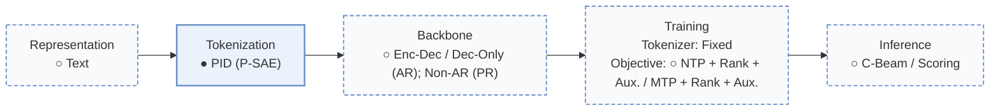
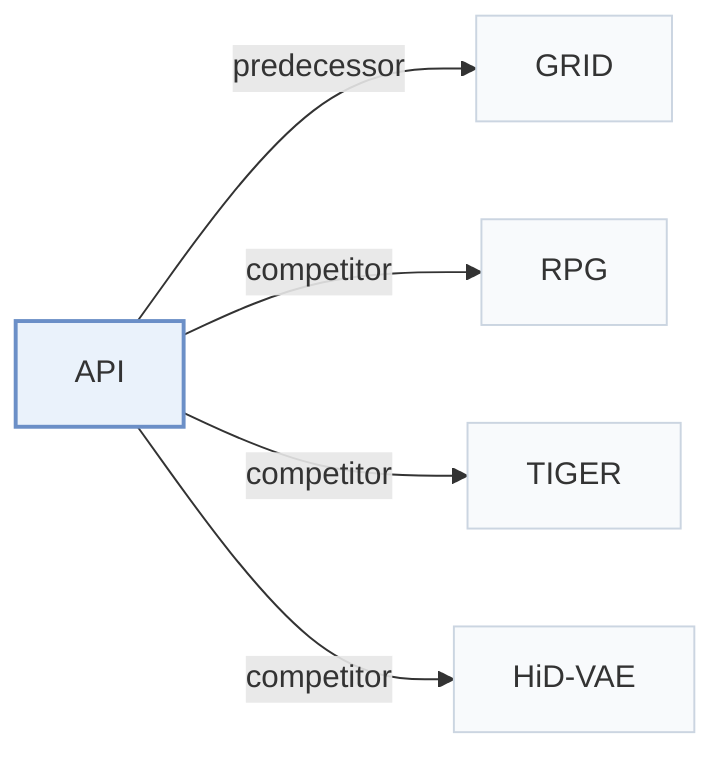

# API

[← Problem × Stage Matrix](../../README.md#ii--tokenization) · [Papers by Stage](../index/stages.md) · [Papers by Modality](../index/modality.md) · [Papers by Domain](../index/domain.md) · English | [中文](../zh/papers/api.md)

| **Title** | *The Vocabulary Is Already Here: Adapting Pretrained Interpretable Features for Generative Recommendation* |
| :-- | :-- |
| **Authors** | Luo et al. |
| **Venue** | arXiv’26 |
| **Problem × Stage** | `II. Uniqueness and Validity` · `Tokenization` |
| **Changes** | ○ Representation · ● Tokenization · ○ Backbone · ○ Objective · ○ Inference |
| **SID inputs** | `Text` |
| **Domain** | `E-commerce` |
| **Settings** | `cross-domain` |
| **Scenario** | `General Item Recommendation`; `Public Benchmarks` |
| **Links** | [Paper](https://arxiv.org/abs/2610.36763) · [Code](https://anonymous.4open.science/r/API-C1F9/) |
| **Reading level** | Overview (Level 1) |

**On this page**: [TL;DR](#tldr) · [3. Experiments](#3-experimental-findings) · [5. Related Work](#5-connections-to-related-work)

- `Text`: Textual item metadata (titles, descriptions, categories, or prompts).
- `PID (P-SAE)`: Pretrained Interpretable ID (Pretrained Sparse Autoencoder).
- `Enc-Dec / Dec-Only (AR); Non-AR (PR)`: Encoder–decoder or decoder-only autoregressive variants, and parallel non-autoregressive variants.
- `Fixed`: SIDs are built first and not changed while the generator trains.
- `NTP + Rank + Aux. / MTP + Rank + Aux.`: Autoregressive or parallel token prediction jointly optimized with ranking and auxiliary objectives.
- `C-Beam / Scoring`: Constrained beam search or direct item scoring, depending on the configuration.

### TL;DR

> [!NOTE]
> API reuses feature indices of a pretrained sparse autoencoder as an interpretable Semantic ID vocabulary and trains an adapter to predict indices and strengths, instead of fitting a new vocabulary.

---

### 3. Experimental Findings

Experimental setup

- **Datasets**: Amazon Beauty, Sports, and Toys as preprocessed in prior work (P5, GRID), keeping their splits; item text from title, brand, category, and price. Sizes: Appendix A (not restated here).
  - Source: Benchmark aligned with P5 and GRID: [S5.SS1.p1](https://arxiv.org/html/2610.36763v1#S5.SS1.p1).
- **Split**: The prior-work (P5 / GRID) splits and evaluation protocol are retained (allocation not restated); checkpoints selected by validation Recall@5.
  - Source: Inherited splits; PID statistics from training items only: [S5.SS1.p1](https://arxiv.org/html/2610.36763v1#S5.SS1.p1).
- **Candidates**: full catalog (complete test split, full catalog without sampled negatives).
  - Source: Full catalog without sampled negatives: [S5.SS1.p4](https://arxiv.org/html/2610.36763v1#S5.SS1.p4).
- **Visibility**: warm; no unseen-item protocol is defined. PID selection statistics and activation calibration are estimated from training-item contents.
  - Source: PID statistics estimated from training-item contents; no unseen-item protocol: [S5.SS1.p1](https://arxiv.org/html/2610.36763v1#S5.SS1.p1).
- **SID**: Pretrained Interpretable IDs: K in {4, 8, 16} feature indices selected by a priority rule from the 32 strongest of 24,576 labeled sparse-autoencoder features of a frozen GPT-2-small, plus their relative activation strengths, which separate items whose index sequences coincide. Collision-affected items at K=4: 15.16% on Beauty (77.37% with native SAE selection).
  - Source: PID from frozen GPT-2 SAE features with K tokens and activation strengths: [S5.SS1.p3](https://arxiv.org/html/2610.36763v1#S5.SS1.p3), [S4.SS1.p3](https://arxiv.org/html/2610.36763v1#S4.SS1.p3); collisions: [S5.T3](https://arxiv.org/html/2610.36763v1#S5.T3).
- **Inference budget**: Two decoders: parallel prediction (PR) with exact catalog scoring, and autoregressive (AR) with catalog-constrained beam search of width 50; T5- and GPT-2-style backbones trained from scratch. Hardware, inference batch size, and latency: not reported.
  - Source: Decoding settings: [S5.SS1.p4](https://arxiv.org/html/2610.36763v1#S5.SS1.p4).
- **Results from**: Table 1 (full API versus sequential and generative recommenders); Table 2 (tokenizers under T5 and GPT-2 backbones with AR and PR decoding); Table 3 (collision rates by token budget); Table 4 (content alignment); Table 5 (preference and strength ablation); Figure 3 (cross-domain vocabulary reuse).
  - Source: Results: [S4.T1](https://arxiv.org/html/2610.36763v1#S4.T1), [S5.T2](https://arxiv.org/html/2610.36763v1#S5.T2), [S5.T3](https://arxiv.org/html/2610.36763v1#S5.T3), [S5.T4](https://arxiv.org/html/2610.36763v1#S5.T4), [S5.F3](https://arxiv.org/html/2610.36763v1#S5.F3).

---

### 5. Connections to Related Work

- **Predecessor** · [GRID](grid.md): API keeps GRID's preprocessed data and its residual-quantization tokenizer baselines, and replaces learned codes with pretrained interpretable SAE feature IDs.
  - Source: API v1, benchmark and tokenization baselines aligned with GRID: [S5.SS1.p1](https://arxiv.org/html/2610.36763v1#S5.SS1.p1) and [S5.SS1.p2](https://arxiv.org/html/2610.36763v1#S5.SS1.p2); Table 2: [S5.T2](https://arxiv.org/html/2610.36763v1#S5.T2).
- **Competitor** · [RPG](rpg.md): RPG's parallel-prediction implementation is the PR backbone; API swaps its OPQ codes for SAE feature indices with activation strengths.
  - Source: API v1, PR implementation based on RPG: [S5.SS1.p2](https://arxiv.org/html/2610.36763v1#S5.SS1.p2); Tables 1-2: [S4.T1](https://arxiv.org/html/2610.36763v1#S4.T1) and [S5.T2](https://arxiv.org/html/2610.36763v1#S5.T2).
- **Competitor** · [TIGER](tiger.md): TIGER's autoregressive implementation is the AR backbone and RQ-VAE is a tokenizer baseline.
  - Source: API v1, AR implementation based on TIGER: [S5.SS1.p2](https://arxiv.org/html/2610.36763v1#S5.SS1.p2); Tables 1-2: [S4.T1](https://arxiv.org/html/2610.36763v1#S4.T1) and [S5.T2](https://arxiv.org/html/2610.36763v1#S5.T2).
- **Competitor** · [HiD-VAE](hid-vae.md): HiD-VAE supervises quantization levels with category tags for interpretability; API takes interpretability from labeled pretrained SAE features.
  - Source: API v1, tokenization baselines: [S5.SS1.p2](https://arxiv.org/html/2610.36763v1#S5.SS1.p2); Table 2: [S5.T2](https://arxiv.org/html/2610.36763v1#S5.T2).

[View all papers in this cell](../../README.md#ii--tokenization)
