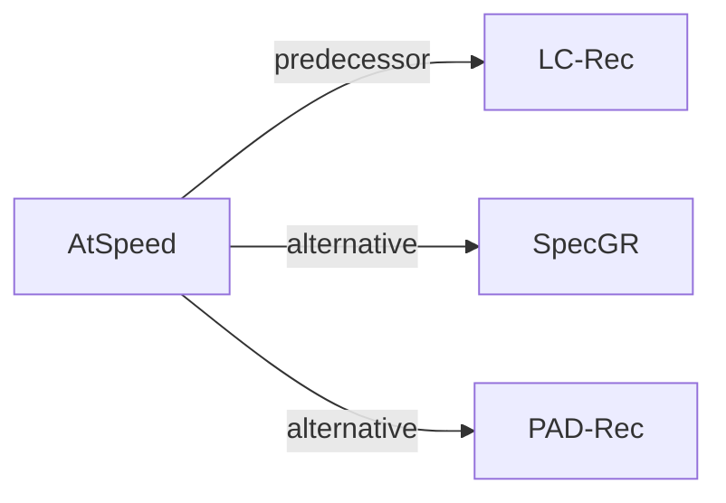

# AtSpeed

*Efficient Inference for Large Language Model-based Generative Recommendation* — Lin et al. · ICLR’25

`V. Efficiency` · `Inference` · [Paper](https://arxiv.org/abs/2410.05165) · [Code](https://github.com/Linxyhaha/AtSpeed) · [Matrix](../../README.md#v--inference) · [中文](../zh/papers/atspeed.md)

Reading level: Overview (Level 1) · On this page: [TL;DR](#tldr) · [At a Glance](#at-a-glance) · [3. Experiments](#3-experimental-findings) · [5. Related Work](#5-connections-to-related-work)

- `Dec-Only`: Decoder-only.
- `Fixed`: SIDs are built first and not changed while the generator trains.
- `NTP`: Next-token prediction loss only; continuing from a pretrained LLM (SFT) also counts as NTP.
- `Spec. Dec.`: Speculative decoding.

### TL;DR

> [!NOTE]
> AtSpeed aligns a draft model with the target LLM on top-K sequences and relaxes speculative-decoding verification, to speed up beam-search generation of top-K items in LLM-based generative recommendation.

### At a Glance

| Aspect | Summary |
| :-- | :-- |
| Research Problem | V. Efficiency: Can it be trained and served within latency and cost budgets? |
| Key Contribution | AtSpeed aligns a draft model with the target LLM on top-K sequences and relaxes speculative-decoding verification, to speed up beam-search generation of top-K items in LLM-based generative recommendation. |
| Modified Stage | Inference |

### 3. Experimental Findings

Experimental setup

- **Datasets**: Amazon Beauty and Games (main), plus MovieLens-1M and Goodreads in Appendix Table 6. Filtering rules: not restated; statistics in Appendix Table 2.
  - Source: Datasets: [S4.SS1.p1](https://arxiv.org/html/2410.05165v3#S4.SS1.p1); split and identifier length: [A1.SS3.SSS1.p1](https://arxiv.org/html/2410.05165v3#A1.SS3.SSS1.p1).
- **Split**: All interactions sorted by global timestamp and split 8:1:1 into training, validation, and test.
  - Source: Global-timestamp 8:1:1 split: [A1.SS3.SSS1.p1](https://arxiv.org/html/2410.05165v3#A1.SS3.SSS1.p1).
- **Candidates**: not reported (full catalog versus sampled); top-K (K = 1, 3, 5, 10, 20) from beam search of the target LLM, evaluated by Recall and NDCG plus walltime speedup.
  - Source: Metrics: [S4.SS1.p3](https://arxiv.org/html/2410.05165v3#S4.SS1.p3).
- **Visibility**: warm; no unseen-item protocol is defined (global temporal split, so test items may include items not seen in training, but this is not analyzed).
  - Source: Global temporal split with no unseen-item protocol: [A1.SS3.SSS1.p1](https://arxiv.org/html/2410.05165v3#A1.SS3.SSS1.p1).
- **SID**: RQ-VAE item identifiers following LC-Rec, length L=4; codebook size and collision handling: not reported.
  - Source: RQ-VAE identifiers following LC-Rec, length 4: [S4.SS1.p1](https://arxiv.org/html/2410.05165v3#S4.SS1.p1) and [A1.SS3.SSS1.p1](https://arxiv.org/html/2410.05165v3#A1.SS3.SSS1.p1).
- **Inference budget**: Speculative beam decoding: LLaMA-68M draft model with draft length 4 and draft beam size N=40 verifying top-K beams (K up to 20) of a LLaMA-7B LC-Rec target with tree-based attention. Figure 1 measures LC-Rec inference time on one NVIDIA A5000; draft training on 4 A5000 GPUs; speedup reported as walltime ratio (WS@K).
  - Source: Draft settings and hardware: [S4.SS1.p4](https://arxiv.org/html/2410.05165v3#S4.SS1.p4) and [A1.SS3.SSS1.p2](https://arxiv.org/html/2410.05165v3#A1.SS3.SSS1.p2); target inference cost figure: [S1.F1](https://arxiv.org/html/2410.05165v3#S1.F1).
- **Results from**: Table 1 (walltime speedup and accepted steps versus SFT, WordKD, SeqKD, TVDKD, DARE drafts); Appendix Table 5 (Recall and NDCG on Beauty and Games for the target LLM, the baselines, and AtSpeed instantiated on LC-Rec with LLaMA-7B); Appendix Tables 6-7 (MovieLens-1M, Goodreads, alignment-data cost).
  - Source: Main: [S4.T1](https://arxiv.org/html/2410.05165v3#S4.T1); ranking results: [A1.T5](https://arxiv.org/html/2410.05165v3#A1.T5); appendix datasets and cost: [A1.T6](https://arxiv.org/html/2410.05165v3#A1.T6) and [A1.T7](https://arxiv.org/html/2410.05165v3#A1.T7).

### 5. Connections to Related Work

- **Predecessor** · [LC-Rec](lc-rec.md): AtSpeed accelerates an LC-Rec target model: it trains a small draft model aligned to LC-Rec's top-K beams and verifies drafted beams in parallel.
  - Source: AtSpeed v3, instantiated on LC-Rec: https://arxiv.org/html/2410.05165v3#S4.SS1.p1 and https://arxiv.org/html/2410.05165v3#S4.SS1.p4; Figure 1 inference cost of LC-Rec: https://arxiv.org/html/2410.05165v3#S1.F1.
- **Alternative** · [SpecGR](specgr.md): SpecGR uses speculative drafting to recommend new items inductively, whereas AtSpeed uses it only to speed up decoding while keeping the target model's top-K.
  - Source: AtSpeed v3, Section 5 related work cites SpecGR: https://arxiv.org/html/2410.05165v3#S5.p1.
- **Alternative** · [PAD-Rec](pad-rec.md): PAD-Rec later also applies speculative decoding to LLM generative recommendation, targeting list-wise generation with position-aware drafts.
  - Source: Evidence is from the later PAD-Rec paper, Sections 1 and 2.3: https://arxiv.org/html/2604.27747v1#S1.p2 and https://arxiv.org/html/2604.27747v1#S2.SS3.p1.

[View all papers in this cell](../../README.md#v--inference)
