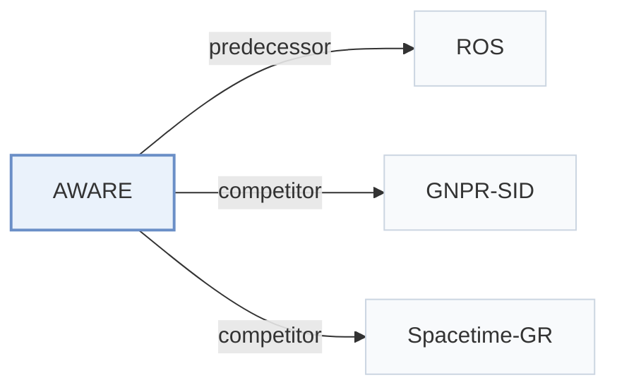

# AWARE

[← Problem × Stage Matrix](../../README.md#vi--training) · [Papers by Stage](../index/stages.md) · [Papers by Modality](../index/modality.md) · [Papers by Domain](../index/domain.md) · English | [中文](../zh/papers/aware.md)

| **Title** | *Why Users Go There: World Knowledge-Augmented Generative Next POI Recommendation* |
| :-- | :-- |
| **Authors** | Ding et al. |
| **Venue** | arXiv’26 |
| **Problem × Stage** | `VI. Generalization` · `Training` · `POI` |
| **Changes** | ● Objective |
| **SID inputs** | `Text` + `Geo` |
| **Domain** | `POI / Local` |
| **Settings** | `cross-domain` |
| **Links** | [Paper](https://arxiv.org/abs/2605.11807) |
| **Reading level** | Overview (Level 1) |

**On this page**: [TL;DR](#tldr) · [3. Experiments](#3-experimental-findings) · [5. Related Work](#5-connections-to-related-work)

- `Text+Geo`: Text representations combined with geographic or spatial features.
- `Geo-Prefix+HClus`: Geographic prefixes combined with hierarchical clustering codes.
- `Dec-Only`: Decoder-only.
- `Fixed`: SIDs are built first and not changed while the generator trains.
- `NTP`: Next-token prediction loss only; continuing from a pretrained LLM (SFT) also counts as NTP.

### TL;DR

> [!NOTE]
> AWARE adds agent-generated narratives about local events, culture, and seasonal trends, grounded in each user's behavior, to LLM-based next-POI generation, whose knowledge otherwise stays fixed after training.

---

### 3. Experimental Findings

Experimental setup

- **Datasets**: Foursquare-NYC, Foursquare-TKY and Gowalla-CA; filter users/POIs with fewer than 10 check-ins; segment chronological trajectories at a 24-hour gap; reverse-geocode street addresses.
  - Source: Sec.4.1 and Appendix A: [S4.SS1.p1](https://arxiv.org/html/2605.11807v1#S4.SS1.p1) and [A1.p1](https://arxiv.org/html/2605.11807v1#A1.p1)
- **Split**: Temporal 80/10/10 train/validation/test; per-user versus global allocation: not reported. History budget 150 entries, reserving 40% for matching day-of-week and filling the remainder with recent entries.
  - Source: Appendix A and E: [A1.p1](https://arxiv.org/html/2605.11807v1#A1.p1) and [A5.p1](https://arxiv.org/html/2605.11807v1#A5.p1)
- **Candidates**: not reported; full-catalog versus sampled evaluation and history-POI exclusion are unspecified.
  - Source: Sec.4.1 reports prediction metrics without catalog/negative-sampling details: [S4.SS1.p3](https://arxiv.org/html/2605.11807v1#S4.SS1.p3)
- **Visibility**: warm; main protocol: all validation/test users and POIs are observed during training. Cross-city transfer trains on NYC and evaluates TKY/CA without adaptation; pretrained-generator/tokenizer exposure to target-city POIs: not reported. Hard cases only exclude the target from the user's last five visits, not from training.
  - Source: Appendix A guarantees seen users/POIs; Sec.4.6 defines cross-city transfer: [A1.p1](https://arxiv.org/html/2605.11807v1#A1.p1) and [S4.SS6.p1](https://arxiv.org/html/2605.11807v1#S4.SS6.p1) and [S4.SS4.p1](https://arxiv.org/html/2605.11807v1#S4.SS4.p1)
- **SID**: ROS Spatial SIDs: hierarchical clustering of Qwen3-0.6B POI text embeddings plus multi-resolution S2-cell geospatial prefixes. Numerical SID length, branching/codebook sizes, S2 levels and collision handling: not reported.
  - Source: Sec.3.3, Sec.4.1 and Appendix D: [S3.SS3.p1](https://arxiv.org/html/2605.11807v1#S3.SS3.p1) and [S4.SS1.p4](https://arxiv.org/html/2605.11807v1#S4.SS1.p4) and [A4.SS0.SSS0.Px12.p1](https://arxiv.org/html/2605.11807v1#A4.SS0.SSS0.Px12.p1)
- **Inference budget**: Autoregressive SID prediction; HR@1 and HR/NDCG@5/10/20. Beam width, inference hardware/batch, generated-length cap and numerical latency: not reported. Qwen3-max knowledge acquisition is offline, capped at two retrieval rounds and 80/150-word narratives; no agent calls during serving. Eight MI308X GPUs are the training setup.
  - Source: Sec.3.3/4.1, Appendix E and Limitations: [S3.SS3.p1](https://arxiv.org/html/2605.11807v1#S3.SS3.p1) and [S4.SS1.p3](https://arxiv.org/html/2605.11807v1#S4.SS1.p3) and [A5.p1](https://arxiv.org/html/2605.11807v1#A5.p1) and [Sx1.p1](https://arxiv.org/html/2605.11807v1#Sx1.p1)
- **Results from**: Paper's Table1 main comparisons, Tables2-3 NYC ablations/hard cases, Table4 top-K and Figure5 cross-city transfer; scores average three inference runs, not three stated training seeds. ROS pretrained backbone is the controlled baseline. Other baselines' quoted-versus-rerun provenance: not reported.
  - Source: Sec.4.2, Sec.4.1 metrics and Tables1-4/Figure5: [S4.SS2.p1](https://arxiv.org/html/2605.11807v1#S4.SS2.p1) and [S4.SS1.p3](https://arxiv.org/html/2605.11807v1#S4.SS1.p3) and [S4.T1](https://arxiv.org/html/2605.11807v1#S4.T1) and [S4.T4](https://arxiv.org/html/2605.11807v1#S4.T4) and [S4.F5.g1](https://arxiv.org/html/2605.11807v1#S4.F5.g1)

---

### 5. Connections to Related Work

- **Predecessor** · [ROS](ros.md): AWARE reuses ROS's SID-equipped pretrained backbone as the controlled baseline.
  - Source: AWARE v1, Sec.4.2 and Appendix D: [S4.SS2.p1](https://arxiv.org/html/2605.11807v1#S4.SS2.p1); [A4.SS0.SSS0.Px12.p1](https://arxiv.org/html/2605.11807v1#A4.SS0.SSS0.Px12.p1).
- **Competitor** · [GNPR-SID](gnpr-sid.md): GNPR-SID is a compared generative POI baseline.
  - Source: AWARE v1, Sec.4.1 and Table1: [S4.SS1.p2](https://arxiv.org/html/2605.11807v1#S4.SS1.p2); [S4.T1](https://arxiv.org/html/2605.11807v1#S4.T1).
- **Competitor** · [Spacetime-GR](spacetime-gr.md): SpaceTime-GR is a compared spatial-temporal generative baseline.
  - Source: AWARE v1, Appendix D and Table1: [A4.SS0.SSS0.Px7.p1](https://arxiv.org/html/2605.11807v1#A4.SS0.SSS0.Px7.p1); [S4.T1](https://arxiv.org/html/2605.11807v1#S4.T1).

[View all papers in this cell](../../README.md#vi--training)
