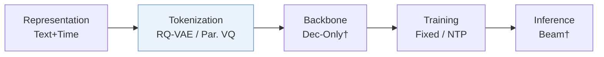
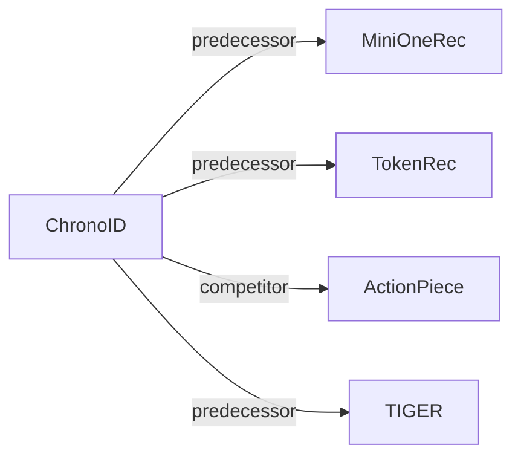

# ChronoID

*Infusing Explicit Temporal Signals into Semantic IDs for Generative Recommendation* — Nian et al. · arXiv’26

`I. Informativeness` · `Tokenization` · [Paper](https://arxiv.org/abs/2606.14260) · [Matrix](../../README.md#i--tokenization) · [中文](../zh/papers/chronoid.md)

Reading level: Overview (Level 1) · On this page: [TL;DR](#tldr) · [At a Glance](#at-a-glance) · [3. Experiments](#3-experimental-findings) · [5. Related Work](#5-connections-to-related-work)

- `Text+Time`: Text representations combined with interaction timestamps.
- `RQ-VAE / Par. VQ`: Residual-quantized variational codes or parallel vector-quantization codes in different configurations.
- `Fixed`: SIDs are built first and not changed while the generator trains.
- `NTP`: Next-token prediction loss only; continuing from a pretrained LLM (SFT) also counts as NTP.

### TL;DR

> [!NOTE]
> ChronoID is a framework and benchmark for time-aware Semantic ID learning that studies where and how explicit time signals enter the IDs, unlike existing time-agnostic Semantic ID learning.

### At a Glance

| Aspect | Summary |
| :-- | :-- |
| Research Problem | I. Informativeness: Do the SIDs, or the model reading them, carry the collaborative and multimodal signals recommendation needs? |
| Key Contribution | ChronoID is a framework and benchmark for time-aware Semantic ID learning that studies where and how explicit time signals enter the IDs, unlike existing time-agnostic Semantic ID learning. |
| Modified Stage | Tokenization |

### 3. Experimental Findings

Experimental setup

- **Datasets**: Amazon Industrial and Office; Mercari. Item text plus interaction timestamps; interaction-count filtering not reported.
  - Source: Section 4 and Appendix B.1/Table 1: [S4.p1](https://arxiv.org/html/2606.14260v1#S4.p1) ; [A2.SS1.p1](https://arxiv.org/html/2606.14260v1#A2.SS1.p1) ; [S5.T1](https://arxiv.org/html/2606.14260v1#S5.T1)
- **Split**: Global temporal cutoff: codebook/SFT training before cutoff, test targets on/after cutoff; Appendix B uses 2018 for Amazon. Exact Mercari cutoff and validation allocation not reported. Section 4 inconsistently prints 2028 and 2018.
  - Source: Section 4 and Appendix B.3/B.5: [S4.p1](https://arxiv.org/html/2606.14260v1#S4.p1) ; [A2.SS3.SSS0.Px1.p1](https://arxiv.org/html/2606.14260v1#A2.SS3.SSS0.Px1.p1) ; [A2.T5](https://arxiv.org/html/2606.14260v1#A2.T5)
- **Candidates**: not reported
  - Source: Section 5.1 defines single-ground-truth ranking metrics but no candidate universe: [S5.SS1.SSS0.Px2.p1](https://arxiv.org/html/2606.14260v1#S5.SS1.SSS0.Px2.p1)
- **Visibility**: Unseen by tokenizer too for future items, as claimed in Appendix B.6; codebook fitting uses only pre-2018 interacted items and SFT training uses pre-cutoff targets. Test-item overlap/new-item fraction not reported. Users first appearing after cutoff can be test-only.
  - Source: Section 4 and Appendix B.2/B.6: [S4.p2](https://arxiv.org/html/2606.14260v1#S4.p2) ; [A2.SS2.SSS0.Px1.p1](https://arxiv.org/html/2606.14260v1#A2.SS2.SSS0.Px1.p1) ; [A2.SS6.SSS0.Px2.p1](https://arxiv.org/html/2606.14260v1#A2.SS6.SSS0.Px2.p1)
- **SID**: Frozen text/time quantizer: residual early/late fusion or parallel quantization; default 3 codebooks x 256 entries, code dimension 42. Absolute/relative time encodings; text/time input dimensions 2560/768. Collision resolution not reported.
  - Source: Sections 3.2/3.3 and Appendix B.3/D: [S3.SS2.p2](https://arxiv.org/html/2606.14260v1#S3.SS2.p2) ; [S3.SS2.p3](https://arxiv.org/html/2606.14260v1#S3.SS2.p3) ; [S3.SS3.p3](https://arxiv.org/html/2606.14260v1#S3.SS3.p3) ; [A2.SS3.SSS0.Px2.p1](https://arxiv.org/html/2606.14260v1#A2.SS3.SSS0.Px2.p1) ; [A4.T9](https://arxiv.org/html/2606.14260v1#A4.T9)
- **Inference budget**: HR/NDCG@3/5/10. Decoding algorithm, beam, constraints, inference hardware/batch and latency not reported; batch 1024 per GPU is SFT training.
  - Source: Table 1 and Appendix D/Table 9: [S5.T1](https://arxiv.org/html/2606.14260v1#S5.T1) ; [A4.T9](https://arxiv.org/html/2606.14260v1#A4.T9)
- **Results from**: Original Table 1 compares five baselines and six ChronoID designs on three datasets; Tables 2/6-8/10-11 give fusion, temporal/capacity and hyperparameter analyses. Baseline implementation/result provenance not reported.
  - Source: Sections 5.1/5.2 and Tables 1/2/6-8/10-11: [S5.SS1.SSS0.Px1.p1](https://arxiv.org/html/2606.14260v1#S5.SS1.SSS0.Px1.p1) ; [S5.SS2.p1](https://arxiv.org/html/2606.14260v1#S5.SS2.p1) ; [S5.T1](https://arxiv.org/html/2606.14260v1#S5.T1) ; [A3.T6](https://arxiv.org/html/2606.14260v1#A3.T6) ; [A4.T11](https://arxiv.org/html/2606.14260v1#A4.T11)

### 5. Connections to Related Work

- **Predecessor** · [MiniOneRec](minionerec.md): ChronoID extends MiniOneRec's time-agnostic tokenization with explicit temporal signals.
  - Source: ChronoID v1, Introduction/Section 3 and Table 1: https://arxiv.org/html/2606.14260v1#S1.p2 ; https://arxiv.org/html/2606.14260v1#S3.p1 ; https://arxiv.org/html/2606.14260v1#S5.T1.
- **Predecessor** · [TokenRec](tokenrec.md): ChronoID adopts parallel quantization as one temporal-tokenization design.
  - Source: ChronoID v1, Sections 3.3/6 and Table 1: https://arxiv.org/html/2606.14260v1#S3.SS3.p3 ; https://arxiv.org/html/2606.14260v1#S6.p1 ; https://arxiv.org/html/2606.14260v1#S5.T1.
- **Competitor** · [ActionPiece](actionpiece.md): ActionPiece is a generative recommendation baseline in the temporal benchmark.
  - Source: ChronoID v1, Section 5.1 and Table 1: https://arxiv.org/html/2606.14260v1#S5.SS1.SSS0.Px1.p1 ; https://arxiv.org/html/2606.14260v1#S5.T1.
- **Predecessor** · [TIGER](tiger.md): ChronoID extends the static residual-quantization paradigm with time-aware IDs.
  - Source: ChronoID v1, Section 6: https://arxiv.org/html/2606.14260v1#S6.p1.

[View all papers in this cell](../../README.md#i--tokenization)
