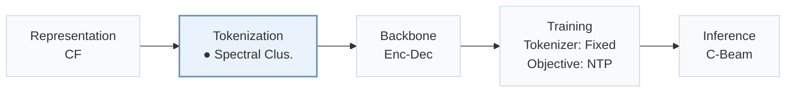
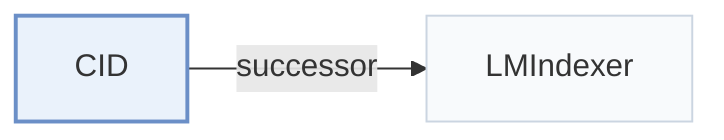

# CID

[← Problem × Stage Matrix](../../README.md#ii--tokenization) · [Papers by Stage](../index/stages.md) · [Papers by Modality](../index/modality.md) · [Papers by Domain](../index/domain.md) · English | [中文](../zh/papers/cid.md)

| **Title** | *How to Index Item IDs for Recommendation Foundation Models* |
| :-- | :-- |
| **Authors** | Hua et al. |
| **Venue** | SIGIR-AP’23 |
| **Problem × Stage** | `II. Uniqueness and Validity` · `Tokenization` |
| **Changes** | ● Tokenization |
| **SID inputs** | `CF` |
| **Domain** | `E-commerce` · `POI / Local` |
| **Links** | [Paper](https://arxiv.org/abs/2305.06569) · [Code](https://github.com/Wenyueh/LLM-RecSys-ID) |
| **Reading level** | Overview (Level 1) |

**On this page**: [TL;DR](#tldr) · [3. Experiments](#3-experimental-findings) · [5. Related Work](#5-connections-to-related-work)

- `CF`: Collaborative filtering signal.
- `Spectral Clus.`: Spectral clustering-based tokenization.
- `Enc-Dec`: Encoder-decoder.
- `Fixed`: SIDs are built first and not changed while the generator trains.
- `NTP`: Next-token prediction loss only; continuing from a pretrained LLM (SFT) also counts as NTP.
- `C-Beam`: Constrained beam search.

### TL;DR

> [!NOTE]
> CID studies item indexing for the P5 foundation model and proposes sequential, collaborative, semantic, and hybrid indexing, replacing random, title, and independent IDs that cause long outputs or hallucinated items.

---

### 3. Experimental Findings

Experimental setup

- **Datasets**: Amazon Sports & Outdoors, Amazon Beauty, Yelp; paper states a Jan-Dec 2019 transaction window. Interaction-count filtering not reported.
  - Source: Section 3.3: [S3.SS3.p1](https://arxiv.org/html/2305.06569v6#S3.SS3.p1)
- **Split**: Per-user leave-one-out: last interaction test, penultimate validation, earlier interactions training. Test history includes the validation interaction.
  - Source: Section 3.3: [S3.SS3.p2](https://arxiv.org/html/2305.06569v6#S3.SS3.p2)
- **Candidates**: not reported
  - Source: Sections 3.3/5.1/5.2 do not define an evaluation candidate pool: [S3.SS3.p2](https://arxiv.org/html/2305.06569v6#S3.SS3.p2) ; [S5.SS1.p1](https://arxiv.org/html/2305.06569v6#S5.SS1.p1) ; [S5.SS2.p1](https://arxiv.org/html/2305.06569v6#S5.SS2.p1)
- **Visibility**: warm; no unseen-item protocol is defined. CID co-occurrence edges/weights use training sequences only; graph nodes represent all items. Separate tokenizer/item holdouts not reported.
  - Source: Sections 3.3/4.2: [S3.SS3.p2](https://arxiv.org/html/2305.06569v6#S3.SS3.p2) ; [S4.SS2.p1](https://arxiv.org/html/2305.06569v6#S4.SS2.p1) ; [S4.SS2.SSS1.p1](https://arxiv.org/html/2305.06569v6#S4.SS2.SSS1.p1)
- **SID**: CID only: recursive N-way spectral clustering until clusters contain at most k items; k shared OOV tokens encode cluster paths plus a unique-within-cluster leaf token. Variable-length fixed IDs; recommended mean length 3-4. Table 6 sweeps N=10/20 and k=200/500/1000; Table 4 default N/k not reported.
  - Source: Sections 4.2/5.5 and Tables 6/7: [S4.SS2.SSS1.p2](https://arxiv.org/html/2305.06569v6#S4.SS2.SSS1.p2) ; [S4.SS2.SSS2.p1](https://arxiv.org/html/2305.06569v6#S4.SS2.SSS2.p1) ; [S4.SS2.SSS2.p4](https://arxiv.org/html/2305.06569v6#S4.SS2.SSS2.p4) ; [S5.SS5.p4](https://arxiv.org/html/2305.06569v6#S5.SS5.p4) ; [S5.T6](https://arxiv.org/html/2305.06569v6#S5.T6) ; [S5.T7](https://arxiv.org/html/2305.06569v6#S5.T7)
- **Inference budget**: Trie-constrained generation; HR/NDCG@5/10. Beam width, inference hardware/batch and latency not reported. Two RTX A5000 GPUs and batch 64 describe 20-epoch P5 training.
  - Source: Introduction, Implementation Details and Table 4: [S1.p5](https://arxiv.org/html/2305.06569v6#S1.p5) ; [S5.SS2.p1](https://arxiv.org/html/2305.06569v6#S5.SS2.p1) ; [S5.T4](https://arxiv.org/html/2305.06569v6#S5.T4)
- **Results from**: Original Table 4 CID row; Figures 4/5 and Tables 6/7 analyze CID clustering parameters and ID lengths. CID+IID is a separate hybrid variant, not CID. Baselines use the S3-Rec implementation; copied-versus-rerun provenance not stated.
  - Source: Sections 5.1/5.3/5.5/5.7 and Tables 4/6/7: [S5.SS1.p1](https://arxiv.org/html/2305.06569v6#S5.SS1.p1) ; [S5.SS3.p2](https://arxiv.org/html/2305.06569v6#S5.SS3.p2) ; [S5.SS5.p2](https://arxiv.org/html/2305.06569v6#S5.SS5.p2) ; [S5.SS7.p1](https://arxiv.org/html/2305.06569v6#S5.SS7.p1) ; [S5.T4](https://arxiv.org/html/2305.06569v6#S5.T4) ; [S5.T6](https://arxiv.org/html/2305.06569v6#S5.T6) ; [S5.T7](https://arxiv.org/html/2305.06569v6#S5.T7)

---

### 5. Connections to Related Work

- **Successor** · [LMIndexer](lmindexer.md): LMIndexer cites this indexing study as earlier generative-recommendation work.
  - Source: Evidence from LMIndexer v3, Section 2 and reference Hua et al. (2023): [S2.p2](https://arxiv.org/html/2310.07815v3#S2.p2) ; [bib.bib11](https://arxiv.org/html/2310.07815v3#bib.bib11).

[View all papers in this cell](../../README.md#ii--tokenization)
