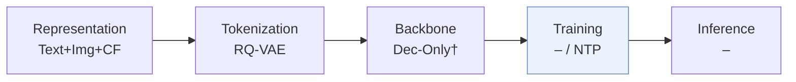
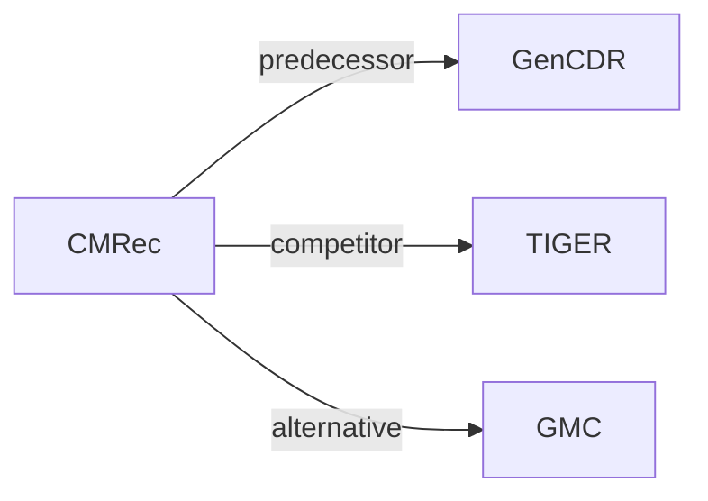

# CMRec

| **Title** | *Cross-Country Code-Mixing for Generative Recommendation* |
| :-- | :-- |
| **Authors** | Gao et al. |
| **Venue** | CIKM’26 Short |
| **Problem × Stage** | `VI. Generalization` · `Training` |
| **Links** | [Paper](https://arxiv.org/abs/2609.28972) · [Matrix](../../README.md#vi--training) · [中文](../zh/papers/cmrec.md) |
| **Reading level** | Overview (Level 1) |

On this page: [TL;DR](#tldr) · [At a Glance](#at-a-glance) · [3. Experiments](#3-experimental-findings) · [5. Related Work](#5-connections-to-related-work)

- `–`: Not reported in the paper.
- `NTP`: Next-token prediction loss only; continuing from a pretrained LLM (SFT) also counts as NTP.

### TL;DR

> [!NOTE]
> CMRec learns a shared cross-country codebook and synthesizes mixed-country sequences by constrained token substitution, so knowledge transfers at the data level and not only through shared parameters.

---

### At a Glance

| Aspect | Summary |
| :-- | :-- |
| Research Problem | VI. Generalization: Does it still work for new items, new domains, and shifting interests? |
| Key Contribution | CMRec learns a shared cross-country codebook and synthesizes mixed-country sequences by constrained token substitution, so knowledge transfers at the data level and not only through shared parameters. |
| Modified Stage | Training |

---

### 3. Experimental Findings

Experimental setup

- **Datasets**: Industrial e-commerce advertising: >1 billion interactions, 19 million users, 25 million ads across 6 countries; largest country has about 10x the smallest's training interactions. Amazon M2/KDD Cup 2023: UK/DE/JP/IT/FR/ES; high-resource locales supply about 91% of training sessions. Filtering rules not reported.
  - Source: [S4.SS1.p1](https://arxiv.org/html/2609.28972v1#S4.SS1.p1)
- **Split**: Offline train/validation/test allocation and chronology not reported; all baselines use the same dataset partition. Online A/B: May 10–20, 2026, 10% live traffic across all 6 countries.
  - Source: [S4.SS1.p2](https://arxiv.org/html/2609.28972v1#S4.SS1.p2) ; [S4.SS2.p4](https://arxiv.org/html/2609.28972v1#S4.SS2.p4)
- **Candidates**: not reported; evaluation pool and history exclusion are unspecified. Sampled-softmax negatives train the i2i model, and cross-country neighbor filtering supports training augmentation; neither defines evaluation negatives.
  - Source: [S4.SS1.p1](https://arxiv.org/html/2609.28972v1#S4.SS1.p1) ; [S3.SS1.p3](https://arxiv.org/html/2609.28972v1#S3.SS1.p3) ; [S3.SS2.p2](https://arxiv.org/html/2609.28972v1#S3.SS2.p2)
- **Visibility**: warm; no unseen-item protocol is defined. Countries have disjoint users/items but are pooled for joint training; tokenizer/i2i exposure to test items is not reported.
  - Source: [S2.p1](https://arxiv.org/html/2609.28972v1#S2.p1) ; [S4.SS1](https://arxiv.org/html/2609.28972v1#S4.SS1)
- **SID**: Shared 4-token RQ-VAE identifiers: Qwen-VL-32B encodes multimodal content to 64 dimensions, with joint cross-country behavioral i2i alignment described before quantization. Codebook sizes and collision handling not reported; dynamic market attributes filter substitutions rather than form SID inputs.
  - Source: [S3.SS1.p2](https://arxiv.org/html/2609.28972v1#S3.SS1.p2) ; [S3.SS1.p3](https://arxiv.org/html/2609.28972v1#S3.SS1.p3) ; [S4.SS1.p2](https://arxiv.org/html/2609.28972v1#S4.SS1.p2) ; [S3.SS2.p2](https://arxiv.org/html/2609.28972v1#S3.SS2.p2)
- **Inference budget**: Autoregressive GenCDR backbone, Recall/NDCG@10/100; decoding algorithm/beam width, history cap, inference hardware, batch size and latency not reported. Mixing rates p=k=0.1 and neighbor thresholds are training augmentation settings.
  - Source: [S3.SS3.p1](https://arxiv.org/html/2609.28972v1#S3.SS3.p1) ; [S4.SS1.p1](https://arxiv.org/html/2609.28972v1#S4.SS1.p1) ; [S4.SS1.p2](https://arxiv.org/html/2609.28972v1#S4.SS1.p2)
- **Results from**: Own offline comparisons on shared partitions (Table 1), industrial ablations (Table 2), and two-backbone sensitivity experiments (Figure 3); no imported baseline scores stated; run counts/variance not reported. Own online six-country aggregate: advertising revenue +1.77%, orders +2.64%; online control model not identified.
  - Source: [S4.SS1.p2](https://arxiv.org/html/2609.28972v1#S4.SS1.p2) ; [S4.T1](https://arxiv.org/html/2609.28972v1#S4.T1) ; [S4.T2](https://arxiv.org/html/2609.28972v1#S4.T2) ; [S4.SS2.p4](https://arxiv.org/html/2609.28972v1#S4.SS2.p4)

---

### 5. Connections to Related Work

- **Predecessor** · [GenCDR](gencdr.md): CMRec uses GenCDR as its backbone and augments its training sequences.
  - Source: https://arxiv.org/html/2609.28972v1#S4.SS1.p2
- **Competitor** · [TIGER](tiger.md): Generative recommendation baseline trained on the common partition.
  - Source: https://arxiv.org/html/2609.28972v1#S4.SS1.p2 ; https://arxiv.org/html/2609.28972v1#S4.T1
- **Alternative** · [GMC](gmc.md): Shared-token cross-domain transfer contrasted with data-level code mixing.
  - Source: https://arxiv.org/html/2609.28972v1#S1.p2

[View all papers in this cell](../../README.md#vi--training)
