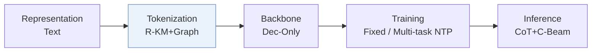
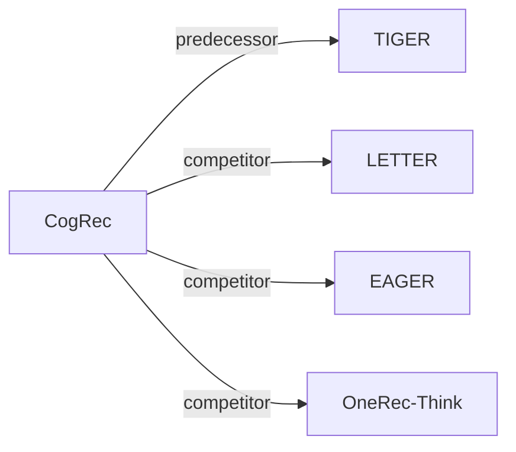

# CogRec

*Structure-Cognitive Fast-and-Slow Reasoning for Generative Recommendation* — Liu et al. · arXiv’26

`III. SID–Model Alignment` · `Tokenization` · [Paper](https://arxiv.org/abs/2607.24402) · [Code](https://github.com/caskcsg/CogRec) · [Matrix](../../README.md#iii--tokenization) · [中文](../zh/papers/cogrec.md)

Reading level: Overview (Level 1) · On this page: [TL;DR](#tldr) · [At a Glance](#at-a-glance) · [3. Experiments](#3-experimental-findings) · [5. Related Work](#5-connections-to-related-work)

- `R-KM+Graph`: Residual k-means combined with a graph over semantic codes.
- `Dec-Only`: Decoder-only.
- `Fixed`: SIDs are built first and not changed while the generator trains.
- `Multi-task NTP`: The same NTP loss over several tasks.
- `CoT+C-Beam`: Reasoning followed by constrained beam-search decoding.

### TL;DR

> [!NOTE]
> CogRec grounds reasoning in Semantic ID structure through intra-layer graphs, item neighborhoods, and Match, LateralJump, and Explore routing steps, instead of a natural-language rationale weakly tied to the IDs.

### At a Glance

| Aspect | Summary |
| :-- | :-- |
| Research Problem | III. SID–Model Alignment: Can the generator read, write, and reason over SIDs, and do the tokenizer and generator work toward the same goal? |
| Key Contribution | CogRec grounds reasoning in Semantic ID structure through intra-layer graphs, item neighborhoods, and Match, LateralJump, and Explore routing steps, instead of a natural-language rationale weakly tied to the IDs. |
| Modified Stage | Tokenization |

### 3. Experimental Findings

Experimental setup

- **Datasets**: Amazon Reviews 2014: Beauty, Sports, Toys; user/item filtering not reported.
  - Source: [S4.SS1.SSS1.p1](https://arxiv.org/html/2607.24402v1#S4.SS1.SSS1.p1)
- **Split**: Chronological per-user leave-one-out: last interaction test, penultimate validation, remainder training. Direct evaluation uses the complete test set; default CoT uses a predefined subset, with separate full-test CoT evaluation.
  - Source: [S4.SS1.SSS1.p1](https://arxiv.org/html/2607.24402v1#S4.SS1.SSS1.p1) ; #S4.SS1.SSS3.p3
- **Candidates**: not reported; all generative variants share a trie containing the complete valid four-layer candidate-item SID set, but evaluation catalog size/sampling and history exclusion are not specified.
  - Source: [S4.SS1.SSS2.p1](https://arxiv.org/html/2607.24402v1#S4.SS1.SSS2.p1) ; #S4.SS1.SSS3.p1
- **Visibility**: warm; no unseen-item protocol is defined. The SID mapping and topology are shared across training stages.
  - Source: [S4.SS1.SSS1.p1](https://arxiv.org/html/2607.24402v1#S4.SS1.SSS1.p1) ; #S3.SS5.p2
- **SID**: BGE-base-en-v1.5 metadata embeddings (title/description/category), 768 dimensions and L2 normalization; residual K-means, 4 layers x 256 codes, 30 iterations/layer; 1,024 layer-specific tokens plus 2 boundary tokens. Intra-layer top-16 centroid graphs retain cosine >=0.15 edges; the mapping/topology is fixed across later stages. Collision handling not reported.
  - Source: [S4.SS1.SSS4.p1](https://arxiv.org/html/2607.24402v1#S4.SS1.SSS4.p1) ; #S4.SS1.SSS4.p2 ; #S3.SS5.p2
- **Inference budget**: Qwen3-1.7B; trie-constrained SID beam 10, temperature 0.6, top-p 1.0, max 8 new SID tokens. Reasoning samples 5 traces (temperature 1.5, top-p 0.95), up to 50 trace-conditioned SID hypotheses. Full-test CoT alone tail-truncates histories to Beauty/Sports/Toys 21/20/18 items. Reasoning-token cap, inference hardware/batch size and latency not reported; A800 GPUs are specified for training.
  - Source: [S3.T1](https://arxiv.org/html/2607.24402v1#S3.T1) ; #S4.SS1.SSS3.p2 ; #S4.SS1.SSS3.p3
- **Results from**: Own CogRec experiments and controlled OneRec-Think Direct/CoT reproductions (Table 4/Figure 3); Table 3 mostly imports cited baseline scores, including standalone LETTER from RAGR and OneRec-Think from its original paper. Cross-source baselines do not share a guaranteed identical implementation/protocol.
  - Source: [S4.SS3.p2](https://arxiv.org/html/2607.24402v1#S4.SS3.p2) ; #S4.SS2.p4 ; #S4.SS5.p1

### 5. Connections to Related Work

- **Predecessor** · [TIGER](tiger.md): Hierarchical SID recommendation provides the identifier-generation foundation; TIGER also appears in the broad baseline comparison.
  - Source: https://arxiv.org/html/2607.24402v1#S2.p2 ; #S4.SS2.p3
- **Competitor** · [LETTER](letter.md): Non-reasoning tokenization baseline; scores are standalone LETTER results reported by RAGR, not LETTER+RAGR.
  - Source: https://arxiv.org/html/2607.24402v1#S4.SS2.p3
- **Competitor** · [EAGER](eager.md): Behavioral/semantic generative baseline in the broad cross-method comparison.
  - Source: https://arxiv.org/html/2607.24402v1#S4.SS2.p3
- **Competitor** · [OneRec-Think](onerec-think.md): Textual rationale before item generation contrasts with SID-grounded routing; original scores enter Table 3 and reproduced Direct/CoT branches enter controlled comparisons.
  - Source: https://arxiv.org/html/2607.24402v1#S4.SS2.p4 ; #S4.SS5.p1

[View all papers in this cell](../../README.md#iii--tokenization)
