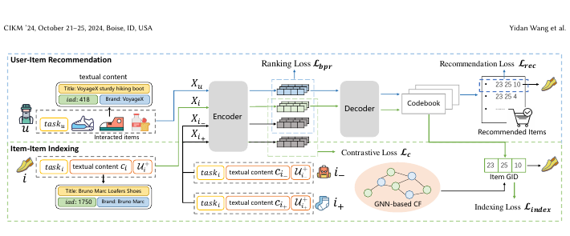

# ColaRec: Content-based collaborative generation for recommender systems

[Back to Catalog](../../README.md) · [Paper (`https://arxiv.org/abs/2403.18480`)](https://arxiv.org/abs/2403.18480) · [Source Record (`data/papers/colarec.yaml`)](../../data/papers/colarec.yaml)

> **Summary**: Abstract: "How to integrate content knowledge and collaborative interaction signals in a generative framework tailored for item recommendation is still an open research challenge".

## Taxonomy & Table 1 Specification

| Field | Value | Vocabulary Definition |
| :--- | :--- | :--- |
| **Authors & Year** | Wang et al. (2024) | Published / posted in `CIKM’24` |
| **Problem Band** | `I. Informativeness` | Do the SIDs, or the model reading them, carry the collaborative and multimodal signals recommendation needs? |
| **Primary Stage** | `Backbone` | The primary design change sits in the Generative Backbone stage. |
| **Representation** | `Text+CF` |  |
| **Tokenization** | `H-KM` | Hierarchical k-means. |
| **Backbone** | `Enc-Dec` | Encoder-decoder. |
| **Tokenizer Training** | `Fixed` | SIDs are built first and not changed while the generator trains. |
| **Training Objective** | `NTP + Ctr.` | NTP plus a contrastive loss. |
| **Inference Decoding** | `C-Beam` | Constrained beam search. |
| **POI / Local-Life** | `false` | Point-of-interest / geographic recommendation indicator |
| **Code Repository** | Not reported | Official or public implementation link |

## Architecture

## Verbatim Evidence & Rationale

- **`problem`** (arXiv abstract): Abstract: "How to integrate content knowledge and collaborative interaction signals in a generative framework tailored for item recommendation is still an open research challenge".
- **`tokenizer`** (p5): Location from the 10-26 'Training split' table in the appendix.
- **`objective`** (p5): Location from the 10-26 'Training split' table in the appendix.

## 旧卡片说明

迁自 `d61aa6c:papers/colarec.md`。保留方法说明、实验叙述与局限；本轮只对照现有记录处理明确冲突，未重新逐句核查原论文。分类和规格以页面上方由记录生成的表格为准。

### ColaRec：基于内容的协同生成推荐

> ColaRec 用 GNN 协同表示构造生成标识，并联合内容信息与推荐目标，直接生成物品 GID。

### 研究动机与问题定义

随机或纯内容型物品 ID 难以表达协同关系。ColaRec 将 GNN 学到的协同结构转化为层次化 GID，同时保留标题、描述等内容信息，解决生成推荐与物品索引之间的脱节。

### TL;DR（核心摘要）

`交互与内容 → GNN协同表示 → 层次化GID → 生成模型 → 推荐物品`

模型用 LightGCN 提取协同表示，以受约束的 K-means 构造树状 GID；用户-物品推荐和物品-GID 索引共享编码器-解码器。训练联合推荐、索引、排序和对比目标，生成的 GID 直接映射到物品。

### 输入与使用场景

| 方面 | 说明 |
|---|---|
| 使用信息 | 用户交互、物品文本内容和 GNN 协同表示 |
| 信息融入位置 | GID 构建、模型输入和联合目标 |
| 语义标识结构 | 定长树状序列 |
| 适用场景 | 内容增强的生成式推荐 |

### 方法设计

#### 4.1 ColaRec 总体结构
ColaRec 共享一个编码器-解码器，同时服务用户-物品推荐和物品-GID 索引两个任务。前者学习用户历史到下一物品的映射，后者学习物品内容到协同生成标识的映射。

#### 4.2 生成标识构建（Generative Identifier Construction）
论文先用 GNN/LightGCN 学习物品协同表示，再以受约束的层次化聚类构造 GID。树的路径就是物品标识，前缀表达较粗粒度的相似性，叶节点区分具体物品；内容信息通过文本和描述进入索引任务。

#### 4.3 用户-物品推荐与物品-物品索引
推荐任务根据用户历史自回归生成目标 GID。索引任务要求模型根据物品文本生成其 GID，使内容表示和协同标识保持一致。两个任务共享生成器，但目标分别对应推荐和索引。

#### 4.4 多任务训练
总目标联合推荐损失、索引损失、排序损失和对比损失。消融实验分别验证内容、协同 GID 以及各辅助目标的作用。

### 实验结论

- 内容-协同联合建模优于单独使用任一来源信息。
- 推荐和索引任务的联合训练均有贡献。

### 局限性与研究定位

#### 局限性
- GID 依赖离线 GNN 与聚类，目录变化时需要更新。
- 生成标识长度、聚类规模和在线效率之间的权衡仍需进一步研究。

#### 研究定位
ColaRec 展示了用协同图结构学习生成标识的一条路径，适合放在“协同语义标识构建”章节。

### 标签

`内容-协同融合` · `GID` · `GNN` · `联合学习`

### 架构图来源

*图源：原论文，图3。图片使用许可待核实。*

---

### 旧总表补充

来源：`d61aa6c:tables/all-methods.md`。

- 核心贡献：用协同图结构学习GID。
- 使用场景：内容增强推荐。

## Peer Methods in `I. Informativeness` × `Backbone` (6 peers)

| Method | Venue | Representation | Tokenization | Backbone | Tokenizer | Objective | Inference |
| :--- | :--- | :--- | :--- | :--- | :--- | :--- | :--- |
| [EAGER](eager.md) | KDD’24 | `Text+CF` | `Dual H-KM` | `Dual Enc-Dec` | `Fixed` | `NTP + Ctr.` | `Fusion` |
| [COBRA](cobra.md) | NeurIPS’25 | `Text+SID` | `Casc. RQ` | `Dec-Only` | `Fixed` | `NTP + Dense` | `BeamFusion` |
| [DiscRec](discrec.md) | arXiv’25 | `Text+CF` | `RQ-VAE / Learn. RQ` | `Enc-Dec` | `Fixed` | `NTP` | `C-Beam` |
| [Spacetime-GR](spacetime-gr.md) | arXiv’25 | `Geo` | `Geo-Idx` | `Dec-Only` | `Fixed` | `NTP → DPO` | `Beam` |
| [SPAR-Youku](spar-youku.md) | arXiv’26 | `–` | `RQ-PIB` | `Dec-Only` | `Fixed` | `NTP → DPO` | `C-Beam` |
| [UniSGR-V2](unisgr-v2.md) | arXiv’26 | `–` | `–` | `Enc-Dec` | `–` | `NTP + Rank` | `Beam` |
