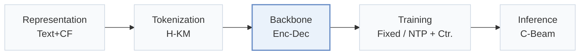
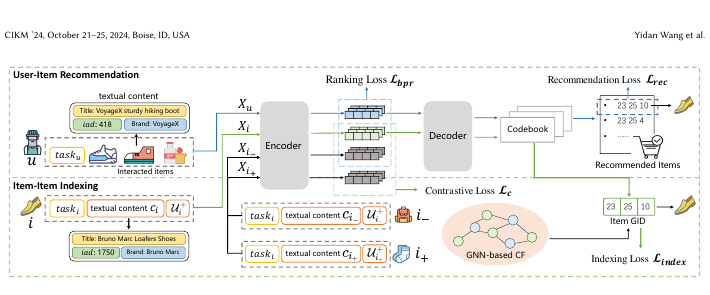
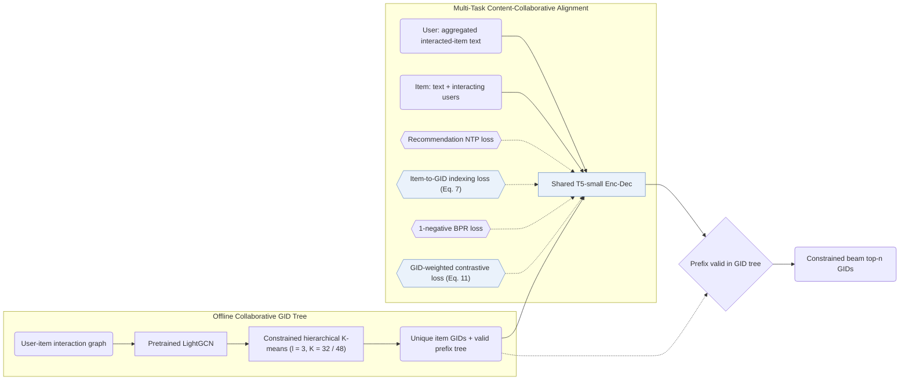
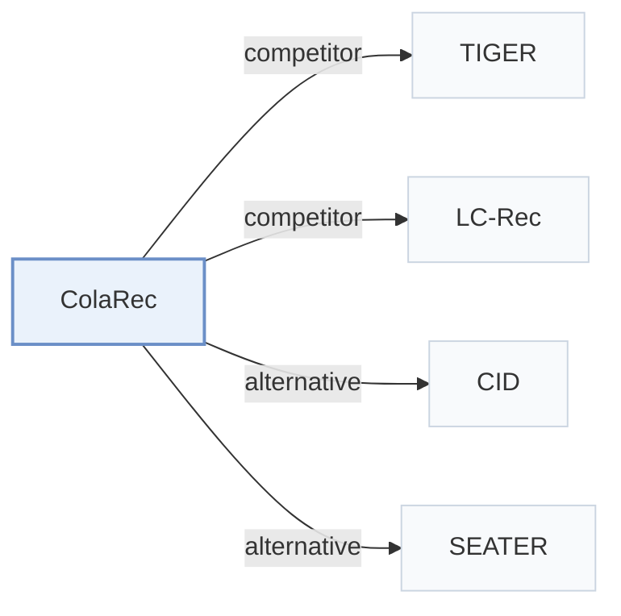

# ColaRec

[← Problem × Stage Matrix](../../README.md#i--backbone) · [Papers by Stage](../index/stages.md) · [Papers by Modality](../index/modality.md) · English | [中文](../zh/papers/colarec.md)

| **Title** | *Content-based collaborative generation for recommender systems* |
| :-- | :-- |
| **Authors** | Wang et al. |
| **Venue** | CIKM’24 |
| **Problem × Stage** | `I. Informativeness` · `Backbone` |
| **Links** | [Paper](https://arxiv.org/abs/2403.18480) · [Code](https://github.com/Junewang0614/ColaRec) |
| **Reading level** | Reading Notes (Level 2) |

**On this page**: [TL;DR](#tldr) · [At a Glance](#at-a-glance) · [1. Why It Matters](#1-why-this-paper-matters) · [2. Method](#2-how-it-works) · [3. Experiments](#3-experimental-findings) · [4. Limitations](#4-limitations--critical-analysis) · [5. Related Work](#5-connections-to-related-work)

- `Text+CF`: Text representations combined with collaborative signals.
- `H-KM`: Hierarchical k-means.
- `Enc-Dec`: Encoder-decoder.
- `Fixed`: SIDs are built first and not changed while the generator trains.
- `NTP + Ctr.`: NTP plus a contrastive loss.
- `C-Beam`: Constrained beam search.

### TL;DR

> [!NOTE]
> ColaRec builds generative identifiers from a pretrained collaborative filtering model and generates them from interacted-item content, with an item indexing task and a contrastive loss aligning both spaces.

---

### At a Glance

| Aspect | Summary |
| :-- | :-- |
| Research Problem | I. Informativeness: Do the SIDs, or the model reading them, carry the collaborative and multimodal signals recommendation needs? |
| Key Contribution | ColaRec builds generative identifiers from a pretrained collaborative filtering model and generates them from interacted-item content, with an item indexing task and a contrastive loss aligning both spaces. |
| Modified Stage | Backbone |
| Key Findings | Across full-catalog evaluation on Amazon Beauty, Sports and Outdoors, Cell Phones and Accessories, and Food.com Recipe, ColaRec outperforms collaborative, content-enhanced, and generative baselines (including TIGER and LC-Rec) on Recall@5/10 and NDCG@5/10, with ablations confirming gains from both item-to-GID indexing and contrastive alignment (Sec. 5.2, Table 2, Table 3, Table 4). |
| Limitation | Generative identifiers (GIDs) are built offline by running constrained hierarchical K-means over pretrained LightGCN embeddings, so cold-start items without interactions lack collaborative representations to cluster (Sec. 4.2). |

---

### 1. Why This Paper Matters

Prompt-based LLM recommenders fuse item text and collaborative signals through natural-language generation, leaving open-ended text decoding misaligned with full-catalog item ranking (Abstract). ColaRec instead assigns each item a tree-structured Semantic ID (SID)—called a generative identifier (GID)—from a pretrained collaborative filtering graph, and trains a T5-small encoder-decoder to generate target GIDs from aggregated interacted-item text while aligning content and collaborative spaces.

> "To model collaborative signals, the GIDs are constructed from a pretrained collaborative filtering model, and the user is represented as the content aggregation of interacted items." (Abstract)

---

### 2. How It Works

#### Generative Identifier Construction

ColaRec extracts item embeddings from a pretrained LightGCN model and recursively partitions them with size-constrained K-means ($`l = 3`$ levels, $`K = 32`$ clusters per level on Amazon and $`K = 48`$ on Recipe) so each cluster holds at most $`K^{l-t}`$ items and each leaf maps uniquely to one item (Sec. 4.2, Sec. 5.4).

> "Specifically, we first extract item representations from a pretrained LightGCN model. Then the constrained K-means algorithm is called hierarchically based on the item representations." (Sec. 4.2)

#### Item Indexing Task

To bridge textual inputs and collaborative GIDs, an auxiliary item-indexing task feeds an item's text and its interacting users into the shared T5-small encoder-decoder and predicts the item's own GID (Sec. 4.4, Eq. 7).

#### Training Objective

ColaRec jointly optimizes the user-to-GID recommendation loss, the item-to-GID indexing loss, a list-level BPR ranking loss with 1 sampled negative, and a GID-similarity-weighted contrastive loss over item representations (Sec. 4.5, Eq. 11).

> "The idea is that items with similar GIDs should also be similar in the content-based semantic space." (Sec. 4.5)

#### Inference

At inference, constrained beam search masks out invalid transitions at each step so every decoded token path stays within the catalog's valid GID prefix tree (Sec. 4.5).

---

### 3. Experimental Findings

Experimental setup

- **Datasets**: Amazon Product Reviews: Beauty, Sports and Outdoors, Cell Phones and Accessories (Phone); Food.com Recipe. Users and items with fewer than 5 interactions are filtered. Sizes (users / items / interactions): Beauty 22,363 / 12,101 / 198,502; Sports 35,598 / 18,357 / 296,337; Phone 27,879 / 10,429 / 194,439; Recipe 17,813 / 41,240 / 555,618.
  - Source: Datasets and 5-interaction filter: [S5.SS1.p1](https://arxiv.org/html/2403.18480v2#S5.SS1.p1); statistics: [S4.T1](https://arxiv.org/html/2403.18480v2#S4.T1).
- **Split**: General recommendation, not sequential: each user's interactions are randomly split 8:1:1 into training, validation, and test. Three runs are averaged.
  - Source: Random 8:1:1 per-user split for general (non-sequential) recommendation: [S5.SS2.p1](https://arxiv.org/html/2403.18480v2#S5.SS2.p1).
- **Candidates**: full catalog
  - Source: Candidate set is the whole item set: [S5.SS2.p1](https://arxiv.org/html/2403.18480v2#S5.SS2.p1).
- **Visibility**: warm; no unseen-item protocol is defined.
  - Source: Random interaction split with no cold-start experiment: [S5.SS2.p1](https://arxiv.org/html/2403.18480v2#S5.SS2.p1); long-tail users are analyzed separately: [S5.T3](https://arxiv.org/html/2403.18480v2#S5.T3).
- **SID**: GID length l=3 from hierarchical constrained K-means over pretrained LightGCN item embeddings, K=32 clusters per level (48 for Recipe). Collisions are avoided by construction: clusters hold at most K^(l-t) items and leaf positions are assigned randomly, so each item has a unique GID.
  - Source: Constrained hierarchical K-means over LightGCN embeddings, random leaf assignment, one unique GID per item: [S4.SS2.p1](https://arxiv.org/html/2403.18480v2#S4.SS2.p1) and [S4.SS2.p2](https://arxiv.org/html/2403.18480v2#S4.SS2.p2); l=3, K=32 (Recipe 48): [S5.SS4.p1](https://arxiv.org/html/2403.18480v2#S5.SS4.p1).
- **Inference budget**: Constrained beam search over valid GID prefixes; numerical beam width not reported. T5-small backbone. Recall and NDCG at n=5 and 10 (Table 2). Hardware, inference batch size, and latency: not reported.
  - Source: Constrained beam search: [S4.SS5.p5](https://arxiv.org/html/2403.18480v2#S4.SS5.p5); no numerical width found in Section 5.
- **Results from**: Table 2 (four datasets; mean of three runs); Table 3 (long-tail users); Table 4 (multi-task ablation and GID types); Figures 4-5 (GID length and cluster number).
  - Source: Main: [S4.T2](https://arxiv.org/html/2403.18480v2#S4.T2); long-tail users: [S5.T3](https://arxiv.org/html/2403.18480v2#S5.T3); ablation and GID types: [S5.T4](https://arxiv.org/html/2403.18480v2#S5.T4); GID length and K: [S5.SS7.SSS2.p1](https://arxiv.org/html/2403.18480v2#S5.SS7.SSS2.p1) and [S5.SS7.SSS2.p2](https://arxiv.org/html/2403.18480v2#S5.SS7.SSS2.p2).

- Full-catalog comparison: under an 8:1:1 per-user random split (averaged over 3 runs) across Beauty (22,363 users / 12,101 items), Sports and Outdoors (35,598 / 18,357), Cell Phones and Accessories (27,879 / 10,429), and Food.com Recipe (17,813 / 41,240), ColaRec outperforms collaborative filtering, content-collaborative, and generative baselines on Recall@5/10 and NDCG@5/10 (Abstract, Table 1, Table 2).
- Long-tail users: stratifying users by interaction count shows consistent gains on sparse-history users (Table 3).
- Multi-task and identifier ablations: removing item text, the indexing task, the BPR loss, or the weighted contrastive loss degrades accuracy, and LightGCN-based GIDs outperform random IDs, text-only K-means IDs, and flat IDs (Table 4, Fig. 4, Fig. 5).

---

### 4. Limitations & Critical Analysis

**Our analysis.**

- The weighted contrastive loss pulls content representations toward the collaborative GID tree, which suggests that noisy LightGCN clusters on sparse items can distort content similarity.
- The paper does not report the numerical beam width or inference latency for constrained beam search (Sec. 4.5, Sec. 5).
- SEATER also builds balanced tree-structured identifiers (`Tree-Clus.`) from collaborative interactions (`CF`); ColaRec incorporates item metadata alongside collaborative structure (`Text+CF`) and aligns both views with auxiliary indexing and contrastive losses.

---

### 5. Connections to Related Work

- **Competitor** · [TIGER](tiger.md): TIGER builds content-only RQ-VAE identifiers; ColaRec builds collaborative GIDs from LightGCN embeddings and aligns them with item content through item-item indexing.
  - Source: ColaRec v2, Section 5.3 baselines: [S5.SS3.p1](https://arxiv.org/html/2403.18480v2#S5.SS3.p1) and [S5.I2.i8.p1](https://arxiv.org/html/2403.18480v2#S5.I2.i8.p1) (adapted without sequential order); Table 2: [S4.T2](https://arxiv.org/html/2403.18480v2#S4.T2).
- **Competitor** · [LC-Rec](lc-rec.md): LC-Rec learns TIGER-style indices and aligns an LLM through language tasks; ColaRec uses a T5-small generator with collaborative GIDs and a contrastive ranking loss.
  - Source: ColaRec v2, Section 5.3 baselines: [S5.I2.i9.p1](https://arxiv.org/html/2403.18480v2#S5.I2.i9.p1); Table 2: [S4.T2](https://arxiv.org/html/2403.18480v2#S4.T2).
- **Alternative** · [CID](cid.md): P5-CID builds collaborative IDs for prompt-based P5 models that rank a candidate list in the prompt; ColaRec generates GIDs over the whole item set.
  - Source: ColaRec v2, Section 5.3 explains why P5-based methods including Hua et al. (2023) are excluded as baselines: [S5.SS3.p2](https://arxiv.org/html/2403.18480v2#S5.SS3.p2); related work: [S2.SS2.p3](https://arxiv.org/html/2403.18480v2#S2.SS2.p3).
- **Alternative** · [SEATER](seater.md): SEATER also builds tree-structured identifiers for generative recommendation; ColaRec derives its tree from collaborative LightGCN embeddings and adds content-based item-item indexing.
  - Source: ColaRec v2, Section 1 and Section 2.2 cite SEATER among generative identifier methods: [S1.p3](https://arxiv.org/html/2403.18480v2#S1.p3) and [S2.SS2.p3](https://arxiv.org/html/2403.18480v2#S2.SS2.p3); not a baseline in Table 2.

[View all papers in this cell](../../README.md#i--backbone)
