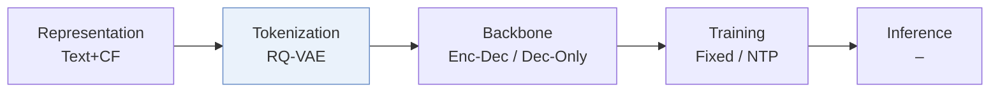
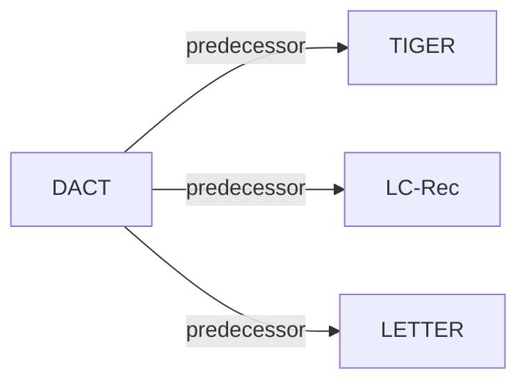

# DACT

| **Title** | *Drift-Aware Continual Tokenization for Generative Recommendation* |
| :-- | :-- |
| **Authors** | Feng et al. |
| **Venue** | SIGIR’26 |
| **Problem × Stage** | `VI. Generalization` · `Tokenization` |
| **Links** | [Paper](https://arxiv.org/abs/2603.29705) · [Code](https://github.com/HomesAmaranta/DACT) · [Matrix](../../README.md#vi--tokenization) · [中文](../zh/papers/dact.md) |
| **Reading level** | Overview (Level 1) |

On this page: [TL;DR](#tldr) · [At a Glance](#at-a-glance) · [3. Experiments](#3-experimental-findings) · [5. Related Work](#5-connections-to-related-work)

- `Enc-Dec / Dec-Only`: Evaluated on both Encoder-Decoder and Decoder-Only backbones.
- `Fixed`: SIDs are built first and not changed while the generator trains.
- `NTP`: Next-token prediction loss only; continuing from a pretrained LLM (SFT) also counts as NTP.
- `–`: Not reported in the paper.

### TL;DR

> [!NOTE]
> DACT fine-tunes a collaborative tokenizer as interactions drift, with an item-level drift detector and relaxed-to-strict code reassignment, to update Semantic IDs without full retraining or mass ID changes.

---

### At a Glance

| Aspect | Summary |
| :-- | :-- |
| Research Problem | VI. Generalization: Does it still work for new items, new domains, and shifting interests? |
| Key Contribution | DACT fine-tunes a collaborative tokenizer as interactions drift, with an item-level drift detector and relaxed-to-strict code reassignment, to update Semantic IDs without full retraining or mass ID changes. |
| Modified Stage | Tokenization |

---

### 3. Experimental Findings

Experimental setup

- **Datasets**: Amazon Beauty, Tools, Toys; users/items with <5 interactions removed. Amazon release year not reported.
  - Source: [S4.SS1.SSS1.p1](https://arxiv.org/html/2603.29705v1#S4.SS1.SSS1.p1) ; #S4.SS1.SSS1.p2
- **Split**: Chronological interaction stream: P0 is the first 60% for pretraining; P1-P4 equally divide the remaining 40%. Sliding-window sequences and leave-one-out train/validation/test; exact window and held-out positions not reported. Fine-tuning uses the current period from the previous checkpoint; retraining uses all accumulated periods.
  - Source: [S4.SS1.SSS1.p2](https://arxiv.org/html/2603.29705v1#S4.SS1.SSS1.p2) ; #S4.SS1.SSS2.p3
- **Candidates**: not reported; only HR/NDCG@5,10 are specified, without evaluation catalog size, negative sampling or history exclusion.
  - Source: [S4.SS1.SSS4.p1](https://arxiv.org/html/2603.29705v1#S4.SS1.SSS4.p1)
- **Visibility**: Continual arrivals; warm items occur in P0 tokenizer training, cold items first appear after P0 (unseen by tokenizer too at initialization). TIGER/Toys warm-cold analysis evaluates P1 after current-period tokenizer/GRM updates; evaluation-time zero exposure is not established. CF is fine-tuned on current-period data; its validation/test-item exposure is not separately reported.
  - Source: [S4.SS4.SSS3.p1](https://arxiv.org/html/2603.29705v1#S4.SS4.SSS3.p1) ; #S4.SS1.SSS2.p3 ; #S3.SS2.p4
- **SID**: Title/description semantic embeddings plus LETTER-style CF regularization; RQ-VAE, 3 layers x 256 codes, 32-dimensional code embeddings. DACT fine-tunes with drift/stability constraints, reassigns layer 1, and updates deeper codes only when layer 1 changes. Content-encoder/CF-model identity and collision handling not reported.
  - Source: [S2.SS1.p1](https://arxiv.org/html/2603.29705v1#S2.SS1.p1) ; #S2.SS1.p5 ; #S4.SS1.SSS3.p1 ; #S3.SS2.p2 ; #S3.SS2.p3
- **Inference budget**: Autoregressive TIGER (T5 encoder-decoder; size not reported) or LCRec (Qwen2.5-1.5B-Instruct decoder). CDIM is training-only. Beam, decoding constraints, token cap, inference hardware/batch size and latency not reported; Figure 8 measures relative training time.
  - Source: [S4.SS1.SSS2.p1](https://arxiv.org/html/2603.29705v1#S4.SS1.SSS2.p1) ; #S3.SS1.SSS1.p1 ; #S4.SS4.SSS5.p1
- **Results from**: Own P1-P4 continual-update experiments: TIGER on Beauty/Tools/Toys and LCRec on Beauty/Tools, comparing frozen/fine-tuned/retrained components and Reformer; LCRec additionally compares LSAT/PESO. Baseline scores are presented as experiments in this study; no imported-score source is identified.
  - Source: [S4.T2](https://arxiv.org/html/2603.29705v1#S4.T2) ; #S4.T3 ; #S4.SS1.SSS2.p2 ; #S4.SS2.SSS1.p1 ; #S4.SS2.SSS2.p1

---

### 5. Connections to Related Work

- **Predecessor** · [TIGER](tiger.md): T5-based SID generator is a backbone for testing DACT under period-wise tokenizer and recommender updates.
  - Source: https://arxiv.org/html/2603.29705v1#S4.SS1.SSS2.p1 ; #S4.T2
- **Predecessor** · [LC-Rec](lc-rec.md): LLM-based generative framework is adapted with Qwen2.5-1.5B-Instruct and continual LoRA updates to evaluate DACT.
  - Source: https://arxiv.org/html/2603.29705v1#S4.SS1.SSS2.p1 ; #S4.T3
- **Predecessor** · [LETTER](letter.md): DACT follows LETTER's CF-to-quantized-embedding collaborative regularization, then adds drift-aware continual adaptation.
  - Source: https://arxiv.org/html/2603.29705v1#S2.SS1.p5

[View all papers in this cell](../../README.md#vi--tokenization)
