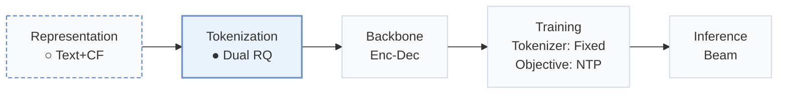
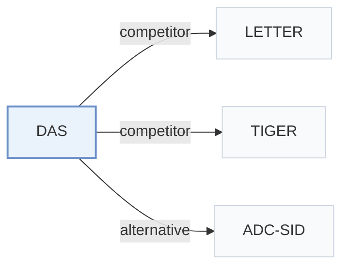

# DAS

[← Problem × Stage Matrix](../../README.md#i--tokenization) · [Papers by Stage](../index/stages.md) · [Papers by Modality](../index/modality.md) · [Papers by Domain](../index/domain.md) · English | [中文](../zh/papers/das.md)

| **Title** | *Dual-Aligned Semantic IDs Empowered Industrial Recommender System* |
| :-- | :-- |
| **Authors** | Ye et al. |
| **Venue** | CIKM’25 |
| **Problem × Stage** | `I. Informativeness` · `Tokenization` |
| **Changes** | ○ Representation · ● Tokenization |
| **SID inputs** | `Text` + `CF` |
| **Domain** | `Ads` |
| **Scenario** | `General Item Recommendation` · `Ranking and Reranking`; `Online Experiment or Deployment` |
| **Links** | [Paper](https://arxiv.org/abs/2508.10584) |
| **Reading level** | Overview (Level 1) |

**On this page**: [TL;DR](#tldr) · [3. Experiments](#3-experimental-findings) · [5. Related Work](#5-connections-to-related-work)

- `Text+CF`: Text representations combined with collaborative signals.
- `Dual RQ`: Dual residual quantization over two representation streams or entity types.
- `Enc-Dec`: Encoder-decoder.
- `Fixed`: SIDs are built first and not changed while the generator trains.
- `NTP`: Next-token prediction loss only; continuing from a pretrained LLM (SFT) also counts as NTP.
- `Beam`: Autoregressive beam search over Semantic ID tokens.

### TL;DR

> [!NOTE]
> DAS optimizes quantization and collaborative alignment in one stage, with multi-view contrastive alignment and dual quantization of users and ads, instead of two-stage alignment that loses information.

---

### 3. Experimental Findings

Experimental setup

- **Datasets**: Kuaishou advertising platform only (public datasets excluded). CTR task: 1.8 billion user-ad samples from about 100 million users and 8 million ads, with ad clicks as positives. Generative task: user-ad sequences from the past 15 days with length at least 10, about 50 million users.
  - Source: Industrial-only data and filters: [S4.SS1.SSS1.p1](https://arxiv.org/html/2508.10584v2#S4.SS1.SSS1.p1).
- **Split**: CTR: chronological 80% training / 20% testing. Generative task: leave-one-out (citing TIGER); the exact validation/test allocation is not reported. Online: multi-week A/B test with 10% of traffic (about 40+ million users).
  - Source: CTR chronological 80/20 and generative leave-one-out: [S4.SS1.SSS1.p1](https://arxiv.org/html/2508.10584v2#S4.SS1.SSS1.p1); online test: [S4.SS4.p1](https://arxiv.org/html/2508.10584v2#S4.SS4.p1).
- **Candidates**: not reported (full catalog versus sampled evaluation candidates for the generative HR@K/NDCG@K task).
  - Source: Metrics only: [S4.SS1.SSS2.p1](https://arxiv.org/html/2508.10584v2#S4.SS1.SSS2.p1).
- **Visibility**: Offline: warm; no unseen-item protocol is defined. Online results report larger gains in cold-start scenarios (eCPM +8.98%), but generator/tokenizer visibility for those items is not reported.
  - Source: Offline protocols are in-domain: [S4.SS1.SSS1.p1](https://arxiv.org/html/2508.10584v2#S4.SS1.SSS1.p1); online cold-start scenarios are named but not defined: [S4.SS4.p1](https://arxiv.org/html/2508.10584v2#S4.SS4.p1).
- **SID**: Separate user and ad SIDs from jointly trained RQ-VAEs: 3 codebooks x 512 codes, code dimension 32, k-means-initialized codebooks; ad embeddings 256-dimensional, user embeddings 1,024-dimensional. Collision handling: not reported (SIDs are also used as prefix-ngram sparse features in CTR models).
  - Source: 3 codebooks x 512 codes, dimension 32, k-means initialization: [S4.SS1.SSS3.p1](https://arxiv.org/html/2508.10584v2#S4.SS1.SSS3.p1) and [S2.SS1.SSS2.p1](https://arxiv.org/html/2508.10584v2#S2.SS1.SSS2.p1); no collision rule found.
- **Inference budget**: Generative task: TIGER architecture on T5 (4-layer encoder and decoder, 13M parameters), trained on four NVIDIA GPUs for five days; decoding method, beam width, inference batch size, and latency: not reported. CTR models are trained on 16 T4 GPUs. Online, top-k SID predictions from TIGER++ feed two deployment strategies.
  - Source: Generative model details: [S4.SS1.SSS3.p1](https://arxiv.org/html/2508.10584v2#S4.SS1.SSS3.p1); online use of top-k SID predictions: [S4.SS4.p2](https://arxiv.org/html/2508.10584v2#S4.SS4.p2).
- **Results from**: Table 1 (offline CTR AUC/UAUC/GAUC with SID feature variants); Table 2 (generative HR/NDCG for TIGER, TIGER+, TIGER++); Table 3 (dual-alignment ablation); Section 4.4 (online A/B: eCPM +3.48% overall, +8.98% in cold-start scenarios).
  - Source: CTR table: [S4.T1](https://arxiv.org/html/2508.10584v2#S4.T1); generative table: [S4.T2](https://arxiv.org/html/2508.10584v2#S4.T2); ablation: [S4.T3](https://arxiv.org/html/2508.10584v2#S4.T3); online: [S4.SS4.p1](https://arxiv.org/html/2508.10584v2#S4.SS4.p1) and [S4.SS4.p2](https://arxiv.org/html/2508.10584v2#S4.SS4.p2).

---

### 5. Connections to Related Work

- **Competitor** · [LETTER](letter.md): LETTER aligns the quantizer with CF embeddings in a two-stage pipeline; DAS trains quantization and debiased CF jointly in one stage and aligns user and ad SIDs dually.
  - Source: DAS v2, Section 4.2 variant (4) +ASID (LETTER): [S4.SS2.p2](https://arxiv.org/html/2508.10584v2#S4.SS2.p2); Table 1: [S4.T1](https://arxiv.org/html/2508.10584v2#S4.T1).
- **Competitor** · [TIGER](tiger.md): TIGER with unaligned RQ-VAE ad SIDs is the generative baseline; DAS replaces them with aligned ad SIDs (TIGER+) and adds aligned user SIDs (TIGER++).
  - Source: DAS v2, Section 4.2: [S4.SS2.p4](https://arxiv.org/html/2508.10584v2#S4.SS2.p4); Table 2: [S4.T2](https://arxiv.org/html/2508.10584v2#S4.T2).
- **Alternative** · [ADC-SID](adc-sid.md): ADC-SID compares against DAS and adds adaptive alignment strength and dynamic behavioral weighting to denoise long-tail collaborative signals.
  - Source: Evidence is from the later ADC-SID paper: DAS is a baseline in Section 4.1.2 and Table 2: [S4.I3.i4.p1](https://arxiv.org/html/2510.25622v3#S4.I3.i4.p1) and [S4.T2](https://arxiv.org/html/2510.25622v3#S4.T2).

[View all papers in this cell](../../README.md#i--tokenization)
