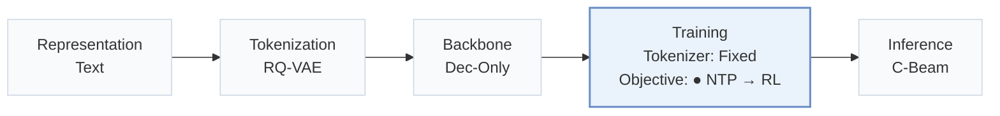
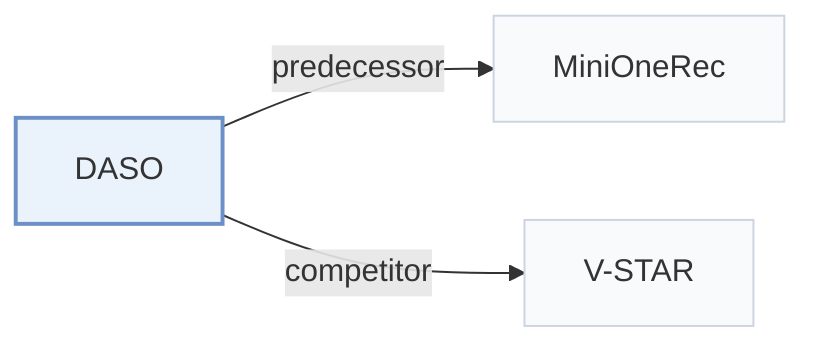

# DASO

[← Problem × Stage Matrix](../../README.md#iv--training) · [Papers by Stage](../index/stages.md) · [Papers by Modality](../index/modality.md) · [Papers by Domain](../index/domain.md) · English | [中文](../zh/papers/daso.md)

| **Title** | *Difficulty-Aware Semantic-ID Optimization for Generative Recommendation* |
| :-- | :-- |
| **Authors** | Yu et al. |
| **Venue** | arXiv’26 |
| **Problem × Stage** | `IV. Utility` · `Training` |
| **Changes** | ● Objective |
| **SID inputs** | `Text` + `Other` (Internal 4-level, 2048-code SIDs; input unstated) |
| **Domain** | `E-commerce` · `Other` (Proprietary user-to-item data, business unstated) |
| **Scenario** | `General Item Recommendation`; `Industrial Data, Offline` |
| **Links** | [Paper](https://arxiv.org/abs/2608.20611) · [Code](https://github.com/LucasXinYu/DASO) |
| **Reading level** | Overview (Level 1) |

**On this page**: [TL;DR](#tldr) · [3. Experiments](#3-experimental-findings) · [5. Related Work](#5-connections-to-related-work)

- `Text`: Textual item metadata (titles, descriptions, categories, or prompts).
- `RQ-VAE`: Residual-Quantized Variational AutoEncoder.
- `Dec-Only`: Decoder-only.
- `Fixed`: SIDs are built first and not changed while the generator trains.
- `NTP → RL`: NTP, then reinforcement learning (GRPO, GBPO, etc.).
- `C-Beam`: Constrained beam search.

### TL;DR

> [!NOTE]
> DASO reallocates part of each GRPO rollout group to prefix-guided completions at Semantic ID levels where candidates leave the target path and adds a graded prefix reward, unlike vanilla GRPO.

---

### 3. Experimental Findings

Experimental setup

- **Datasets**: Amazon Reviews 2018 Industrial & Scientific and Office Products, 5-core; proprietary user-to-item task with 1.36M recommendation examples and 319K users. Internal filtering rules: not reported.
  - Source: Experimental Setup and Appendix C: [Sx5.SSx1.p1](https://arxiv.org/html/2608.20611v1#Sx5.SSx1.p1) and [A3.SSx1.p1](https://arxiv.org/html/2608.20611v1#A3.SSx1.p1)
- **Split**: Public: fixed chronological next-item prediction, earlier interactions as history and a held-out next item. Train/validation/test sequences: Office Products 38924/4866/4866; Industrial and Scientific 36259/4532/4533. Split assignment rule and history-item cap: not reported. Internal: SFT train/eval 1139832/60168, GRPO training prompts 100326, and about 36K disjoint constrained-generation evaluation prompts; allocation rules not reported.
  - Source: Table 1, Appendix C and Table 4: [Sx5.T1](https://arxiv.org/html/2608.20611v1#Sx5.T1) and [A3.SSx1.p1](https://arxiv.org/html/2608.20611v1#A3.SSx1.p1) and [A3.T4](https://arxiv.org/html/2608.20611v1#A3.T4) and [Sx5.SSx1.p1](https://arxiv.org/html/2608.20611v1#Sx5.SSx1.p1)
- **Candidates**: Valid-catalog SID trie and 50-beam generated ranking for public evaluation. Full-catalog versus sampled-negative evaluation and history-item exclusion: not reported.
  - Source: Preliminaries, Appendix B and D: [Sx3.SSx1.p2](https://arxiv.org/html/2608.20611v1#Sx3.SSx1.p2) and [A2.SSx2.p2](https://arxiv.org/html/2608.20611v1#A2.SSx2.p2) and [A4.SSx4.p1](https://arxiv.org/html/2608.20611v1#A4.SSx4.p1)
- **Visibility**: warm; no unseen-item protocol is defined. Easy/Medium/Hard diagnostics measure frozen-SFT prefix/target recovery, not item holdouts. Item-level exposure to the pretrained tokenizer: not reported.
  - Source: Experimental Setup and Appendix F: [Sx5.SSx1](https://arxiv.org/html/2608.20611v1#Sx5.SSx1) and [A6.p2](https://arxiv.org/html/2608.20611v1#A6.p2)
- **SID**: Public: official frozen MiniOneRec RQ-VAE assignments from Qwen text embeddings, 3 levels x256 codes. Internal: 4 levels x2048 codes; SID construction details not reported. Collision handling: not reported for either setting.
  - Source: SID construction and Appendix C: [Sx5.SSx1.p2](https://arxiv.org/html/2608.20611v1#Sx5.SSx1.p2) and [A3.SSx1.p2](https://arxiv.org/html/2608.20611v1#A3.SSx1.p2) and [A3.SSx2.p1](https://arxiv.org/html/2608.20611v1#A3.SSx2.p1)
- **Inference budget**: Public: trie-constrained beam50, HR@5/10 and NDCG@5. Internal: level-wise Top1/20 recall; internal beam width not reported. Primary training/evaluation setup uses 8x A100 80GB; inference batch and latency not reported. G=16 rollouts, Bmax=9 guided replacements and batch128 are training settings.
  - Source: Appendix D evaluation and H compute resources: [A4.SSx4.p1](https://arxiv.org/html/2608.20611v1#A4.SSx4.p1) and [A4.SSx4.p2](https://arxiv.org/html/2608.20611v1#A4.SSx4.p2) and [A8.p1](https://arxiv.org/html/2608.20611v1#A8.p1) and [A4.T5](https://arxiv.org/html/2608.20611v1#A4.T5)
- **Results from**: Paper's Table2 public and Table3 internal experiments plus appendix ablations/diagnostics. SFT-only, MiniOneRec-style GRPO, uniform GT injection, Sibling-GRPO and DASO share SFT initialization and fixed SID/trie per setting. One algorithm run per dataset/backbone/method; no multi-seed significance tests. No borrowed baseline scores are identified.
  - Source: Experimental Setup, Tables2/3 and Appendix B: [Sx5.SSx1.p3](https://arxiv.org/html/2608.20611v1#Sx5.SSx1.p3) and [Sx5.T2](https://arxiv.org/html/2608.20611v1#Sx5.T2) and [Sx5.T3](https://arxiv.org/html/2608.20611v1#Sx5.T3) and [A2.SSx2.p1](https://arxiv.org/html/2608.20611v1#A2.SSx2.p1) and [A2.SSx2.p2](https://arxiv.org/html/2608.20611v1#A2.SSx2.p2)

---

### 5. Connections to Related Work

- **Predecessor** · [MiniOneRec](minionerec.md): MiniOneRec supplies public SIDs and the baseline SFT-to-GRPO recipe.
  - Source: DASO v1, Experimental Setup and Appendix C: [Sx5.SSx1.p2](https://arxiv.org/html/2608.20611v1#Sx5.SSx1.p2); [Sx5.SSx1.p4](https://arxiv.org/html/2608.20611v1#Sx5.SSx1.p4); [A3.SSx1.p2](https://arxiv.org/html/2608.20611v1#A3.SSx1.p2).
- **Competitor** · [V-STAR](v-star.md): V-STAR's Sibling-GRPO is a compared tree-structured training baseline.
  - Source: DASO v1, Related Work and Appendix D: [Sx2.SSx2.p2](https://arxiv.org/html/2608.20611v1#Sx2.SSx2.p2); [A4.SSx3.p2](https://arxiv.org/html/2608.20611v1#A4.SSx3.p2).

[View all papers in this cell](../../README.md#iv--training)
