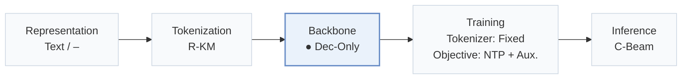
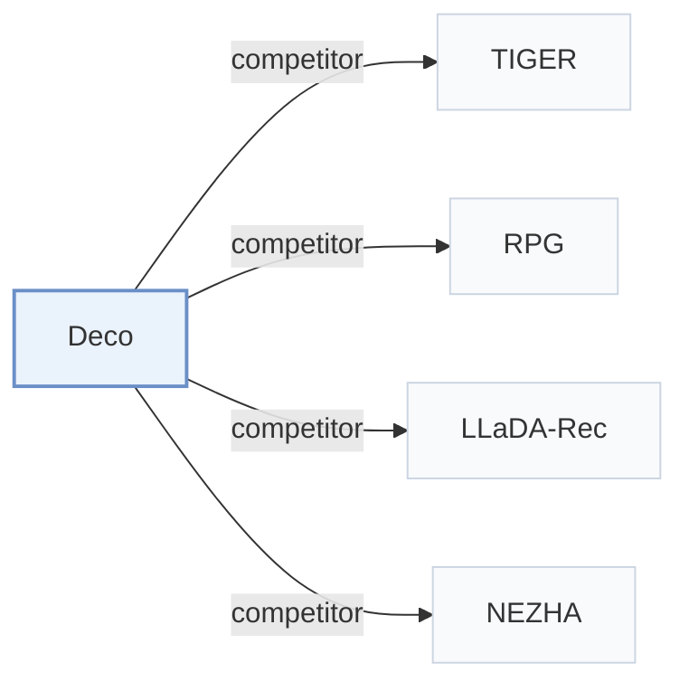

# Deco

[← Problem × Stage Matrix](../../README.md#v--backbone) · [Papers by Stage](../index/stages.md) · [Papers by Modality](../index/modality.md) · [Papers by Domain](../index/domain.md) · English | [中文](../zh/papers/deco.md)

| **Title** | *Separating Thinking from Spelling for Efficient Generative Recommendation* |
| :-- | :-- |
| **Authors** | Gusak et al. |
| **Venue** | arXiv’26 |
| **Problem × Stage** | `V. Efficiency` · `Backbone` |
| **Changes** | ● Backbone |
| **SID inputs** | A: `Text` · B: `Audio` |
| **Domain** | `E-commerce` · `Movie` · `Music` |
| **Scenario** | `General Item Recommendation`; `Public Benchmarks` |
| **Links** | [Paper](https://arxiv.org/abs/2610.32980) |
| **Reading level** | Overview (Level 1) |

**On this page**: [TL;DR](#tldr) · [3. Experiments](#3-experimental-findings) · [5. Related Work](#5-connections-to-related-work)

- `Text / –`: Text representations in one configuration; the representation source is not reported in another.
- `R-KM`: Residual k-means.
- `Dec-Only`: Decoder-only.
- `Fixed`: SIDs are built first and not changed while the generator trains.
- `NTP + Aux.`: NTP plus another auxiliary loss.
- `C-Beam`: Constrained beam search.

### TL;DR

> [!NOTE]
> Deco reads each history item as one fused token, condenses the history into a next-item concept, and runs beam search in a light KV-cached decoder instead of the full backbone.

---

### 3. Experimental Findings

Experimental setup

- **Datasets**: Amazon-2014 Beauty/Sports/Toys and Amazon-2023 BPC-23/Books-23, published 5-core subsets; MovieLens-25M subset (filtering rules not reported); Yambda-500M last30 days, exact deduplication, consecutive track-repeat collapse and user/item thresholds5/20.
  - Source: Sec.4.1.1: [S4.SS1.SSS1.p1](https://arxiv.org/html/2610.32980v2#S4.SS1.SSS1.p1)
- **Split**: Global temporal: latest10% interactions test, latest10% of the remainder validation; Yambda uses last day test and preceding day validation. Each user's last event per held-out period is target; earlier within-period events enter history. History cap20 Amazon,100 MovieLens/Yambda. Separate Beauty leave-one-out comparison also reported.
  - Source: Sec.4.1.2/4.1.4: [S4.SS1.SSS2.p1](https://arxiv.org/html/2610.32980v2#S4.SS1.SSS2.p1) and [S4.SS1.SSS4.p1](https://arxiv.org/html/2610.32980v2#S4.SS1.SSS4.p1) and [S4.SS2.SSS1.Px5.p1](https://arxiv.org/html/2610.32980v2#S4.SS2.SSS1.Px5.p1)
- **Candidates**: full catalog: the training item catalog; history items are not excluded because repeats are legitimate targets. Main beam100; larger candidate budgets up to1000 are separately tested.
  - Source: Sec.4.1.2: [S4.SS1.SSS2.p1](https://arxiv.org/html/2610.32980v2#S4.SS1.SSS2.p1)
- **Visibility**: warm; no unseen-item protocol is defined. Yambda new targets mean absent from the last100 history items, not globally unseen items. Tokenizer-fitting exposure to test items/interactions: not reported.
  - Source: Sec.4.1 protocol and repeat/new analysis: [S4.SS1.SSS2.p1](https://arxiv.org/html/2610.32980v2#S4.SS1.SSS2.p1) and [S4.F6](https://arxiv.org/html/2610.32980v2#S4.F6) and [S4.SS2.SSS4.Px2.p1](https://arxiv.org/html/2610.32980v2#S4.SS2.SSS4.Px2.p1)
- **SID**: Fixed RQ-KMeans,4 levels x2048 codes, from multilingual E5-large metadata embeddings or provided128-dimensional Yambda item embeddings. Popularity-based collision resolution is stated; detailed rule not reported. Depth study uses2-8 nested levels x256 codes.
  - Source: Sec.4.1.4 and SID-depth study: [S4.SS1.SSS4.p1](https://arxiv.org/html/2610.32980v2#S4.SS1.SSS4.p1) and [S4.SS2.SSS3.Px2.p1](https://arxiv.org/html/2610.32980v2#S4.SS2.SSS3.Px2.p1)
- **Inference budget**: Testbeam100 (validationbeam10), NDCG/Recall@10/50/100; copy pointer on Yambda. One H10080GB, bf16; main serving pipeline compiled with CUDA graphs and beam-shared history cache. Report batch128, peak sweep and50ms p95 budget;3.2-7.3x FusedGR throughput under that budget. GPU batch latency includes concept prefill/full beam/trie masking, excludes data loading/SID-item mapping and compilation/capture/warm-up. Each point repeats3 times,100 timed batches after10 warm-ups (50/5 above batch64). Table3 instead uses common eager PyTorch, batch128.
  - Source: Sec.4.1.4, Sec.4.2.2 and Appendix C: [S4.SS1.SSS4.p1](https://arxiv.org/html/2610.32980v2#S4.SS1.SSS4.p1) and [S4.SS2.SSS2.p2](https://arxiv.org/html/2610.32980v2#S4.SS2.SSS2.p2) and [A3.SS0.SSS0.Px3.p1](https://arxiv.org/html/2610.32980v2#A3.SS0.SSS0.Px3.p1)
- **Results from**: Table2: paper's six matched-family models, shared SIDs/training budgets, mean+SD over3 seeds. Table3 external baselines are tuned/retrained from scratch under this protocol; eager native-path timing, RPG graph construction excluded. Separate Table4 Beauty leave-one-out baseline scores come from literature. Main throughput includes prefill; decoder-only comparisons excluding prefill are separate.
  - Source: Sec.4.1 baselines, Tables2-4 and Appendix C: [S4.SS1.SSS3.p1](https://arxiv.org/html/2610.32980v2#S4.SS1.SSS3.p1) and [S4.SS1.SSS3.p2](https://arxiv.org/html/2610.32980v2#S4.SS1.SSS3.p2) and [S4.T2](https://arxiv.org/html/2610.32980v2#S4.T2) and [S4.T3](https://arxiv.org/html/2610.32980v2#S4.T3) and [S4.SS2.SSS1.Px5.p1](https://arxiv.org/html/2610.32980v2#S4.SS2.SSS1.Px5.p1) and [A3.SS0.SSS0.Px3.p1](https://arxiv.org/html/2610.32980v2#A3.SS0.SSS0.Px3.p1)

---

### 5. Connections to Related Work

- **Competitor** · [TIGER](tiger.md): KV-cached TIGER is retrained as an autoregressive comparison.
  - Source: Deco v2, Sec.4.1.3 and Table3: [S4.SS1.SSS3.p2](https://arxiv.org/html/2610.32980v2#S4.SS1.SSS3.p2); [S4.T3](https://arxiv.org/html/2610.32980v2#S4.T3).
- **Competitor** · [RPG](rpg.md): RPG is compared with both graph search and full-catalog scoring.
  - Source: Deco v2, Sec.4.1.3 and Table3: [S4.SS1.SSS3.p2](https://arxiv.org/html/2610.32980v2#S4.SS1.SSS3.p2); [S4.T3](https://arxiv.org/html/2610.32980v2#S4.T3).
- **Competitor** · [LLaDA-Rec](llada-rec.md): LLaDA-Rec is a retrained diffusion-based comparison.
  - Source: Deco v2, Related Work and Table3: [S2.SS0.SSS0.Px2.p1](https://arxiv.org/html/2610.32980v2#S2.SS0.SSS0.Px2.p1); [S4.SS1.SSS3.p2](https://arxiv.org/html/2610.32980v2#S4.SS1.SSS3.p2); [S4.T3](https://arxiv.org/html/2610.32980v2#S4.T3).
- **Competitor** · [NEZHA](nezha.md): NEZHA is a retrained efficient-generation comparison.
  - Source: Deco v2, Sec.4.1.3 and Table3: [S4.SS1.SSS3.p2](https://arxiv.org/html/2610.32980v2#S4.SS1.SSS3.p2); [S4.T3](https://arxiv.org/html/2610.32980v2#S4.T3).

[View all papers in this cell](../../README.md#v--backbone)
