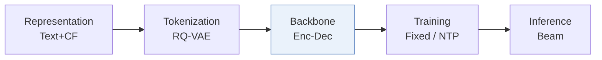
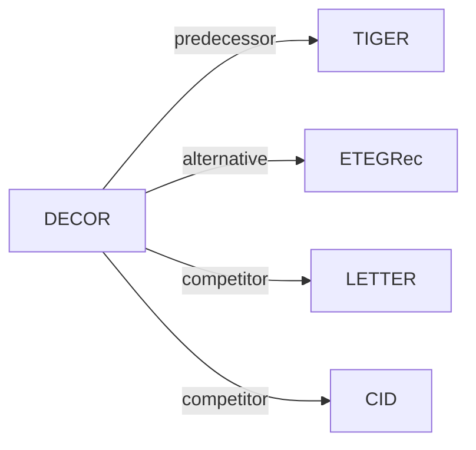

# DECOR

*Learning Decomposed Contextual Token Representations from Pretrained and Collaborative Signals for Generative Recommendation* — Liu et al. · SIGIR’26

`III. SID–Model Alignment` · `Backbone` · [Paper](https://arxiv.org/abs/2509.10468) · [Code](https://github.com/yliuaa/DECOR.git) · [Matrix](../../README.md#iii--backbone) · [中文](../zh/papers/decor.md)

Reading level: Overview (Level 1) · On this page: [TL;DR](#tldr) · [At a Glance](#at-a-glance) · [3. Experiments](#3-experimental-findings) · [5. Related Work](#5-connections-to-related-work)

- `Enc-Dec`: Encoder-decoder.
- `Fixed`: SIDs are built first and not changed while the generator trains.
- `NTP`: Next-token prediction loss only; continuing from a pretrained LLM (SFT) also counts as NTP.

### TL;DR

> [!NOTE]

> DECOR refines Semantic ID token embeddings by interaction context and fuses pretrained codebook embeddings with learned collaborative embeddings, instead of static token assignments that overwrite pretrained semantics.

### At a Glance

| Aspect | Summary |
| :-- | :-- |
| Research Problem | III. SID–Model Alignment: Can the generator read, write, and reason over SIDs, and do the tokenizer and generator work toward the same goal? |
| Key Contribution | DECOR refines Semantic ID token embeddings by interaction context and fuses pretrained codebook embeddings with learned collaborative embeddings, instead of static token assignments that overwrite pretrained semantics. |
| Modified Stage | Backbone |

### 3. Experimental Findings

Experimental setup

- **Datasets**: Amazon Scientific, Instrument and Game (paper labels); user/item 5-core filtering; chronological histories capped at 20 items.
  - Source: Section 4.1.1 and Table 1: [S4.SS1.SSS1.p1](https://arxiv.org/html/2509.10468v2#S4.SS1.SSS1.p1) ; [S3.T1](https://arxiv.org/html/2509.10468v2#S3.T1)
- **Split**: Per-user chronological leave-one-out: last interaction test, penultimate validation, remaining interactions training.
  - Source: Section 4.1.1: [S4.SS1.SSS1.p1](https://arxiv.org/html/2509.10468v2#S4.SS1.SSS1.p1)
- **Candidates**: full catalog; full-ranking evaluation without sampling.
  - Source: Section 4.1.1: [S4.SS1.SSS1.p1](https://arxiv.org/html/2509.10468v2#S4.SS1.SSS1.p1)
- **Visibility**: warm; no unseen-item protocol is defined. RQ-VAE/text-encoder exposure to test items not reported; collaborative embeddings are learned from recommendation sequences.
  - Source: Sections 3.2/3.3/4.1 define no item holdout: [S3.SS2.p1](https://arxiv.org/html/2509.10468v2#S3.SS2.p1) ; [S3.SS3.p2](https://arxiv.org/html/2509.10468v2#S3.SS3.p2) ; [S4.SS1.SSS1.p1](https://arxiv.org/html/2509.10468v2#S4.SS1.SSS1.p1)
- **SID**: Sentence-T5 embeddings; frozen RQ-VAE with 3 levels x 256 entries, plus an incremental index token resolving identical 3-token prefixes: 4-token IDs. Token assignments remain fixed while embeddings are contextually composed and fused with learned collaborative embeddings.
  - Source: Sections 3.2/3.3/4.1.2: [S3.SS2.p2](https://arxiv.org/html/2509.10468v2#S3.SS2.p2) ; [S3.SS3.p2](https://arxiv.org/html/2509.10468v2#S3.SS3.p2) ; [S4.SS1.SSS2.p1](https://arxiv.org/html/2509.10468v2#S4.SS1.SSS2.p1)
- **Inference budget**: Beam 50; Recall/NDCG@5/10; experiments on one Tesla A40. Table 5 batches 8/16/32/64/128: DECOR 4.49-4.70 ms/sample, 213-223 samples/s; batch 128 adds 0.85 ms over TIGER. Prefix constraints not reported.
  - Source: Section 4.1.2/4.8 and Table 5: [S4.SS1.SSS2.p1](https://arxiv.org/html/2509.10468v2#S4.SS1.SSS2.p1) ; [S4.SS8.p1](https://arxiv.org/html/2509.10468v2#S4.SS8.p1) ; [S4.T5](https://arxiv.org/html/2509.10468v2#S4.T5)
- **Results from**: Original Table 2 test results use seed 2025; significance tested across five seeds. Generative baselines rerun from official code; other baselines adapted or quoted when protocols match. Table 5 measures inference cost; Figure 5 measures convergence, excluding ETEGRec tokenizer-update epochs.
  - Source: Sections 4.1.2/4.2/4.7 and Tables 2/5: [S4.SS1.SSS2.p1](https://arxiv.org/html/2509.10468v2#S4.SS1.SSS2.p1) ; [S4.SS2.p1](https://arxiv.org/html/2509.10468v2#S4.SS2.p1) ; [S3.T2](https://arxiv.org/html/2509.10468v2#S3.T2) ; [S4.T5](https://arxiv.org/html/2509.10468v2#S4.T5) ; [S4.SS7.p1](https://arxiv.org/html/2509.10468v2#S4.SS7.p1)

### 5. Connections to Related Work

- **前序工作** · [TIGER](tiger.md): DECOR augments TIGER's fixed tokenization with contextual token embeddings.
  - Source: DECOR v2, Sections 3.2/4.1.2 and Table 2: https://arxiv.org/html/2509.10468v2#S3.SS2.p1 ; https://arxiv.org/html/2509.10468v2#S4.SS1.SSS2.p1 ; https://arxiv.org/html/2509.10468v2#S3.T2.
- **替代方案** · [ETEGRec](etegrec.md): DECOR adapts embeddings without ETEGRec's repeated re-tokenization.
  - Source: DECOR v2, Sections 3.4/4.7: https://arxiv.org/html/2509.10468v2#S3.SS4.p2 ; https://arxiv.org/html/2509.10468v2#S4.SS7.p1.
- **同期对比** · [LETTER](letter.md): LETTER is a tokenizer-enhancement baseline in the shared evaluation.
  - Source: DECOR v2, Sections 1/4.2 and Table 2: https://arxiv.org/html/2509.10468v2#S1.p6 ; https://arxiv.org/html/2509.10468v2#S4.SS2.p1 ; https://arxiv.org/html/2509.10468v2#S3.T2.
- **同期对比** · [CID](cid.md): P5-CID is a collaborative-indexing baseline.
  - Source: DECOR v2, Section 4.2 and Table 2: https://arxiv.org/html/2509.10468v2#S4.SS2.p1 ; https://arxiv.org/html/2509.10468v2#S3.T2.

[查看同格全部论文](../../README.md#iii--backbone)
