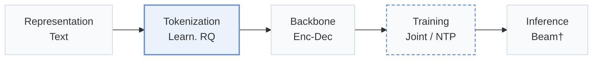
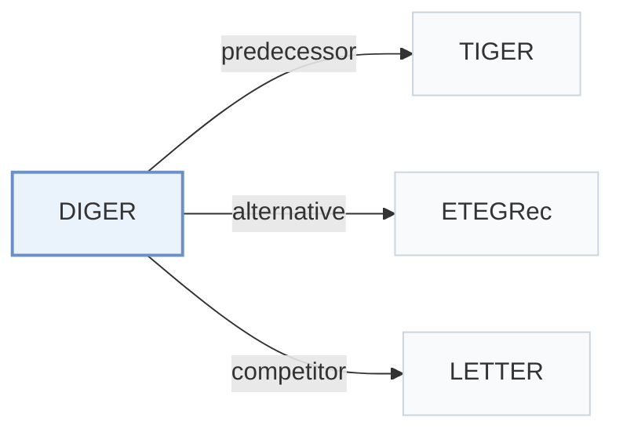

# DIGER

[← Problem × Stage Matrix](../../README.md#ii--tokenization) · [Papers by Stage](../index/stages.md) · [Papers by Modality](../index/modality.md) · English | [中文](../zh/papers/diger.md)

| **Title** | *Differentiable Semantic ID for Generative Recommendation* |
| :-- | :-- |
| **Authors** | Fu et al. |
| **Venue** | SIGIR’26 |
| **Problem × Stage** | `II. Uniqueness and Validity` · `Tokenization` — Also: `III. SID–Model Alignment` × `Training` |
| **Links** | [Paper](https://arxiv.org/abs/2601.19711) · [Code](https://github.com/junchen-fu/DIGER) |
| **Reading level** | Overview (Level 1) |

**On this page**: [TL;DR](#tldr) · [At a Glance](#at-a-glance) · [3. Experiments](#3-experimental-findings) · [5. Related Work](#5-connections-to-related-work)

- `Text`: Textual item metadata (titles, descriptions, categories, or prompts).
- `Learn. RQ`: End-to-end or alternatingly updated learnable residual quantization.
- `Enc-Dec`: Encoder-decoder.
- `Joint`: The generator loss updates the tokenizer directly.
- `NTP`: Next-token prediction loss only; continuing from a pretrained LLM (SFT) also counts as NTP.
- `Beam†`: Autoregressive beam search (inferred).

### TL;DR

> [!NOTE]
> DIGER makes Semantic IDs differentiable so recommendation gradients update the tokenizer, and adds decaying Gumbel noise against codebook collapse, instead of a tokenizer trained only for reconstruction.

---

### At a Glance

| Aspect | Summary |
| :-- | :-- |
| Research Problem | II. Uniqueness and Validity: Does every item get its own SID, every generated SID name a real item, and the codebook get used evenly? |
| Key Contribution | DIGER makes Semantic IDs differentiable so recommendation gradients update the tokenizer, and adds decaying Gumbel noise against codebook collapse, instead of a tokenizer trained only for reconstruction. |
| Modified Stage | Tokenization |

---

### 3. Experimental Findings

Experimental setup

- **Datasets**: B-Shop (cosmetic products), I-Shop (music-related products), Yelp (restaurants); remove users/items with fewer than five interactions. LLaMA-7B-generated item content; review text supplies interactions only. History cap not reported.
  - Source: Section 5, Datasets: [S5.p1](https://arxiv.org/html/2601.19711v3#S5.p1)
- **Split**: Leave-one-out; exact validation/test allocation not reported. All reported results use the test set.
  - Source: Section 5, Evaluation: [S5.p2](https://arxiv.org/html/2601.19711v3#S5.p2)
- **Candidates**: full catalog; predicted item ranked against the full item set.
  - Source: Section 5, Evaluation: [S5.p2](https://arxiv.org/html/2601.19711v3#S5.p2)
- **Visibility**: warm; no unseen-item protocol is defined. Pretrained RQ-VAE/content-encoder exposure to test items not reported.
  - Source: Sections 4.3/5 define no item holdout: [S4.SS3.p2](https://arxiv.org/html/2601.19711v3#S4.SS3.p2) ; [S5.p1](https://arxiv.org/html/2601.19711v3#S5.p1) ; [S5.p2](https://arxiv.org/html/2601.19711v3#S5.p2)
- **SID**: Pretrained RQ-VAE initialization, then jointly optimized differentiable IDs: 3 code positions x 256 entries plus one conflict code. Conflict-code assignment details not reported. Training uses Gumbel exploration with uncertainty decay; validation/inference tokenizer assignments are deterministic.
  - Source: Sections 4.2/4.3/5: [S4.SS2.p1](https://arxiv.org/html/2601.19711v3#S4.SS2.p1) ; [S4.SS3.p1](https://arxiv.org/html/2601.19711v3#S4.SS3.p1) ; [S5.p4](https://arxiv.org/html/2601.19711v3#S5.p4)
- **Inference budget**: Autoregressive next-SID generation; Recall/NDCG@10. Decoder search/beam, prefix constraints, inference batch and latency not reported. Experiments use two H100 GPUs; tokenizer argmax is reported separately from generation.
  - Source: Sections 3/4.2/5: [S3.p3](https://arxiv.org/html/2601.19711v3#S3.p3) ; [S4.SS2.p1](https://arxiv.org/html/2601.19711v3#S4.SS2.p1) ; [S5.p2](https://arxiv.org/html/2601.19711v3#S5.p2) ; [S5.p4](https://arxiv.org/html/2601.19711v3#S5.p4)
- **Results from**: Original Tables 2/3 compare DIGER variants and baselines; main DIGER uses FrqUD. Most baseline results are quoted from LETTER (Wang et al., 2024); implemented methods are validation-tuned. Original Tables 4/5 give component and capacity/length ablations.
  - Source: Sections 5/6.2 and Tables 2/3/4/5: [S5.p3](https://arxiv.org/html/2601.19711v3#S5.p3) ; [S5.T2](https://arxiv.org/html/2601.19711v3#S5.T2) ; [S6.T3](https://arxiv.org/html/2601.19711v3#S6.T3) ; [S6.SS2.p1](https://arxiv.org/html/2601.19711v3#S6.SS2.p1) ; [S7.T4](https://arxiv.org/html/2601.19711v3#S7.T4) ; [S7.T5](https://arxiv.org/html/2601.19711v3#S7.T5)

---

### 5. Connections to Related Work

- **Predecessor** · [TIGER](tiger.md): TIGER supplies the reference two-stage framework for differentiable-ID training.
  - Source: DIGER v3, Sections 3/5 and Table 3: [S3.p1](https://arxiv.org/html/2601.19711v3#S3.p1) ; [S5.p3](https://arxiv.org/html/2601.19711v3#S5.p3) ; [S6.T3](https://arxiv.org/html/2601.19711v3#S6.T3).
- **Alternative** · [ETEGRec](etegrec.md): DIGER replaces alternating distillation with direct recommendation gradients through indexing.
  - Source: DIGER v3, Sections 2/6.2: [S2.p3](https://arxiv.org/html/2601.19711v3#S2.p3) ; [S2.p4](https://arxiv.org/html/2601.19711v3#S2.p4) ; [S6.SS2.p2](https://arxiv.org/html/2601.19711v3#S6.SS2.p2).
- **Competitor** · [LETTER](letter.md): LETTER is a comparison method and the source of most quoted baseline results.
  - Source: DIGER v3, Sections 5/6.2 and Table 3: [S5.p3](https://arxiv.org/html/2601.19711v3#S5.p3) ; [S6.SS2.p3](https://arxiv.org/html/2601.19711v3#S6.SS2.p3) ; [S6.T3](https://arxiv.org/html/2601.19711v3#S6.T3).

[View all papers in this cell](../../README.md#ii--tokenization)
