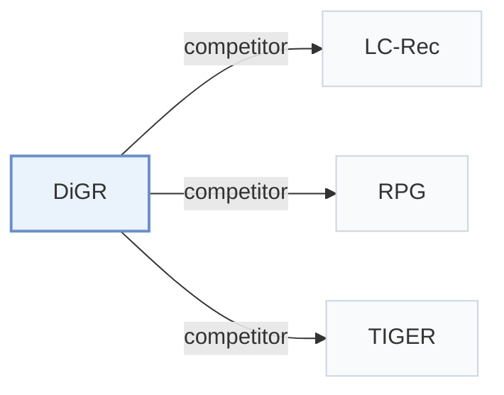

# DiGR

[← Problem × Stage Matrix](../../README.md#iv--backbone) · [Papers by Stage](../index/stages.md) · [Papers by Modality](../index/modality.md) · [Papers by Domain](../index/domain.md) · English | [中文](../zh/papers/digr.md)

| **Title** | *From Token Generation to Item Ranking: Direct Generative Recommendation with Semantic IDs* |
| :-- | :-- |
| **Authors** | Zhao et al. |
| **Venue** | arXiv’26 |
| **Problem × Stage** | `IV. Utility` · `Backbone` |
| **Changes** | ● Backbone · ○ Objective · ○ Inference |
| **SID inputs** | `unknown` |
| **Domain** | `E-commerce` |
| **Links** | [Paper](https://arxiv.org/abs/2602.07847) · [Code](https://anonymous.4open.science/r/SimGR-C408/) |
| **Reading level** | Overview (Level 1) |

**On this page**: [TL;DR](#tldr) · [3. Experiments](#3-experimental-findings) · [5. Related Work](#5-connections-to-related-work)

- `RQ-VAE`: Residual-Quantized Variational AutoEncoder.
- `Dec-Only`: Decoder-only.
- `Fixed`: SIDs are built first and not changed while the generator trains.
- `Discrim.`: Scores items; does not generate SIDs.
- `Scoring`: Direct candidate scoring without step-by-step SID generation.

### TL;DR

> [!NOTE]
> DiGR uses Semantic ID tokens as item representations and scores items with one item-level function, instead of generating tokens, after showing that token decoding adds no ranking expressiveness.

---

### 3. Experimental Findings

Experimental setup

- **Datasets**: Amazon Reviews 2018: Musical Instruments, Arts/Crafts/Sewing, Video Games; user/item 5-core; chronological histories capped at 20.
  - Source: [Sx5.SSx1.SSSx1.p1](https://arxiv.org/html/2602.07847v2#Sx5.SSx1.SSSx1.p1)
- **Split**: Per-user leave-one-out: last interaction test, penultimate validation, all earlier interactions training; learning rate and training epochs selected by validation grid search.
  - Source: [Sx5.SSx1.SSSx3.p1](https://arxiv.org/html/2602.07847v2#Sx5.SSx1.SSSx3.p1) ; [Sx5.SSx1.SSSx4.p1](https://arxiv.org/html/2602.07847v2#Sx5.SSx1.SSSx4.p1)
- **Candidates**: full catalog for DiGR and other scoring-based methods; autoregressive baselines use prefix-constrained beam 20; history exclusion not reported.
  - Source: [Sx5.SSx1.SSSx3.p1](https://arxiv.org/html/2602.07847v2#Sx5.SSx1.SSSx3.p1)
- **Visibility**: warm; no unseen-item protocol is defined. Tokenizer exposure to test items is not reported.
  - Source: [Sx5.SSx1.SSSx3.p1](https://arxiv.org/html/2602.07847v2#Sx5.SSx1.SSSx3.p1) ; inductive capability is discussed, not evaluated as an item-holdout protocol.
- **SID**: RQ-VAE SIDs composed by mean-pooling shared position-specific SID-token embeddings; SID length, codebook sizes, tokenizer input encoder and collision handling not reported. Appendix D additionally compares R-KMeans and OPQ on Instruments.
  - Source: [Sx5.SSx1.SSSx4.p2](https://arxiv.org/html/2602.07847v2#Sx5.SSx1.SSSx4.p2) ; [Sx4.SSx2.SSS0.Px2.p1](https://arxiv.org/html/2602.07847v2#Sx4.SSx2.SSS0.Px2.p1) ; [A4.p1](https://arxiv.org/html/2602.07847v2#A4.p1)
- **Inference budget**: Precomputed item vectors and direct item-level scoring; no SID decoding. HR@1/5/10 and NDCG@5/10. Instruments timing: 0.074 s/user on one NVIDIA A100; inference batch size not reported. Beam 20 belongs to main autoregressive baselines, with 50/100 in the separate timing study.
  - Source: [Sx4.SSx2.SSS0.Px3.p1](https://arxiv.org/html/2602.07847v2#Sx4.SSx2.SSS0.Px3.p1) ; [Sx5.T3](https://arxiv.org/html/2602.07847v2#Sx5.T3) ; [Sx5.SSx1.SSSx3.p1](https://arxiv.org/html/2602.07847v2#Sx5.SSx1.SSSx3.p1)
- **Results from**: Own recommendation comparison and controlled ranking/efficiency studies; ID baselines use RecBole, generative baselines follow official designs, LC-Rec shares Qwen3-4B/LoRA settings. Ranking-overlap reference is exhaustive LC-Rec scoring, not observed ground-truth preference order. Appendix D uses GPT-2 controls; no imported baseline scores stated; run counts/variance not reported.
  - Source: [Sx5.T2](https://arxiv.org/html/2602.07847v2#Sx5.T2) ; [Sx5.SSx1.SSSx4.p2](https://arxiv.org/html/2602.07847v2#Sx5.SSx1.SSSx4.p2) ; [Sx5.SSx3.p1](https://arxiv.org/html/2602.07847v2#Sx5.SSx3.p1) ; [A4.p1](https://arxiv.org/html/2602.07847v2#A4.p1)

---

### 5. Connections to Related Work

- **Competitor** · [LC-Rec](lc-rec.md): Matched-backbone baseline and exhaustive-ranking reference.
  - Source: [Sx5.SSx1.SSSx4.p2](https://arxiv.org/html/2602.07847v2#Sx5.SSx1.SSSx4.p2) ; [Sx5.SSx3.p1](https://arxiv.org/html/2602.07847v2#Sx5.SSx3.p1)
- **Competitor** · [RPG](rpg.md): Parallel SID-generation baseline in the main comparison.
  - Source: [Sx5.SSx1.SSSx2.p1](https://arxiv.org/html/2602.07847v2#Sx5.SSx1.SSSx2.p1) ; [Sx5.T2](https://arxiv.org/html/2602.07847v2#Sx5.T2)
- **Competitor** · [TIGER](tiger.md): Autoregressive SID-generation baseline in the main comparison.
  - Source: [Sx5.SSx1.SSSx2.p1](https://arxiv.org/html/2602.07847v2#Sx5.SSx1.SSSx2.p1) ; [Sx5.T2](https://arxiv.org/html/2602.07847v2#Sx5.T2)

[View all papers in this cell](../../README.md#iv--backbone)
