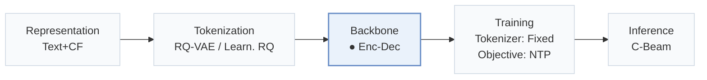
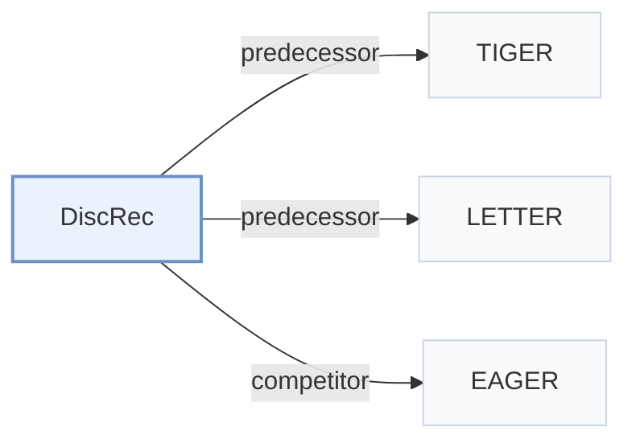

# DiscRec

[← Problem × Stage Matrix](../../README.md#i--backbone) · [Papers by Stage](../index/stages.md) · [Papers by Modality](../index/modality.md) · [Papers by Domain](../index/domain.md) · English | [中文](../zh/papers/discrec.md)

| **Title** | *Disentangled Semantic-Collaborative Modeling for Generative Recommendation* |
| :-- | :-- |
| **Authors** | Liu et al. |
| **Venue** | arXiv’25 |
| **Problem × Stage** | `I. Informativeness` · `Backbone` |
| **Changes** | ● Backbone |
| **SID inputs** | A: `Text` · B: `Text` + `CF` |
| **Domain** | `E-commerce` |
| **Settings** | `cold-start (user)` |
| **Scenario** | `General Item Recommendation`; `Public Benchmarks` |
| **Links** | [Paper](https://arxiv.org/abs/2506.15576) · [Code](https://github.com/Ten-Mao/DiscRec) |
| **Reading level** | Overview (Level 1) |

**On this page**: [TL;DR](#tldr) · [3. Experiments](#3-experimental-findings) · [5. Related Work](#5-connections-to-related-work)

- `Text+CF`: Text representations combined with collaborative signals.
- `RQ-VAE / Learn. RQ`: Residual-quantized variational codes or learnable residual-quantization codes in different configurations.
- `Enc-Dec`: Encoder-decoder.
- `Fixed`: SIDs are built first and not changed while the generator trains.
- `NTP`: Next-token prediction loss only; continuing from a pretrained LLM (SFT) also counts as NTP.
- `C-Beam`: Constrained beam search.

### TL;DR

> [!NOTE]
> DiscRec adds item-level position embeddings and splits semantic and collaborative signals into two gated branches, one with attention inside each item, instead of fusing them in one embedding space.

---

### 3. Experimental Findings

Experimental setup

- **Datasets**: Amazon Review subsets Beauty, Musical Instruments, Arts, Toys; remove users/items with fewer than 5 interactions; keep latest 20 history items, padding shorter histories.
  - Source: [S4.SS1.SSS1.p1](https://arxiv.org/html/2506.15576v2#S4.SS1.SSS1.p1)
- **Split**: Main per-user chronological leave-one-out: most recent item test, second-most-recent validation, remaining interactions training. Additional Beauty user-level random split: train/validation/test 8:1:1, with all models retrained from scratch.
  - Source: [S4.SS1.SSS1.p1](https://arxiv.org/html/2506.15576v2#S4.SS1.SSS1.p1) ; [S4.SS5.p2](https://arxiv.org/html/2506.15576v2#S4.SS5.p2)
- **Candidates**: full catalog; reported full-ranking evaluation over the entire item set, with prefix-tree-constrained generation; history exclusion not reported.
  - Source: [S4.SS1.SSS3.p1](https://arxiv.org/html/2506.15576v2#S4.SS1.SSS3.p1)
- **Visibility**: warm; no unseen-item protocol is defined. Beauty additionally evaluates held-out users and low-popularity targets; LETTER uses pretrained SASRec embeddings, whose test-item exposure is not reported.
  - Source: [S4.SS1.SSS1.p1](https://arxiv.org/html/2506.15576v2#S4.SS1.SSS1.p1) ; [S4.SS1.SSS4.p1](https://arxiv.org/html/2506.15576v2#S4.SS1.SSS4.p1) ; [S4.SS5.p2](https://arxiv.org/html/2506.15576v2#S4.SS5.p2)
- **SID**: 4 RQ-VAE codebooks, 256 entries/level, 32 dimensions/entry, from LLaMA2-7B title/description representations. DiscRec-T uses TIGER tokenization; DiscRec-L uses LETTER collaborative/diversity regularization with pretrained SASRec embeddings. Tokenizer trained before recommender; collision handling not reported.
  - Source: [S4.SS1.SSS4.p1](https://arxiv.org/html/2506.15576v2#S4.SS1.SSS4.p1) ; [S4.SS1.SSS4.p2](https://arxiv.org/html/2506.15576v2#S4.SS1.SSS4.p2) ; [S3.SS2.p2](https://arxiv.org/html/2506.15576v2#S3.SS2.p2)
- **Inference budget**: Prefix-tree-constrained autoregressive decoding, beam 20; Recall/NDCG@5/10; inference hardware, batch size and measured latency not reported. The paper gives theoretical complexity rather than serving measurements.
  - Source: [S4.SS1.SSS3.p1](https://arxiv.org/html/2506.15576v2#S4.SS1.SSS3.p1) ; [S3.SS3.p4](https://arxiv.org/html/2506.15576v2#S3.SS3.p4)
- **Results from**: Own DiscRec-T/DiscRec-L comparisons, ablations and Beauty generalization studies. Baselines follow referenced implementations under a unified generative configuration; EAGER is resized to dimension 128 and its histories are correctly sorted chronologically. No copied baseline result scores stated; run counts/variance not reported.
  - Source: [S4.SS1.SSS4.p1](https://arxiv.org/html/2506.15576v2#S4.SS1.SSS4.p1) ; [S4.T2](https://arxiv.org/html/2506.15576v2#S4.T2) ; [S4.SS5.p2](https://arxiv.org/html/2506.15576v2#S4.SS5.p2)

---

### 5. Connections to Related Work

- **Predecessor** · [TIGER](tiger.md): DiscRec-T inserts disentangled modeling into TIGER.
  - Source: [S1.p5](https://arxiv.org/html/2506.15576v2#S1.p5) ; [S4.SS1.SSS4.p2](https://arxiv.org/html/2506.15576v2#S4.SS1.SSS4.p2)
- **Predecessor** · [LETTER](letter.md): DiscRec-L uses LETTER's collaboratively regularized tokenizer.
  - Source: [S4.SS1.SSS4.p1](https://arxiv.org/html/2506.15576v2#S4.SS1.SSS4.p1) ; [S4.SS1.SSS4.p2](https://arxiv.org/html/2506.15576v2#S4.SS1.SSS4.p2)
- **Competitor** · [EAGER](eager.md): Two-stream baseline compared with DiscRec's single-workflow disentanglement.
  - Source: [S4.SS1.SSS2.p2](https://arxiv.org/html/2506.15576v2#S4.SS1.SSS2.p2) ; [S4.SS1.SSS4.p1](https://arxiv.org/html/2506.15576v2#S4.SS1.SSS4.p1)

[View all papers in this cell](../../README.md#i--backbone)
