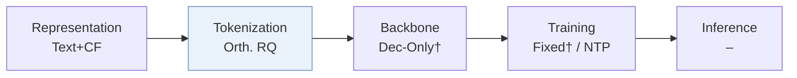
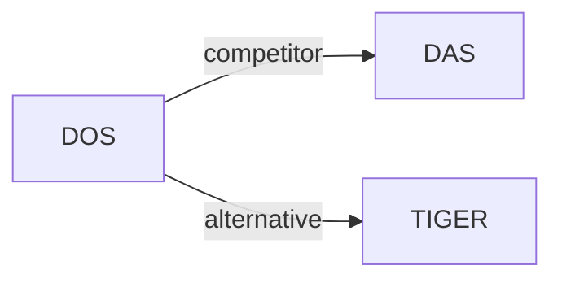

# DOS

*Dual-Flow Orthogonal Semantic IDs for Recommendation in Meituan* — Yin et al. · WWW’26 Short

`III. SID–Model Alignment` · `Tokenization` · `POI`

[Paper](https://arxiv.org/abs/2602.04460) · [Matrix](../../README.md#iii--tokenization)

Reading level: Overview (Level 1) · On this page: [TL;DR](#tldr) · [At a Glance](#at-a-glance) · [3. Experimental Findings](#3-experimental-findings) · [5. Connections to Related Work](#5-connections-to-related-work)

- `Orth. RQ`: Orthogonal residual quantization.
- `NTP`: Next-token prediction loss only; continuing from a pretrained LLM (SFT) also counts as NTP.
- `–`: Not reported in the paper.

### TL;DR

DOS aligns the Semantic ID codebook with the generation space through a user-item dual flow over collaborative signals and rotates the semantic space with orthogonal residual quantization.

### At a Glance

| Aspect | Summary |
| :-- | :-- |
| Research Problem | III. SID–Model Alignment: Can the generator read, write, and reason over SIDs, and do the tokenizer and generator work toward the same goal? |
| Key Contribution | DOS aligns the Semantic ID codebook with the generation space through a user-item dual flow over collaborative signals and rotates the semantic space with orthogonal residual quantization. |
| Modified Stage | Tokenization |

### 3. Experimental Findings

**Experimental setup**

- **Datasets**: Private Meituan production data only: past-year quantization data covering 24M unique items, and 60-day downstream data with 180M interactions. User/item filtering not reported.
- **Split**: Quantization data: train/validation/test 8:1:1, partition method not reported; 50-click histories predict the 51st item. Downstream data: first 57 days training, last 3 days validation; a generation test split is not separately reported.
- **Candidates**: not reported for Hit@10 generation. Quantization classification uses randomly sampled negatives; negative count, sampling distribution and user-history exclusion not reported.
- **Visibility**: warm; no unseen-item protocol is defined. The quantization dataset covers past-year business items; validation/test-item exposure during SID learning is not separately reported.
- **SID**: Qwen3-0.6B-embedding encodes restaurant name/categories, reservation status, prices and dishes into 1,024 dimensions. Dual user/item Transformer flows share an orthogonal residual quantizer: 3 layers x 1,024 codes, with salient-feature selection and residual propagation. Collision handling not reported.
- **Inference budget**: Downstream generation evaluated within HSTU. Model size, beam/decoding constraints, token budget, inference hardware/batch size and latency not reported; batch 1,024 is a training setting.
- **Results from**: Own offline quantization AUC/F1 and HSTU Hit@10 experiments; RQ-KMeans/RQ-VAE baselines are fine-tuned for application metrics. Own one-week A/B test on 30% of production traffic reports +1.15% revenue from adding DOS SIDs to the original baseline.

Sources

- **Datasets**: [S3.SS1.SSS1.p1](https://arxiv.org/html/2602.04460v1#S3.SS1.SSS1.p1) ; #S3.SS1.SSS1.p2
- **Split**: [S3.SS1.SSS1.p2](https://arxiv.org/html/2602.04460v1#S3.SS1.SSS1.p2) ; #S3.SS1.SSS2.p1
- **Candidates**: [S3.SS1.SSS1.p2](https://arxiv.org/html/2602.04460v1#S3.SS1.SSS1.p2) ; #S3.SS1.SSS2.p1 ; #S3.SS2.SSS2.p1
- **Visibility**: [S3.SS1.SSS1.p2](https://arxiv.org/html/2602.04460v1#S3.SS1.SSS1.p2) ; #S3.SS1.SSS2.p1
- **SID**: [S2.SS1.p2](https://arxiv.org/html/2602.04460v1#S2.SS1.p2) ; #S2.SS1.p3 ; #S2.SS1.p6 ; #S2.SS1.p8 ; #S2.SS2.p5 ; #S3.SS1.SSS2.p1
- **Inference budget**: [S3.SS2.SSS2.p1](https://arxiv.org/html/2602.04460v1#S3.SS2.SSS2.p1) ; #S3.SS1.SSS2.p1
- **Results from**: [S3.SS2.p1](https://arxiv.org/html/2602.04460v1#S3.SS2.p1) ; #S3.SS2.SSS2.p1 ; #S3.SS4.p1 ; #S3.SS4.p2

### 5. Connections to Related Work

- **Competitor** · [DAS](das.md): Industrial SID baseline compared offline and within HSTU; DOS contrasts direct sequence-target modeling with DAS's indirect collaborative alignment.
  - Source: https://arxiv.org/html/2602.04460v1#S3.SS2.SSS1.p1 ; #S3.SS2.SSS2.p1
- **Alternative** · [TIGER](tiger.md): Cited as task-agnostic SID learning whose codebook-generation gap motivates context-aware DOS quantization.
  - Source: https://arxiv.org/html/2602.04460v1#S1.p2 (Rajput et al., 2023)

[View all papers in this cell](../../README.md#iii--tokenization)
