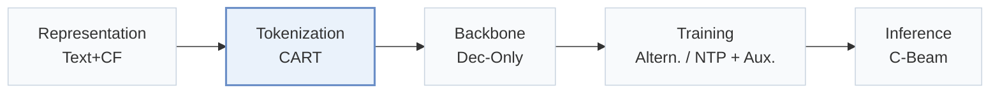
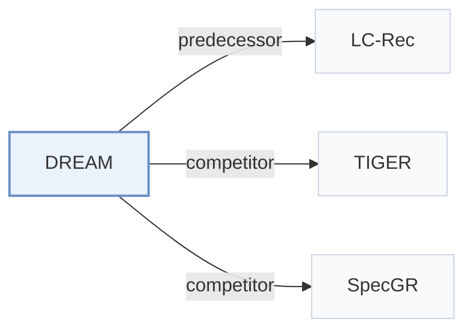

# DREAM

[← Problem × Stage Matrix](../../README.md#vi--tokenization) · [Papers by Stage](../index/stages.md) · [Papers by Modality](../index/modality.md) · English | [中文](../zh/papers/dream.md)

| **Title** | *Dynamic Refinement of Early Assignment Mappings* |
| :-- | :-- |
| **Authors** | Guan et al. |
| **Venue** | arXiv’26 |
| **Problem × Stage** | `VI. Generalization` · `Tokenization` |
| **Links** | [Paper](https://arxiv.org/abs/2606.06947) |
| **Reading level** | Overview (Level 1) |

**On this page**: [TL;DR](#tldr) · [At a Glance](#at-a-glance) · [3. Experiments](#3-experimental-findings) · [5. Related Work](#5-connections-to-related-work)

- `Text+CF`: Text representations combined with collaborative signals.
- `CART`: Collaborative-Aware Refined Tokenization.
- `Dec-Only`: Decoder-only.
- `Altern.`: Tokenizer and generator are updated in turns.
- `NTP + Aux.`: NTP plus another auxiliary loss.
- `C-Beam`: Constrained beam search.

### TL;DR

> [!NOTE]
> DREAM refines cold-start item Semantic IDs after the initial assignment, with an intent-aware tokenizer proposing candidates, the frozen generator selecting one, and a dynamic beam keeping weighted ID hypotheses.

---

### At a Glance

| Aspect | Summary |
| :-- | :-- |
| Research Problem | VI. Generalization: Does it still work for new items, new domains, and shifting interests? |
| Key Contribution | DREAM refines cold-start item Semantic IDs after the initial assignment, with an intent-aware tokenizer proposing candidates, the frozen generator selecting one, and a dynamic beam keeping weighted ID hypotheses. |
| Modified Stage | Tokenization |

---

### 3. Experimental Findings

Experimental setup

- **Datasets**: Amazon Beauty, Sports and Outdoors, Toys and Games; iterative user-core-5 and item-core-3 filtering.
  - Source: Section 4.1: [S4.SS1.p1](https://arxiv.org/html/2606.06947v1#S4.SS1.p1)
- **Split**: Per-user leave-one-out: last interaction test, penultimate validation, earlier interactions training.
  - Source: Section 4.1: [S4.SS1.p3](https://arxiv.org/html/2606.06947v1#S4.SS1.p3)
- **Candidates**: full catalog
  - Source: Section 4.1: [S4.SS1.p3](https://arxiv.org/html/2606.06947v1#S4.SS1.p3)
- **Visibility**: warm; no unseen-item protocol is defined. The cold subset means at most five interactions, not exclusively unseen items; Section 3.1 counts training frequency whereas Section 4.1 says total frequency. Strict item-level generator/tokenizer holdouts: not reported.
  - Source: Sections 3.1 and 4.1 define low-frequency subsets, not a separate unseen-item protocol: [S3.SS1.p2](https://arxiv.org/html/2606.06947v1#S3.SS1.p2) and [S4.SS1.p1](https://arxiv.org/html/2606.06947v1#S4.SS1.p1)
- **SID**: Frozen Llama-3-8B text embeddings initialize shared RQ-VAE SIDs (4 positions x 256 codes). CART refines assignments with collaborative residuals, Gumbel-Softmax/STE, diversity regularization and a static-index anchor, exporting top-8 candidates per cold item. UC3 produces a refined single-path index; CPDE preserves alternative SIDs for multi-path inference (B=4). Collision disambiguation: not reported.
  - Source: Sections 3.1, 3.3-3.6 and 4.1: [S3.SS1.p2](https://arxiv.org/html/2606.06947v1#S3.SS1.p2) ; [S3.SS3](https://arxiv.org/html/2606.06947v1#S3.SS3) ; [S3.SS4](https://arxiv.org/html/2606.06947v1#S3.SS4) ; [S3.SS6](https://arxiv.org/html/2606.06947v1#S3.SS6) ; [S4.SS1.p1](https://arxiv.org/html/2606.06947v1#S4.SS1.p1) ; [S4.SS1.p4](https://arxiv.org/html/2606.06947v1#S4.SS1.p4)
- **Inference budget**: Beam-Aware multi-path inference is primary: B=4 retained SID paths per cold item and one per warm item in a union trie; Compat-Top1 retains one path per item for ablations. LoRA is merged into the backbone at deployment. Evaluation K=5/10/50; numerical autoregressive decoding beam width, inference hardware, batch size and latency: not reported.
  - Source: Sections 3.5-3.6 and 4.1: [S3.SS5](https://arxiv.org/html/2606.06947v1#S3.SS5) ; [S3.SS6](https://arxiv.org/html/2606.06947v1#S3.SS6) ; [S4.SS1.p3](https://arxiv.org/html/2606.06947v1#S4.SS1.p3) ; [S4.SS1.p4](https://arxiv.org/html/2606.06947v1#S4.SS1.p4)
- **Results from**: This paper's experiments: Tables 2/3/4 report cold/overall/warm comparisons with DREAM's primary Beam-Aware view; Table 5 reports stage ablations and Compat-Top1; Figures 2-4 report Sports mechanism diagnostics.
  - Source: Tables 2-5 and Figures 2-4: [S4.T2](https://arxiv.org/html/2606.06947v1#S4.T2) ; [S4.T3](https://arxiv.org/html/2606.06947v1#S4.T3) ; [S4.T4](https://arxiv.org/html/2606.06947v1#S4.T4) ; [S4.T5](https://arxiv.org/html/2606.06947v1#S4.T5) ; [S4.SS4](https://arxiv.org/html/2606.06947v1#S4.SS4) ; [S4.SS5](https://arxiv.org/html/2606.06947v1#S4.SS5)

---

### 5. Connections to Related Work

- **Predecessor** · [LC-Rec](lc-rec.md): DREAM adopts LC-Rec's LLaMA-7B setup, adding staged SID refinement.
  - Source: DREAM v1, Section 4.1: [S4.SS1.p4](https://arxiv.org/html/2606.06947v1#S4.SS1.p4).
- **Competitor** · [TIGER](tiger.md): TIGER is a single-index baseline against DREAM's multi-path retrieval.
  - Source: DREAM v1, Section 4.1 and Table 2: [S4.SS1.p2](https://arxiv.org/html/2606.06947v1#S4.SS1.p2); [S4.T2](https://arxiv.org/html/2606.06947v1#S4.T2).
- **Competitor** · [SpecGR](specgr.md): SpecGR drafts and verifies candidates; DREAM refines cold-item SID assignments.
  - Source: DREAM v1, Section 4.1 and Table 2: [S4.SS1.p2](https://arxiv.org/html/2606.06947v1#S4.SS1.p2); [S4.T2](https://arxiv.org/html/2606.06947v1#S4.T2).

[View all papers in this cell](../../README.md#vi--tokenization)
