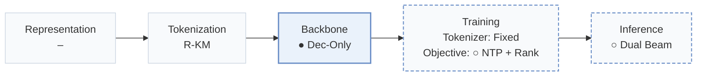
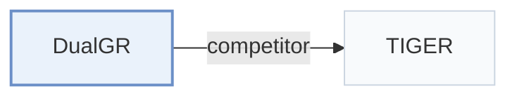

# DualGR

[← Problem × Stage Matrix](../../README.md#vi--backbone) · [Papers by Stage](../index/stages.md) · [Papers by Modality](../index/modality.md) · [Papers by Domain](../index/domain.md) · English | [中文](../zh/papers/dualgr.md)

| **Title** | *Generative Retrieval with Long and Short-Term Interests Modeling* |
| :-- | :-- |
| **Authors** | Yi et al. |
| **Venue** | WWW’26 Short |
| **Problem × Stage** | `VI. Generalization` · `Backbone` |
| **Changes** | ● Backbone · ○ Objective · ○ Inference |
| **SID inputs** | `Other` (RQ-KMeans per OneRec Technical Report, input unstated) |
| **Domain** | `Short video / Live` |
| **Links** | [Paper](https://arxiv.org/abs/2511.12518) |
| **Reading level** | Overview (Level 1) |

**On this page**: [TL;DR](#tldr) · [3. Experiments](#3-experimental-findings) · [5. Related Work](#5-connections-to-related-work)

- `R-KM`: Residual k-means.
- `Dec-Only`: Decoder-only.
- `Fixed`: SIDs are built first and not changed while the generator trains.
- `NTP + Rank`: NTP plus a ranking loss.
- `Dual Beam`: Beam-search decoding in two branches with merged candidates.

### TL;DR

> [!NOTE]
> DualGR adds a long- and short-term interest router, decodes fine Semantic ID levels inside the current coarse bucket, and treats unclicked exposures as coarse-level hard negatives in training.

---

### 3. Experimental Findings

Experimental setup

- **Datasets**: Kuaishou double-column Explore-feed logs; filtering rules and dataset dates not reported.
  - Source: Section 3: [S3.p1](https://arxiv.org/html/2511.12518v1#S3.p1)
- **Split**: Offline split not reported; online A/B test lasts one week with 6% traffic.
  - Source: Sections 3 and 3.1: [S3.p1](https://arxiv.org/html/2511.12518v1#S3.p1) and [S3.SS1.p1](https://arxiv.org/html/2511.12518v1#S3.SS1.p1)
- **Candidates**: not reported
  - Source: Section 3 describes online HR without specifying a full-catalog or sampled-negative protocol: [S3.p1](https://arxiv.org/html/2511.12518v1#S3.p1)
- **Visibility**: warm; no unseen-item protocol is defined. Item-level generator/tokenizer exposure: not reported.
  - Source: Sections 2.1 and 3 do not specify generator/tokenizer item holdouts: [S2.SS1](https://arxiv.org/html/2511.12518v1#S2.SS1) and [S3](https://arxiv.org/html/2511.12518v1#S3)
- **SID**: Residual k-means: 3 levels x 8192 codes; collision handling not reported.
  - Source: Sections 2.2 and 3: [S2.SS2.p1](https://arxiv.org/html/2511.12518v1#S2.SS2.p1) and [S3.p1](https://arxiv.org/html/2511.12518v1#S3.p1)
- **Inference budget**: Two branch-wise beam searches, followed by merging; HR@100/500/1000. Beam width, hardware, inference batch size, and numerical latency not reported; A/B test reports no measurable response-time increase.
  - Source: Section 2.3, Table 1, and Section 3.1: [S2.SS3.p2](https://arxiv.org/html/2511.12518v1#S2.SS3.p2) and [S3.T1](https://arxiv.org/html/2511.12518v1#S3.T1) and [S3.SS1.p1](https://arxiv.org/html/2511.12518v1#S3.SS1.p1)
- **Results from**: Original Table 1: online HR; Table 2: ablations; Section 3.1: A/B results.
  - Source: Tables 1-2 and Section 3.1: [S3.T1](https://arxiv.org/html/2511.12518v1#S3.T1) and [S3.T2](https://arxiv.org/html/2511.12518v1#S3.T2) and [S3.SS1.p1](https://arxiv.org/html/2511.12518v1#S3.SS1.p1)

---

### 5. Connections to Related Work

- **Competitor** · [TIGER](tiger.md): TIGER is reimplemented as the generative baseline; DualGR adds explicit long/short routing and exposure-aware training.
  - Source: DualGR v1, Section 3 and Table 1: [S3.p1](https://arxiv.org/html/2511.12518v1#S3.p1); [S3.T1](https://arxiv.org/html/2511.12518v1#S3.T1).

[View all papers in this cell](../../README.md#vi--backbone)
