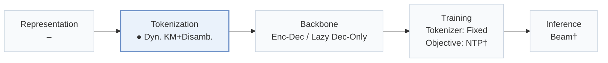
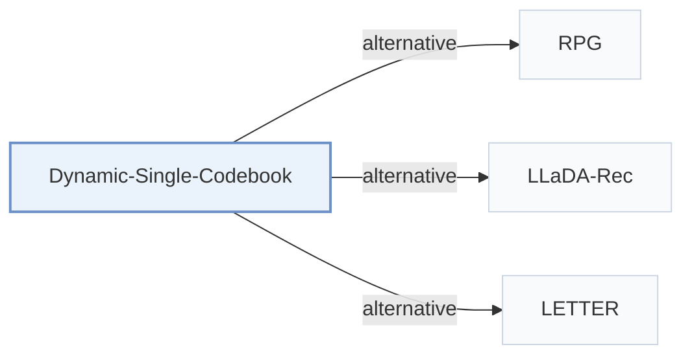

# Dynamic-Single-Codebook

[← Problem × Stage Matrix](../../README.md#v--tokenization) · [Papers by Stage](../index/stages.md) · [Papers by Modality](../index/modality.md) · [Papers by Domain](../index/domain.md) · English | [中文](../zh/papers/dynamic-single-codebook.md)

| **Title** | *From a Static Multi-Level Small Semantic Codebook to a Dynamic Single-Level Large Semantic Codebook for Generative Recommendation* |
| :-- | :-- |
| **Authors** | Xie et al. |
| **Venue** | arXiv’26 |
| **Problem × Stage** | `V. Efficiency` · `Tokenization` |
| **Changes** | ● Tokenization |
| **SID inputs** | `Other` (Precomputed item embeddings, source unstated) |
| **Domain** | `E-commerce` · `Short video / Live` · `Other` (Unnamed industrial platform, business unstated) |
| **Settings** | `catalog-change` |
| **Scenario** | `General Item Recommendation`; `Online Experiment or Deployment` |
| **Links** | [Paper](https://arxiv.org/abs/2608.21012) |
| **Reading level** | Overview (Level 1) |

**On this page**: [TL;DR](#tldr) · [3. Experiments](#3-experimental-findings) · [5. Related Work](#5-connections-to-related-work)

- `Dyn. KM+Disamb.`: Dynamically updated k-means codes combined with disambiguation codes.
- `Enc-Dec / Lazy Dec-Only`: Encoder–decoder and lazy decoder-only backbone variants.
- `Fixed`: SIDs are built first and not changed while the generator trains.
- `NTP†`: Next-token prediction loss (inferred).
- `Beam†`: Autoregressive beam search (inferred).

### TL;DR

> [!NOTE]
> Dynamic-Single-Codebook replaces multi-level residual codes with one token from a large single-level codebook plus a collaborative disambiguation token, and updates the codebook as exposure changes.

---

### 3. Experimental Findings

Experimental setup

- **Datasets**: Amazon Beauty 2014; KuaiRec 2.0 Big Matrix, watch_ratio>=1 and users with >=5 retained events; industrial data. Other filters not reported.
  - Source: Section 4.1: [S4.SS1.p1](https://arxiv.org/html/2608.21012v1#S4.SS1.p1) and [S4.SS1.p2](https://arxiv.org/html/2608.21012v1#S4.SS1.p2)
- **Split**: Per-user chronological last/penultimate holdouts; separate KuaiRec experiment trains through September 3, validates September 4, tests September 5.
  - Source: Section 4.1 and fixed-date protocol: [S4.SS1.p2](https://arxiv.org/html/2608.21012v1#S4.SS1.p2) and [S4.SS3.SSS2.p1](https://arxiv.org/html/2608.21012v1#S4.SS3.SSS2.p1)
- **Candidates**: not reported
  - Source: Candidate protocol absent from Sections 4.1-4.5 and Appendices B-E: [S4.SS1](https://arxiv.org/html/2608.21012v1#S4.SS1)
- **Visibility**: warm; no unseen-item protocol is defined. Fixed-date validation/test days are excluded from codebook fitting; leave-two-out PV weights use all viewing events. Item-level holdouts: not reported.
  - Source: Section 4.1 and fixed-date protocol: [S4.SS1.p2](https://arxiv.org/html/2608.21012v1#S4.SS1.p2) and [S4.SS3.SSS2.p1](https://arxiv.org/html/2608.21012v1#S4.SS3.SSS2.p1)
- **SID**: Public data: [1024,512], semantic plus balanced disambiguation code; baseline [256,256,256].
  - Source: Section 4.1: [S4.SS1.p3](https://arxiv.org/html/2608.21012v1#S4.SS1.p3)
- **Inference budget**: K=5/10; beam width, hardware model, inference batch size, absolute latency/QPS not reported. Single-card QPS gains: 28.57%-47.0%.
  - Source: Sections 4.1 and 4.5: [S4.SS1.p5](https://arxiv.org/html/2608.21012v1#S4.SS1.p5) and [S4.SS5.p1](https://arxiv.org/html/2608.21012v1#S4.SS5.p1)
- **Results from**: Original Table 2, Figures 3/4/6, Tables 9-14; Section 4.5 online A/B.
  - Source: Section 4 and Appendices C-E: [S4](https://arxiv.org/html/2608.21012v1#S4) and [A3](https://arxiv.org/html/2608.21012v1#A3) and [A4](https://arxiv.org/html/2608.21012v1#A4) and [A5](https://arxiv.org/html/2608.21012v1#A5)

---

### 5. Connections to Related Work

- **Alternative** · [RPG](rpg.md): RPG parallelizes long SIDs; this method shortens SIDs.
  - Source: Dynamic-Single-Codebook v1, Section 2.2: [S2.SS2.p2](https://arxiv.org/html/2608.21012v1#S2.SS2.p2).
- **Alternative** · [LLaDA-Rec](llada-rec.md): LLaDA-Rec uses diffusion with adapted beam search; this method reduces token count.
  - Source: Dynamic-Single-Codebook v1, Sections 1 and 2.2: [S1.p4](https://arxiv.org/html/2608.21012v1#S1.p4); [S2.SS2.p2](https://arxiv.org/html/2608.21012v1#S2.SS2.p2).
- **Alternative** · [LETTER](letter.md): LETTER regularizes residual quantization; this method changes semantic codebook width and depth.
  - Source: Dynamic-Single-Codebook v1, Section 2.1: [S2.SS1.p2](https://arxiv.org/html/2608.21012v1#S2.SS1.p2).

[View all papers in this cell](../../README.md#v--tokenization)
