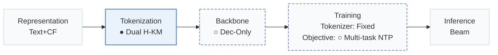
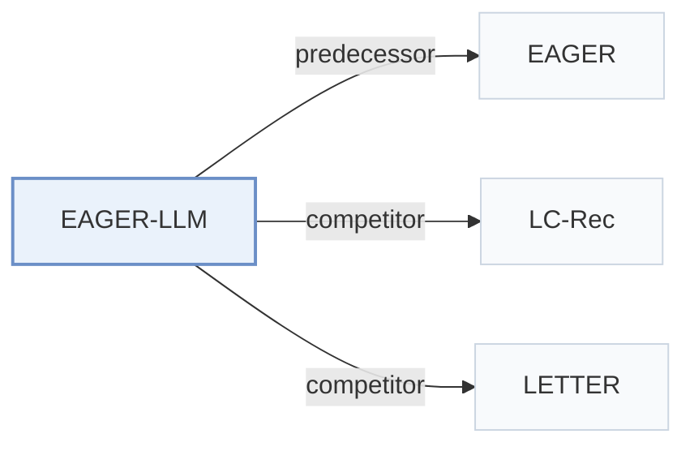

# EAGER-LLM

[← Problem × Stage Matrix](../../README.md#i--tokenization) · [Papers by Stage](../index/stages.md) · [Papers by Modality](../index/modality.md) · [Papers by Domain](../index/domain.md) · English | [中文](../zh/papers/eager-llm.md)

| **Title** | *Enhancing Large Language Models as Recommenders through Exogenous Behavior-Semantic Integration* |
| :-- | :-- |
| **Authors** | Hong et al. |
| **Venue** | WWW’25 |
| **Problem × Stage** | `I. Informativeness` · `Tokenization` |
| **Changes** | ● Tokenization · ○ Backbone · ○ Objective |
| **SID inputs** | semantic: `Text` · behavior: `CF` |
| **Domain** | `E-commerce` |
| **Links** | [Paper](https://arxiv.org/abs/2502.14735) |
| **Reading level** | Overview (Level 1) |

**On this page**: [TL;DR](#tldr) · [3. Experiments](#3-experimental-findings) · [5. Related Work](#5-connections-to-related-work)

- `Text+CF`: Text representations combined with collaborative signals.
- `Dual H-KM`: Dual-source hierarchical k-means over behavioral and semantic embeddings.
- `Dec-Only`: Decoder-only.
- `Fixed`: SIDs are built first and not changed while the generator trains.
- `Multi-task NTP`: The same NTP loss over several tasks.
- `Beam`: Autoregressive beam search over Semantic ID tokens.

### TL;DR

> [!NOTE]
> EAGER-LLM adds dual-source behavior and semantic item indices, multiscale alignment reconstruction tasks, and an annealing adapter to a decoder-only LLM, instead of learning collaborative semantics from scratch.

---

### 3. Experimental Findings

Experimental setup

- **Datasets**: Amazon Beauty, Sports and Outdoors, Musical Instruments; user/item 5-core filtering.
  - Source: Section 4.1.1: [S4.SS1.SSS1.p1](https://arxiv.org/html/2502.14735v1#S4.SS1.SSS1.p1)
- **Split**: Leave-one-out; exact validation allocation not reported; training histories capped at 20 items.
  - Source: Section 4.1.2: [S4.SS1.SSS2.p1](https://arxiv.org/html/2502.14735v1#S4.SS1.SSS2.p1)
- **Candidates**: not reported
  - Source: Sections 4.1-4.4 do not state full-catalog versus sampled-negative evaluation: [S4.SS1.SSS2.p1](https://arxiv.org/html/2502.14735v1#S4.SS1.SSS2.p1)
- **Visibility**: warm; no unseen-item protocol is defined. Item-level tokenizer and DIN behavior-encoder training exposure: not reported.
  - Source: Sections 3.2 and 4.1 define no unseen-item protocol; DIN supplies behavioral embeddings: [S3.SS2.p3](https://arxiv.org/html/2502.14735v1#S3.SS2.p3) and [S4.SS1.SSS3.p1](https://arxiv.org/html/2502.14735v1#S4.SS1.SSS3.p1)
- **SID**: Separate semantic/behavioral hierarchical k-means until singleton clusters; four layers discussed. 256 values/token is a theoretical capacity example; explicit main codebook sizes not reported.
  - Source: Section 3.2 and Figure 6 discussion: [S3.SS2.p5](https://arxiv.org/html/2502.14735v1#S3.SS2.p5) and [S4.SS4.p3](https://arxiv.org/html/2502.14735v1#S4.SS4.p3)
- **Inference budget**: Beam 20; Recall/NDCG@5/10; hardware, inference batch size, latency not reported.
  - Source: Section 4.1.2; Section 4.1.3's batch 128 is training, not inference: [S4.SS1.SSS2.p1](https://arxiv.org/html/2502.14735v1#S4.SS1.SSS2.p1) and [S4.SS1.SSS3.p1](https://arxiv.org/html/2502.14735v1#S4.SS1.SSS3.p1)
- **Results from**: Original Tables 2-4; Table 3 compares LETTER on Instruments using Llama2-7B.
  - Source: Tables 2-4: [S4.T2](https://arxiv.org/html/2502.14735v1#S4.T2) and [S4.T3](https://arxiv.org/html/2502.14735v1#S4.T3) and [S4.T4](https://arxiv.org/html/2502.14735v1#S4.T4)

---

### 5. Connections to Related Work

- **Predecessor** · [EAGER](eager.md): The authors explicitly extend EAGER's dual-source modeling to an LLM backbone.
  - Source: EAGER-LLM v1, Section 2.1: [S2.SS1.p1](https://arxiv.org/html/2502.14735v1#S2.SS1.p1).
- **Competitor** · [LC-Rec](lc-rec.md): LC-Rec supplies the compared vector-quantized IDs; EAGER-LLM separately clusters behavioral and semantic embeddings.
  - Source: EAGER-LLM v1, Sections 3.2/4.2.1 and Table 2: [S3.SS2.p5](https://arxiv.org/html/2502.14735v1#S3.SS2.p5); [S4.SS2.SSS1.p5](https://arxiv.org/html/2502.14735v1#S4.SS2.SSS1.p5); [S4.T2](https://arxiv.org/html/2502.14735v1#S4.T2).
- **Competitor** · [LETTER](letter.md): LETTER regularizes collaborative coding; EAGER-LLM separates the two information sources before LLM fusion.
  - Source: EAGER-LLM v1, Section 4.2.2 and Table 3: [S4.SS2.SSS2.p4](https://arxiv.org/html/2502.14735v1#S4.SS2.SSS2.p4); [S4.T3](https://arxiv.org/html/2502.14735v1#S4.T3).

[View all papers in this cell](../../README.md#i--tokenization)
