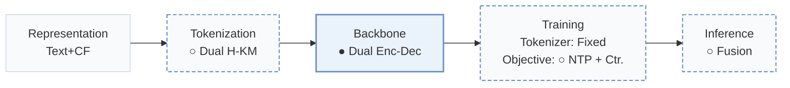
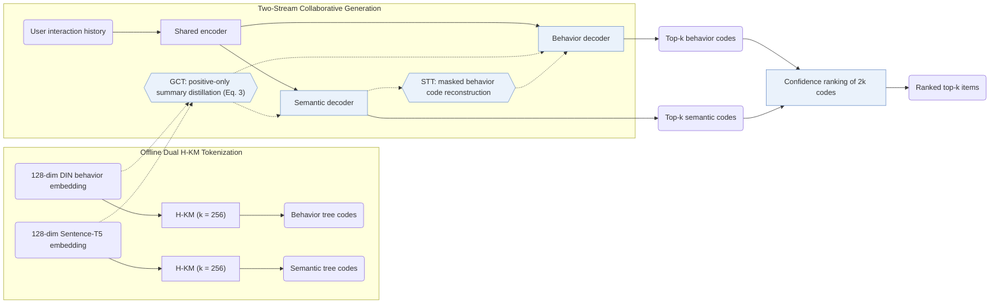
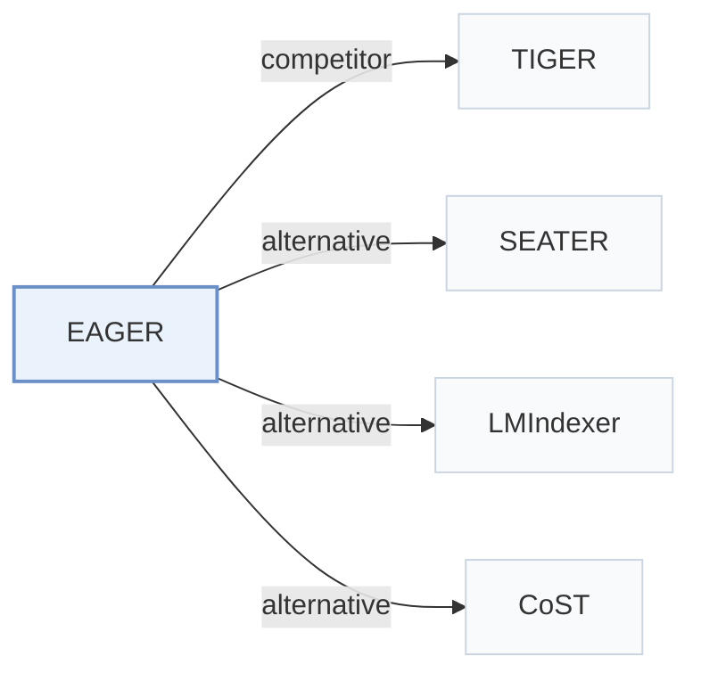

# EAGER

[← Problem × Stage Matrix](../../README.md#i--backbone) · [Papers by Stage](../index/stages.md) · [Papers by Modality](../index/modality.md) · [Papers by Domain](../index/domain.md) · English | [中文](../zh/papers/eager.md)

| **Title** | *Two-Stream Generative Recommender with Behavior-Semantic Collaboration* |
| :-- | :-- |
| **Authors** | Wang et al. |
| **Venue** | KDD’24 |
| **Problem × Stage** | `I. Informativeness` · `Backbone` |
| **Changes** | ○ Tokenization · ● Backbone · ○ Objective · ○ Inference |
| **SID inputs** | semantic: `Text` · behavior: `CF` |
| **Domain** | `E-commerce` · `POI / Local` |
| **Scenario** | `General Item Recommendation`; `Public Benchmarks` |
| **Links** | [Paper](https://arxiv.org/abs/2406.14017) · [Code](https://github.com/yewzz/EAGER) |
| **Reading level** | Reading Notes (Level 2) |

**On this page**: [TL;DR](#tldr) · [At a Glance](#at-a-glance) · [1. Why It Matters](#1-why-this-paper-matters) · [2. Method](#2-how-it-works) · [3. Experiments](#3-experimental-findings) · [4. Limitations](#4-limitations--critical-analysis) · [5. Related Work](#5-connections-to-related-work)

- `Text+CF`: Text representations combined with collaborative signals.
- `Dual H-KM`: Dual-source hierarchical k-means over behavioral and semantic embeddings.
- `Dual Enc-Dec`: Shared encoder paired with two parallel decoders for dual token streams.
- `Fixed`: SIDs are built first and not changed while the generator trains.
- `NTP + Ctr.`: NTP plus a contrastive loss.
- `Fusion`: Fusion of candidate scores decoded from parallel token branches.

### TL;DR

> [!NOTE]
> EAGER decodes behavior tokens and semantic tokens with a shared encoder and two decoders, adding contrastive and semantic-guided transfer tasks, instead of using only one type of item information.

---

### At a Glance

| Aspect | Summary |
| :-- | :-- |
| Key Findings | Across Amazon Beauty, Sports and Outdoors, Toys and Games, and Yelp, EAGER outperforms sequential, tree-based, and single-stream generative baselines (Table 2), removing the two-stream architecture causes the largest ablation drop (Sec. 4.3, Table 3), and inference on Beauty takes 0.0325 s per sample against 0.0281 s for TIGER (Table 6). |
| Limitation | Inference runs beam search (size 100) in two separate decoders and merges 2k candidates by log-probability confidence, increasing per-sample latency on Beauty from 0.0281 s (TIGER) to 0.0325 s (Sec. 3.6, Table 6). |

---

### 1. Why This Paper Matters

Single-stream generative recommenders construct each item's Semantic ID (SID) from either behavioral interactions or content semantics alone, discarding signals from the other view or forcing both into one shared quantization space (Abstract). EAGER combines behavioral and semantic signals through three design choices: a unified two-stream encoder-decoder architecture, separate hierarchical code trees for each view, and cross-stream alignment tasks.

> "we propose (1) a two-stream generation architecture leveraging a shared encoder and two separate decoders to decode behavior tokens and semantic tokens with a confidence-based ranking strategy" (Abstract)

---

### 2. How It Works

#### Behavior Codes and Semantic Codes

EAGER extracts 128-dimensional behavioral embeddings from a pre-trained DIN model and 128-dimensional semantic embeddings from Sentence-T5 (Sec. 4.1). Each embedding space is independently partitioned by hierarchical k-means (`Dual H-KM`) with branching factor $`k = 256`$ until every leaf cluster contains a single item, producing two separate hierarchical SIDs per item (Sec. 3.3, Sec. 4.1).

#### Global Contrastive Task

In the global contrastive task (GCT), each decoder appends a stream summary token and distills its hidden state toward that stream's frozen item embedding (DIN or Sentence-T5) using a positive-only cosine-distance metric rather than negative-sampling InfoNCE (Sec. 3.4, Eq. 3).

#### Semantic-Guided Transfer Task

To transfer semantic structure into behavioral decoding without collapsing the two code spaces, the semantic-guided transfer task (STT) uses the semantic stream's global feature to reconstruct masked behavior tokens and trains a binary relevance classifier (Sec. 3.5).

#### Confidence-Based Ranking

At inference, beam search in each decoder returns $`k`$ candidate paths, and EAGER ranks the combined $`2k`$ predictions by their sequence log-probability confidence score (Sec. 3.6).

> "With the 2*k prediction codes, we calculate the log probabilities over the codes as the confidence score of each prediction, which is similar to the perplexity used in the language model and the lower value indicates more confidence." (Sec. 3.6)

---

### 3. Experimental Findings

Experimental setup

- **Datasets**: Amazon Product Reviews (May 1996-July 2018): Beauty, Sports and Outdoors, Toys and Games; Yelp 2019 transactions (January-December 2019). 5-core filtering of users and items. Sizes (users / items / interactions): Beauty 22,363 / 12,101 / 198,360; Sports 35,598 / 18,357 / 296,175; Toys 19,412 / 11,924 / 167,526; Yelp 30,431 / 20,033 / 316,354.
  - Source: 5-core filtering and timestamp ordering: [S4.SS1.p1](https://arxiv.org/html/2406.14017v2#S4.SS1.p1); Amazon and Yelp scope: [S4.I2.i1.p1](https://arxiv.org/html/2406.14017v2#S4.I2.i1.p1) and [S4.I2.i2.p1](https://arxiv.org/html/2406.14017v2#S4.I2.i2.p1); statistics: [S3.T1](https://arxiv.org/html/2406.14017v2#S3.T1).
- **Split**: Chronological leave-one-out: last item for test, second-to-last for validation, the rest for training; training histories limited to 20 items.
  - Source: Leave-one-out allocation and history cap: [S4.SS1.p2](https://arxiv.org/html/2406.14017v2#S4.SS1.p2).
- **Candidates**: not reported (full catalog versus sampled evaluation candidates); top-k lists come from beam search in two streams.
  - Source: Metrics only: [S4.SS1.p2](https://arxiv.org/html/2406.14017v2#S4.SS1.p2).
- **Visibility**: warm; no unseen-item protocol is defined.
  - Source: Standard leave-one-out with no cold-start experiment: [S4.SS1.p2](https://arxiv.org/html/2406.14017v2#S4.SS1.p2).
- **SID**: Two codes per item: behavior codes from DIN embeddings and semantic codes from Sentence-T5 embeddings, each built by hierarchical k-means with k=256 branches, splitting until each child cluster contains a single item; code length l follows from the item count and k.
  - Source: Dual hierarchical k-means codes until each leaf holds one item: [S3.SS3.p3](https://arxiv.org/html/2406.14017v2#S3.SS3.p3); k=256: [S4.SS1.p3](https://arxiv.org/html/2406.14017v2#S4.SS1.p3); length varies with k: [S4.SS5.p2](https://arxiv.org/html/2406.14017v2#S4.SS5.p2).
- **Inference budget**: Beam search in each of the behavior and semantic decoders returns top-k codes; the 2k predictions are merged by log-probability confidence. Table 6 (Beauty, top-k=5, beam size 100): 0.0325 s per sample for EAGER versus 0.0281 s for TIGER; hardware and inference batch size not reported. Recall and NDCG at 5, 10, and 20.
  - Source: Two-stream beam search and confidence ranking: [S3.SS6.p2](https://arxiv.org/html/2406.14017v2#S3.SS6.p2); speed table: [S4.T6](https://arxiv.org/html/2406.14017v2#S4.T6).
- **Results from**: Table 2 (Beauty, Sports, Toys, Yelp versus sequential, tree-based, and generative baselines); Table 3 (TSG/GCT/STT ablations); Tables 4, 5, 7 and Figures 4-6 (modalities, summary token, contrastive metric, layers, cluster number); Table 6 (inference speed).
  - Source: Main: [S3.T2](https://arxiv.org/html/2406.14017v2#S3.T2); ablations: [S4.T3](https://arxiv.org/html/2406.14017v2#S4.T3); analyses: [S4.T4](https://arxiv.org/html/2406.14017v2#S4.T4), [S4.T5](https://arxiv.org/html/2406.14017v2#S4.T5), [S4.T7](https://arxiv.org/html/2406.14017v2#S4.T7); speed: [S4.T6](https://arxiv.org/html/2406.14017v2#S4.T6).

- Main comparison: across 5-core filtered Beauty (22,363 users / 12,101 items), Sports and Outdoors (35,598 / 18,357), Toys and Games (19,412 / 11,924), and Yelp (30,431 / 20,033), EAGER outperforms sequential, tree-based, and generative baselines on Recall@5/10/20 and NDCG@5/10/20 (Abstract, Table 1, Table 2).
- Component ablations: removing the two-stream generation (TSG) architecture causes the steepest drop, and removing GCT hurts accuracy more than removing STT (Sec. 4.3, Table 3).

  > "Removing GCT leads to more performance drops than removing STT, suggesting that global information distillation of the inter-code is slightly more important than the knowledge flow between the intra-code." (Sec. 4.3)

- Visual modality extension: on Yelp, extracting item-cover visual features with ViT-B to form a visual semantic code stream also improves over single-stream baselines (Sec. 4.4, Table 4).
- Inference latency: on Beauty with top-$`k = 5`$ and beam size 100, EAGER averages 0.0325 s per sample versus 0.0281 s for TIGER, 0.0499 s for RecForest, and 0.2349 s for full-catalog DIN scoring (Table 6).

---

### 4. Limitations & Critical Analysis

**Our analysis.**

- Both code trees rely on frozen DIN and Sentence-T5 encoders followed by offline hierarchical k-means down to single-item leaves, which suggests that catalog updates require re-clustering both trees.
- Merging two top-$`k`$ beam lists by raw log-probability confidence assumes that token log probabilities are calibrated across the behavior and semantic decoders (Sec. 3.6).
- CoST injects contrastive alignment into the tokenizer itself (`C-RQ`); EAGER keeps its `Dual H-KM` codes fixed and applies contrastive distillation (`GCT`) and cross-stream reconstruction (`STT`) inside the `Dual Enc-Dec` generator.

---

### 5. Connections to Related Work

- **Competitor** · [TIGER](tiger.md): TIGER decodes one content-based semantic ID; EAGER decodes behavior and semantic hierarchical k-means codes with two decoders and merges them by confidence.
  - Source: EAGER v2, baselines: [S4.I6.i1.p1](https://arxiv.org/html/2406.14017v2#S4.I6.i1.p1); Table 2: [S3.T2](https://arxiv.org/html/2406.14017v2#S3.T2); speed comparison in Table 6: [S4.T6](https://arxiv.org/html/2406.14017v2#S4.T6).
- **Alternative** · [SEATER](seater.md): SEATER also uses tree-structured identifiers for generative retrieval; EAGER builds separate behavior and semantic trees and aligns them with contrastive and transfer tasks.
  - Source: EAGER v2, Section 1 cites SEATER among generative recommenders: [S1.p2](https://arxiv.org/html/2406.14017v2#S1.p2); not a baseline in Table 2.
- **Alternative** · [LMIndexer](lmindexer.md): LMIndexer learns semantic IDs from text with a language model; EAGER keeps fixed k-means codes from pre-trained behavior and semantic encoders.
  - Source: EAGER v2, Section 2 cites LMIndexer among semantic indexing methods: [S2.p2](https://arxiv.org/html/2406.14017v2#S2.p2); not a baseline in Table 2.
- **Alternative** · [CoST](cost.md): CoST learns RQ codes with a contrastive objective, whereas EAGER clusters frozen embeddings and adds contrastive learning on the generator side.
  - Source: EAGER v2, Section 2 cites CoST: [S2.p2](https://arxiv.org/html/2406.14017v2#S2.p2). CoST v2, Section 2 in turn cites EAGER as a hierarchical k-means tokenizer: [S2.p2](https://arxiv.org/html/2404.14774v2#S2.p2).

[View all papers in this cell](../../README.md#i--backbone)
