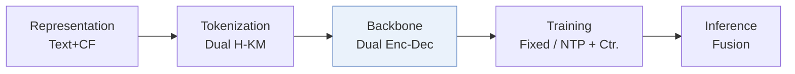
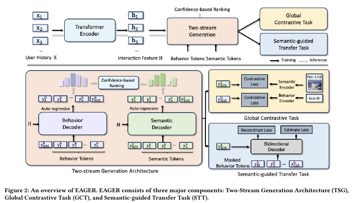
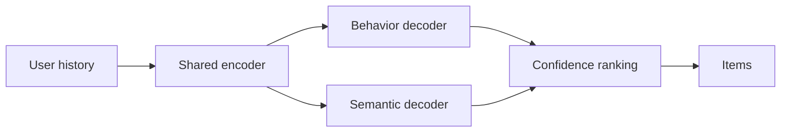
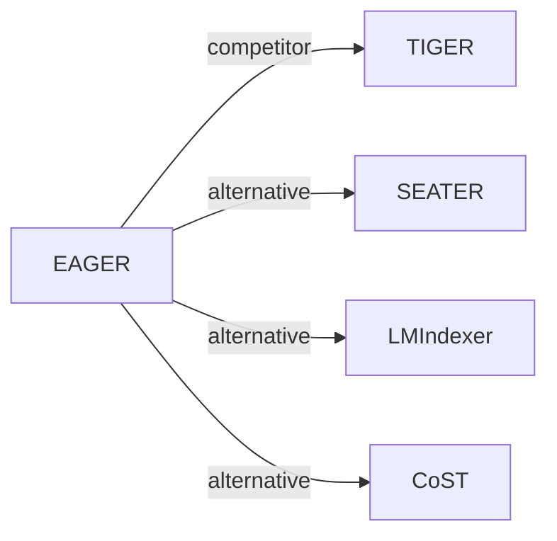

# EAGER

*Two-Stream Generative Recommender with Behavior-Semantic Collaboration* — Wang et al. · KDD’24

`I. Informativeness` · `Backbone` · [Paper](https://arxiv.org/abs/2406.14017) · [Code](https://github.com/yewzz/EAGER) · [Matrix](../../README.md#i--backbone) · [中文](../zh/papers/eager.md)

Reading level: Reading Notes (Level 2) · On this page: [TL;DR](#tldr) · [At a Glance](#at-a-glance) · [1. Why It Matters](#1-why-this-paper-matters) · [2. Method](#2-how-it-works) · [3. Experiments](#3-experimental-findings) · [4. Limitations](#4-limitations--critical-analysis) · [5. Related Work](#5-connections-to-related-work)

- `Fixed`: SIDs are built first and not changed while the generator trains.
- `NTP + Ctr.`: NTP plus a contrastive loss.

### TL;DR

> [!NOTE]
> EAGER decodes behavior tokens and semantic tokens with a shared encoder and two decoders, adding contrastive and semantic-guided transfer tasks, instead of using only one type of item information.

### At a Glance

| Aspect | Summary |
| :-- | :-- |
| Research Problem | I. Informativeness: Do the SIDs, or the model reading them, carry the collaborative and multimodal signals recommendation needs? |
| Key Contribution | EAGER decodes behavior tokens and semantic tokens with a shared encoder and two decoders, adding contrastive and semantic-guided transfer tasks, instead of using only one type of item information. |
| Modified Stage | Backbone |
| Key Findings | Removing the two-stream architecture causes the largest drop in the ablation (Sec. 4.3, Table 3), and on Beauty EAGER takes 0.0325 s per sample at inference against 0.0281 s for TIGER (Table 6). |
| Limitation | Inference runs beam search in two decoders and merges the results, which makes EAGER slower than TIGER (Sec. 3.6, Table 6). |

### 1. Why This Paper Matters

Existing generative methods use either the behavioral or the semantic side of item information, which the authors state neglects their complementary nature (Abstract). EAGER names three requirements for combining them: one architecture for both feature types, independent learning for each, and interaction between them (Abstract).

> "we propose (1) a two-stream generation architecture leveraging a shared encoder and two separate decoders to decode behavior tokens and semantic tokens with a confidence-based ranking strategy" (Abstract)

Based on arXiv v2.

### 2. How It Works

#### Behavior Codes and Semantic Codes

A pre-trained DIN model is the behavior encoder and Sentence-T5 is the semantic encoder, with hidden size 128 (Sec. 4.1). Hierarchical k-means with cluster number 256 turns each embedding into codes (Sec. 3.3, Sec. 4.1).

#### Global Contrastive Task

A summary token in each stream is distilled toward that stream's pre-trained item embedding with a positive-only contrastive metric instead of InfoNCE (Sec. 3.4, Eq. 3).

#### Semantic-Guided Transfer Task

The semantic global feature reconstructs masked behavior codes, and a recognition objective adds a relevance classifier (Sec. 3.5).

#### Confidence-Based Ranking

Each decoder returns $`k`$ codes, and the $`2k`$ predictions are ranked by log probability (Sec. 3.6).

> "With the 2*k prediction codes, we calculate the log probabilities over the codes as the confidence score of each prediction, which is similar to the perplexity used in the language model and the lower value indicates more confidence." (Sec. 3.6)

### 3. Experimental Findings

Experimental setup

- **Datasets**: Amazon Product Reviews (May 1996-July 2018): Beauty, Sports and Outdoors, Toys and Games; Yelp 2019 transactions (January-December 2019). 5-core filtering of users and items. Sizes (users / items / interactions): Beauty 22,363 / 12,101 / 198,360; Sports 35,598 / 18,357 / 296,175; Toys 19,412 / 11,924 / 167,526; Yelp 30,431 / 20,033 / 316,354.
  - Source: 5-core filtering and timestamp ordering: [S4.SS1.p1](https://arxiv.org/html/2406.14017v2#S4.SS1.p1); Amazon and Yelp scope: [S4.I2.i1.p1](https://arxiv.org/html/2406.14017v2#S4.I2.i1.p1) and [S4.I2.i2.p1](https://arxiv.org/html/2406.14017v2#S4.I2.i2.p1); statistics: [S3.T1](https://arxiv.org/html/2406.14017v2#S3.T1).
- **Split**: Chronological leave-one-out: last item for test, second-to-last for validation, the rest for training; training histories limited to 20 items.
  - Source: Leave-one-out allocation and history cap: [S4.SS1.p2](https://arxiv.org/html/2406.14017v2#S4.SS1.p2).
- **Candidates**: not reported (full catalog versus sampled evaluation candidates); top-k lists come from beam search in two streams.
  - Source: Metrics only: [S4.SS1.p2](https://arxiv.org/html/2406.14017v2#S4.SS1.p2).
- **Visibility**: warm; no unseen-item protocol is defined.
  - Source: Standard leave-one-out with no cold-start experiment: [S4.SS1.p2](https://arxiv.org/html/2406.14017v2#S4.SS1.p2).
- **SID**: Two codes per item: behavior codes from DIN embeddings and semantic codes from Sentence-T5 embeddings, each built by hierarchical k-means with k=256 branches, splitting until each child cluster contains a single item; code length l follows from the item count and k.
  - Source: Dual hierarchical k-means codes until each leaf holds one item: [S3.SS3.p3](https://arxiv.org/html/2406.14017v2#S3.SS3.p3); k=256: [S4.SS1.p3](https://arxiv.org/html/2406.14017v2#S4.SS1.p3); length varies with k: [S4.SS5.p2](https://arxiv.org/html/2406.14017v2#S4.SS5.p2).
- **Inference budget**: Beam search in each of the behavior and semantic decoders returns top-k codes; the 2k predictions are merged by log-probability confidence. Table 6 (Beauty, top-k=5, beam size 100): 0.0325 s per sample for EAGER versus 0.0281 s for TIGER; hardware and inference batch size not reported. Recall and NDCG at 5, 10, and 20.
  - Source: Two-stream beam search and confidence ranking: [S3.SS6.p2](https://arxiv.org/html/2406.14017v2#S3.SS6.p2); speed table: [S4.T6](https://arxiv.org/html/2406.14017v2#S4.T6).
- **Results from**: Table 2 (Beauty, Sports, Toys, Yelp versus sequential, tree-based, and generative baselines); Table 3 (TSG/GCT/STT ablations); Tables 4, 5, 7 and Figures 4-6 (modalities, summary token, contrastive metric, layers, cluster number); Table 6 (inference speed).
  - Source: Main: [S3.T2](https://arxiv.org/html/2406.14017v2#S3.T2); ablations: [S4.T3](https://arxiv.org/html/2406.14017v2#S4.T3); analyses: [S4.T4](https://arxiv.org/html/2406.14017v2#S4.T4), [S4.T5](https://arxiv.org/html/2406.14017v2#S4.T5), [S4.T7](https://arxiv.org/html/2406.14017v2#S4.T7); speed: [S4.T6](https://arxiv.org/html/2406.14017v2#S4.T6).

- Main comparison: EAGER reports better performance than existing methods on four public benchmarks (Abstract).
- Ablation: removing the global contrastive task (GCT) costs more than removing the semantic-guided transfer task (STT) (Sec. 4.3, Table 3).

  > "Removing GCT leads to more performance drops than removing STT, suggesting that global information distillation of the inter-code is slightly more important than the knowledge flow between the intra-code." (Sec. 4.3)

- Visual features: on Yelp, ViT-B features of item covers produce a visual semantic code (Sec. 4.4, Table 4).
- Inference speed: with top-k 5 and beam size 100 on Beauty, RecForest takes 0.0499 s and DIN 0.2349 s per sample (Table 6).

### 4. Limitations & Critical Analysis

**Our analysis.**

- Both code sets come from frozen encoders and offline clustering. This suggests that adding items requires re-running both encoders and the clustering.
- CoST trains its codes with a contrastive objective (`C-RQ`); EAGER keeps `Dual H-KM` codes fixed and adds the contrastive term on the generator side.

### 5. Connections to Related Work

- **Competitor** · [TIGER](tiger.md): TIGER decodes one content-based semantic ID; EAGER decodes behavior and semantic hierarchical k-means codes with two decoders and merges them by confidence.
  - Source: EAGER v2, baselines: https://arxiv.org/html/2406.14017v2#S4.I6.i1.p1; Table 2: https://arxiv.org/html/2406.14017v2#S3.T2; speed comparison in Table 6: https://arxiv.org/html/2406.14017v2#S4.T6.
- **Alternative** · [SEATER](seater.md): SEATER also uses tree-structured identifiers for generative retrieval; EAGER builds separate behavior and semantic trees and aligns them with contrastive and transfer tasks.
  - Source: EAGER v2, Section 1 cites SEATER among generative recommenders: https://arxiv.org/html/2406.14017v2#S1.p2; not a baseline in Table 2.
- **Alternative** · [LMIndexer](lmindexer.md): LMIndexer learns semantic IDs from text with a language model; EAGER keeps fixed k-means codes from pre-trained behavior and semantic encoders.
  - Source: EAGER v2, Section 2 cites LMIndexer among semantic indexing methods: https://arxiv.org/html/2406.14017v2#S2.p2; not a baseline in Table 2.
- **Alternative** · [CoST](cost.md): CoST learns RQ codes with a contrastive objective, whereas EAGER clusters frozen embeddings and adds contrastive learning on the generator side.
  - Source: EAGER v2, Section 2 cites CoST: https://arxiv.org/html/2406.14017v2#S2.p2. CoST v2, Section 2 in turn cites EAGER as a hierarchical k-means tokenizer: https://arxiv.org/html/2404.14774v2#S2.p2.

[View all papers in this cell](../../README.md#i--backbone)
