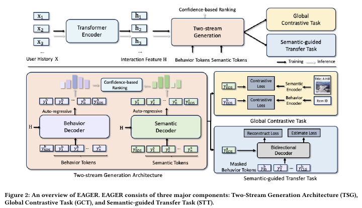

# EAGER

*Two-Stream Generative Recommender with Behavior-Semantic Collaboration* — Wang et al. · KDD’24

`I. Informativeness` · `Backbone`

[Paper](https://arxiv.org/abs/2406.14017) · [Code](https://github.com/yewzz/EAGER) · [Matrix](../../README.md#i--backbone)

Reading level: Overview (Level 1) · On this page: [At a Glance](#at-a-glance) · [2. How It Works](#2-how-it-works) · [5. Connections to Related Work](#5-connections-to-related-work)

| Representation | Tokenization | Backbone | Training | Inference |
| :-: | :-: | :-: | :-: | :-: |
| `Text+CF` | `Dual H-KM` | **`Dual Enc-Dec`** | `Fixed / NTP + Ctr.` | `Fusion` |

- `Fixed`: SIDs are built first and not changed while the generator trains.
- `NTP + Ctr.`: NTP plus a contrastive loss.

### At a Glance

| Aspect | Summary |
| :-- | :-- |
| Research Problem | I. Informativeness: Do the SIDs, or the model reading them, carry the collaborative and multimodal signals recommendation needs? |
| Modified Stage | Backbone |

### 2. How It Works

## 旧卡片说明

迁自 `d61aa6c:papers/eager.md`。保留方法说明、实验叙述与局限；本轮只对照现有记录处理明确冲突，未重新逐句核查原论文。分类和规格以页面上方由记录生成的表格为准。

### EAGER：行为-语义协同双流生成式推荐

> EAGER 通过共享编码器和双解码器分别生成行为码与语义码，再以内部置信度合并两路结果，用于直接生成下一物品的推荐列表。

### 研究动机与问题定义

现有生成式推荐通常只利用行为信息或语义信息，难以同时保留用户偏好与物品内容的互补性。EAGER 将二者置于同一生成式检索框架中，目标是直接生成物品标识，而不是先生成表示再依赖 ANN 检索。

### TL;DR（核心摘要）

`用户历史 → 共享编码器 → 行为/语义双码 → 双解码器生成 → 置信度合并 → 推荐物品`

模型先使用预训练 DIN 提取行为表示、Sentence-T5 提取文本语义表示，并分别通过层次化 K-means 构造两套物品码。共享 Transformer 编码用户历史，两个独立解码器并行自回归生成行为码和语义码。推理时分别用束搜索取得候选，再依据两路码的对数概率进行置信度排序和去重，直接得到 Top-K 物品。图像语义也在 Yelp 的扩展实验中进行了验证。

### 输入与使用场景

| 方面 | 说明 |
|---|---|
| 使用信息 | 用户交互行为、物品文本语义；扩展实验加入图像信息 |
| 信息融入位置 | 行为和语义分别进入码构建；历史进入共享编码器；辅助任务进入训练目标 |
| 语义标识结构 | 层次化序列码；长度由树的分支数决定 |
| 适用场景 | 常规序列推荐、多模态语义扩展 |

### 方法设计

#### 3.1 行为码与语义码构建
EAGER 分别从用户行为表示和物品语义表示学习两套层次化 code。行为侧使用预训练行为模型，语义侧使用文本/图像编码器，再通过层次化聚类获得可生成的离散码。两套码保留不同信息来源的互补性。

#### 3.2 双流生成器
共享 Transformer 编码器读取用户历史，行为解码器和语义解码器分别预测下一物品的行为码与语义码。训练包含各自的生成损失，并通过全局对比任务约束用户、物品和两类语义空间之间的一致性。旧卡片的速览还列有重构与识别辅助目标。

#### 3.3 语义引导迁移与推理
语义引导迁移任务把一类标识或模态作为条件，要求模型预测另一类标识，从而让两条生成流相互传递信息。推理时两路分别进行束搜索，再用内部置信度合并、去重和排序，输出最终物品。

#### 3.4 扩展实验
论文还讨论了图像信息、不同码结构和速度。行为码、语义码及迁移任务的消融共同支持双流设计。

### 实验结论

- 在 Beauty、Sports、Toys 和 Yelp 四个公开数据集上，EAGER 在论文报告的多数 Recall/NDCG 指标上优于比较方法。
- 去除双流架构、全局对比任务或语义引导迁移任务都会造成性能下降，其中双流架构影响最大。
- 双流生成在 Beauty 上报告了优于 DIN 和 TIGER 的推理速度，但缺少完整线上服务评测。

### 局限性与研究定位

#### 局限性
- 行为码依赖预训练 DIN，语义码依赖预训练模态编码器和离线层次化聚类，新增物品的更新流程未充分说明。
- 两路结果仍需要内部置信度排序；虽然不是外部精排器，但会增加合并和去重逻辑。
- 实验主要采用 Amazon/Yelp 的 5-core 留一法设置，真实动态目录、开放物品空间和长期线上收益尚未验证。

#### 研究定位
EAGER 的主要贡献是将行为码和语义码分流建模，并通过全局对比学习和语义引导迁移实现协同。它适合放在“多源信息融合”和“生成式推荐架构”章节；后续研究可关注动态物品更新、码结构稳定性与可扩展解码。

### 相关资源

- [论文原文](https://doi.org/10.1145/3637528.3671775)
- [开源代码（作者仓库）](https://github.com/yewzz/EAGER)

### 标签

`行为-语义协同` · `双流生成` · `层次化聚类` · `对比学习` · `序列推荐` · `束搜索`

### 架构图来源

*图源：原论文，图2。图片使用许可待核实。*

---

### 旧总表补充

来源：`d61aa6c:tables/all-methods.md`。

- 核心贡献：联合生成行为码与语义码。
- 使用场景：多源序列推荐。

### 5. Connections to Related Work

[View all papers in this cell](../../README.md#i--backbone)
