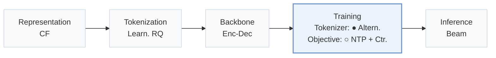
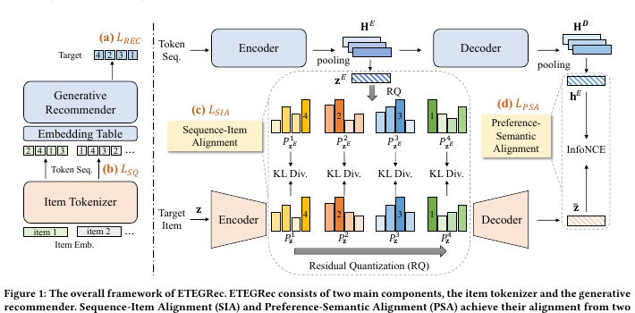
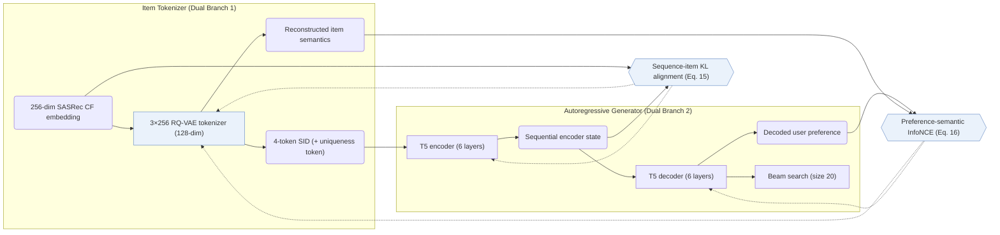
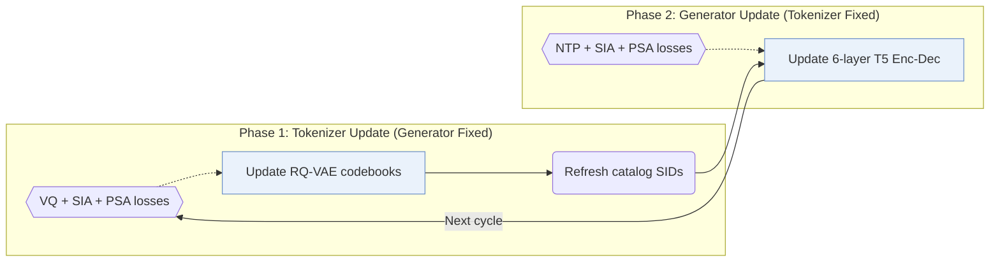
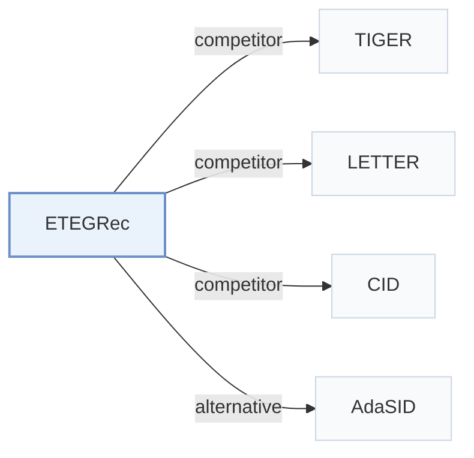

# ETEGRec

[← Problem × Stage Matrix](../../README.md#iii--training) · [Papers by Stage](../index/stages.md) · [Papers by Modality](../index/modality.md) · [Papers by Domain](../index/domain.md) · English | [中文](../zh/papers/etegrec.md)

| **Title** | *Generative recommender with end-to-end learnable item tokenization* |
| :-- | :-- |
| **Authors** | Liu et al. |
| **Venue** | SIGIR’25 |
| **Problem × Stage** | `III. SID–Model Alignment` · `Training` |
| **Changes** | ● Tokenizer · ○ Objective |
| **SID inputs** | `CF` |
| **Domain** | `E-commerce` |
| **Settings** | `cold-start (user)` |
| **Links** | [Paper](https://arxiv.org/abs/2409.05546) · [Code](https://github.com/RUCAIBox/ETEGRec) |
| **Reading level** | Reading Notes (Level 2) |

**On this page**: [TL;DR](#tldr) · [At a Glance](#at-a-glance) · [1. Why It Matters](#1-why-this-paper-matters) · [2. Method](#2-how-it-works) · [3. Experiments](#3-experimental-findings) · [4. Limitations](#4-limitations--critical-analysis) · [5. Related Work](#5-connections-to-related-work)

- `CF`: Collaborative filtering signal.
- `Learn. RQ`: End-to-end or alternatingly updated learnable residual quantization.
- `Enc-Dec`: Encoder-decoder.
- `Altern.`: Tokenizer and generator are updated in turns.
- `NTP + Ctr.`: NTP plus a contrastive loss.
- `Beam`: Autoregressive beam search over Semantic ID tokens.

### TL;DR

> [!NOTE]
> ETEGRec trains the item tokenizer and the generator in alternation with sequence-item and preference-semantic alignment losses, instead of building the tokenizer separately before generator training.

---

### At a Glance

| Aspect | Summary |
| :-- | :-- |
| Key Findings | Under full-catalog evaluation on Amazon Musical Instruments, Industrial and Scientific, and Video Games, ETEGRec outperforms sequential and fixed-tokenizer generative baselines (including TIGER, LETTER, and CID) on Recall@5/10 and NDCG@5/10, and keeps its lead on held-out unseen users (the 5% with the fewest interactions) (Sec. 4.2, Sec. 4.4.1, Table 3, Table 4, Fig. 2). |
| Limitation | The RQ-VAE tokenizer reads collaborative item embeddings only, leaving unseen items without interaction history unable to receive tokens, while measured inference latency is not reported (Sec. 3.2.1, Sec. 3.5). |

---

### 1. Why This Paper Matters

Two-stage generative recommenders train the Semantic ID (SID) tokenizer offline and freeze item codes before training the sequence generator, leaving discrete tokenization decoupled from autoregressive recommendation (Abstract). ETEGRec unifies item tokenization and sequence-to-sequence recommendation inside a dual encoder-decoder architecture coupled by two alignment objectives and alternating optimization.

> "To enable synergistic interaction between these components, we propose a recommendation-oriented alignment strategy, which includes two key optimization objectives: sequence-item alignment and preference-semantic alignment." (Abstract)

---

### 2. How It Works

#### Item Tokenizer

The item tokenizer feeds each item's 256-dimensional collaborative embedding (extracted from SASRec) into a 3-level RQ-VAE with 256 codewords of dimension 128 per level, appending an extra token to resolve collisions so every item has a unique 4-token SID (Sec. 3.2.1, Sec. 4.1.4).

> "By taking a hierarchical scheme, we essentially organize the items in a tree-structured way, which is particularly suitable for generative tasks." (Sec. 3.2.1)

#### Recommendation-Oriented Alignment

Sequence-item alignment minimizes divergence between the quantized token distributions produced from the generator encoder's sequential state and from the target item's collaborative embedding (Sec. 1, Eq. 15). Preference-semantic alignment contrasts the user preference representation output by the generator decoder against the target item semantics reconstructed by the RQ-VAE decoder (Sec. 1, Eq. 16).

#### Alternating Optimization

Direct joint gradient updates shift discrete item codes while the generator is still adapting; ETEGRec instead alternates between a tokenizer phase (updating the RQ-VAE under quantization and both alignment losses with the generator frozen) and a generator phase (updating the T5 generator under next-token prediction and alignment losses with SIDs frozen) (Sec. 3.4).

> "In order to improve the training stability, we propose an alternating optimization strategy to mutually train the item tokenizer and the generative recommender." (Sec. 3.4)

---

### 3. Experimental Findings

Experimental setup

- **Datasets**: Amazon 2023 Reviews (May 1996-September 2023): Musical Instruments, Industrial and Scientific, Video Games; 5-core filtering of users and items; sequences capped at 50 items. Sizes (users / items / interactions): Instrument 57,439 / 24,587 / 511,836; Scientific 50,985 / 25,848 / 412,947; Game 94,762 / 25,612 / 814,586.
  - Source: Amazon 2023 subsets, 5-core filter, sequence length 50: [S4.SS1.SSS1.p1](https://arxiv.org/html/2409.05546v3#S4.SS1.SSS1.p1); statistics: [S4.T2](https://arxiv.org/html/2409.05546v3#S4.T2).
- **Split**: Per-user leave-one-out: latest interaction for test, second most recent for validation, the rest for training. Separate generalization study on Instrument and Scientific: the 5% of users with the least history are removed from training and evaluated as unseen users.
  - Source: Leave-one-out allocation: [S4.SS1.SSS3.p1](https://arxiv.org/html/2409.05546v3#S4.SS1.SSS3.p1); unseen-user experiment: [S4.SS4.SSS1.p1](https://arxiv.org/html/2409.05546v3#S4.SS4.SSS1.p1).
- **Candidates**: full catalog
  - Source: Full ranking over the entire item set: [S4.SS1.SSS3.p1](https://arxiv.org/html/2409.05546v3#S4.SS1.SSS3.p1).
- **Visibility**: Main: warm; no unseen-item protocol is defined. The generalization study holds out users, not items: test users are unseen by both tokenizer and generator training, while item visibility is unchanged.
  - Source: Main protocol and unseen-user study: [S4.SS1.SSS3.p1](https://arxiv.org/html/2409.05546v3#S4.SS1.SSS3.p1) and [S4.SS4.SSS1.p1](https://arxiv.org/html/2409.05546v3#S4.SS4.SSS1.p1).
- **SID**: 3-level RQ-VAE x 256 codewords (dimension 128) over 256-dimensional SASRec collaborative embeddings; following TIGER, an extra token is appended to make IDs unique. The tokenizer is trained jointly with the generator by alternating optimization.
  - Source: 3 codebooks x 256, dimension 128, extra uniqueness token: [S4.SS1.SSS4.p1](https://arxiv.org/html/2409.05546v3#S4.SS1.SSS4.p1); SASRec embeddings as input: [S4.SS1.SSS4.p1](https://arxiv.org/html/2409.05546v3#S4.SS1.SSS4.p1).
- **Inference budget**: Beam size 20 for all generative models; T5 with 6 encoder and 6 decoder layers. Recall and NDCG at K=5 and 10. Hardware, inference batch size, and latency: not reported (Section 3.5 gives asymptotic complexity only).
  - Source: Beam size 20 for all generative models: [S4.SS1.SSS3.p1](https://arxiv.org/html/2409.05546v3#S4.SS1.SSS3.p1); backbone: [S4.SS1.SSS5.p1](https://arxiv.org/html/2409.05546v3#S4.SS1.SSS5.p1); complexity analysis only: [S3.SS5.SSS2.p1](https://arxiv.org/html/2409.05546v3#S3.SS5.SSS2.p1).
- **Results from**: Table 3 (Instrument, Scientific, Game; paired t-tests); Table 4 (alignment-loss and alternating-training ablations); Figure 2 (seen versus unseen users); Figure 4 (alignment coefficients).
  - Source: Main: [S4.T3](https://arxiv.org/html/2409.05546v3#S4.T3); ablation: [S4.T4](https://arxiv.org/html/2409.05546v3#S4.T4); seen/unseen users: [S4.F2](https://arxiv.org/html/2409.05546v3#S4.F2); coefficients: [S4.F4](https://arxiv.org/html/2409.05546v3#S4.F4).

- Full-catalog comparison: on 5-core filtered Amazon 2023 Musical Instruments (57,439 users / 24,587 items), Industrial and Scientific (50,985 / 25,848), and Video Games (94,762 / 25,612) with beam size 20, ETEGRec significantly outperforms sequential and generative baselines (paired t-tests) across Recall@5/10 and NDCG@5/10 (Abstract, Sec. 4.1, Table 2, Table 3).
- Alignment and optimization ablations: removing either sequence-item alignment, preference-semantic alignment, or alternating updates lowers accuracy, confirming that end-to-end tokenizer feedback improves over frozen tokenization (Table 4, Fig. 4).
- Generalization to unseen users: holding out the 5% of users with the fewest interactions on Musical Instruments and Industrial and Scientific from both tokenizer and generator training, ETEGRec outperforms LETTER and TIGER on both seen and unseen user groups (Sec. 4.4.1, Fig. 2).

---

### 4. Limitations & Critical Analysis

**Our analysis.**

- Refreshing the tokenizer between alternating phases reassigns item SIDs mid-training, requiring periodic full-catalog re-indexing to keep generator inputs consistent (Sec. 3.4).
- Section 3.5 analyzes asymptotic complexity rather than reporting wall-clock training overhead or serving latency.
- LETTER also regularizes `Learn. RQ` codes with collaborative signals, but freezes the tokenizer before generator training (`Fixed`); ETEGRec updates the `Learn. RQ` tokenizer and `Enc-Dec` generator in turns (`Altern.`).

---

### 5. Connections to Related Work

- **Competitor** · [TIGER](tiger.md): TIGER trains the RQ-VAE tokenizer once and freezes it; ETEGRec optimizes tokenizer and generator alternately with sequence-item and preference-semantic alignment losses.
  - Source: ETEGRec v3, baselines and implementation: [S4.SS1.SSS2.p1](https://arxiv.org/html/2409.05546v3#S4.SS1.SSS2.p1) and [S4.SS1.SSS5.p2](https://arxiv.org/html/2409.05546v3#S4.SS1.SSS5.p2); Table 3: [S4.T3](https://arxiv.org/html/2409.05546v3#S4.T3); unseen-user comparison in Figure 2: [S4.SS4.SSS1.p1](https://arxiv.org/html/2409.05546v3#S4.SS4.SSS1.p1).
- **Competitor** · [LETTER](letter.md): LETTER regularizes the tokenizer before generator training; ETEGRec couples the two end to end during training.
  - Source: ETEGRec v3, Table 1 comparison of methods: [S3.T1](https://arxiv.org/html/2409.05546v3#S3.T1); baselines with official implementation: [S4.SS1.SSS5.p2](https://arxiv.org/html/2409.05546v3#S4.SS1.SSS5.p2); Table 3: [S4.T3](https://arxiv.org/html/2409.05546v3#S4.T3).
- **Competitor** · [CID](cid.md): CID and SID (Hua et al., 2023) are fixed indexing schemes for P5-style models; ETEGRec learns the tokenizer jointly with the recommender.
  - Source: ETEGRec v3, Table 1: [S3.T1](https://arxiv.org/html/2409.05546v3#S3.T1); baselines CID and SID with official implementations: [S4.SS1.SSS5.p2](https://arxiv.org/html/2409.05546v3#S4.SS1.SSS5.p2); Table 3: [S4.T3](https://arxiv.org/html/2409.05546v3#S4.T3).
- **Alternative** · [AdaSID](adasid.md): AdaSID keeps a pre-trained tokenizer and adapts collision repulsion, contrasting with ETEGRec's end-to-end downstream supervision of the tokenizer.
  - Source: Evidence is from the later AdaSID paper, Section 2.2: [S2.SS2.p1](https://arxiv.org/html/2604.23522v1#S2.SS2.p1).

[View all papers in this cell](../../README.md#iii--training)
