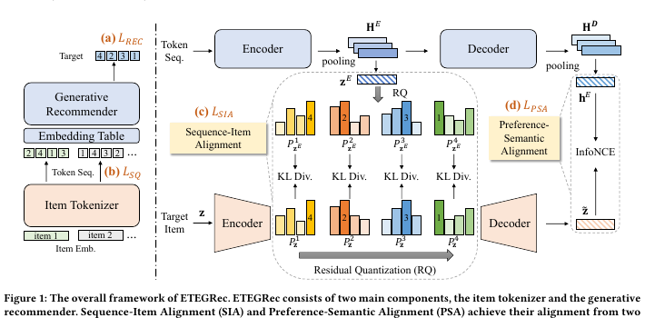

# ETEGRec

*Generative recommender with end-to-end learnable item tokenization* — Liu et al. · SIGIR’25

`III. SID–Model Alignment` · `Training`

[Paper](https://arxiv.org/abs/2409.05546) · [Matrix](../../README.md#iii--training)

Reading level: Overview (Level 1) · On this page: [At a Glance](#at-a-glance) · [2. How It Works](#2-how-it-works) · [5. Connections to Related Work](#5-connections-to-related-work)

| Representation | Tokenization | Backbone | Training | Inference |
| :-: | :-: | :-: | :-: | :-: |
| `CF` | `Learn. RQ` | `Enc-Dec` | **`Altern. / NTP + Ctr.`** | `Beam` |

- `CF`: Collaborative filtering signal.
- `Enc-Dec`: Encoder-decoder.
- `Altern.`: Tokenizer and generator are updated in turns.
- `NTP + Ctr.`: NTP plus a contrastive loss.

### At a Glance

| Aspect | Summary |
| :-- | :-- |
| Research Problem | III. SID–Model Alignment: Can the generator read, write, and reason over SIDs, and do the tokenizer and generator work toward the same goal? |
| Modified Stage | Training |

### 2. How It Works

## 旧卡片说明

迁自 `d61aa6c:papers/etegrec.md`。保留方法说明、实验叙述与局限；本轮只对照现有记录处理明确冲突，未重新逐句核查原论文。分类和规格以页面上方由记录生成的表格为准。

### ETEGRec：端到端可学习物品分词生成推荐

> ETEGRec 将物品分词器与生成推荐器联合优化，让物品标识同时保留语义信息并适应推荐偏好。

### 研究动机与问题定义

固定或独立训练的物品 tokenizer 可能与推荐目标不一致，导致语义标识虽可解释却不利于生成。ETEGRec 研究 tokenizer 与推荐器的端到端协同学习。

### TL;DR（核心摘要）

`物品交互表示 → RQ-VAE分词器 → 语义/偏好对齐 → 生成推荐器 → SID对应物品`

物品编码器和残差量化器产生离散 token，生成推荐器根据用户历史预测 token 序列。序列-物品对齐和偏好-语义对齐损失共同更新两部分，使标识学习受到推荐任务反向约束。

### 输入与使用场景

| 方面 | 说明 |
|---|---|
| 使用信息 | 物品交互表示、用户历史和交互偏好 |
| 信息融入位置 | tokenizer 表示、生成输入和对齐目标 |
| 语义标识结构 | 多级离散序列 |
| 适用场景 | 常规生成式序列推荐 |

### 方法设计

#### 3.1 问题定义与双编码器-解码器结构
ETEGRec 同时包含物品 tokenizer 和生成推荐器。物品交互表示经过编码器和 RQ-VAE 得到离散表示，用户历史中的物品表示则由生成推荐器编码并用于预测下一物品 token。

#### 3.2 物品 tokenizer
tokenizer 通过残差量化逐层编码语义向量，并由解码器重构物品表示。量化损失和重构损失保证离散标识仍保留语义信息；相比固定 tokenizer，它可以在推荐训练中继续接受任务反馈。

#### 3.3 推荐导向对齐
序列-物品对齐让生成器学习历史与目标物品之间的关系，偏好-语义对齐则约束推荐偏好表示和重构语义表示的一致性。两个目标共同推动 tokenizer 从“语义可重构”转向“推荐可生成”。

#### 3.4 交替优化
论文在 tokenizer 和生成推荐器之间进行交替更新，避免离散 code 变化导致推荐器训练不稳定。推理时生成完整 item token 序列，并映射到目标物品。

### 实验结论

- 端到端可学习 tokenizer 在已见和未见用户设置下均有收益。
- 序列-物品与偏好-语义两类对齐目标均有效。

### 局限性与研究定位

#### 局限性
- 交替优化增加训练复杂度和稳定性要求。
- 动态新增物品、低延迟解码和开放目录场景仍未充分验证。

#### 研究定位
ETEGRec 的关键贡献是让 SID 学习直接接受推荐目标的反馈，适合放在“端到端物品标识学习”章节。

### 相关资源

- [论文原文](https://arxiv.org/abs/2409.05546)

### 标签

`端到端学习` · `物品分词` · `语义-偏好对齐` · `生成式推荐`

### 架构图来源

*图源：原论文，图1。图片使用许可待核实。*

---

### 旧总表补充

来源：`d61aa6c:tables/all-methods.md`。

- 核心贡献：端到端对齐tokenizer与推荐器。
- 使用场景：序列推荐。

### 5. Connections to Related Work

[View all papers in this cell](../../README.md#iii--training)
