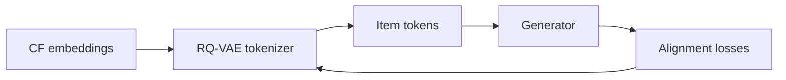

# ETEGRec

*Generative recommender with end-to-end learnable item tokenization* — Liu et al. · SIGIR’25

`III. SID–Model Alignment` · `Training`

[Paper](https://arxiv.org/abs/2409.05546) · [Code](https://github.com/RUCAIBox/ETEGRec) · [Matrix](../../README.md#iii--training)

Reading level: Reading Notes (Level 2) · On this page: [TL;DR](#tldr) · [At a Glance](#at-a-glance) · [1. Why This Paper Matters](#1-why-this-paper-matters) · [2. How It Works](#2-how-it-works) · [3. Experimental Findings](#3-experimental-findings) · [4. Limitations & Critical Analysis](#4-limitations--critical-analysis) · [5. Connections to Related Work](#5-connections-to-related-work)

| Representation | Tokenization | Backbone | Training | Inference |
| :-: | :-: | :-: | :-: | :-: |
| `CF` | `Learn. RQ` | `Enc-Dec` | **`Altern. / NTP + Ctr.`** | `Beam` |

- `CF`: Collaborative filtering signal.
- `Enc-Dec`: Encoder-decoder.
- `Altern.`: Tokenizer and generator are updated in turns.
- `NTP + Ctr.`: NTP plus a contrastive loss.

### TL;DR

ETEGRec trains the item tokenizer and the generator in alternation with sequence-item and preference-semantic alignment losses, instead of building the tokenizer separately before generator training.

### At a Glance

| Aspect | Summary |
| :-- | :-- |
| Research Problem | III. SID–Model Alignment: Can the generator read, write, and reason over SIDs, and do the tokenizer and generator work toward the same goal? |
| Key Contribution | ETEGRec trains the item tokenizer and the generator in alternation with sequence-item and preference-semantic alignment losses, instead of building the tokenizer separately before generator training. |
| Modified Stage | Training |
| Limitation | The tokenizer reads collaborative embeddings only, so items without interactions have no input to tokenize (Sec. 3.2.1). |

### 1. Why This Paper Matters

Current approaches often train item tokenization and generative recommendation as separate processes (Abstract). ETEGRec couples the two inside one dual encoder-decoder framework (Abstract).

> "To enable synergistic interaction between these components, we propose a recommendation-oriented alignment strategy, which includes two key optimization objectives: sequence-item alignment and preference-semantic alignment." (Abstract)

Based on arXiv v3.

### 2. How It Works

*Figure source: Fig. 1, original paper.*

#### Item Tokenizer

The tokenizer takes each item's collaborative embedding, for example from SASRec, and quantizes it hierarchically (Sec. 3.2.1).

> "By taking a hierarchical scheme, we essentially organize the items in a tree-structured way, which is particularly suitable for generative tasks." (Sec. 3.2.1)

#### Recommendation-Oriented Alignment

Sequence-item alignment matches the quantized token distributions of the encoder's sequential states and of the target item's embedding (Sec. 1, Eq. 15). Preference-semantic alignment contrasts the user preference from the decoder with the target item semantics reconstructed by the RQ-VAE (Sec. 1, Eq. 16).

#### Alternating Optimization

In the tokenizer phase, the quantization loss and both alignment losses update the tokenizer while the generator stays fixed (Sec. 3.4).

> "In order to improve the training stability, we propose an alternating optimization strategy to mutually train the item tokenizer and the generative recommender." (Sec. 3.4)

### 3. Experimental Findings

**Experimental setup**

- **Datasets**: Amazon 2023 Reviews (May 1996-September 2023): Musical Instruments, Industrial and Scientific, Video Games; 5-core filtering of users and items; sequences capped at 50 items. Sizes (users / items / interactions): Instrument 57,439 / 24,587 / 511,836; Scientific 50,985 / 25,848 / 412,947; Game 94,762 / 25,612 / 814,586.
  - Source: Amazon 2023 subsets, 5-core filter, sequence length 50: https://arxiv.org/html/2409.05546v3#S4.SS1.SSS1.p1; statistics: https://arxiv.org/html/2409.05546v3#S4.T2.
- **Split**: Per-user leave-one-out: latest interaction for test, second most recent for validation, the rest for training. Separate generalization study on Instrument and Scientific: the 5% of users with the least history are removed from training and evaluated as unseen users.
  - Source: Leave-one-out allocation: https://arxiv.org/html/2409.05546v3#S4.SS1.SSS3.p1; unseen-user experiment: https://arxiv.org/html/2409.05546v3#S4.SS4.SSS1.p1.
- **Candidates**: full catalog
  - Source: Full ranking over the entire item set: https://arxiv.org/html/2409.05546v3#S4.SS1.SSS3.p1.
- **Visibility**: Main: warm; no unseen-item protocol is defined. The generalization study holds out users, not items: test users are unseen by both tokenizer and generator training, while item visibility is unchanged.
  - Source: Main protocol and unseen-user study: https://arxiv.org/html/2409.05546v3#S4.SS1.SSS3.p1 and https://arxiv.org/html/2409.05546v3#S4.SS4.SSS1.p1.
- **SID**: 3-level RQ-VAE x 256 codewords (dimension 128) over 256-dimensional SASRec collaborative embeddings; following TIGER, an extra token is appended to make IDs unique. The tokenizer is trained jointly with the generator by alternating optimization.
  - Source: 3 codebooks x 256, dimension 128, extra uniqueness token: https://arxiv.org/html/2409.05546v3#S4.SS1.SSS4.p1; SASRec embeddings as input: https://arxiv.org/html/2409.05546v3#S4.SS1.SSS4.p1.
- **Inference budget**: Beam size 20 for all generative models; T5 with 6 encoder and 6 decoder layers. Recall and NDCG at K=5 and 10. Hardware, inference batch size, and latency: not reported (Section 3.5 gives asymptotic complexity only).
  - Source: Beam size 20 for all generative models: https://arxiv.org/html/2409.05546v3#S4.SS1.SSS3.p1; backbone: https://arxiv.org/html/2409.05546v3#S4.SS1.SSS5.p1; complexity analysis only: https://arxiv.org/html/2409.05546v3#S3.SS5.SSS2.p1.
- **Results from**: Table 3 (Instrument, Scientific, Game; paired t-tests); Table 4 (alignment-loss and alternating-training ablations); Figure 2 (seen versus unseen users); Figure 4 (alignment coefficients).
  - Source: Main: https://arxiv.org/html/2409.05546v3#S4.T3; ablation: https://arxiv.org/html/2409.05546v3#S4.T4; seen/unseen users: https://arxiv.org/html/2409.05546v3#S4.F2; coefficients: https://arxiv.org/html/2409.05546v3#S4.F4.

- Main comparison: ETEGRec reports better performance than sequential and generative baselines (Abstract).
- Seen and unseen users: with the 5% of users with the fewest interactions on Instrument and Scientific held out as new users, ETEGRec outperforms LETTER and TIGER on both groups (Sec. 4.4.1, Fig. 2).

### 4. Limitations & Critical Analysis

**Our analysis.**

- Updating the tokenizer changes item token sequences during training. The alternating schedule is the paper's answer to this instability.
- LETTER also uses `Learn. RQ` codes but trains them before the generator; ETEGRec trains them together with the generator.

### 5. Connections to Related Work

- **Competitor** · [TIGER](tiger.md): TIGER trains the RQ-VAE tokenizer once and freezes it; ETEGRec optimizes tokenizer and generator alternately with sequence-item and preference-semantic alignment losses.
  - Source: ETEGRec v3, baselines and implementation: https://arxiv.org/html/2409.05546v3#S4.SS1.SSS2.p1 and https://arxiv.org/html/2409.05546v3#S4.SS1.SSS5.p2; Table 3: https://arxiv.org/html/2409.05546v3#S4.T3; unseen-user comparison in Figure 2: https://arxiv.org/html/2409.05546v3#S4.SS4.SSS1.p1.
- **Competitor** · [LETTER](letter.md): LETTER regularizes the tokenizer before generator training; ETEGRec couples the two end to end during training.
  - Source: ETEGRec v3, Table 1 comparison of methods: https://arxiv.org/html/2409.05546v3#S3.T1; baselines with official implementation: https://arxiv.org/html/2409.05546v3#S4.SS1.SSS5.p2; Table 3: https://arxiv.org/html/2409.05546v3#S4.T3.
- **Competitor** · [CID](cid.md): CID and SID (Hua et al., 2023) are fixed indexing schemes for P5-style models; ETEGRec learns the tokenizer jointly with the recommender.
  - Source: ETEGRec v3, Table 1: https://arxiv.org/html/2409.05546v3#S3.T1; baselines CID and SID with official implementations: https://arxiv.org/html/2409.05546v3#S4.SS1.SSS5.p2; Table 3: https://arxiv.org/html/2409.05546v3#S4.T3.
- **Alternative** · [AdaSID](adasid.md): AdaSID keeps a pre-trained tokenizer and adapts collision repulsion, contrasting with ETEGRec's end-to-end downstream supervision of the tokenizer.
  - Source: Evidence is from the later AdaSID paper, Section 2.2: https://arxiv.org/html/2604.23522v1#S2.SS2.p1.

[View all papers in this cell](../../README.md#iii--training)
