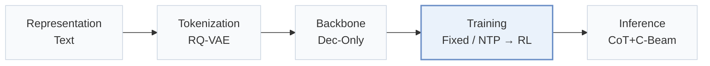
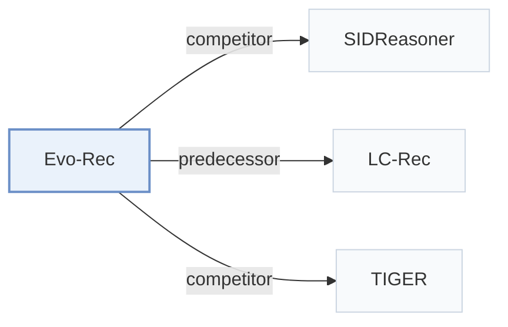

# Evo-Rec

[← Problem × Stage Matrix](../../README.md#iii--training) · [Papers by Stage](../index/stages.md) · [Papers by Modality](../index/modality.md) · English | [中文](../zh/papers/evo-rec.md)

| **Title** | *Learning Better Reasoning for Generative Recommendation with Semantic IDs* |
| :-- | :-- |
| **Authors** | Zhu et al. |
| **Venue** | arXiv’26 |
| **Problem × Stage** | `III. SID–Model Alignment` · `Training` |
| **Links** | [Paper](https://arxiv.org/abs/2609.29973) · [Code](https://github.com/mengdanzhu/evo-rec) |
| **Reading level** | Overview (Level 1) |

**On this page**: [TL;DR](#tldr) · [At a Glance](#at-a-glance) · [3. Experiments](#3-experimental-findings) · [5. Related Work](#5-connections-to-related-work)

- `Text`: Textual item metadata (titles, descriptions, categories, or prompts).
- `RQ-VAE`: Residual-Quantized Variational AutoEncoder.
- `Dec-Only`: Decoder-only.
- `Fixed`: SIDs are built first and not changed while the generator trains.
- `NTP → RL`: NTP, then reinforcement learning (GRPO, GBPO, etc.).
- `CoT+C-Beam`: Reasoning followed by constrained beam-search decoding.

### TL;DR

> [!NOTE]
> Evo-Rec aligns Semantic IDs with text and behavior, fine-tunes on sampled reasoning traces that improve target prediction, and then refines reasoning with catalog-constrained reinforcement learning.

---

### At a Glance

| Aspect | Summary |
| :-- | :-- |
| Research Problem | III. SID–Model Alignment: Can the generator read, write, and reason over SIDs, and do the tokenizer and generator work toward the same goal? |
| Key Contribution | Evo-Rec aligns Semantic IDs with text and behavior, fine-tunes on sampled reasoning traces that improve target prediction, and then refines reasoning with catalog-constrained reinforcement learning. |
| Modified Stage | Training |

---

### 3. Experimental Findings

Experimental setup

- **Datasets**: Amazon Video Games, Office Products, Industrial and Scientific; 5-core filtering.
  - Source: Section 4.1.1: [S4.SS1.SSS1.p1](https://arxiv.org/html/2609.29973v1#S4.SS1.SSS1.p1)
- **Split**: Per-user chronological 80%/10%/10% training/validation/test; sliding histories capped at 10.
  - Source: Section 4.1.1: [S4.SS1.SSS1.p1](https://arxiv.org/html/2609.29973v1#S4.SS1.SSS1.p1)
- **Candidates**: full catalog
  - Source: Section 4.1.1 explicitly ranks against the entire item catalog: [S4.SS1.SSS1.p2](https://arxiv.org/html/2609.29973v1#S4.SS1.SSS1.p2)
- **Visibility**: warm; no unseen-item protocol is defined. Item-level visibility to RQ-VAE and SID-language alignment: not reported.
  - Source: Sections 3.2 and 4.1: [S3.SS2](https://arxiv.org/html/2609.29973v1#S3.SS2) and [S4.SS1.SSS1.p1](https://arxiv.org/html/2609.29973v1#S4.SS1.SSS1.p1)
- **SID**: Three RQ-VAE semantic tokens; codebook sizes and collision handling not reported.
  - Source: Sections 3.2 and 4.1.3: [S3.SS2.p1](https://arxiv.org/html/2609.29973v1#S3.SS2.p1) and [S4.SS1.SSS3.p1](https://arxiv.org/html/2609.29973v1#S4.SS1.SSS3.p1)
- **Inference budget**: Reasoning followed by catalog-trie beam search, beam 10; inference hardware, batch size, reasoning cap, and latency not reported.
  - Source: Section 4.1.3 separates training rollout settings from inference: [S4.SS1.SSS3.p1](https://arxiv.org/html/2609.29973v1#S4.SS1.SSS3.p1)
- **Results from**: Original Table 2; baseline numbers quoted from SIDReasoner, with Evo-Rec evaluated on the same split/protocol.
  - Source: Section 4.1.2 and Table 2: [S4.SS1.SSS2.p1](https://arxiv.org/html/2609.29973v1#S4.SS1.SSS2.p1) and [S4.T2](https://arxiv.org/html/2609.29973v1#S4.T2)

---

### 5. Connections to Related Work

- **Competitor** · [SIDReasoner](sidreasoner.md): Evo-Rec compares against SIDReasoner and adds utility-selected reasoning plus ranking-aware RL.
  - Source: Evo-Rec v1, Sections 2.2/4.1.2 and Table 2: [S2.SS2.p1](https://arxiv.org/html/2609.29973v1#S2.SS2.p1); [S4.SS1.SSS2.p1](https://arxiv.org/html/2609.29973v1#S4.SS1.SSS2.p1); [S4.T2](https://arxiv.org/html/2609.29973v1#S4.T2).
- **Predecessor** · [LC-Rec](lc-rec.md): The SID-language alignment stage explicitly follows LC-Rec before adding reasoning optimization.
  - Source: Evo-Rec v1, Section 3.2: [S3.SS2.p1](https://arxiv.org/html/2609.29973v1#S3.SS2.p1).
- **Competitor** · [TIGER](tiger.md): TIGER directly generates SIDs; Evo-Rec generates and optimizes an intermediate reasoning sequence.
  - Source: Evo-Rec v1, Sections 2.1/3.1 and Table 2: [S2.SS1](https://arxiv.org/html/2609.29973v1#S2.SS1); [S3.SS1.p1](https://arxiv.org/html/2609.29973v1#S3.SS1.p1); [S4.T2](https://arxiv.org/html/2609.29973v1#S4.T2).

[View all papers in this cell](../../README.md#iii--training)
