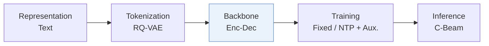
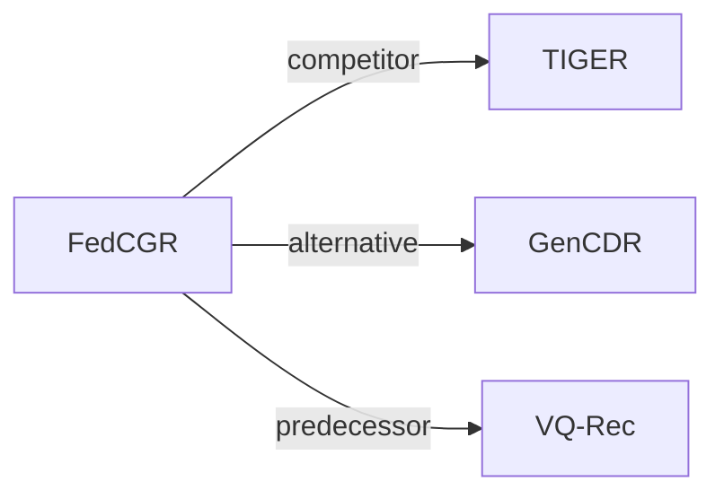

# FedCGR

*Federated Cross-Domain Generative Recommendation* — Liu et al. · CIKM’26

`VI. Generalization` · `Backbone`

[Paper](https://arxiv.org/abs/2608.10929) · [Code](https://github.com/ZhuodLiu/FedCGR) · [Matrix](../../README.md#vi--backbone)

Reading level: Overview (Level 1) · On this page: [TL;DR](#tldr) · [At a Glance](#at-a-glance) · [3. Experimental Findings](#3-experimental-findings) · [5. Connections to Related Work](#5-connections-to-related-work)

- `Enc-Dec`: Encoder-decoder.
- `Fixed`: SIDs are built first and not changed while the generator trains.
- `NTP + Aux.`: NTP plus another auxiliary loss.
- `C-Beam`: Constrained beam search.

### TL;DR

FedCGR performs federated cross-domain recommendation over shared Semantic IDs from public metadata, injects local collaborative evidence, and aggregates parameters by domain relatedness, without exchanging private interactions.

### At a Glance

| Aspect | Summary |
| :-- | :-- |
| Research Problem | VI. Generalization: Does it still work for new items, new domains, and shifting interests? |
| Key Contribution | FedCGR performs federated cross-domain recommendation over shared Semantic IDs from public metadata, injects local collaborative evidence, and aggregates parameters by domain relatedness, without exchanging private interactions. |
| Modified Stage | Backbone |

### 3. Experimental Findings

**Experimental setup**

- **Datasets**: Amazon Review: Grocery, Beauty, Sports, Food, Kitchen; six cross-domain scenarios FK/GB/GS/FKB/GBS/GKBS; per-domain 5-core filtering.
- **Split**: Per-user leave-one-out: last item test, second-to-last validation, remaining interactions training.
- **Candidates**: full catalog; additionally sampled: 999 random negatives per user, fixed once and shared across methods (seed42). Negative-sampling distribution beyond random and history-item exclusion: not reported.
- **Visibility**: warm; no unseen-item protocol is defined. Cold-start analysis groups users by training-history length (<=7, 8-15, >=16), not unseen items. SID metadata pretraining excludes private interactions; local CF uses client interaction sequences. Item-level generator/tokenizer/CF exposure: not reported.
- **SID**: Frozen metadata RQ-VAE: 3 levels x 256 codes; colliding items share SID scores, ties broken by validation-set item popularity.
- **Inference budget**: Target-domain trie-constrained beam 50; H/NDCG@10; experiments on RTX 4090 GPUs. Inference batch size and latency: not reported.
- **Results from**: Original Tables 3/4: full-ranking/sampled comparisons; Table 5: ablation; Table 6: diagnostics; Figures 3-5: user activity, sensitivity, communication efficiency.

Sources

- **Datasets**: Section 4.1.1: [S4.SS1.SSS1.p1](https://arxiv.org/html/2608.10929v1#S4.SS1.SSS1.p1) and [S4.SS1.SSS1.p3](https://arxiv.org/html/2608.10929v1#S4.SS1.SSS1.p3)
- **Split**: Section 4.1.3: [S4.SS1.SSS3.p1](https://arxiv.org/html/2608.10929v1#S4.SS1.SSS3.p1)
- **Candidates**: Section 4.1.3: [S4.SS1.SSS3.p1](https://arxiv.org/html/2608.10929v1#S4.SS1.SSS3.p1)
- **Visibility**: Sections 3.1 and 4.4: [S3.SS1.p1](https://arxiv.org/html/2608.10929v1#S3.SS1.p1) and [S4.SS4.p1](https://arxiv.org/html/2608.10929v1#S4.SS4.p1)
- **SID**: Sections 3.2 and 4.1.4: [S3.SS2.p2](https://arxiv.org/html/2608.10929v1#S3.SS2.p2) and [S4.SS1.SSS4.p1](https://arxiv.org/html/2608.10929v1#S4.SS1.SSS4.p1)
- **Inference budget**: Sections 3.4 and 4.1.4: [S3.SS4.p2](https://arxiv.org/html/2608.10929v1#S3.SS4.p2) and [S4.SS1.SSS4.p1](https://arxiv.org/html/2608.10929v1#S4.SS1.SSS4.p1)
- **Results from**: Tables 3-6 and Figures 3-5: [S4.T3](https://arxiv.org/html/2608.10929v1#S4.T3) and [S4.T4](https://arxiv.org/html/2608.10929v1#S4.T4) and [S4.T5](https://arxiv.org/html/2608.10929v1#S4.T5) and [S4.T6](https://arxiv.org/html/2608.10929v1#S4.T6) and [S4.F3](https://arxiv.org/html/2608.10929v1#S4.F3) and [S4.F4](https://arxiv.org/html/2608.10929v1#S4.F4) and [S4.F5](https://arxiv.org/html/2608.10929v1#S4.F5)

### 5. Connections to Related Work

- **Competitor** · [TIGER](tiger.md): TIGER and its FedAvg/FedProx variants are full-ranking baselines.
  - Source: FedCGR v1, Section 4.1.2 and Table 3: https://arxiv.org/html/2608.10929v1#S4.SS1.SSS2.p2; https://arxiv.org/html/2608.10929v1#S4.T3.
- **Alternative** · [GenCDR](gencdr.md): GenCDR uses centralized semantic CDR; FedCGR keeps interactions local.
  - Source: FedCGR v1, Section 5: https://arxiv.org/html/2608.10929v1#S5.p1; https://arxiv.org/html/2608.10929v1#S5.p2.
- **Predecessor** · [VQ-Rec](vq-rec.md): Related work identifies VQ-Rec as an earlier transferable quantized-item representation method.
  - Source: FedCGR v1, Section 5: https://arxiv.org/html/2608.10929v1#S5.p2.

[View all papers in this cell](../../README.md#vi--backbone)
