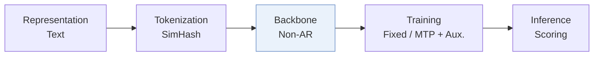
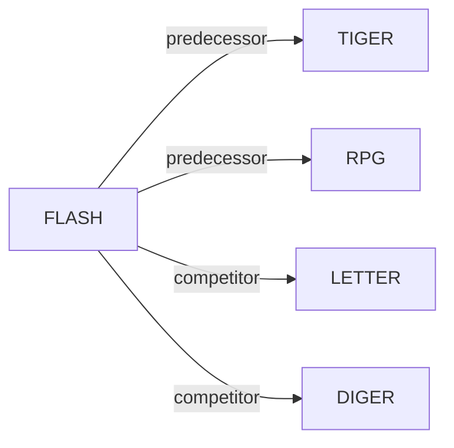

# FLASH

*Rethinking Semantic ID Construction for Generative Recommendation: SimHash with Parallel Decoding and Semantic Alignment* — Liu et al. · NeurIPS’26

`III. SID–Model Alignment` · `Backbone` · [Paper](https://arxiv.org/abs/2610.07402) · [Code](https://github.com/KevinC2015/Flash) · [Matrix](../../README.md#iii--backbone) · [中文](../zh/papers/flash.md)

Reading level: Overview (Level 1) · On this page: [TL;DR](#tldr) · [At a Glance](#at-a-glance) · [3. Experiments](#3-experimental-findings) · [5. Related Work](#5-connections-to-related-work)

- `SimHash`: Locality-sensitive hashing with random hyperplanes.
- `Non-AR`: Non-autoregressive.
- `Fixed`: SIDs are built first and not changed while the generator trains.
- `MTP + Aux.`: Multi-token prediction jointly optimized with auxiliary objectives.

### TL;DR

> [!NOTE]

> FLASH pairs training-free SimHash Semantic IDs with parallel decoding and explicit semantic alignment, attributing the weakness of hashing to autoregressive decoding and rigid discretization rather than hashing itself.

### At a Glance

| Aspect | Summary |
| :-- | :-- |
| Research Problem | III. SID–Model Alignment: Can the generator read, write, and reason over SIDs, and do the tokenizer and generator work toward the same goal? |
| Key Contribution | FLASH pairs training-free SimHash Semantic IDs with parallel decoding and explicit semantic alignment, attributing the weakness of hashing to autoregressive decoding and rigid discretization rather than hashing itself. |
| Modified Stage | Backbone |

### 3. Experimental Findings

Experimental setup

- **Datasets**: Amazon Beauty, Toys and Games, Sports and Outdoors, CDs and Vinyl; users/items with fewer than 5 interactions removed.
  - Source: Sections 3.1 and A.1: [S3.SS1.p1](https://arxiv.org/html/2610.07402v1#S3.SS1.p1) and [A1.SS1.p1](https://arxiv.org/html/2610.07402v1#A1.SS1.p1)
- **Split**: Per-user chronological leave-last-out: last item test, penultimate validation, earlier interactions training.
  - Source: Appendix A.1: [A1.SS1.p1](https://arxiv.org/html/2610.07402v1#A1.SS1.p1)
- **Candidates**: not reported
  - Source: Section 2.3 ranks all candidate items but evaluation sampling is unspecified: [S2.SS3.p1](https://arxiv.org/html/2610.07402v1#S2.SS3.p1) and [S3.SS1.p3](https://arxiv.org/html/2610.07402v1#S3.SS1.p3)
- **Visibility**: Warm main protocol; cold-start targets unseen by generator only: randomly select 5% of test-target items and remove all their training interactions. Tokenizer fitting n/a: fixed SimHash on precomputed text embeddings.
  - Source: Sections 2.1, 3.5 and A.4: [S2.SS1.p1](https://arxiv.org/html/2610.07402v1#S2.SS1.p1) and [S3.SS5.p1](https://arxiv.org/html/2610.07402v1#S3.SS5.p1) and [A1.SS4.p1](https://arxiv.org/html/2610.07402v1#A1.SS4.p1)
- **SID**: SimHash: Beauty 32x256, Toys/Sports 64x256, CDs 64x512; collision counts analyzed, collision disambiguation not reported.
  - Source: Section 2.1, Table 4 and collision analysis: [S2.SS1.p2](https://arxiv.org/html/2610.07402v1#S2.SS1.p2) and [A1.T4](https://arxiv.org/html/2610.07402v1#A1.T4) and [S3.SS3.SSS1.p3](https://arxiv.org/html/2610.07402v1#S3.SS3.SSS1.p3)
- **Inference budget**: Parallel per-position probabilities cached, then candidate scores gathered/summed; K=5/10; beam n/a. Single NVIDIA A100 80GB for experiments; inference batch size and latency not reported.
  - Source: Sections 2.3, 3.1 and A.3: [S2.SS3.p2](https://arxiv.org/html/2610.07402v1#S2.SS3.p2) and [S3.SS1.p3](https://arxiv.org/html/2610.07402v1#S3.SS1.p3) and [A1.SS3.p4](https://arxiv.org/html/2610.07402v1#A1.SS3.p4)
- **Results from**: Original Table 1 overall results; Figure 6 cold-start. Most baseline results copied from TIGER/RPG; remaining baselines implemented from public code.
  - Source: Sections 3.1/3.2 and Figure 6: [S3.SS1.p4](https://arxiv.org/html/2610.07402v1#S3.SS1.p4) and [S3.T1](https://arxiv.org/html/2610.07402v1#S3.T1) and [S3.F6](https://arxiv.org/html/2610.07402v1#S3.F6)

### 5. Connections to Related Work

- **前序工作** · [TIGER](tiger.md): FLASH revisits TIGER's SimHash ablation with parallel decoding and semantic alignment.
  - Source: FLASH v1, Introduction and Table 1: https://arxiv.org/html/2610.07402v1#S1.p2; https://arxiv.org/html/2610.07402v1#S1.p3; https://arxiv.org/html/2610.07402v1#S3.T1.
- **前序工作** · [RPG](rpg.md): FLASH follows RPG's cached-logit scoring, replacing learned OPQ codes with training-free SimHash.
  - Source: FLASH v1, Sections 2.3 and A.2: https://arxiv.org/html/2610.07402v1#S2.SS3.p2; https://arxiv.org/html/2610.07402v1#A1.SS2.p4.
- **同期对比** · [LETTER](letter.md): LETTER learns regularized residual codes; FLASH uses fixed hashing with parallel prediction and alignment.
  - Source: FLASH v1, Section A.2 and Table 1: https://arxiv.org/html/2610.07402v1#A1.SS2.p3; https://arxiv.org/html/2610.07402v1#S3.T1.
- **同期对比** · [DIGER](diger.md): DIGER jointly learns residual quantization and recommendation; FLASH uses a fixed tokenizer.
  - Source: FLASH v1, Section A.2 and Table 1: https://arxiv.org/html/2610.07402v1#A1.SS2.p3; https://arxiv.org/html/2610.07402v1#S3.T1.

[查看同格全部论文](../../README.md#iii--backbone)
