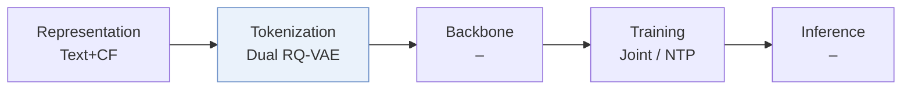
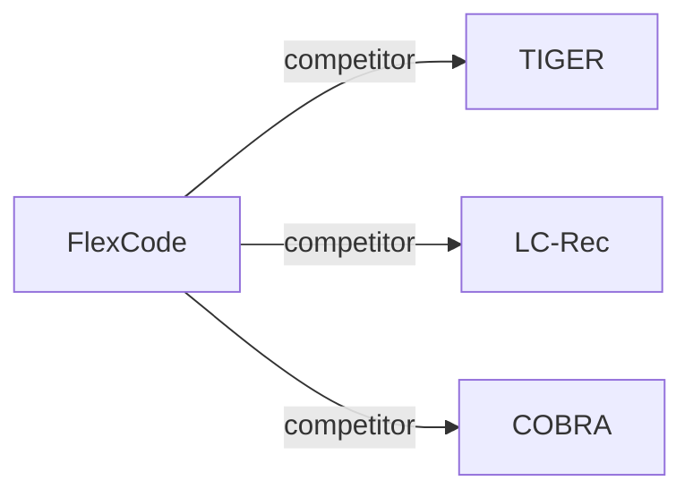

# FlexCode

| **Title** | *Semantics Meet Signals: Dual Codebook Representationl Learning for Generative Recommendation* |
| :-- | :-- |
| **Authors** | Hui et al. |
| **Venue** | arXiv’25 |
| **Problem × Stage** | `I. Informativeness` · `Tokenization` |
| **Links** | [Paper](https://arxiv.org/abs/2511.20673) · [Matrix](../../README.md#i--tokenization) · [中文](../zh/papers/flexcode.md) |
| **Reading level** | Overview (Level 1) |

On this page: [TL;DR](#tldr) · [At a Glance](#at-a-glance) · [3. Experiments](#3-experimental-findings) · [5. Related Work](#5-connections-to-related-work)

- `Dual RQ-VAE`: Two residual-quantized variational autoencoders for separate representation streams.
- `–`: Not reported in the paper.
- `Joint`: The generator loss updates the tokenizer directly.
- `NTP`: Next-token prediction loss only; continuing from a pretrained LLM (SFT) also counts as NTP.

### TL;DR

> [!NOTE]
> FlexCode splits a fixed token budget between a collaborative codebook and a semantic codebook according to item popularity through a lightweight MoE, instead of one uniform codebook for all items.

---

### At a Glance

| Aspect | Summary |
| :-- | :-- |
| Research Problem | I. Informativeness: Do the SIDs, or the model reading them, carry the collaborative and multimodal signals recommendation needs? |
| Key Contribution | FlexCode splits a fixed token budget between a collaborative codebook and a semantic codebook according to item popularity through a lightweight MoE, instead of one uniform codebook for all items. |
| Modified Stage | Tokenization |

---

### 3. Experimental Findings

Experimental setup

- **Datasets**: Amazon-Beauty, Amazon-Sports and Outdoors, KuaiRand-1K; 5-core filtering; proprietary industrial interactions.
  - Source: Sections 4.1.1 and Public Benchmarks: [S4.SS1.SSS1.p1](https://arxiv.org/html/2511.20673v1#S4.SS1.SSS1.p1) and [S4.SS1.SSS1.Px1.p1](https://arxiv.org/html/2511.20673v1#S4.SS1.SSS1.Px1.p1)
- **Split**: Public: chronological last item test, penultimate validation; industrial: last logged day evaluation, validation not reported.
  - Source: Section 4.1.1: [S4.SS1.SSS1.p1](https://arxiv.org/html/2511.20673v1#S4.SS1.SSS1.p1) and [S4.SS1.SSS1.Px2.p1](https://arxiv.org/html/2511.20673v1#S4.SS1.SSS1.Px2.p1)
- **Candidates**: not reported
  - Source: Candidate protocol absent from Section 4.1: [S4.SS1](https://arxiv.org/html/2511.20673v1#S4.SS1)
- **Visibility**: warm; no unseen-item protocol is defined. Head/tail evaluation concerns popularity; tokenizer and collaborative-encoder item exposure: not reported.
  - Source: Sections 4.1.1 and 4.3.2: [S4.SS1.SSS1](https://arxiv.org/html/2511.20673v1#S4.SS1.SSS1) and [S4.SS3.SSS2.p1](https://arxiv.org/html/2511.20673v1#S4.SS3.SSS2.p1)
- **SID**: Dual RQ-VAE; total token budgets 3/4/5/6, popularity-dependent allocation; base K=512. Main-experiment depth and collision handling not reported.
  - Source: Sections 3.1/3.3 and Tables 4-5: [S3.SS1](https://arxiv.org/html/2511.20673v1#S3.SS1) and [S3.SS3.p3](https://arxiv.org/html/2511.20673v1#S3.SS3.p3) and [S5.T4](https://arxiv.org/html/2511.20673v1#S5.T4) and [S5.T5](https://arxiv.org/html/2511.20673v1#S5.T5)
- **Inference budget**: Recall/NDCG@5/10; beam width, hardware, inference batch size, latency not reported.
  - Source: Sections 3.4 and 4.1.3: [S3.SS4](https://arxiv.org/html/2511.20673v1#S3.SS4) and [S4.SS1.SSS3.p1](https://arxiv.org/html/2511.20673v1#S4.SS1.SSS3.p1)
- **Results from**: Original Table 1: public benchmarks; Figure 2: industrial overall and head/tail results.
  - Source: Table 1 and Figure 2: [S4.T1](https://arxiv.org/html/2511.20673v1#S4.T1) and [S4.F2](https://arxiv.org/html/2511.20673v1#S4.F2)

---

### 5. Connections to Related Work

- **Competitor** · [TIGER](tiger.md): Compared semantic-ID baseline; FlexCode separates semantic and collaborative codebooks.
  - Source: FlexCode v1, Section 4.1.2 and Table 1: https://arxiv.org/html/2511.20673v1#S4.SS1.SSS2.p1; https://arxiv.org/html/2511.20673v1#S4.T1.
- **Competitor** · [LC-Rec](lc-rec.md): Compared semantic-ID baseline; FlexCode allocates tokens by item popularity.
  - Source: FlexCode v1, Section 4.1.2 and Table 1: https://arxiv.org/html/2511.20673v1#S4.SS1.SSS2.p1; https://arxiv.org/html/2511.20673v1#S4.T1.
- **Competitor** · [COBRA](cobra.md): Compared semantic-ID baseline; FlexCode combines dual codebooks with adaptive routing.
  - Source: FlexCode v1, Section 4.1.2 and Table 1: https://arxiv.org/html/2511.20673v1#S4.SS1.SSS2.p1; https://arxiv.org/html/2511.20673v1#S4.T1.

[View all papers in this cell](../../README.md#i--tokenization)
