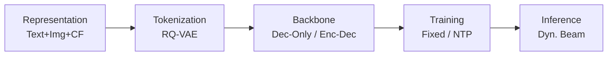
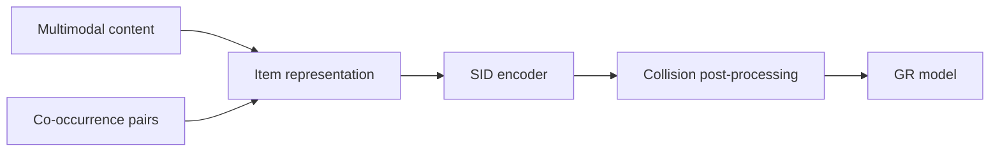
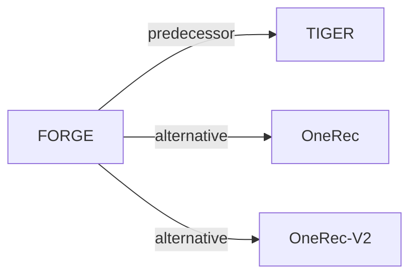

# FORGE

*Forming semantic identifiers for generative retrieval in industrial datasets* — Fu et al. · KDD’26

`Paradigms, Systems and Benchmarks` · `No single stage`

[Paper](https://arxiv.org/abs/2509.20904) · [Code](https://github.com/selous123/al_sid) · [Matrix](../../README.md#paradigms-systems-and-benchmarks)

Reading level: Reading Notes (Level 2) · On this page: [TL;DR](#tldr) · [At a Glance](#at-a-glance) · [1. Why This Paper Matters](#1-why-this-paper-matters) · [2. How It Works](#2-how-it-works) · [3. Experimental Findings](#3-experimental-findings) · [4. Limitations & Critical Analysis](#4-limitations--critical-analysis) · [5. Connections to Related Work](#5-connections-to-related-work)

- `Dec-Only / Enc-Dec`: Decoder-only and encoder–decoder backbone variants.
- `Fixed`: SIDs are built first and not changed while the generator trains.
- `NTP`: Next-token prediction loss only; continuing from a pretrained LLM (SFT) also counts as NTP.
- `Dyn. Beam`: Dynamic beam search.

### TL;DR

FORGE is a benchmark and industrial dataset, not a new recommender: it compares Semantic ID construction strategies, adds metrics that assess IDs without generator training, and releases Taobao data.

### At a Glance

| Aspect | Summary |
| :-- | :-- |
| Research Problem | Paradigms, Systems and Benchmarks: Baseline (TIGER), end-to-end multi-stage paradigms, open-source frameworks, benchmarks, and diagnostic resources. |
| Key Contribution | FORGE is a benchmark and industrial dataset, not a new recommender: it compares Semantic ID construction strategies, adds metrics that assess IDs without generator training, and releases Taobao data. |
| Modified Stage | No single stage |
| Key Findings | In online A/B tests on Taobao, SID construction strategies chosen from the benchmark findings increase transaction count by 0.35% (Abstract). |

### 1. Why This Paper Matters

Current studies offer limited investigation of how to construct Semantic IDs (SIDs), and their SID assessment usually needs costly generative retrieval (GR) training (Abstract). FORGE turns these choices into a benchmark.

> "Specifically, FORGE provides a taxonomy of the SID construction process from several perspectives and validates their impact on downstream GR through offline experiments across diverse settings." (Abstract)

Based on arXiv v3.

### 2. How It Works

#### Item Representation

Items are encoded with CN-CLIP and fused with a QFormer (Sec. 3.1.1). An optional InfoNCE loss with positives from the item-to-item co-occurrence table adds user-behavior patterns (Sec. 3.1.1, Eq. 2).

#### SID Encoding and Collision Post-Processing

The benchmark compares RQ-VAE with random assignment, multiple VQ, OPQ, and RQ-Kmeans (Sec. 3.1.2). KNN-based and random-based post-processing cap the number of items per SID (Sec. 3.1.3).

#### Dynamic Beam Search

The beam size is 300 at the first step, 600 at the second, and 1,200 at the final step (Sec. 3.2).

#### SID Quality Metrics

Embedding HitRate and the Gini coefficient measure SID quality without GR training (Sec. 3.4).

> "The Gini coefficient measures the deviation between a uniform SID distribution and the actual item distribution, where a lower value indicates a more balanced assignment." (Sec. 3.4)

### 3. Experimental Findings

**Experimental setup**

- **Datasets**: Amazon 2023 Clothing (2,524,981 users / 714,957 items / 12,530,806 interactions; filtering not reported) and AL-GR, released from Taobao (131M users / 251M items / 14B interactions): 40 million behavior records sampled per day over ten consecutive days, sequences truncated to 100 items, with multimodal item embeddings and i2i relations.
- **Split**: AL-GR: temporal stages S1 (4 days), S2 (3 days), S3 (3 days); 100,000 samples from the day after each stage are used for evaluation; training uses the first clicked item as target, evaluation uses all interacted items on the page view. Amazon split: not reported.
- **Candidates**: Beam search generates 1,200 candidate SIDs (3 x 8192 example), mapped back to items; top-K items by score are checked against the page-view targets (HR@20 to HR@1000). Full catalog versus sampled candidates is not otherwise stated.
- **Visibility**: warm; no unseen-item protocol is defined. Evaluation uses the next day after each training stage.
- **SID**: Benchmark of configurations: main 3 levels x 8,192 codewords (also 2 x 32,768), RQ-VAE with 64-dimensional codebook over CN-CLIP multimodal features. Collisions are handled by optional post-processing that caps items per SID: KNN-based reassignment (thresholds 25, 10, 5) or Random-5 random assignment of the last codeword; a no-collision-handling variant (noco) is also tested.
- **Inference budget**: Beam search producing 1,200 candidate SIDs; generators T5-Base (0.2B), Qwen2.5-0.5B, and Qwen2.5-3B. Training uses 16 (T5) or 32 (Qwen2.5-0.5B) PPU-ZW810E GPUs; inference hardware, batch size, and latency: not reported.
- **Results from**: Table 3 (AL-GR SID configurations across stages S1-S3); Table 4 (Amazon); Table 5 (relation sources); Table 9 (encoding methods including RQ-Kmeans); Table 11 (generative search); Table 12 (architectures and model sizes); Figures 3-4 (Embedding HitRate, Gini, and other SID metrics).

Sources

- **Datasets**: Datasets: [S3.SS3.p1](https://arxiv.org/html/2509.20904v3#S3.SS3.p1) and [S3.T1](https://arxiv.org/html/2509.20904v3#S3.T1); AL-GR construction and truncation: [S3.SS3.SSS1.p2](https://arxiv.org/html/2509.20904v3#S3.SS3.SSS1.p2) and [S3.SS3.SSS1.p3](https://arxiv.org/html/2509.20904v3#S3.SS3.SSS1.p3).
- **Split**: Stage split and next-day evaluation: [S3.SS3.SSS1.p2](https://arxiv.org/html/2509.20904v3#S3.SS3.SSS1.p2); targets: [S3.SS3.SSS1.p3](https://arxiv.org/html/2509.20904v3#S3.SS3.SSS1.p3); Amazon split not found in Sections 3-4.
- **Candidates**: 1,200 candidate SIDs from beam search mapped back to items: [S3.SS4.p1](https://arxiv.org/html/2509.20904v3#S3.SS4.p1).
- **Visibility**: Next-day temporal evaluation; unseen-item generalization is cited, not tested: [S3.SS3.SSS1.p2](https://arxiv.org/html/2509.20904v3#S3.SS3.SSS1.p2) and [S2.SS2.p1](https://arxiv.org/html/2509.20904v3#S2.SS2.p1).
- **SID**: Main 3 x 8192 and 2 x 32768: [S4.SS1.SSS1.p1](https://arxiv.org/html/2509.20904v3#S4.SS1.SSS1.p1) and [S4.T11](https://arxiv.org/html/2509.20904v3#S4.T11); collision post-processing: [S3.SS1.SSS3.p1](https://arxiv.org/html/2509.20904v3#S3.SS1.SSS3.p1) and [S4.SS1.SSS4.p3](https://arxiv.org/html/2509.20904v3#S4.SS1.SSS4.p3); RQ-VAE config: [A1.T15](https://arxiv.org/html/2509.20904v3#A1.T15).
- **Inference budget**: Beam candidates: [S3.SS4.p1](https://arxiv.org/html/2509.20904v3#S3.SS4.p1); models and GPUs (training): [A1.SS2.p1](https://arxiv.org/html/2509.20904v3#A1.SS2.p1) and [A1.T14](https://arxiv.org/html/2509.20904v3#A1.T14).
- **Results from**: Results: [S4.T3](https://arxiv.org/html/2509.20904v3#S4.T3), [S4.T4](https://arxiv.org/html/2509.20904v3#S4.T4), [S4.T5](https://arxiv.org/html/2509.20904v3#S4.T5), [S4.T11](https://arxiv.org/html/2509.20904v3#S4.T11), [S4.T12](https://arxiv.org/html/2509.20904v3#S4.T12); encoding comparison: [S4.SS1.SSS6.p1](https://arxiv.org/html/2509.20904v3#S4.SS1.SSS6.p1).

- Metrics: both metrics are strongly correlated with HR (Sec. 3.4, Sec. 4.2, Fig. 3).

  > "Our experiments show that both metrics are strongly correlated with HR, thus enabling efficient SID evaluation without additional GR training." (Sec. 3.4)

- Deployment: the strategies are deployed at full scale on Taobao (Abstract).
- Dataset: AL-GR contains 14 billion interactions and 250 million items with multimodal features (Abstract).

### 4. Limitations & Critical Analysis

**Our analysis.**

- The metric-HR correlation is shown on the benchmark's data. This suggests that it should be re-checked before the metrics replace GR training on other catalogs.
- A final beam of 1,200 suggests a high decoding cost.
- OneRec uses `R-KM` codes and OneRec-V2 uses `R-KM†` codes; FORGE's base configuration uses `RQ-VAE` codes.

### 5. Connections to Related Work

- **Predecessor** · [TIGER](tiger.md): TIGER introduced RQ-VAE semantic IDs for recommendation; FORGE benchmarks how modality, encoding, and collision post-processing choices for such SIDs affect retrieval at industrial scale.
  - Source: FORGE v3, Section 2.2 cites Rajput et al. (2023) as the SID adopted in recommendation: https://arxiv.org/html/2509.20904v3#S2.SS2.p1; Section 3.1.2 RQ-VAE encoding: https://arxiv.org/html/2509.20904v3#S3.SS1.SSS2.p1.
- **Alternative** · [OneRec](onerec.md): OneRec encodes items with RQ-Kmeans; FORGE compares this encoding against its RQ-VAE base and Final configurations.
  - Source: FORGE v3, Section 4.1.6 cites Deng et al. (2025) for RQ-Kmeans and compares it in Table 9: https://arxiv.org/html/2509.20904v3#S4.SS1.SSS6.p1.
- **Alternative** · [OneRec-V2](onerec-v2.md): OneRec-V2 is cited for the same RQ-Kmeans encoding route evaluated in FORGE's encoding comparison.
  - Source: FORGE v3, Section 4.1.6 cites Zhou et al. (2025): https://arxiv.org/html/2509.20904v3#S4.SS1.SSS6.p1.

[View all papers in this cell](../../README.md#paradigms-systems-and-benchmarks)
