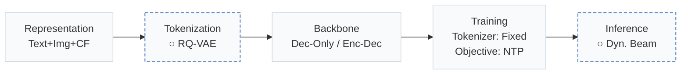
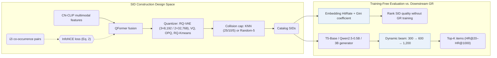
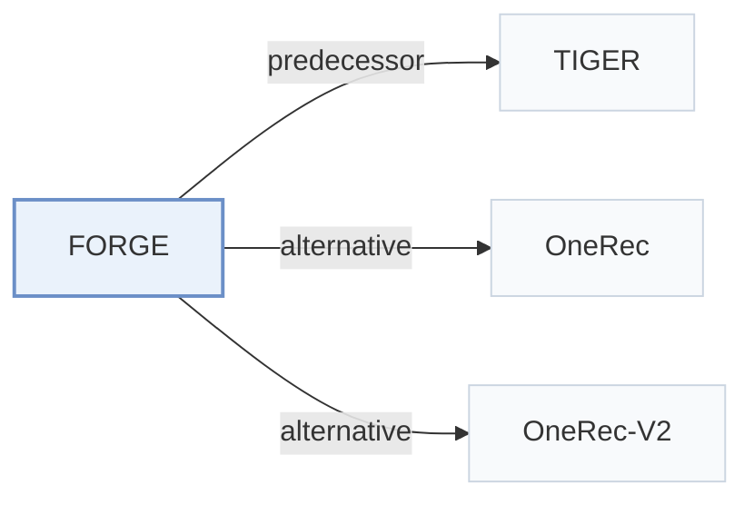

# FORGE

[← Problem × Stage Matrix](../../README.md#paradigms-systems-and-benchmarks) · [Papers by Stage](../index/stages.md) · [Papers by Modality](../index/modality.md) · [Papers by Domain](../index/domain.md) · English | [中文](../zh/papers/forge.md)

| **Title** | *Forming semantic identifiers for generative retrieval in industrial datasets* |
| :-- | :-- |
| **Authors** | Fu et al. |
| **Venue** | KDD’26 |
| **Problem × Stage** | `Paradigms, Systems and Benchmarks` · `No single stage` |
| **Changes** | ○ Tokenization · ○ Inference |
| **SID inputs** | `Text` + `Img` + `CF` |
| **Domain** | `E-commerce` · `Search` |
| **Links** | [Paper](https://arxiv.org/abs/2509.20904) · [Code](https://github.com/selous123/al_sid) |
| **Reading level** | Reading Notes (Level 2) |

**On this page**: [TL;DR](#tldr) · [At a Glance](#at-a-glance) · [1. Why It Matters](#1-why-this-paper-matters) · [2. Method](#2-how-it-works) · [3. Experiments](#3-experimental-findings) · [4. Limitations](#4-limitations--critical-analysis) · [5. Related Work](#5-connections-to-related-work)

- `Text+Img+CF`: Text and image representations combined with collaborative signals.
- `RQ-VAE`: Residual-Quantized Variational AutoEncoder.
- `Dec-Only / Enc-Dec`: Decoder-only and encoder–decoder backbone variants.
- `Fixed`: SIDs are built first and not changed while the generator trains.
- `NTP`: Next-token prediction loss only; continuing from a pretrained LLM (SFT) also counts as NTP.
- `Dyn. Beam`: Dynamic beam search.

### TL;DR

> [!NOTE]
> FORGE benchmarks Semantic ID construction strategies on a released Taobao dataset and proposes metrics that evaluate ID quality without training a generator.

---

### At a Glance

| Aspect | Summary |
| :-- | :-- |
| Key Findings | In online A/B tests on Taobao, Semantic ID (SID) construction strategies selected from FORGE's benchmark increase transaction count by 0.35%, while offline Embedding HitRate and Gini coefficient correlate strongly with downstream HR@20–HR@1000 on the 250-million-item AL-GR dataset (Abstract, Sec. 3.4, Sec. 4.2, Table 3, Fig. 3). |
| Limitation | Dynamic beam search expands to 1,200 candidate SIDs at the final decoding step without reported inference latency, and the training-free SID quality metrics are validated only on the benchmark's datasets (Sec. 3.2, Sec. 3.4). |

---

### 1. Why This Paper Matters

Industrial generative retrieval (GR) systems face a wide design space when building Semantic IDs (SIDs)—spanning feature modalities, vector quantizers, and collision resolution—while evaluating each candidate tokenizer normally requires training a full GR generator (Abstract). FORGE benchmarks these choices on a released hundred-million-item Taobao dataset (AL-GR) and introduces training-free metrics to rank SID tokenizers before generator training.

> "Specifically, FORGE provides a taxonomy of the SID construction process from several perspectives and validates their impact on downstream GR through offline experiments across diverse settings." (Abstract)

---

### 2. How It Works

#### Item Representation

FORGE encodes item text and images with CN-CLIP and fuses them through a QFormer (Sec. 3.1.1). An InfoNCE contrastive loss using positive pairs from the item-to-item (`i2i`) co-occurrence table injects user-behavior signals into the fused embeddings before quantization (Sec. 3.1.1, Eq. 2).

#### SID Encoding and Collision Post-Processing

Across codebooks such as 3 levels × 8,192 codewords and 2 levels × 32,768 codewords, FORGE compares RQ-VAE against random assignment, multi-codebook VQ, OPQ, and RQ-Kmeans (Sec. 3.1.2, Sec. 4.1, Table 9, Table 11). To bound items sharing the same SID prefix, KNN-based reassignment (with collision thresholds 25, 10, or 5) and Random-5 reassignment adjust the final codeword (Sec. 3.1.3).

#### Dynamic Beam Search

During autoregressive decoding, dynamic beam search widens the beam progressively across code levels—300 at step 1, 600 at step 2, and 1,200 at step 3—before mapping candidate SIDs back to catalog items (Sec. 3.2, Sec. 3.4).

#### SID Quality Metrics

To evaluate tokenizers without training a generator, Embedding HitRate measures neighbor preservation in quantized space and the Gini coefficient measures how evenly items populate the SID space (Sec. 3.4).

> "The Gini coefficient measures the deviation between a uniform SID distribution and the actual item distribution, where a lower value indicates a more balanced assignment." (Sec. 3.4)

---

### 3. Experimental Findings

Experimental setup

- **Datasets**: Amazon 2023 Clothing (2,524,981 users / 714,957 items / 12,530,806 interactions; filtering not reported) and AL-GR, released from Taobao (131M users / 251M items / 14B interactions): 40 million behavior records sampled per day over ten consecutive days, sequences truncated to 100 items, with multimodal item embeddings and i2i relations.
  - Source: Datasets: [S3.SS3.p1](https://arxiv.org/html/2509.20904v3#S3.SS3.p1) and [S3.T1](https://arxiv.org/html/2509.20904v3#S3.T1); AL-GR construction and truncation: [S3.SS3.SSS1.p2](https://arxiv.org/html/2509.20904v3#S3.SS3.SSS1.p2) and [S3.SS3.SSS1.p3](https://arxiv.org/html/2509.20904v3#S3.SS3.SSS1.p3).
- **Split**: AL-GR: temporal stages S1 (4 days), S2 (3 days), S3 (3 days); 100,000 samples from the day after each stage are used for evaluation; training uses the first clicked item as target, evaluation uses all interacted items on the page view. Amazon split: not reported.
  - Source: Stage split and next-day evaluation: [S3.SS3.SSS1.p2](https://arxiv.org/html/2509.20904v3#S3.SS3.SSS1.p2); targets: [S3.SS3.SSS1.p3](https://arxiv.org/html/2509.20904v3#S3.SS3.SSS1.p3); Amazon split not found in Sections 3-4.
- **Candidates**: Beam search generates 1,200 candidate SIDs (3 x 8192 example), mapped back to items; top-K items by score are checked against the page-view targets (HR@20 to HR@1000). Full catalog versus sampled candidates is not otherwise stated.
  - Source: 1,200 candidate SIDs from beam search mapped back to items: [S3.SS4.p1](https://arxiv.org/html/2509.20904v3#S3.SS4.p1).
- **Visibility**: warm; no unseen-item protocol is defined. Evaluation uses the next day after each training stage.
  - Source: Next-day temporal evaluation; unseen-item generalization is cited, not tested: [S3.SS3.SSS1.p2](https://arxiv.org/html/2509.20904v3#S3.SS3.SSS1.p2) and [S2.SS2.p1](https://arxiv.org/html/2509.20904v3#S2.SS2.p1).
- **SID**: Benchmark of configurations: main 3 levels x 8,192 codewords (also 2 x 32,768), RQ-VAE with 64-dimensional codebook over CN-CLIP multimodal features. Collisions are handled by optional post-processing that caps items per SID: KNN-based reassignment (thresholds 25, 10, 5) or Random-5 random assignment of the last codeword; a no-collision-handling variant (noco) is also tested.
  - Source: Main 3 x 8192 and 2 x 32768: [S4.SS1.SSS1.p1](https://arxiv.org/html/2509.20904v3#S4.SS1.SSS1.p1) and [S4.T11](https://arxiv.org/html/2509.20904v3#S4.T11); collision post-processing: [S3.SS1.SSS3.p1](https://arxiv.org/html/2509.20904v3#S3.SS1.SSS3.p1) and [S4.SS1.SSS4.p3](https://arxiv.org/html/2509.20904v3#S4.SS1.SSS4.p3); RQ-VAE config: [A1.T15](https://arxiv.org/html/2509.20904v3#A1.T15).
- **Inference budget**: Beam search producing 1,200 candidate SIDs; generators T5-Base (0.2B), Qwen2.5-0.5B, and Qwen2.5-3B. Training uses 16 (T5) or 32 (Qwen2.5-0.5B) PPU-ZW810E GPUs; inference hardware, batch size, and latency: not reported.
  - Source: Beam candidates: [S3.SS4.p1](https://arxiv.org/html/2509.20904v3#S3.SS4.p1); models and GPUs (training): [A1.SS2.p1](https://arxiv.org/html/2509.20904v3#A1.SS2.p1) and [A1.T14](https://arxiv.org/html/2509.20904v3#A1.T14).
- **Results from**: Table 3 (AL-GR SID configurations across stages S1-S3); Table 4 (Amazon); Table 5 (relation sources); Table 9 (encoding methods including RQ-Kmeans); Table 11 (generative search); Table 12 (architectures and model sizes); Figures 3-4 (Embedding HitRate, Gini, and other SID metrics).
  - Source: Results: [S4.T3](https://arxiv.org/html/2509.20904v3#S4.T3), [S4.T4](https://arxiv.org/html/2509.20904v3#S4.T4), [S4.T5](https://arxiv.org/html/2509.20904v3#S4.T5), [S4.T11](https://arxiv.org/html/2509.20904v3#S4.T11), [S4.T12](https://arxiv.org/html/2509.20904v3#S4.T12); encoding comparison: [S4.SS1.SSS6.p1](https://arxiv.org/html/2509.20904v3#S4.SS1.SSS6.p1).

- Training-free metric correlation: across SID configurations on AL-GR (stages S1–S3) and Amazon Clothing, both Embedding HitRate and the Gini coefficient correlate strongly with downstream GR HitRate (HR@20 to HR@1000) (Sec. 3.4, Sec. 4.2, Table 3, Table 4, Fig. 3, Fig. 4).

  > "Our experiments show that both metrics are strongly correlated with HR, thus enabling efficient SID evaluation without additional GR training." (Sec. 3.4)

- Modality, quantizer, and backbone studies: adding `i2i` collaborative contrastive alignment (Table 5), RQ-VAE quantization over RQ-Kmeans (Table 9), collision capping (Table 3), and scaling generators from T5-Base (0.2B) to Qwen2.5-0.5B and Qwen2.5-3B (Table 12) consistently improve retrieval HR.
- Industrial dataset and online A/B test: FORGE releases AL-GR—covering 14 billion interactions and 250 million items with multimodal features (Table 1 cites 131M users / 251M items)—and full-scale Taobao deployment of the benchmark-selected SID strategy raises online transaction count by 0.35% (Abstract, Sec. 3.3).

---

### 4. Limitations & Critical Analysis

**Our analysis.**

- The correlation between Embedding HitRate / Gini and downstream HR is established within FORGE's RQ-VAE and post-processing variants; tokenizers trained jointly with the generator may shift that relationship.
- Expanding the beam to 1,200 candidate SIDs at the final step increases decoding and item-lookup cost, and wall-clock serving latency is not reported.
- OneRec uses `R-KM` codes and OneRec-V2 uses `R-KM†` codes; FORGE evaluates `RQ-Kmeans` against `RQ-VAE` in Table 9 and adopts `RQ-VAE` with collision post-processing as its primary configuration.

---

### 5. Connections to Related Work

- **Predecessor** · [TIGER](tiger.md): TIGER introduced RQ-VAE semantic IDs for recommendation; FORGE benchmarks how modality, encoding, and collision post-processing choices for such SIDs affect retrieval at industrial scale.
  - Source: FORGE v3, Section 2.2 cites Rajput et al. (2023) as the SID adopted in recommendation: [S2.SS2.p1](https://arxiv.org/html/2509.20904v3#S2.SS2.p1); Section 3.1.2 RQ-VAE encoding: [S3.SS1.SSS2.p1](https://arxiv.org/html/2509.20904v3#S3.SS1.SSS2.p1).
- **Alternative** · [OneRec](onerec.md): OneRec encodes items with RQ-Kmeans; FORGE compares this encoding against its RQ-VAE base and Final configurations.
  - Source: FORGE v3, Section 4.1.6 cites Deng et al. (2025) for RQ-Kmeans and compares it in Table 9: [S4.SS1.SSS6.p1](https://arxiv.org/html/2509.20904v3#S4.SS1.SSS6.p1).
- **Alternative** · [OneRec-V2](onerec-v2.md): OneRec-V2 is cited for the same RQ-Kmeans encoding route evaluated in FORGE's encoding comparison.
  - Source: FORGE v3, Section 4.1.6 cites Zhou et al. (2025): [S4.SS1.SSS6.p1](https://arxiv.org/html/2509.20904v3#S4.SS1.SSS6.p1).

[View all papers in this cell](../../README.md#paradigms-systems-and-benchmarks)
