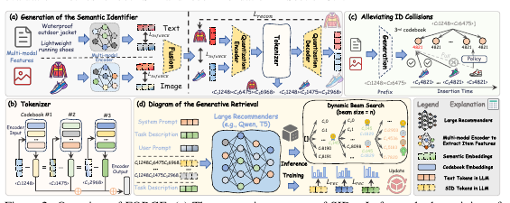

# FORGE

*Forming semantic identifiers for generative retrieval in industrial datasets* — Fu et al. · KDD’26

`Paradigms, Systems and Benchmarks` · `No single stage`

[Paper](https://arxiv.org/abs/2509.20904) · [Code](https://github.com/selous123/al_sid) · [Matrix](../../README.md#paradigms-systems-and-benchmarks)

Reading level: Overview (Level 1) · On this page: [TL;DR](#tldr) · [At a Glance](#at-a-glance) · [2. How It Works](#2-how-it-works) · [3. Experimental Findings](#3-experimental-findings) · [5. Connections to Related Work](#5-connections-to-related-work)

| Representation | Tokenization | Backbone | Training | Inference |
| :-: | :-: | :-: | :-: | :-: |
| `Text+Img` | `RQ-VAE` | `Dec-Only` | `Fixed / NTP` | `Dyn. Beam` |

- `Dec-Only`: Decoder-only.
- `Fixed`: SIDs are built first and not changed while the generator trains.
- `NTP`: Next-token prediction loss only; continuing from a pretrained LLM (SFT) also counts as NTP.
- `Dyn. Beam`: Dynamic beam search.

### TL;DR

FORGE is a benchmark and industrial dataset, not a new recommender: it compares Semantic ID construction strategies, adds metrics that assess IDs without generator training, and releases Taobao data.

### At a Glance

| Aspect | Summary |
| :-- | :-- |
| Research Problem | Paradigms, Systems and Benchmarks: Baseline (TIGER), end-to-end multi-stage paradigms, open-source frameworks, benchmarks, and diagnostic resources. |
| Key Contribution | FORGE is a benchmark and industrial dataset, not a new recommender: it compares Semantic ID construction strategies, adds metrics that assess IDs without generator training, and releases Taobao data. |
| Modified Stage | No single stage |

### 2. How It Works

### 3. Experimental Findings

**Experimental setup**

- **Datasets**: Amazon 2023 Clothing (2,524,981 users / 714,957 items / 12,530,806 interactions; filtering not reported) and AL-GR, released from Taobao (131M users / 251M items / 14B interactions): 40 million behavior records sampled per day over ten consecutive days, sequences truncated to 100 items, with multimodal item embeddings and i2i relations.
  - Source: Datasets: https://arxiv.org/html/2509.20904v3#S3.SS3.p1 and https://arxiv.org/html/2509.20904v3#S3.T1; AL-GR construction and truncation: https://arxiv.org/html/2509.20904v3#S3.SS3.SSS1.p2 and https://arxiv.org/html/2509.20904v3#S3.SS3.SSS1.p3.
- **Split**: AL-GR: temporal stages S1 (4 days), S2 (3 days), S3 (3 days); 100,000 samples from the day after each stage are used for evaluation; training uses the first clicked item as target, evaluation uses all interacted items on the page view. Amazon split: not reported.
  - Source: Stage split and next-day evaluation: https://arxiv.org/html/2509.20904v3#S3.SS3.SSS1.p2; targets: https://arxiv.org/html/2509.20904v3#S3.SS3.SSS1.p3; Amazon split not found in Sections 3-4.
- **Candidates**: Beam search generates 1,200 candidate SIDs (3 x 8192 example), mapped back to items; top-K items by score are checked against the page-view targets (HR@20 to HR@1000). Full catalog versus sampled candidates is not otherwise stated.
  - Source: 1,200 candidate SIDs from beam search mapped back to items: https://arxiv.org/html/2509.20904v3#S3.SS4.p1.
- **Visibility**: warm; no unseen-item protocol is defined. Evaluation uses the next day after each training stage.
  - Source: Next-day temporal evaluation; unseen-item generalization is cited, not tested: https://arxiv.org/html/2509.20904v3#S3.SS3.SSS1.p2 and https://arxiv.org/html/2509.20904v3#S2.SS2.p1.
- **SID**: Benchmark of configurations: main 3 levels x 8,192 codewords (also 2 x 32,768), RQ-VAE with 64-dimensional codebook over CN-CLIP multimodal features. Collisions are handled by optional post-processing that caps items per SID: KNN-based reassignment (thresholds 25, 10, 5) or Random-5 random assignment of the last codeword; a no-collision-handling variant (noco) is also tested.
  - Source: Main 3 x 8192 and 2 x 32768: https://arxiv.org/html/2509.20904v3#S4.SS1.SSS1.p1 and https://arxiv.org/html/2509.20904v3#S4.T11; collision post-processing: https://arxiv.org/html/2509.20904v3#S3.SS1.SSS3.p1 and https://arxiv.org/html/2509.20904v3#S4.SS1.SSS4.p3; RQ-VAE config: https://arxiv.org/html/2509.20904v3#A1.T15.
- **Inference budget**: Beam search producing 1,200 candidate SIDs; generators T5-Base (0.2B), Qwen2.5-0.5B, and Qwen2.5-3B. Training uses 16 (T5) or 32 (Qwen2.5-0.5B) PPU-ZW810E GPUs; inference hardware, batch size, and latency: not reported.
  - Source: Beam candidates: https://arxiv.org/html/2509.20904v3#S3.SS4.p1; models and GPUs (training): https://arxiv.org/html/2509.20904v3#A1.SS2.p1 and https://arxiv.org/html/2509.20904v3#A1.T14.
- **Results from**: Table 3 (AL-GR SID configurations across stages S1-S3); Table 4 (Amazon); Table 5 (relation sources); Table 9 (encoding methods including RQ-Kmeans); Table 11 (generative search); Table 12 (architectures and model sizes); Figures 3-4 (Embedding HitRate, Gini, and other SID metrics).
  - Source: Results: https://arxiv.org/html/2509.20904v3#S4.T3, https://arxiv.org/html/2509.20904v3#S4.T4, https://arxiv.org/html/2509.20904v3#S4.T5, https://arxiv.org/html/2509.20904v3#S4.T11, https://arxiv.org/html/2509.20904v3#S4.T12; encoding comparison: https://arxiv.org/html/2509.20904v3#S4.SS1.SSS6.p1.

## 旧卡片说明

迁自 `d61aa6c:papers/forge.md`。保留方法说明、实验叙述与局限；本轮只对照现有记录处理明确冲突，未重新逐句核查原论文。分类和规格以页面上方由记录生成的表格为准。

### FORGE：工业数据集语义标识构建

> FORGE 面向大规模工业交互数据，融合多模态内容和协同关系构造、清洗并评估生成式检索所需的语义标识。

### 研究动机与问题定义

小规模公开数据集难以反映工业生成式检索中的多模态、长尾和标识碰撞问题。FORGE 提供大规模数据、SID 构建流程、碰撞后处理和生成式检索评估，重点考察标识质量对推荐的影响。

### TL;DR（核心摘要）

`多模态内容与协同关系 → RQ-VAE SID → 碰撞消解 → 生成式检索 → 推荐物品`

文本和图像编码器提取内容表示，并以最相关的物品关系补充协同信息；RQ-VAE 生成多级 SID，随后使用碰撞处理和质量指标筛选。下游生成式检索模型直接生成 SID，SID 再映射到物品。

### 输入与使用场景

| 方面 | 说明 |
|---|---|
| 使用信息 | 文本、图像、物品关系和用户交互 |
| 信息融入位置 | SID 构建与生成式检索训练 |
| 语义标识结构 | 多级离散序列 |
| 适用场景 | 大规模工业生成式检索 |

### 方法设计

#### 3.1 SID 生成（SID Generation）
FORGE 使用文本和图像语言模型提取物品多模态内容，并结合最具协同关系的物品信息。融合表示经过 RQ-VAE 量化为多级 SID，既保留内容语义，也纳入工业交互中的相似关系。

#### 3.2 标识碰撞缓解（Alleviating ID Collisions）
论文分析多个物品获得相同 SID 的情况，并通过碰撞后处理、码本分配和质量指标评估标识可用性。相关指标包括碰撞、分布均衡、生成命中和代码升级收敛等。

#### 3.3 生成式检索（Generative Retrieval）
SID 被作为生成式检索的目标序列，推荐模型直接预测 SID。论文同时讨论训练阶段和动态推理阶段，考察大规模工业交互下生成结果的有效性与泛化。

#### 3.4 评估与工业分析
实验把 SID 直接指标和下游推荐指标结合，并分析数据规模、模态组合、代码本升级和线上可用性。FORGE 的重点也包括工业数据资源与评估基准。

### 实验结论

- FORGE 的工业数据规模和交互密度显著高于常见公开基准。
- SID 质量指标与生成式检索效果存在关联，碰撞处理能改善可用性。

### 局限性与研究定位

#### 局限性
- 工业数据和线上结果的可复现程度受数据开放范围限制。
- 具体下游模型与完整线上延迟比较未统一报告。

#### 研究定位
FORGE 的价值在于把 SID 学习从小规模基准推进到工业数据工程与评估。它适合放在“工业生成式检索与语义标识质量”章节。

### 相关资源

- [项目与数据资源](https://huggingface.co/AL-GR)

### 标签

`工业数据` · `多模态` · `SID优化` · `生成式检索`

### 架构图来源

*图源：原论文，图2。图片使用许可待核实。*

---

### 旧总表补充

来源：`d61aa6c:tables/all-methods.md`。

- 核心贡献：提供工业SID构建与评估流程。
- 使用场景：工业生成式检索。

### 5. Connections to Related Work

- **Predecessor** · [TIGER](tiger.md): TIGER introduced RQ-VAE semantic IDs for recommendation; FORGE benchmarks how modality, encoding, and collision post-processing choices for such SIDs affect retrieval at industrial scale.
  - Source: FORGE v3, Section 2.2 cites Rajput et al. (2023) as the SID adopted in recommendation: https://arxiv.org/html/2509.20904v3#S2.SS2.p1; Section 3.1.2 RQ-VAE encoding: https://arxiv.org/html/2509.20904v3#S3.SS1.SSS2.p1.
- **Alternative** · [OneRec](onerec.md): OneRec encodes items with RQ-Kmeans; FORGE compares this encoding against its RQ-VAE base and Final configurations.
  - Source: FORGE v3, Section 4.1.6 cites Deng et al. (2025) for RQ-Kmeans and compares it in Table 9: https://arxiv.org/html/2509.20904v3#S4.SS1.SSS6.p1.
- **Alternative** · [OneRec-V2](onerec-v2.md): OneRec-V2 is cited for the same RQ-Kmeans encoding route evaluated in FORGE's encoding comparison.
  - Source: FORGE v3, Section 4.1.6 cites Zhou et al. (2025): https://arxiv.org/html/2509.20904v3#S4.SS1.SSS6.p1.

[View all papers in this cell](../../README.md#paradigms-systems-and-benchmarks)
