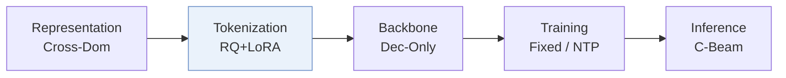
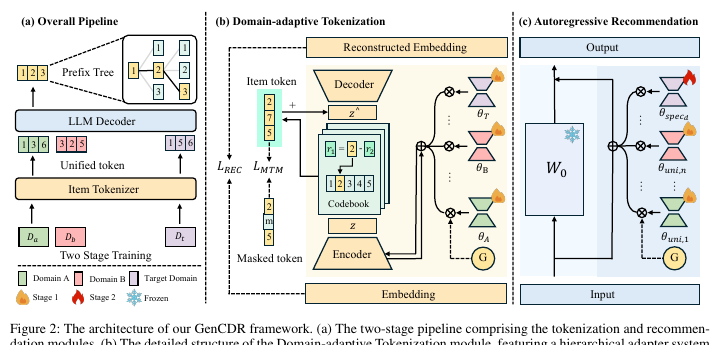
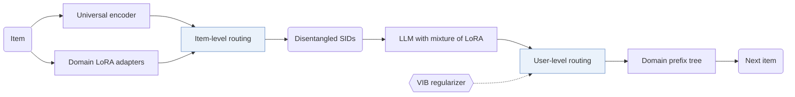
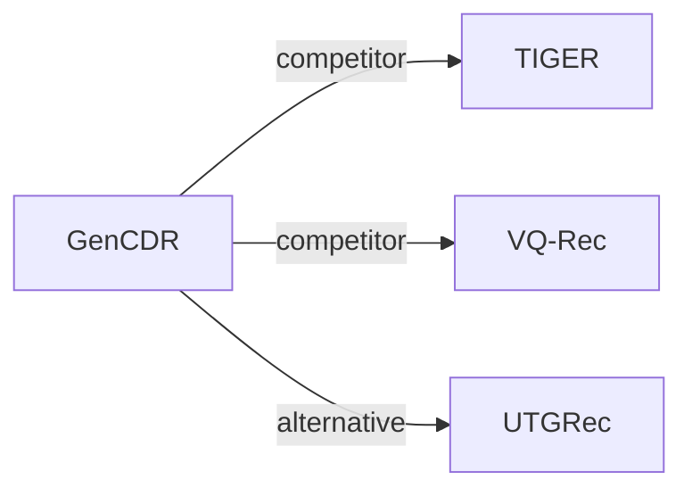

# GenCDR

| **Title** | *From ids to semantics: A generative framework for cross-domain recommendation with adaptive semantic tokenization* |
| :-- | :-- |
| **Authors** | Hu et al. |
| **Venue** | AAAI’26 |
| **Problem × Stage** | `VI. Generalization` · `Tokenization` |
| **Links** | [Paper](https://arxiv.org/abs/2511.08006) · [Code](https://github.com/hupeiyu21/GenCDR) · [Matrix](../../README.md#vi--tokenization) · [中文](../zh/papers/gencdr.md) |
| **Reading level** | Reading Notes (Level 2) |

On this page: [TL;DR](#tldr) · [At a Glance](#at-a-glance) · [1. Why It Matters](#1-why-this-paper-matters) · [2. Method](#2-how-it-works) · [3. Experiments](#3-experimental-findings) · [4. Limitations](#4-limitations--critical-analysis) · [5. Related Work](#5-connections-to-related-work)

- `Dec-Only`: Decoder-only.
- `Fixed`: SIDs are built first and not changed while the generator trains.
- `NTP`: Next-token prediction loss only; continuing from a pretrained LLM (SFT) also counts as NTP.
- `C-Beam`: Constrained beam search.

### TL;DR

> [!NOTE]
> GenCDR generates domain-disentangled Semantic IDs by routing between a universal encoder and domain adapters, and decodes over a domain-aware prefix tree, instead of relying on shared user or item IDs.

---

### At a Glance

| Aspect | Summary |
| :-- | :-- |
| Research Problem | VI. Generalization: Does it still work for new items, new domains, and shifting interests? |
| Key Contribution | GenCDR generates domain-disentangled Semantic IDs by routing between a universal encoder and domain adapters, and decodes over a domain-aware prefix tree, instead of relying on shared user or item IDs. |
| Modified Stage | Tokenization |
| Limitation | Each domain adds its own tokenizer adapter and its own offline prefix tree (Domain-adaptive Tokenization, Domain-aware Prefix-tree). |

---

### 1. Why This Paper Matters

Traditional cross-domain recommendation relies on shared user or item IDs, which most real-world scenarios do not have (Abstract). The authors state that LLM-based approaches face an item ID tokenization dilemma and insufficient domain-specific modeling (Abstract). GenCDR moves domain adaptation into the tokenizer itself.

> "GenCDR first employs a Domain-adaptive Tokenization module, which generates disentangled semantic IDs for items by dynamically routing between a universal encoder and domain-specific adapters." (Abstract)

---

### 2. How It Works

#### Domain-Adaptive Tokenization

One LoRA adapter per domain learns domain-specific representations next to the universal encoder (Domain-adaptive Tokenization).

> "To effectively integrate universal and domain-specific representations, we propose an Item-level Dynamic Semantic Routing Network that adaptively balances these representations on a per-item basis." (Domain-adaptive Tokenization)

The authors state that per-item routing reduces the negative transfer of static fusion (Domain-adaptive Tokenization).

#### Cross-Domain Autoregressive Recommendation

The generator first trains a mixture of LoRA adapters on data from all domains to capture domain-agnostic interests (Cross-domain Autoregressive Recommendation). A user-level routing network regularized by a variational information bottleneck (VIB) fuses universal and domain-specific interests (Cross-domain Autoregressive Recommendation).

#### Domain-Aware Prefix Tree

For each domain, an offline prefix tree holds all valid ID sequences from the tokenizer and restricts decoding (Domain-aware Prefix-tree).

> "Finally, a Domain-aware Prefix-tree enables efficient and accurate generation." (Abstract)

---

### 3. Experimental Findings

Experimental setup

- **Datasets**: Three cross-domain pairs: Amazon Sports-Clothing (35,598 / 39,387 users; 18,357 / 23,033 items; item overlap 1.73%, 704), Amazon Phones-Electronics (27,879 / 192,403 users; 10,429 / 63,001 items; overlap 0.55%, 404), and Douban Books-Movies (1,713 / 2,628 users; 8,601 / 20,964 items; overlap 7.48%, 2,058). Filtering rules: not reported.
  - Source: Domain pairs: [Sx5.SSx1.p1](https://arxiv.org/html/2511.08006v2#Sx5.SSx1.p1); statistics and overlap after merging: [Sx5.T1](https://arxiv.org/html/2511.08006v2#Sx5.T1); no filtering rule found in Section 5.1.
- **Split**: Chronological leave-last-out per user: last item for test, second-to-last for validation; checkpoint chosen by validation Recall@10.
  - Source: Chronological leave-last-out allocation: [Sx5.SSx1.p2](https://arxiv.org/html/2511.08006v2#Sx5.SSx1.p2); checkpoint selection: [Sx5.SSx1.p6](https://arxiv.org/html/2511.08006v2#Sx5.SSx1.p6).
- **Candidates**: not reported (full catalog versus sampled evaluation candidates); generation is restricted to the target domain's prefix tree.
  - Source: Metrics only: [Sx5.SSx1.p6](https://arxiv.org/html/2511.08006v2#Sx5.SSx1.p6).
- **Visibility**: warm; no unseen-item protocol is defined. The RQ-VAE is pre-trained on the textual features of all items.
  - Source: Standard split with no cold-start experiment: [Sx5.SSx1.p2](https://arxiv.org/html/2511.08006v2#Sx5.SSx1.p2); RQ-VAE is pre-trained on all items: [Sx4.SSx1.SSSx1.p1](https://arxiv.org/html/2511.08006v2#Sx4.SSx1.SSSx1.p1).
- **SID**: Universal RQ-VAE with M codebooks over item text embeddings, plus domain-specific LoRA adapters and an item-level router; numerical M and codebook size: not reported. Collision handling: not reported.
  - Source: M codebooks, no numerical M or codebook size: [Sx4.SSx1.SSSx1.p1](https://arxiv.org/html/2511.08006v2#Sx4.SSx1.SSSx1.p1); adapters and router: [Sx5.SSx1.p7](https://arxiv.org/html/2511.08006v2#Sx5.SSx1.p7).
- **Inference budget**: Qwen2.5-7B with LoRA experts; decoding constrained by a per-domain prefix tree with masked softmax; beam width not reported. Training on NVIDIA H200 GPUs; inference batch size not reported. Figure 6 (Qwen2.5-0.5B) reports runtime memory and inference time versus item-pool size against TriCDR and TIGER, stating constant cost; numerical latencies are only in the figure.
  - Source: Domain-aware prefix tree: [Sx4.SSx2.SSSx4.p1](https://arxiv.org/html/2511.08006v2#Sx4.SSx2.SSSx4.p1); backbone and GPUs: [Sx5.SSx1.p7](https://arxiv.org/html/2511.08006v2#Sx5.SSx1.p7); scalability figure: [Sx5.SSx6.p2](https://arxiv.org/html/2511.08006v2#Sx5.SSx6.p2) and [Sx5.F6](https://arxiv.org/html/2511.08006v2#Sx5.F6).
- **Results from**: Table 2 (six domains across three pairs versus single-domain, generative, and cross-domain baselines); Table 3 (ablations); Figures 3-6 (t-SNE, sensitivity, training efficiency, inference scalability).
  - Source: Main: [Sx5.T2](https://arxiv.org/html/2511.08006v2#Sx5.T2); ablation: [Sx5.T3](https://arxiv.org/html/2511.08006v2#Sx5.T3); efficiency: [Sx5.F5](https://arxiv.org/html/2511.08006v2#Sx5.F5) and [Sx5.F6](https://arxiv.org/html/2511.08006v2#Sx5.F6).

- Main comparison: GenCDR reports better performance than the baselines on multiple real-world datasets (Abstract).
- Ablation: Table 3 removes the MTM component, the adapter, the specific expert, the universal experts, the MoE gate, and the prefix tree (Table 3).

---

### 4. Limitations & Critical Analysis

**Our analysis.**

- The prefix trees are built offline from the tokenizer output. This suggests that new items require re-tokenization and a tree rebuild.
- VQ-Rec also transfers across domains (`Multi-Dom`), with `OPQ` codes and `Scoring`; GenCDR generates `RQ+LoRA` codes with a `Dec-Only` LLM.

---

### 5. Connections to Related Work

- **Competitor** · [TIGER](tiger.md): TIGER tokenizes one domain with a single RQ-VAE; GenCDR adds domain-specific tokenizer adapters with item-level routing and an LLM with universal and domain LoRA experts.
  - Source: GenCDR v2, baselines: https://arxiv.org/html/2511.08006v2#Sx5.SSx1.p4 and https://arxiv.org/html/2511.08006v2#Sx5.I3.i2.I1.i2.p1; Table 2: https://arxiv.org/html/2511.08006v2#Sx5.T2; inference scalability in Figure 6: https://arxiv.org/html/2511.08006v2#Sx5.F6.
- **Competitor** · [VQ-Rec](vq-rec.md): VQ-Rec transfers across domains with discrete codes in a discriminative model; GenCDR generates domain-adapted semantic IDs autoregressively.
  - Source: GenCDR v2, baselines: https://arxiv.org/html/2511.08006v2#Sx5.I3.i2.I1.i1.p1; Table 2: https://arxiv.org/html/2511.08006v2#Sx5.T2.
- **Alternative** · [UTGRec](utgrec.md): UTGRec is cited for item tokenization in generative recommendation that GenCDR describes as developed for single domains; GenCDR targets multi-domain tokenization with domain adapters.
  - Source: GenCDR v2, Related Work cites Zheng et al. (2025): https://arxiv.org/html/2511.08006v2#Sx2.p2; not a baseline in Table 2.

[View all papers in this cell](../../README.md#vi--tokenization)
