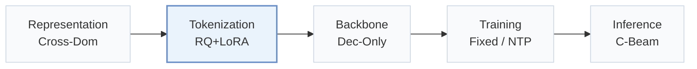
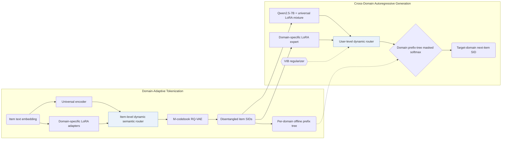
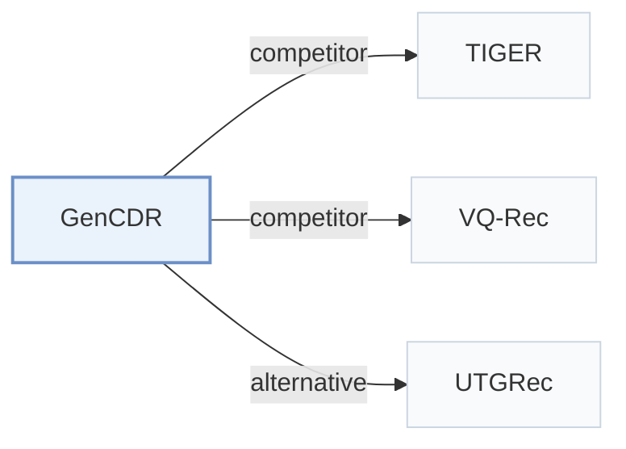

# GenCDR

[← Problem × Stage Matrix](../../README.md#vi--tokenization) · [Papers by Stage](../index/stages.md) · [Papers by Modality](../index/modality.md) · English | [中文](../zh/papers/gencdr.md)

| **Title** | *From ids to semantics: A generative framework for cross-domain recommendation with adaptive semantic tokenization* |
| :-- | :-- |
| **Authors** | Hu et al. |
| **Venue** | AAAI’26 |
| **Problem × Stage** | `VI. Generalization` · `Tokenization` |
| **Links** | [Paper](https://arxiv.org/abs/2511.08006) · [Code](https://github.com/hupeiyu21/GenCDR) |
| **Reading level** | Reading Notes (Level 2) |

**On this page**: [TL;DR](#tldr) · [At a Glance](#at-a-glance) · [1. Why It Matters](#1-why-this-paper-matters) · [2. Method](#2-how-it-works) · [3. Experiments](#3-experimental-findings) · [4. Limitations](#4-limitations--critical-analysis) · [5. Related Work](#5-connections-to-related-work)

- `Cross-Dom`: Item representations transferred or shared across multiple domains.
- `RQ+LoRA`: Residual quantization adapted per domain with LoRA modules.
- `Dec-Only`: Decoder-only.
- `Fixed`: SIDs are built first and not changed while the generator trains.
- `NTP`: Next-token prediction loss only; continuing from a pretrained LLM (SFT) also counts as NTP.
- `C-Beam`: Constrained beam search.

### TL;DR

> [!NOTE]
> GenCDR generates domain-disentangled Semantic IDs by routing between a universal encoder and domain adapters, and decodes over a domain-aware prefix tree, instead of relying on shared user or item IDs.

---

### At a Glance

| Aspect | Summary |
| :-- | :-- |
| Research Problem | VI. Generalization: Does it still work for new items, new domains, and shifting interests? |
| Key Contribution | GenCDR generates domain-disentangled Semantic IDs by routing between a universal encoder and domain adapters, and decodes over a domain-aware prefix tree, instead of relying on shared user or item IDs. |
| Modified Stage | Tokenization |
| Key Findings | Across six domains in three low-overlap cross-domain pairs—Amazon Sports-Clothing (1.73% item overlap), Phones-Electronics (0.55%), and Douban Books-Movies (7.48%)—GenCDR outperforms single-domain, generative (TIGER, VQ-Rec), and cross-domain baselines on Recall@10 and NDCG@10 while maintaining constant inference cost as catalog size grows (Sec. 5.1, Sec. 5.6, Table 1, Table 2, Table 3, Fig. 6). |
| Limitation | Each domain requires a dedicated LoRA tokenizer adapter and a separate offline prefix tree, while the number of RQ-VAE codebooks M, codebook size, collision handling, and beam width are not reported (Domain-adaptive Tokenization, Domain-aware Prefix-tree, Sec. 5.1). |

---

### 1. Why This Paper Matters

Conventional cross-domain recommenders rely on overlapping users or shared item IDs that rarely hold across real-world platforms, whereas single-tokenizer generative recommenders struggle to balance shared semantics against domain-specific characteristics (Abstract). GenCDR pushes cross-domain adaptation into both the Semantic ID (SID) tokenizer and the autoregressive LLM generator via dynamic routing and domain-constrained prefix trees.

> "GenCDR first employs a Domain-adaptive Tokenization module, which generates disentangled semantic IDs for items by dynamically routing between a universal encoder and domain-specific adapters." (Abstract)

---

### 2. How It Works

#### Domain-Adaptive Tokenization

Alongside a universal encoder pre-trained across all domains, GenCDR attaches one LoRA adapter per domain to capture domain-specific item semantics, and an item-level dynamic routing network fuses the two representations before $`M`$-codebook RQ-VAE quantization (Domain-adaptive Tokenization). Per-item routing mitigates negative transfer caused by static cross-domain fusion.

> "To effectively integrate universal and domain-specific representations, we propose an Item-level Dynamic Semantic Routing Network that adaptively balances these representations on a per-item basis." (Domain-adaptive Tokenization)

#### Cross-Domain Autoregressive Recommendation

On the Qwen2.5-7B generator side, a mixture of universal LoRA experts is trained across all domains to model shared user preferences, and a user-level routing network regularized by a variational information bottleneck (VIB) loss combines universal and domain-specific LoRA outputs (Cross-domain Autoregressive Recommendation).

#### Domain-Aware Prefix Tree

For each target domain, GenCDR builds an offline prefix tree containing all valid item SID sequences from that domain's catalog and applies masked softmax during beam decoding so generation never leaves the target domain (Domain-aware Prefix-tree).

> "Finally, a Domain-aware Prefix-tree enables efficient and accurate generation." (Abstract)

---

### 3. Experimental Findings

Experimental setup

- **Datasets**: Three cross-domain pairs: Amazon Sports-Clothing (35,598 / 39,387 users; 18,357 / 23,033 items; item overlap 1.73%, 704), Amazon Phones-Electronics (27,879 / 192,403 users; 10,429 / 63,001 items; overlap 0.55%, 404), and Douban Books-Movies (1,713 / 2,628 users; 8,601 / 20,964 items; overlap 7.48%, 2,058). Filtering rules: not reported.
  - Source: Domain pairs: [Sx5.SSx1.p1](https://arxiv.org/html/2511.08006v2#Sx5.SSx1.p1); statistics and overlap after merging: [Sx5.T1](https://arxiv.org/html/2511.08006v2#Sx5.T1); no filtering rule found in Section 5.1.
- **Split**: Chronological leave-last-out per user: last item for test, second-to-last for validation; checkpoint chosen by validation Recall@10.
  - Source: Chronological leave-last-out allocation: [Sx5.SSx1.p2](https://arxiv.org/html/2511.08006v2#Sx5.SSx1.p2); checkpoint selection: [Sx5.SSx1.p6](https://arxiv.org/html/2511.08006v2#Sx5.SSx1.p6).
- **Candidates**: not reported (full catalog versus sampled evaluation candidates); generation is restricted to the target domain's prefix tree.
  - Source: Metrics only: [Sx5.SSx1.p6](https://arxiv.org/html/2511.08006v2#Sx5.SSx1.p6).
- **Visibility**: warm; no unseen-item protocol is defined. The RQ-VAE is pre-trained on the textual features of all items.
  - Source: Standard split with no cold-start experiment: [Sx5.SSx1.p2](https://arxiv.org/html/2511.08006v2#Sx5.SSx1.p2); RQ-VAE is pre-trained on all items: [Sx4.SSx1.SSSx1.p1](https://arxiv.org/html/2511.08006v2#Sx4.SSx1.SSSx1.p1).
- **SID**: Universal RQ-VAE with M codebooks over item text embeddings, plus domain-specific LoRA adapters and an item-level router; numerical M and codebook size: not reported. Collision handling: not reported.
  - Source: M codebooks, no numerical M or codebook size: [Sx4.SSx1.SSSx1.p1](https://arxiv.org/html/2511.08006v2#Sx4.SSx1.SSSx1.p1); adapters and router: [Sx5.SSx1.p7](https://arxiv.org/html/2511.08006v2#Sx5.SSx1.p7).
- **Inference budget**: Qwen2.5-7B with LoRA experts; decoding constrained by a per-domain prefix tree with masked softmax; beam width not reported. Training on NVIDIA H200 GPUs; inference batch size not reported. Figure 6 (Qwen2.5-0.5B) reports runtime memory and inference time versus item-pool size against TriCDR and TIGER, stating constant cost; numerical latencies are only in the figure.
  - Source: Domain-aware prefix tree: [Sx4.SSx2.SSSx4.p1](https://arxiv.org/html/2511.08006v2#Sx4.SSx2.SSSx4.p1); backbone and GPUs: [Sx5.SSx1.p7](https://arxiv.org/html/2511.08006v2#Sx5.SSx1.p7); scalability figure: [Sx5.SSx6.p2](https://arxiv.org/html/2511.08006v2#Sx5.SSx6.p2) and [Sx5.F6](https://arxiv.org/html/2511.08006v2#Sx5.F6).
- **Results from**: Table 2 (six domains across three pairs versus single-domain, generative, and cross-domain baselines); Table 3 (ablations); Figures 3-6 (t-SNE, sensitivity, training efficiency, inference scalability).
  - Source: Main: [Sx5.T2](https://arxiv.org/html/2511.08006v2#Sx5.T2); ablation: [Sx5.T3](https://arxiv.org/html/2511.08006v2#Sx5.T3); efficiency: [Sx5.F5](https://arxiv.org/html/2511.08006v2#Sx5.F5) and [Sx5.F6](https://arxiv.org/html/2511.08006v2#Sx5.F6).

- Six-domain comparison: across Sports-Clothing (1.73% item overlap, 704 shared items), Phones-Electronics (0.55%, 404), and Douban Books-Movies (7.48%, 2,058), GenCDR outperforms single-domain, generative (TIGER, VQ-Rec), and cross-domain baselines on Recall@5/10 and NDCG@5/10 (Abstract, Sec. 5.1, Table 1, Table 2).
- Module ablations: Table 3 confirms accuracy drops when removing the MTM component, the tokenizer LoRA adapter, the domain-specific expert, the universal LoRA experts, the MoE routing gate, or the domain-aware prefix tree (Table 3).
- Inference scalability: on Qwen2.5-0.5B, runtime memory and inference time stay constant as candidate catalog size scales, outperforming full-catalog scoring in TriCDR and matching TIGER's scaling curve (Sec. 5.6, Fig. 5, Fig. 6).

---

### 4. Limitations & Critical Analysis

**Our analysis.**

- Because the tokenizer and per-domain prefix trees are built offline (`Fixed`), adding new items or onboarding a new domain requires re-running routed RQ-VAE quantization and rebuilding the domain prefix tree.
- The paper leaves key SID hyperparameters unspecified, including the number of codebooks $`M`$, codebook size, collision resolution, and decoding beam width (Sec. 4.1.1, Sec. 5.1).
- VQ-Rec transfers discrete `OPQ` codes across domains (`Multi-Dom`) inside a discriminative `Encoder` with `Scoring`; GenCDR learns routed `RQ+LoRA` codes (`Cross-Dom`) and decodes them autoregressively with a `Dec-Only` LLM under `C-Beam`.

---

### 5. Connections to Related Work

- **Competitor** · [TIGER](tiger.md): TIGER tokenizes one domain with a single RQ-VAE; GenCDR adds domain-specific tokenizer adapters with item-level routing and an LLM with universal and domain LoRA experts.
  - Source: GenCDR v2, baselines: [Sx5.SSx1.p4](https://arxiv.org/html/2511.08006v2#Sx5.SSx1.p4) and [Sx5.I3.i2.I1.i2.p1](https://arxiv.org/html/2511.08006v2#Sx5.I3.i2.I1.i2.p1); Table 2: [Sx5.T2](https://arxiv.org/html/2511.08006v2#Sx5.T2); inference scalability in Figure 6: [Sx5.F6](https://arxiv.org/html/2511.08006v2#Sx5.F6).
- **Competitor** · [VQ-Rec](vq-rec.md): VQ-Rec transfers across domains with discrete codes in a discriminative model; GenCDR generates domain-adapted semantic IDs autoregressively.
  - Source: GenCDR v2, baselines: [Sx5.I3.i2.I1.i1.p1](https://arxiv.org/html/2511.08006v2#Sx5.I3.i2.I1.i1.p1); Table 2: [Sx5.T2](https://arxiv.org/html/2511.08006v2#Sx5.T2).
- **Alternative** · [UTGRec](utgrec.md): UTGRec is cited for item tokenization in generative recommendation that GenCDR describes as developed for single domains; GenCDR targets multi-domain tokenization with domain adapters.
  - Source: GenCDR v2, Related Work cites Zheng et al. (2025): [Sx2.p2](https://arxiv.org/html/2511.08006v2#Sx2.p2); not a baseline in Table 2.

[View all papers in this cell](../../README.md#vi--tokenization)
