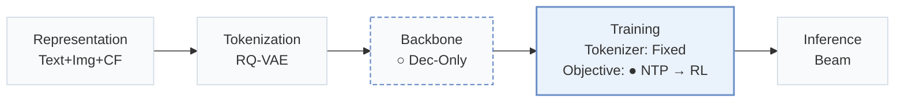
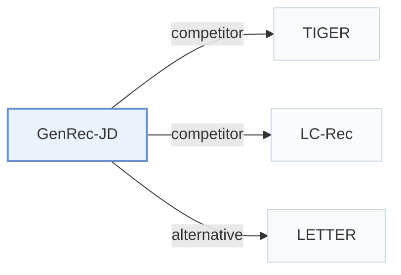

# GenRec-JD

[← Problem × Stage Matrix](../../README.md#iv--training) · [Papers by Stage](../index/stages.md) · [Papers by Modality](../index/modality.md) · [Papers by Domain](../index/domain.md) · English | [中文](../zh/papers/genrec-jd.md)

| **Title** | *GenRec: A Preference-Oriented Generative Framework for Large-Scale Recommendation* |
| :-- | :-- |
| **Authors** | Zou et al. |
| **Venue** | SIGIR’26 |
| **Problem × Stage** | `IV. Utility` · `Training` |
| **Changes** | ○ Backbone · ● Objective |
| **SID inputs** | `Text` + `Img` + `CF` |
| **Domain** | `E-commerce` |
| **Links** | [Paper](https://arxiv.org/abs/2604.14878) |
| **Reading level** | Overview (Level 1) |

**On this page**: [TL;DR](#tldr) · [3. Experiments](#3-experimental-findings) · [5. Related Work](#5-connections-to-related-work)

- `Text+Img+CF`: Text and image representations combined with collaborative signals.
- `RQ-VAE`: Residual-Quantized Variational AutoEncoder.
- `Dec-Only`: Decoder-only.
- `Fixed`: SIDs are built first and not changed while the generator trains.
- `NTP → RL`: NTP, then reinforcement learning (GRPO, GBPO, etc.).
- `Beam`: Autoregressive beam search over Semantic ID tokens.

### TL;DR

> [!NOTE]
> GenRec-JD trains a decoder-only generator with page-wise next-token prediction, compresses prompt Semantic IDs with a Token Merger, and aligns outputs with GRPO-SR under hybrid rewards.

---

### 3. Experimental Findings

Experimental setup

- **Datasets**: JD.com large-scale recommender platform: about 560 million user interaction sequences over one month. Filtering rules and catalog size: not reported.
  - Source: JD.com data scope: [S3.SS1.p1](https://arxiv.org/html/2604.14878v1#S3.SS1.p1).
- **Split**: Temporal: the last day for testing, the remaining days for training; a validation split is not reported. Online: 10% of traffic per variant for one month on JD's homepage feed.
  - Source: Last-day test split: [S3.SS1.p1](https://arxiv.org/html/2604.14878v1#S3.SS1.p1); online test: [S3.SS3.p1](https://arxiv.org/html/2604.14878v1#S3.SS3.p1).
- **Candidates**: not reported (full catalog versus sampled evaluation candidates); HR and NDCG at K=1, 10, 50 over beam-search outputs, plus the share of invalid SIDs.
  - Source: Metrics only, including the hallucination rate: [S3.SS1.p1](https://arxiv.org/html/2604.14878v1#S3.SS1.p1).
- **Visibility**: warm; no unseen-item protocol is defined. Online results report long-tail item gains without a visibility definition.
  - Source: Next-day temporal test with no unseen-item protocol: [S3.SS1.p1](https://arxiv.org/html/2604.14878v1#S3.SS1.p1); long-tail items are analyzed online only: [S3.SS3.p1](https://arxiv.org/html/2604.14878v1#S3.SS3.p1).
- **SID**: 3-level RQ K-means over Qwen2.5-VL multimodal embeddings fine-tuned on domain collaborative pairs; codebook size per level: not reported. A linear token merger compresses each SID triplet into one input vector in the prompt. Collision handling: not reported; generated invalid SIDs are measured (HaR 4.96% for GenRec).
  - Source: Qwen2.5-VL embeddings fine-tuned on collaborative pairs, RQ K-means triplets: [S2.SS1.p2](https://arxiv.org/html/2604.14878v1#S2.SS1.p2); token merger: [S2.SS2.SSS0.Px3.p1](https://arxiv.org/html/2604.14878v1#S2.SS2.SSS0.Px3.p1).
- **Inference budget**: Point-wise beam search returning beam-width items per query; numerical beam width not reported. Qwen2.5 decoder-only backbones of 1.5B, 3B, and 7B; training on 8 NVIDIA H100 GPUs; inference hardware, batch size, and latency: not reported.
  - Source: Point-wise beam search at serving: [S2.SS2.SSS0.Px2.p1](https://arxiv.org/html/2604.14878v1#S2.SS2.SSS0.Px2.p1); hardware: [S3.SS1.p1](https://arxiv.org/html/2604.14878v1#S3.SS1.p1).
- **Results from**: Table 1 (page-wise SFT versus BERT4Rec, SASRec, TIGER, LC-Rec, with hallucination rate); Table 2 (model scaling); Table 3 (GRPO-SR and reward variants); Table 4 (one-month online A/B test).
  - Source: SFT table: [S3.T1](https://arxiv.org/html/2604.14878v1#S3.T1); scaling: [S3.T2](https://arxiv.org/html/2604.14878v1#S3.T2); RL: [S3.T3](https://arxiv.org/html/2604.14878v1#S3.T3); online: [S3.T4](https://arxiv.org/html/2604.14878v1#S3.T4).

---

### 5. Connections to Related Work

- **Competitor** · [TIGER](tiger.md): TIGER is trained with point-wise next-item prediction; GenRec trains on page-wise target lists with a decoder-only LLM and aligns it with GRPO-SR.
  - Source: GenRec v1, Section 3.1 baselines: [S3.SS1.p1](https://arxiv.org/html/2604.14878v1#S3.SS1.p1); Table 1: [S3.T1](https://arxiv.org/html/2604.14878v1#S3.T1).
- **Competitor** · [LC-Rec](lc-rec.md): LC-Rec also fine-tunes an LLM on SIDs but with point-wise NTP; GenRec adds page-wise supervision, a token merger, and RL alignment.
  - Source: GenRec v1, Section 3.1 baselines: [S3.SS1.p1](https://arxiv.org/html/2604.14878v1#S3.SS1.p1); Table 1: [S3.T1](https://arxiv.org/html/2604.14878v1#S3.T1).
- **Alternative** · [LETTER](letter.md): LETTER improves the tokenizer, whereas GenRec keeps RQ K-means SIDs and changes the supervision and alignment of the generator.
  - Source: GenRec v1, Section 4 cites Wang et al. (2025), LETTER: [S4.p1](https://arxiv.org/html/2604.14878v1#S4.p1); not a baseline in Table 1.

[View all papers in this cell](../../README.md#iv--training)
