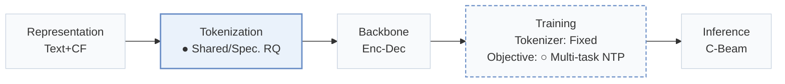
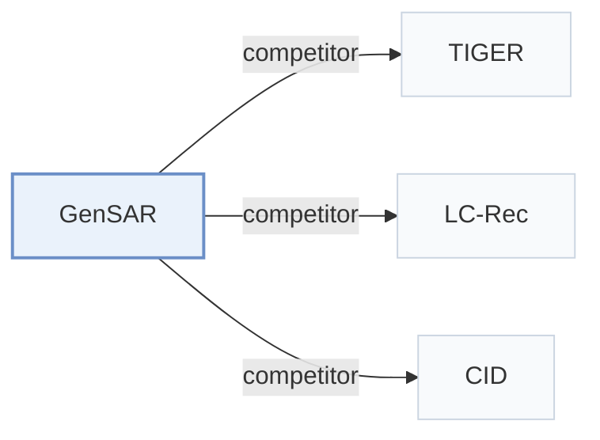

# GenSAR

[← Problem × Stage Matrix](../../README.md#i--tokenization) · [Papers by Stage](../index/stages.md) · [Papers by Modality](../index/modality.md) · [Papers by Domain](../index/domain.md) · English | [中文](../zh/papers/gensar.md)

| **Title** | *Unified Generative Search and Recommendation* |
| :-- | :-- |
| **Authors** | Shi et al. |
| **Venue** | RecSys’25 |
| **Problem × Stage** | `I. Informativeness` · `Tokenization` |
| **Changes** | ● Tokenization · ○ Objective |
| **SID inputs** | semantic: `Text` + `CF` · collaborative: `Text` + `CF` |
| **Domain** | `E-commerce` · `Search` |
| **Links** | [Paper](https://arxiv.org/abs/2504.05730) |
| **Reading level** | Overview (Level 1) |

**On this page**: [TL;DR](#tldr) · [3. Experiments](#3-experimental-findings) · [5. Related Work](#5-connections-to-related-work)

- `Text+CF`: Text representations combined with collaborative signals.
- `Shared/Spec. RQ`: Residual quantization using shared and task-specific codebooks.
- `Enc-Dec`: Encoder-decoder.
- `Fixed`: SIDs are built first and not changed while the generator trains.
- `Multi-task NTP`: The same NTP loss over several tasks.
- `C-Beam`: Constrained beam search.

### TL;DR

> [!NOTE]
> GenSAR unifies search and recommendation in one generator with dual-purpose identifiers carrying semantic and collaborative signals and task-specific training, to reduce the trade-off between the two tasks.

---

### 3. Experimental Findings

Experimental setup

- **Datasets**: Semi-synthetic Amazon Electronics search/recommendation data; Commercial Chinese-app data, 10,000 users over two weeks. Filtering rules: not reported in paper.
  - Source: Section 4.1.1: [S4.SS1.SSS1.p1](https://arxiv.org/html/2504.05730v2#S4.SS1.SSS1.p1)
- **Split**: not reported in paper; data-processing and train/validation/test details are delegated to code.
  - Source: Section 4.1.1 directs split details to code: [S4.SS1.SSS1.p1](https://arxiv.org/html/2504.05730v2#S4.SS1.SSS1.p1)
- **Candidates**: Recommendation sampled: 99 random negatives excluding user-interacted items, plus the target. Search sampled: 99 BM25-retrieved hard negatives, plus the target; search history exclusion: not reported.
  - Source: Tables 3 and 4 captions: [S4.T3](https://arxiv.org/html/2504.05730v2#S4.T3) and [S4.T4](https://arxiv.org/html/2504.05730v2#S4.T4)
- **Visibility**: warm; no unseen-item protocol is defined. Collaborative-encoder exposure to test items: not reported.
  - Source: Sections 3.2.1 and 4.1 define no unseen-item protocol: [S3.SS2.SSS1.p1](https://arxiv.org/html/2504.05730v2#S3.SS2.SSS1.p1) and [S4.SS1](https://arxiv.org/html/2504.05730v2#S4.SS1)
- **SID**: Shared/task-specific RQ-VAE; sensitivity favors 2 shared + 2 task-specific codes. Numerical codebook size and collision handling: not reported; semantic/collaborative collision rates 0.18%/0.39%.
  - Source: Sections 3.2.2 and 4.4.2-4.4.3: [S3.SS2.SSS2.p1](https://arxiv.org/html/2504.05730v2#S3.SS2.SSS2.p1) and [S4.SS4.SSS2.p1](https://arxiv.org/html/2504.05730v2#S4.SS4.SSS2.p1) and [S4.SS4.SSS3.p2](https://arxiv.org/html/2504.05730v2#S4.SS4.SSS3.p2)
- **Inference budget**: Constrained beam search; HR/NDCG@1/5/10. Beam width, hardware, inference batch size, latency: not reported in paper.
  - Source: Sections 3.4.2 and 4.1.3: [S3.SS4.SSS2.p1](https://arxiv.org/html/2504.05730v2#S3.SS4.SSS2.p1) and [S4.SS1.SSS3.p1](https://arxiv.org/html/2504.05730v2#S4.SS1.SSS3.p1)
- **Results from**: Original Tables 3/4: recommendation/search; Table 5: task ablations; Figures 4-7: identifier analyses.
  - Source: Tables 3-5 and Figures 4-7: [S4.T3](https://arxiv.org/html/2504.05730v2#S4.T3) and [S4.T4](https://arxiv.org/html/2504.05730v2#S4.T4) and [S4.T5](https://arxiv.org/html/2504.05730v2#S4.T5) and [S4.F4](https://arxiv.org/html/2504.05730v2#S4.F4) and [S4.F7](https://arxiv.org/html/2504.05730v2#S4.F7)

---

### 5. Connections to Related Work

- **Competitor** · [TIGER](tiger.md): TIGER is a recommendation baseline; GenSAR extends RQ-VAE identifiers with shared and task-specific codes for joint search/recommendation.
  - Source: GenSAR v2, Sections 1 and 4.1.2, Table 3: [S1.p6](https://arxiv.org/html/2504.05730v2#S1.p6); [S4.SS1.SSS2.p2](https://arxiv.org/html/2504.05730v2#S4.SS1.SSS2.p2); [S4.T3](https://arxiv.org/html/2504.05730v2#S4.T3).
- **Competitor** · [LC-Rec](lc-rec.md): LC-Rec is a generative recommendation baseline; GenSAR learns separate semantic/collaborative identifiers and joint search/recommendation tasks.
  - Source: GenSAR v2, Sections 3.2 and 4.1.2, Table 3: [S3.SS2.p1](https://arxiv.org/html/2504.05730v2#S3.SS2.p1); [S4.SS1.SSS2.p2](https://arxiv.org/html/2504.05730v2#S4.SS1.SSS2.p2); [S4.T3](https://arxiv.org/html/2504.05730v2#S4.T3).
- **Competitor** · [CID](cid.md): P5-CID is a generative recommendation baseline; GenSAR uses learned shared/task-specific codebooks.
  - Source: GenSAR v2, Sections 2 and 4.1.2, Table 3: [S2.p2](https://arxiv.org/html/2504.05730v2#S2.p2); [S4.SS1.SSS2.p2](https://arxiv.org/html/2504.05730v2#S4.SS1.SSS2.p2); [S4.T3](https://arxiv.org/html/2504.05730v2#S4.T3).

[View all papers in this cell](../../README.md#i--tokenization)
