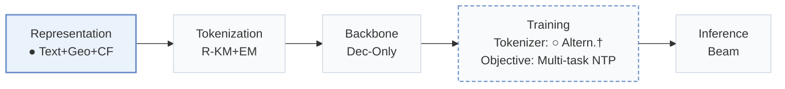
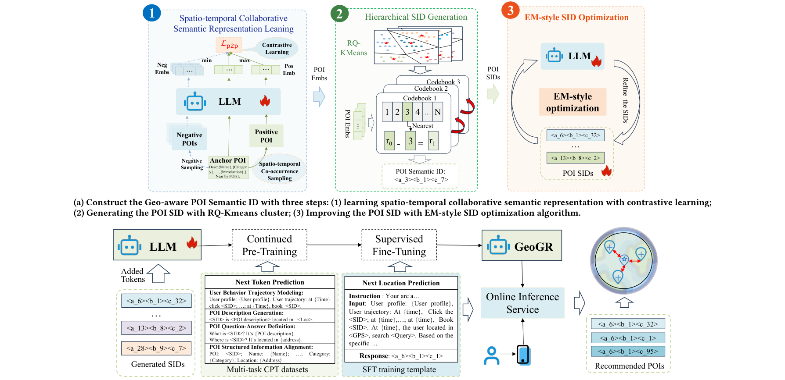
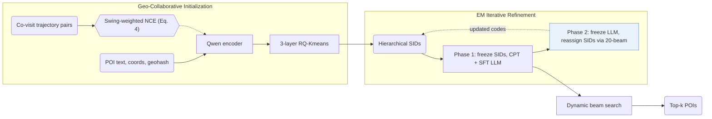
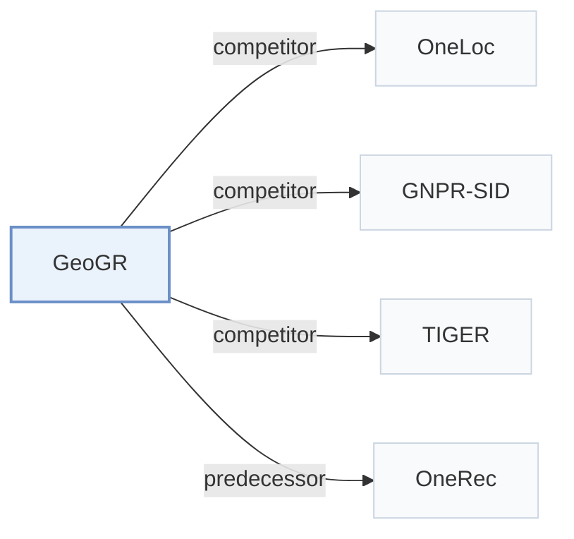

# GeoGR

[← Problem × Stage Matrix](../../README.md#i--representation) · [Papers by Stage](../index/stages.md) · [Papers by Modality](../index/modality.md) · [Papers by Domain](../index/domain.md) · English | [中文](../zh/papers/geogr.md)

| **Title** | *Enabling Spatio-Temporal Aware Industrial-Scale Generative POI Recommendations* |
| :-- | :-- |
| **Authors** | Wang et al. |
| **Venue** | arXiv’26 |
| **Problem × Stage** | `I. Informativeness` · `Representation` · `POI` |
| **Changes** | ● Representation · ○ Tokenizer |
| **SID inputs** | `Text` + `Geo` + `CF` |
| **Domain** | `POI / Local` · `Search` |
| **Scenario** | `POI and Local Services` · `Query-Conditioned Retrieval`; `Online Experiment or Deployment` |
| **Links** | [Paper](https://arxiv.org/abs/2602.10411) |
| **Reading level** | Reading Notes (Level 2) |

**On this page**: [TL;DR](#tldr) · [At a Glance](#at-a-glance) · [1. Why It Matters](#1-why-this-paper-matters) · [2. Method](#2-how-it-works) · [3. Experiments](#3-experimental-findings) · [4. Limitations](#4-limitations--critical-analysis) · [5. Related Work](#5-connections-to-related-work)

- `Text+Geo+CF`: Text representations combined with geographic features and collaborative signals.
- `R-KM+EM`: Residual k-means with expectation-maximization-style refinement.
- `Dec-Only`: Decoder-only.
- `Altern.†`: Tokenizer and generator updated in alternation (inferred).
- `Multi-task NTP`: The same NTP loss over several tasks.
- `Beam`: Autoregressive beam search over Semantic ID tokens.

### TL;DR

> [!NOTE]
> GeoGR builds geo-aware POI Semantic IDs from geographically constrained co-visited pairs, contrastive learning, and iterative refinement, then aligns an LLM to them through continued pre-training and fine-tuning.

---

### At a Glance

| Aspect | Summary |
| :-- | :-- |
| Key Findings | In a three-month deployment on the AMAP platform, GeoGR reports online gains of +2.91% in WINRATE and +5.55% in PV_CTR (Abstract). |
| Limitation | Semantic IDs (SIDs) are updated from the LLM's predictions, tying each codebook version to the specific LLM checkpoint used during refinement (Sec. 4.1.3). |

---

### 1. Why This Paper Matters

Standard point-of-interest (POI) SID tokenizers miss cross-category spatio-temporal co-visitation patterns and align poorly with pretrained large language models (LLMs) (Abstract). GeoGR couples Swing-weighted co-visit contrastive learning with an alternating EM-style refinement loop between RQ-Kmeans codes and a Qwen generator for industrial navigation services on AMAP.

> "Instead, we explicitly model the joint constraints of geographic proximity and behavioral co-occurrence by constructing spatiotemporal co-visit POI pairs." (Sec. 4.1.1)

---

### 2. How It Works

#### Location Description

Each POI prompt combines coordinates, address, name, brand, categories, geohash code, consumption level, and active time period, which a Qwen encoder maps into a dense representation (Sec. 4.1.1).

#### Co-Visit Contrastive Learning

POI pairs that frequently co-occur within user trajectories are weighted by Swing similarity to downweight popular hubs, training the encoder under an NCE contrastive objective (Sec. 4.1.1, Eq. 4).

#### Quantization and Iterative Refinement

RQ-Kmeans discretizes the aligned embeddings into initial 3-layer hierarchical SIDs (Sec. 1). GeoGR then alternates between updating the generator and reassigning SIDs from the generator's predictive distribution:

> "As shown in Algorithm 1, the framework alternates between two phases: (1) fixing the SIDs and fine-tuning the LLM to better predict them, and (2) fixing the LLM and updating the SIDs based on its predictions." (Sec. 4.1.3)

#### Multi-Stage LLM Training

Continued pre-training (CPT) warms up the out-of-vocabulary SID tokens across multi-task prompt templates covering POI metadata and user behavior sequences (Sec. 4.2.1), followed by supervised fine-tuning (SFT) for next-POI generation (Abstract).

> "Since the newly introduced SID tokens are out-of-vocabulary for the base LLM, we first perform Continued Pre-Training (CPT) to warm up these tokens and inject scenario-specific recommendation knowledge." (Sec. 4.2)

---

### 3. Experimental Findings

Experimental setup

- **Datasets**: Foursquare NYC and TKY (11 months of check-ins; POIs with fewer than 10 interactions and users with fewer than 10 check-ins removed, following GNPR-SID; 2,083 users / 5,135 POIs and 2,293 / 7,873), and AMAP industrial data: AMAP (one day of platform-wide traffic with users' traced histories; 7,536K users / 34,119K POIs) and AMAP-SH (one month in Shanghai; 4,820K users / 910K POIs). Industrial filtering rules: not reported.
  - Source: Datasets and filtering: [S5.SS1.SSS1.p1](https://arxiv.org/html/2602.10411v2#S5.SS1.SSS1.p1) and [S5.SS1.SSS1.p2](https://arxiv.org/html/2602.10411v2#S5.SS1.SSS1.p2); statistics: [S5.T1](https://arxiv.org/html/2602.10411v2#S5.T1).
- **Split**: NYC and TKY: records sorted by time and split 80% / 10% / 10% into training, validation, and test. AMAP: one day for training and 1 million records randomly sampled from the following day for testing. AMAP-SH: last day held out for testing. Online: three-month A/B test against the legacy multi-stage retrieval.
  - Source: Splits: [S5.SS1.SSS1.p2](https://arxiv.org/html/2602.10411v2#S5.SS1.SSS1.p2); online test: [S5.SS9.p2](https://arxiv.org/html/2602.10411v2#S5.SS9.p2).
- **Candidates**: not reported (full catalog versus sampled evaluation candidates); top-k SIDs come from beam search.
  - Source: Metrics only: [S5.SS1.SSS2.p1](https://arxiv.org/html/2602.10411v2#S5.SS1.SSS2.p1).
- **Visibility**: warm; no unseen-item protocol is defined.
  - Source: Temporal splits with no unseen-POI protocol: [S5.SS1.SSS1.p2](https://arxiv.org/html/2602.10411v2#S5.SS1.SSS1.p2).
- **SID**: 3 RQ-Kmeans layers over Qwen-4B POI embeddings with geographic co-visitation alignment; codebook size stated as 32 and 64 for NYC and TKY, respectively, and 4,096 for AMAP and AMAP-SH. SIDs are refined by an EM-style loop with the LLM, using a 20-candidate dynamic beam to prevent SID collisions; a final collision-resolution rule is not reported.
  - Source: Three RQ-Kmeans layers and codebook sizes: [S5.SS1.SSS4.p1](https://arxiv.org/html/2602.10411v2#S5.SS1.SSS4.p1) and [S4.SS1.SSS2.p2](https://arxiv.org/html/2602.10411v2#S4.SS1.SSS2.p2); RQ-Kmeans following OneRec: [S4.SS1.p1](https://arxiv.org/html/2602.10411v2#S4.SS1.p1); EM refinement with 20-candidate beam to avoid collisions: [S4.SS1.SSS3.p1](https://arxiv.org/html/2602.10411v2#S4.SS1.SSS3.p1).
- **Inference budget**: Offline: beam search for the top-k SIDs; numerical beam width not reported. Online: dynamic beam search generating 50 candidate SIDs per request; GeoGR-0.6B averages 50 ms per request on NVIDIA H20 GPUs versus 90 ms for GeoGR-4B; inference batch size not reported. Training on 16 H20 GPUs with per-GPU batch 16.
  - Source: Beam search for top-k: [S4.SS2.SSS2.p4](https://arxiv.org/html/2602.10411v2#S4.SS2.SSS2.p4); deployment budget and latency: [S5.SS9.p1](https://arxiv.org/html/2602.10411v2#S5.SS9.p1); training hardware: [S5.SS1.SSS4.p1](https://arxiv.org/html/2602.10411v2#S5.SS1.SSS4.p1).
- **Results from**: Table 2 (NYC, TKY versus traditional, POI, and generative baselines); Table 3 (AMAP, AMAP-SH); Table 4 (ablation); Table 5 (SID quality); Table 6 (CPT effect); Section 5.6 (model scaling); Table 7 and Section 5.9 (three-month online A/B test).
  - Source: Public: [S5.T2](https://arxiv.org/html/2602.10411v2#S5.T2); industrial: [S5.T3](https://arxiv.org/html/2602.10411v2#S5.T3); ablation: [S5.T4](https://arxiv.org/html/2602.10411v2#S5.T4); SID evaluation: [S5.T5](https://arxiv.org/html/2602.10411v2#S5.T5); CPT: [S5.T6](https://arxiv.org/html/2602.10411v2#S5.T6); scaling: [S5.SS6.p2](https://arxiv.org/html/2602.10411v2#S5.SS6.p2); online: [S5.SS9.p2](https://arxiv.org/html/2602.10411v2#S5.SS9.p2).

- Offline comparison: GeoGR outperforms traditional sequential, POI, and generative baselines across Foursquare and AMAP datasets (Abstract).
- Online deployment: in a three-month online A/B test serving millions of users on AMAP, GeoGR achieves +2.91% WINRATE and +5.55% PV_CTR over the multi-stage production baseline (Abstract).

---

### 4. Limitations & Critical Analysis

**Our analysis.**

- OneLoc incorporates visual features and aligns an `Enc-Dec` generator via DPO; GeoGR injects spatio-temporal co-visitation into tokenization and trains a `Dec-Only` LLM with `Multi-task NTP`.
- GNPR-SID freezes its `RQ-VAE` codes prior to generator training; GeoGR iteratively updates its `R-KM+EM` codes against the LLM's own predictions.

---

### 5. Connections to Related Work

- **Competitor** · [OneLoc](oneloc.md): OneLoc injects geography into the SID input embedding and adds geographic rewards; GeoGR builds geo-aware SIDs from geographically constrained co-visitation and refines them with an EM loop tied to the LLM.
  - Source: GeoGR v2, Table 2 (POI baseline) and Table 3 (strongest industrial baseline): [S5.T2](https://arxiv.org/html/2602.10411v2#S5.T2) and [S5.T3](https://arxiv.org/html/2602.10411v2#S5.T3); discussion in Section 5.2.2: [S5.SS2.SSS2.p3](https://arxiv.org/html/2602.10411v2#S5.SS2.SSS2.p3).
- **Competitor** · [GNPR-SID](gnpr-sid.md): GNPR-SID builds POI semantic IDs for next-POI generation; GeoGR follows its preprocessing and adds co-visitation alignment, EM-style SID refinement, and CPT plus SFT.
  - Source: GeoGR v2, follows the GNPR-SID preprocessing: [S5.SS1.SSS1.p2](https://arxiv.org/html/2602.10411v2#S5.SS1.SSS1.p2); Tables 2, 3, 5, and 6: [S5.T2](https://arxiv.org/html/2602.10411v2#S5.T2), [S5.T3](https://arxiv.org/html/2602.10411v2#S5.T3), [S5.T5](https://arxiv.org/html/2602.10411v2#S5.T5), [S5.T6](https://arxiv.org/html/2602.10411v2#S5.T6).
- **Competitor** · [TIGER](tiger.md): TIGER uses content RQ-VAE SIDs with a small Transformer; GeoGR uses geo-aware RQ-Kmeans SIDs with an LLM aligned through continued pre-training.
  - Source: GeoGR v2, Tables 2 and 3: [S5.T2](https://arxiv.org/html/2602.10411v2#S5.T2) and [S5.T3](https://arxiv.org/html/2602.10411v2#S5.T3).
- **Predecessor** · [OneRec](onerec.md): GeoGR adopts OneRec's RQ-Kmeans tokenization and adds geographic co-visitation signals and EM-style refinement.
  - Source: GeoGR v2, Section 4.1 adopts the RQ-Kmeans strategy of Deng et al. (2025): [S4.SS1.p1](https://arxiv.org/html/2602.10411v2#S4.SS1.p1).

[View all papers in this cell](../../README.md#i--representation)
