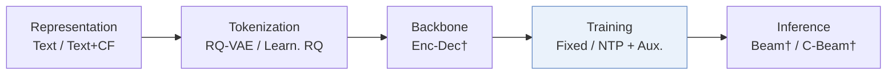
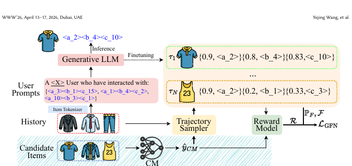
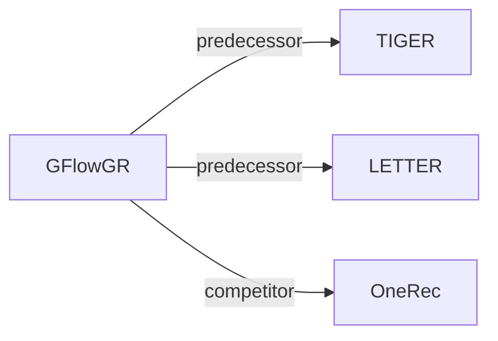

# GFlowGR

*Fine-Tuning Generative Recommendation Frameworks with Generative Flow Networks* — Wang et al. · SIGIR’26

`IV. Utility` · `Training` · [Paper](https://arxiv.org/abs/2506.16114) · [Code](https://github.com/Applied-Machine-Learning-Lab/SIGIR26_GFlowGR) · [Matrix](../../README.md#iv--training) · [中文](../zh/papers/gflowgr.md)

Reading level: Reading Notes (Level 2) · On this page: [TL;DR](#tldr) · [At a Glance](#at-a-glance) · [1. Why It Matters](#1-why-this-paper-matters) · [2. Method](#2-how-it-works) · [3. Experiments](#3-experimental-findings) · [4. Limitations](#4-limitations--critical-analysis) · [5. Related Work](#5-connections-to-related-work)

- `Text / Text+CF`: Text-only representations or text representations combined with collaborative signals.
- `RQ-VAE / Learn. RQ`: Residual-quantized variational codes or learnable residual-quantization codes in different configurations.
- `Fixed`: SIDs are built first and not changed while the generator trains.
- `NTP + Aux.`: NTP plus another auxiliary loss.
- `Beam† / C-Beam†`: Beam search or constrained beam search in the respective inherited configurations.

### TL;DR

> [!NOTE]

> GFlowGR fine-tunes generative recommenders as multi-step generation with GFlowNets, using a collaborative trajectory sampler and reward model to explore unobserved positives, instead of next-token or DPO fine-tuning.

### At a Glance

| Aspect | Summary |
| :-- | :-- |
| Research Problem | IV. Utility: Are training and search aimed at what users and the platform value, rather than at token likelihood? |
| Key Contribution | GFlowGR fine-tunes generative recommenders as multi-step generation with GFlowNets, using a collaborative trajectory sampler and reward model to explore unobserved positives, instead of next-token or DPO fine-tuning. |
| Modified Stage | Training |
| Key Findings | On Taobao production data, GFlowGR reports H@20 of 0.444 and N@20 of 0.452 against 0.358 and 0.371 for SFT, and a 15-day online A/B test shows a +0.43% lift in total revenue (Sec. 5, Table 7). |
| Limitation | The reward model learns item utility from logged user signals, so the fine-tuning target is only as good as those logs (Sec. 3.2). |

### 1. Why This Paper Matters

Generative recommendation (GR) models are usually fine-tuned with the next-token loss of supervised fine-tuning (SFT) or with DPO-style objectives (Abstract). The authors state that these objectives predict a single ground-truth item and treat all interactions as equally informative (Abstract).

> "To address these challenges, we reformulate GR as a sequential set-generation problem and propose GFlowGR, a GFlowNet-based fine-tuning framework that explicitly aligns generation probabilities with item-level utilities." (Abstract)

Based on arXiv v3.

### 2. How It Works

#### Trajectory Sampler

The trajectory set comes from four methods (Sec. 3.1). The authors state that random samples cause training instability and drift from the model's learning dynamics (Sec. 3.1).

> "There are four methods for constructing the trajectory set: interaction log, random sampling, CM-based sampling, and on-policy sampling." (Sec. 3.1)

#### Reward Model

A behavior-aware reward model quantifies item utility from heterogeneous user signals (Sec. 1, Sec. 3.2).

#### GFlowNet Objectives

The paper derives detailed balance (DB) and trajectory balance (TB) objectives from the flow-matching principle (Sec. 2).

### 3. Experimental Findings

Experimental setup

- **Datasets**: Yelp, Amazon Beauty, and Amazon Instruments, preprocessed following LETTER (filter thresholds not restated); 30,431 / 20,032, 22,362 / 12,101, and 24,772 / 9,922 users / items. Production: Taobao search advertising data with hundreds of millions of daily requests; filtering not reported.
  - Source: Datasets and LETTER preprocessing: [S4.SS1.p1](https://arxiv.org/html/2506.16114v3#S4.SS1.p1); statistics: [S4.T1](https://arxiv.org/html/2506.16114v3#S4.T1); production data: [S5.p2](https://arxiv.org/html/2506.16114v3#S5.p2).
- **Split**: Per-user leave-one-out: last item for test, second-to-last for validation, the rest for training. Three random seeds. Online: 15-day A/B test on 10% of traffic (50/50).
  - Source: Leave-one-out allocation: [S4.SS1.p1](https://arxiv.org/html/2506.16114v3#S4.SS1.p1); three seeds: [S4.SS1.p2](https://arxiv.org/html/2506.16114v3#S4.SS1.p2); online test: [S5.p3](https://arxiv.org/html/2506.16114v3#S5.p3).
- **Candidates**: not reported (full catalog versus sampled evaluation candidates); top-5 and top-10 lists. Training negatives for the flow objective come from a collaborative-model sampler or beam search, which is a training choice, not the evaluation candidate set.
  - Source: Metrics only: [S4.SS1.p2](https://arxiv.org/html/2506.16114v3#S4.SS1.p2).
- **Visibility**: warm; no unseen-item protocol is defined. Online, newly listed items gain 4.0% revenue, but their tokenizer and generator visibility is not reported.
  - Source: Standard split with no unseen-item protocol: [S4.SS1.p1](https://arxiv.org/html/2506.16114v3#S4.SS1.p1); online newly listed items without visibility definition: [S5.p3](https://arxiv.org/html/2506.16114v3#S5.p3).
- **SID**: Uses the TIGER and LETTER tokenizers as backbones; layer count and codebook size for the experiments: not reported (Figure 1 illustrates L=3). Collision handling: not reported; the paper notes that intermediate states do not uniquely identify items.
  - Source: Backbones TIGER and LETTER, no own SID settings: [S4.SS1.p2](https://arxiv.org/html/2506.16114v3#S4.SS1.p2); L=3 appears in the overview figure: [S1.F1](https://arxiv.org/html/2506.16114v3#S1.F1).
- **Inference budget**: Decoding method and beam width for evaluation: not reported. All experiments run on the same GPU (model not stated). Table 7 reports training cost on production data (GFlowGR 2.1x SFT with 80x samples); inference latency and batch size: not reported.
  - Source: Hardware statement and cost: [S4.SS1.p3](https://arxiv.org/html/2506.16114v3#S4.SS1.p3) and [S4.T7](https://arxiv.org/html/2506.16114v3#S4.T7).
- **Results from**: Table 2 (Beauty, Instruments, Yelp; SFT, GRPO, DPO-family baselines on TIGER and LETTER backbones); Tables 3-6 (rewards, combination, sample selection, LLM reward); Figures 3-4 (parameter study); Table 7 and Section 5 (production offline and 15-day online A/B).
  - Source: Main: [S4.T2](https://arxiv.org/html/2506.16114v3#S4.T2); ablations and strategies: [S4.T3](https://arxiv.org/html/2506.16114v3#S4.T3), [S4.T4](https://arxiv.org/html/2506.16114v3#S4.T4), [S4.T5](https://arxiv.org/html/2506.16114v3#S4.T5), [S4.T6](https://arxiv.org/html/2506.16114v3#S4.T6); production: [S4.T7](https://arxiv.org/html/2506.16114v3#S4.T7) and [S5.p3](https://arxiv.org/html/2506.16114v3#S5.p3).

- Public data: the paper evaluates GFlowGR with two different GR backbones (Abstract).
- Production data: GRPO reaches H@20 = 0.427 and N@20 = 0.408 (Sec. 5, Table 7).

  > "The results show that GFlowGR achieves H@20 of 0.444 and N@20 of 0.452, substantially outperforming SFT (0.358/0.371) and GRPO (0.427/0.408), mirroring the conclusions on public datasets." (Sec. 5)

- Online test: the A/B test used 10% of traffic with a 50/50 split (Sec. 5).
- Deployment: since May 2025, GFlowGR trains the GR models of Taobao search advertising, including Taobao Mobile, Xianyu, and Taobao Web (Sec. 5).

### 4. Limitations & Critical Analysis

**Our analysis.**

- GFlowGR changes only the fine-tuning objective. This suggests that its gains add to the choice of tokenizer rather than replace it.
- OneRec aligns its generator by `NTP → DPO`; GFlowGR adds a GFlowNet loss to the next-token loss (`NTP + Aux.`).

### 5. Connections to Related Work

- **前序工作** · [TIGER](tiger.md): TIGER is one of the two generative backbones; GFlowGR updates the LLM with the sum of the SFT loss and a GFlowNets loss over augmented generation trajectories.
  - Source: GFlowGR v3, Section 4.1 installs GFlowGR on TIGER: https://arxiv.org/html/2506.16114v3#S4.SS1.p2; Table 2: https://arxiv.org/html/2506.16114v3#S4.T2; training objective: https://arxiv.org/html/2506.16114v3#S3.SS4.p1.
- **前序工作** · [LETTER](letter.md): LETTER supplies the second backbone and the data preprocessing; GFlowGR changes only the fine-tuning objective.
  - Source: GFlowGR v3, Section 4.1 follows LETTER preprocessing and uses it as a backbone: https://arxiv.org/html/2506.16114v3#S4.SS1.p1 and https://arxiv.org/html/2506.16114v3#S4.SS1.p2; Table 2: https://arxiv.org/html/2506.16114v3#S4.T2.
- **同期对比** · [OneRec](onerec.md): OneRec's IPA aligns the model by iterative SFT and DPO with reward-selected rejected samples; GFlowGR learns probabilities proportional to rewards over many trajectories.
  - Source: GFlowGR v3, IPA baseline from OneRec, reimplemented with the same reward model: https://arxiv.org/html/2506.16114v3#S4.I2.i6.p1 and https://arxiv.org/html/2506.16114v3#S4.SS1.p3; Table 2: https://arxiv.org/html/2506.16114v3#S4.T2.

[查看同格全部论文](../../README.md#iv--training)
