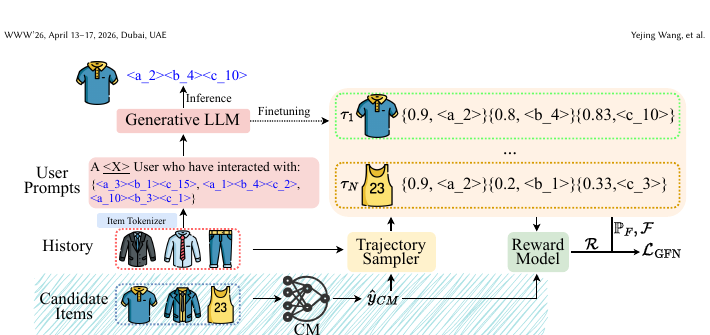

# GFlowGR: GFlowGR: Fine-Tuning Generative Recommendation Frameworks with Generative Flow Networks

[Back to Catalog](../../README.md) · [Paper (`https://arxiv.org/abs/2506.16114`)](https://arxiv.org/abs/2506.16114) · [Source Record (`data/papers/gflowgr.yaml`)](../../data/papers/gflowgr.yaml)

> **Summary**: Abstract: "Both methods ignore the exploration of possible positive unobserved samples, which is commonly referred to as the exposure bias problem". Candidates: IV / none (rule: IV threshold: a flawed training objective counts).

## Taxonomy & Table 1 Specification

| Field | Value | Vocabulary Definition |
| :--- | :--- | :--- |
| **Authors & Year** | Wang et al. (2026) | Published / posted in `SIGIR’26` |
| **Problem Band** | `IV. Utility` | Are training and search aimed at what users and the platform value, rather than at token likelihood? |
| **Primary Stage** | `Training` | The primary design change sits in the Training stage (Tokenizer update schedule or training Objective). |
| **Representation** | `Text / Text+CF` | Text-only setting (TIGER/RQ) vs. text plus collaborative setting (LETTER/ Vibrent vs. industrial). |
| **Tokenization** | `RQ-VAE / Learn. RQ` | Evaluated on both standard RQ-VAE (TIGER) and learnable collaborative RQ (LETTER). |
| **Backbone** | `Enc-Dec†` |  |
| **Tokenizer Training** | `Fixed` | SIDs are built first and not changed while the generator trains. |
| **Training Objective** | `NTP + Aux.` | NTP plus another auxiliary loss. |
| **Inference Decoding** | `Beam† / C-Beam†` | Unconstrained beam search (TIGER) vs. constrained beam search (LETTER) (GFlowGR). |
| **POI / Local-Life** | `false` | Point-of-interest / geographic recommendation indicator |
| **Code Repository** | Not reported | Official or public implementation link |

## Architecture

## Verbatim Evidence & Rationale

- **`problem`** (arXiv abstract): Abstract: "Both methods ignore the exploration of possible positive unobserved samples, which is commonly referred to as the exposure bias problem". Candidates: IV / none (rule: IV threshold: a flawed training objective counts).
- **`representation`** (§4.1, p6): Settings A/B take the TIGER and LETTER rows of Table 1.
- **`tokenization`** (§4.1, p6): Settings A/B take the TIGER and LETTER rows of Table 1.

## 旧卡片说明

迁自 `d61aa6c:papers/gflowgr.md`。保留方法说明、实验叙述与局限；本轮只对照现有记录处理明确冲突，未重新逐句核查原论文。分类和规格以页面上方由记录生成的表格为准。

### GFlowGR：生成流网络生成式推荐微调

> GFlowGR 将生成流网络用于生成式推荐微调，使模型从多条可能的生成轨迹中学习更符合推荐价值的物品标识。

### 研究动机与问题定义

最大似然训练倾向于复现日志中的单一路径，难以表达推荐结果的多样性和长期价值。GFlowGR 将 SID 生成过程视为轨迹采样问题，用奖励约束生成分布。

### TL;DR（核心摘要）

`用户历史 → SID生成轨迹 → 奖励模型 → GFlowNet微调 → 推荐物品`

框架从交互日志、随机采样、协同模型或在线策略获得轨迹，并训练奖励模型评估生成结果。GFlowNet 目标在训练阶段调整生成概率；在线仍由生成器直接产生完整 SID 并映射物品。

### 输入与使用场景

| 方面 | 说明 |
|---|---|
| 使用信息 | 交互日志、协同信号和生成轨迹 |
| 信息融入位置 | 奖励模型与轨迹采样 |
| 语义标识结构 | 多 token 序列 |
| 适用场景 | 偏好对齐与多样化推荐 |

### 方法设计

#### 3.1 轨迹采样器（Trajectory Sampler）
GFlowGR 把 SID 逐 token 生成看作从根节点到完整物品标识的轨迹。轨迹可以来自交互日志、随机策略、协同模型、组合采样或当前生成策略，用于覆盖单一监督路径之外的候选空间。

#### 3.2 奖励模型（Reward Model）
奖励模型评估完整生成结果或中间轨迹的推荐价值，将点击/偏好等信号转成训练奖励。它负责提供 GFlowNet 所需的终点价值，但不作为在线独立精排器。

#### 3.3 GFN 训练目标
模型学习前向生成概率与后向流之间的平衡，使不同高价值 SID 轨迹获得合理概率。该目标鼓励多条有效生成路径共存，缓解最大似然对单一日志目标的过拟合。

#### 3.4 训练与推理
训练阶段交替采样轨迹、计算奖励和更新生成器；推理阶段仍由生成器直接产生 SID。实验还分析不同轨迹来源、参数设置和部署成本。

### 实验结论

- GFlowNet 微调改善了生成推荐的排序表现。
- 不同轨迹来源对训练效果有影响，在线策略轨迹更贴近目标。

### 局限性与研究定位

#### 局限性
- 奖励模型和轨迹采样带来额外训练成本。
- 奖励偏差、探索范围与线上稳定性仍需验证。

#### 研究定位
GFlowGR 的贡献是把生成式推荐的偏好微调改写为生成流学习问题，适合放在“生成轨迹优化与偏好学习”章节。

### 标签

`生成流网络` · `偏好优化` · `SID生成` · `序列推荐`

### 架构图来源

*图源：原论文，图2。图片使用许可待核实。*

---

### 旧总表补充

来源：`d61aa6c:tables/all-methods.md`。

- 核心贡献：用生成流网络进行偏好微调。
- 使用场景：偏好对齐。

## Peer Methods in `IV. Utility` × `Training` (21 peers)

| Method | Venue | Representation | Tokenization | Backbone | Tokenizer | Objective | Inference |
| :--- | :--- | :--- | :--- | :--- | :--- | :--- | :--- |
| [APAO](apao.md) | KDD’26 | `Text` | `R-KM` | `Enc-Dec / Dec-Only` | `Fixed` | `NTP + Rank` | `Beam` |
| [DASO](daso.md) | arXiv’26 | `Text` | `RQ-VAE` | `Dec-Only` | `Fixed` | `NTP → RL` | `C-Beam` |
| [DPE-Rec](dpe-rec.md) | arXiv’26 | `– / Text+Img` | `RQ` | `Non-AR` | `Fixed` | `Masked → RL (→ Masked KD for Fast)` | `Diff.+Legalize` |
| [GEM-Rec](gem-rec.md) | arXiv’26 | `Text` | `RQ-VAE` | `Enc-Dec` | `Fixed` | `NTP` | `Bid-Aware Beam` |
| [GenRec-JD](genrec-jd.md) | SIGIR’26 | `Text+Img+CF` | `RQ-VAE` | `Dec-Only` | `Fixed` | `NTP → RL` | `Beam` |
| [Ghost](ghost.md) | NeurIPS’26 | `Text` | `Skeleton R-KM` | `Dec-Only` | `Fixed` | `NTP + Aux.` | `–` |
| [HASTE](haste.md) | arXiv’26 | `Text / MM` | `RQ-VAE` | `Dec-Only` | `Fixed` | `NTP + Aux.` | `–` |
| [HCGRec](hcgrec.md) | CIKM’26 | `–` | `RQ` | `Dec-Only` | `Fixed` | `NTP → RL` | `Beam` |
| [IDM/CMM](idm-cmm.md) | arXiv’26 | `Text` | `Subspace RQ` | `Non-AR` | `Fixed` | `MTP + Aux.` | `Scoring` |
| [KL-MOPD](kl-mopd.md) | arXiv’26 | `CF` | `R-KM` | `Enc-Dec` | `Fixed†` | `(NTP† / (NTP + Aux.)†) → KL-weighted OPD` | `C-Beam` |
| [MuSID-KD](musid-kd.md) | arXiv’26 | `–` | `RQ-VAE` | `Enc-MLP` | `Fixed` | `NTP + Aux.` | `C-Beam` |
| [NAU](nau.md) | arXiv’26 | `–` | `R-KM` | `Enc-Dec†` | `Fixed` | `NTP + Aux.` | `–` |
| [OneChord](onechord.md) | arXiv’26 | `–` | `Par. OPQ` | `Non-AR` | `Fixed` | `Next-item CE + Cons. KD + Rank KD` | `Scoring` |
| [Retrieval-Grounded-Credit](retrieval-grounded-credit.md) | arXiv’26 | `Text†` | `RQ-VAE` | `Dec-Only` | `Fixed` | `NTP → RL` | `CoT+C-Beam` |
| [SAGE-SID](sage-sid.md) | arXiv’26 | `Text+Img†` | `R-KM†` | `Dec-Only†` | `Fixed†` | `NTP → RL` | `–` |
| [SAHL](sahl.md) | arXiv’26 | `Text` | `SRBQ` | `Non-AR` | `Fixed` | `(MTP + Masked Rec.) → MTP` | `Graph` |
| [SAPO](sapo.md) | arXiv’26 | `Text` | `RQ-VAE` | `Dec-Only` | `Fixed` | `NTP → RL` | `CoT+C-Beam` |
| [SLIDE](slide.md) | arXiv’26 | `–` | `–` | `Dec-Only` | `Fixed` | `NTP` | `Greedy` |
| [Token-Weighted](token-weighted.md) | CIKM’26 | `Text` | `RQ-VAE` | `Enc-Dec` | `Fixed` | `NTP` | `C-Beam` |
| [UGR](ugr.md) | KDD’26 | `Text` | `RQ-VAE` | `Dec-Only` | `Fixed` | `NTP → (RL + Rank)` | `Beam` |
| [V-STAR](v-star.md) | KDD’26 | `Text†` | `RQ-VAE` | `Dec-Only` | `Fixed` | `NTP → RL` | `C-Beam` |
