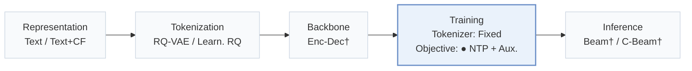
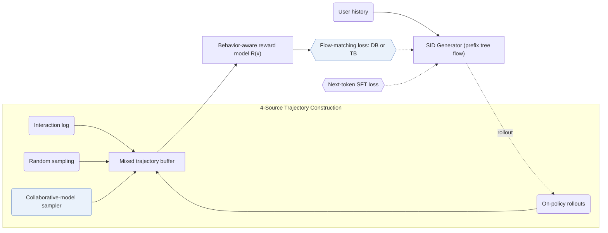
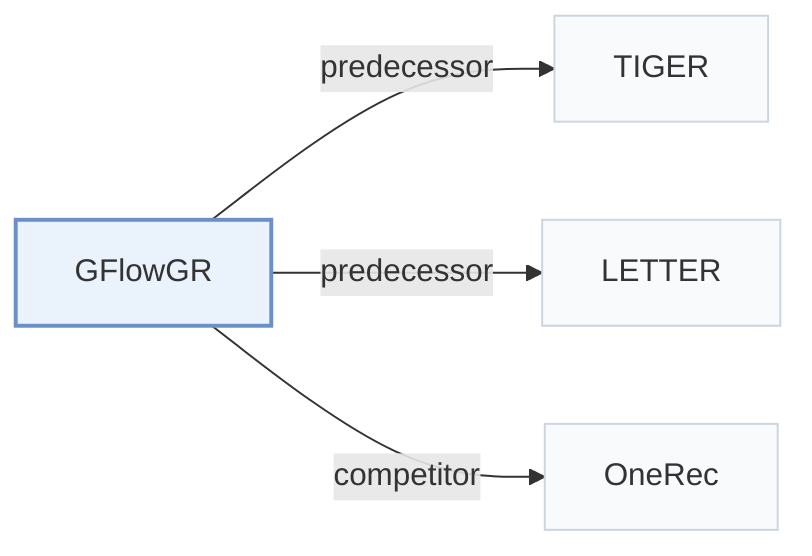

# GFlowGR

[← Problem × Stage Matrix](../../README.md#iv--training) · [Papers by Stage](../index/stages.md) · [Papers by Modality](../index/modality.md) · [Papers by Domain](../index/domain.md) · English | [中文](../zh/papers/gflowgr.md)

| **Title** | *Fine-Tuning Generative Recommendation Frameworks with Generative Flow Networks* |
| :-- | :-- |
| **Authors** | Wang et al. |
| **Venue** | SIGIR’26 |
| **Problem × Stage** | `IV. Utility` · `Training` |
| **Changes** | ● Objective |
| **SID inputs** | A: `Text` · B: `Text` + `CF` |
| **Domain** | `POI / Local` · `E-commerce` · `Ads` · `Search` |
| **Scenario** | `General Item Recommendation`; `Online Experiment or Deployment` |
| **Links** | [Paper](https://arxiv.org/abs/2506.16114) · [Code](https://github.com/Applied-Machine-Learning-Lab/SIGIR26_GFlowGR) |
| **Reading level** | Reading Notes (Level 2) |

**On this page**: [TL;DR](#tldr) · [At a Glance](#at-a-glance) · [1. Why It Matters](#1-why-this-paper-matters) · [2. Method](#2-how-it-works) · [3. Experiments](#3-experimental-findings) · [4. Limitations](#4-limitations--critical-analysis) · [5. Related Work](#5-connections-to-related-work)

- `Text / Text+CF`: Text-only representations or text representations combined with collaborative signals.
- `RQ-VAE / Learn. RQ`: Residual-quantized variational codes or learnable residual-quantization codes in different configurations.
- `Enc-Dec†`: Encoder–decoder backbone (inferred).
- `Fixed`: SIDs are built first and not changed while the generator trains.
- `NTP + Aux.`: NTP plus another auxiliary loss.
- `Beam† / C-Beam†`: Beam search or constrained beam search in the respective inherited configurations.

### TL;DR

> [!NOTE]
> GFlowGR fine-tunes generative recommenders as multi-step generation with GFlowNets, using a collaborative trajectory sampler and reward model to explore unobserved positives, instead of next-token or DPO fine-tuning.

---

### At a Glance

| Aspect | Summary |
| :-- | :-- |
| Key Findings | On Taobao production data, GFlowGR reports H@20 of 0.444 and N@20 of 0.452 against 0.358 and 0.371 for SFT, and a 15-day online A/B test delivers a +0.43% lift in total revenue (Sec. 5, Table 7). |
| Limitation | The behavior-aware reward model fits item utility from logged user feedback, bounding fine-tuning quality by historical exposure bias (Sec. 3.2). |

---

### 1. Why This Paper Matters

Supervised fine-tuning (SFT) with next-token cross-entropy and DPO-style post-training fit a single observed target per step while weighting heterogeneous interactions equally (Abstract). GFlowGR casts SID decoding as multi-step flow generation over a prefix tree, matching terminal generation probabilities to multi-behavior item utilities.

> "To address these challenges, we reformulate GR as a sequential set-generation problem and propose GFlowGR, a GFlowNet-based fine-tuning framework that explicitly aligns generation probabilities with item-level utilities." (Abstract)

---

### 2. How It Works

#### Trajectory Sampler

GFlowGR populates its training buffer from four trajectory sources while downweighting pure random rollouts that destabilize off-policy flow training and drift from the generator's current policy (Sec. 3.1).

> "There are four methods for constructing the trajectory set: interaction log, random sampling, CM-based sampling, and on-policy sampling." (Sec. 3.1)

#### Reward Model

A behavior-aware reward model aggregates heterogeneous feedback signals (such as clicks, carting, and conversions) into a scalar terminal utility for each candidate trajectory (Sec. 1, Sec. 3.2).

#### GFlowNet Objectives

Applying flow-matching conservation across the SID prefix DAG yields detailed balance (DB) on step transitions and trajectory balance (TB) over complete root-to-item paths, optimized jointly with next-token cross-entropy (Sec. 2).

---

### 3. Experimental Findings

Experimental setup

- **Datasets**: Yelp, Amazon Beauty, and Amazon Instruments, preprocessed following LETTER (filter thresholds not restated); 30,431 / 20,032, 22,362 / 12,101, and 24,772 / 9,922 users / items. Production: Taobao search advertising data with hundreds of millions of daily requests; filtering not reported.
  - Source: Datasets and LETTER preprocessing: [S4.SS1.p1](https://arxiv.org/html/2506.16114v3#S4.SS1.p1); statistics: [S4.T1](https://arxiv.org/html/2506.16114v3#S4.T1); production data: [S5.p2](https://arxiv.org/html/2506.16114v3#S5.p2).
- **Split**: Per-user leave-one-out: last item for test, second-to-last for validation, the rest for training. Three random seeds. Online: 15-day A/B test on 10% of traffic (50/50).
  - Source: Leave-one-out allocation: [S4.SS1.p1](https://arxiv.org/html/2506.16114v3#S4.SS1.p1); three seeds: [S4.SS1.p2](https://arxiv.org/html/2506.16114v3#S4.SS1.p2); online test: [S5.p3](https://arxiv.org/html/2506.16114v3#S5.p3).
- **Candidates**: not reported (full catalog versus sampled evaluation candidates); top-5 and top-10 lists. Training negatives for the flow objective come from a collaborative-model sampler or beam search, which is a training choice, not the evaluation candidate set.
  - Source: Metrics only: [S4.SS1.p2](https://arxiv.org/html/2506.16114v3#S4.SS1.p2).
- **Visibility**: warm; no unseen-item protocol is defined. Online, newly listed items gain 4.0% revenue, but their tokenizer and generator visibility is not reported.
  - Source: Standard split with no unseen-item protocol: [S4.SS1.p1](https://arxiv.org/html/2506.16114v3#S4.SS1.p1); online newly listed items without visibility definition: [S5.p3](https://arxiv.org/html/2506.16114v3#S5.p3).
- **SID**: Uses the TIGER and LETTER tokenizers as backbones; layer count and codebook size for the experiments: not reported (Figure 1 illustrates L=3). Collision handling: not reported; the paper notes that intermediate states do not uniquely identify items.
  - Source: Backbones TIGER and LETTER, no own SID settings: [S4.SS1.p2](https://arxiv.org/html/2506.16114v3#S4.SS1.p2); L=3 appears in the overview figure: [S1.F1](https://arxiv.org/html/2506.16114v3#S1.F1).
- **Inference budget**: Decoding method and beam width for evaluation: not reported. All experiments run on the same GPU (model not stated). Table 7 reports training cost on production data (GFlowGR 2.1x SFT with 80x samples); inference latency and batch size: not reported.
  - Source: Hardware statement and cost: [S4.SS1.p3](https://arxiv.org/html/2506.16114v3#S4.SS1.p3) and [S4.T7](https://arxiv.org/html/2506.16114v3#S4.T7).
- **Results from**: Table 2 (Beauty, Instruments, Yelp; SFT, GRPO, DPO-family baselines on TIGER and LETTER backbones); Tables 3-6 (rewards, combination, sample selection, LLM reward); Figures 3-4 (parameter study); Table 7 and Section 5 (production offline and 15-day online A/B).
  - Source: Main: [S4.T2](https://arxiv.org/html/2506.16114v3#S4.T2); ablations and strategies: [S4.T3](https://arxiv.org/html/2506.16114v3#S4.T3), [S4.T4](https://arxiv.org/html/2506.16114v3#S4.T4), [S4.T5](https://arxiv.org/html/2506.16114v3#S4.T5), [S4.T6](https://arxiv.org/html/2506.16114v3#S4.T6); production: [S4.T7](https://arxiv.org/html/2506.16114v3#S4.T7) and [S5.p3](https://arxiv.org/html/2506.16114v3#S5.p3).

- Public benchmarks: GFlowGR consistently improves both TIGER and LETTER backbones across public datasets (Abstract).
- Production offline evaluation: on Taobao data, GFlowGR outperforms both SFT and GRPO (H@20 = 0.427, N@20 = 0.408) (Sec. 5, Table 7).

  > "The results show that GFlowGR achieves H@20 of 0.444 and N@20 of 0.452, substantially outperforming SFT (0.358/0.371) and GRPO (0.427/0.408), mirroring the conclusions on public datasets." (Sec. 5)

- Online deployment: in a 15-day A/B test on 10% of traffic (50/50 split), GFlowGR raises total revenue by +0.43% and has trained Taobao search advertising models across Taobao Mobile, Xianyu, and Taobao Web since May 2025 (Sec. 5).

---

### 4. Limitations & Critical Analysis

**Our analysis.**

- GFlowGR modifies only the generator fine-tuning objective, which suggests its gains compose orthogonally with upstream tokenizer improvements such as LETTER.
- OneRec post-trains its generator sequentially via `NTP → DPO`; GFlowGR optimizes GFlowNet flow balance alongside next-token likelihood (`NTP + Aux.`).

---

### 5. Connections to Related Work

- **Predecessor** · [TIGER](tiger.md): TIGER is one of the two generative backbones; GFlowGR updates the LLM with the sum of the SFT loss and a GFlowNets loss over augmented generation trajectories.
  - Source: GFlowGR v3, Section 4.1 installs GFlowGR on TIGER: [S4.SS1.p2](https://arxiv.org/html/2506.16114v3#S4.SS1.p2); Table 2: [S4.T2](https://arxiv.org/html/2506.16114v3#S4.T2); training objective: [S3.SS4.p1](https://arxiv.org/html/2506.16114v3#S3.SS4.p1).
- **Predecessor** · [LETTER](letter.md): LETTER supplies the second backbone and the data preprocessing; GFlowGR changes only the fine-tuning objective.
  - Source: GFlowGR v3, Section 4.1 follows LETTER preprocessing and uses it as a backbone: [S4.SS1.p1](https://arxiv.org/html/2506.16114v3#S4.SS1.p1) and [S4.SS1.p2](https://arxiv.org/html/2506.16114v3#S4.SS1.p2); Table 2: [S4.T2](https://arxiv.org/html/2506.16114v3#S4.T2).
- **Competitor** · [OneRec](onerec.md): OneRec's IPA aligns the model by iterative SFT and DPO with reward-selected rejected samples; GFlowGR learns probabilities proportional to rewards over many trajectories.
  - Source: GFlowGR v3, IPA baseline from OneRec, reimplemented with the same reward model: [S4.I2.i6.p1](https://arxiv.org/html/2506.16114v3#S4.I2.i6.p1) and [S4.SS1.p3](https://arxiv.org/html/2506.16114v3#S4.SS1.p3); Table 2: [S4.T2](https://arxiv.org/html/2506.16114v3#S4.T2).

[View all papers in this cell](../../README.md#iv--training)
