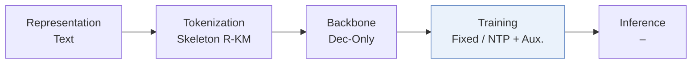
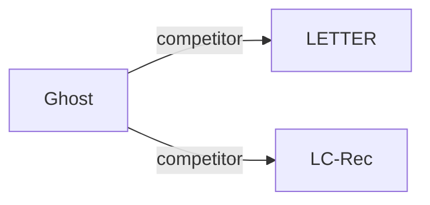

# Ghost

*Echoes in Filter Bubble: Diagnosing and Curing Popularity Bias in Generative Recommenders* — Yin et al. · NeurIPS’26

`IV. Utility` · `Training`

[Paper](https://arxiv.org/abs/2605.16825) · [Code](https://github.com/Esperanto-mega/Ghost) · [Matrix](../../README.md#iv--training)

Reading level: Overview (Level 1) · On this page: [TL;DR](#tldr) · [At a Glance](#at-a-glance) · [3. Experimental Findings](#3-experimental-findings) · [5. Connections to Related Work](#5-connections-to-related-work)

- `Skeleton R-KM`: Residual k-means organized around a shared semantic skeleton.
- `Dec-Only`: Decoder-only.
- `Fixed`: SIDs are built first and not changed while the generator trains.
- `NTP + Aux.`: NTP plus another auxiliary loss.
- `–`: Not reported in the paper.

### TL;DR

Ghost reduces popularity bias in generative recommenders with an asymmetric unlikelihood loss and skeleton-founded tokenization, addressing token-level optimization and undifferentiated item tokenization as its causes.

### At a Glance

| Aspect | Summary |
| :-- | :-- |
| Research Problem | IV. Utility: Are training and search aimed at what users and the platform value, rather than at token likelihood? |
| Key Contribution | Ghost reduces popularity bias in generative recommenders with an asymmetric unlikelihood loss and skeleton-founded tokenization, addressing token-level optimization and undifferentiated item tokenization as its causes. |
| Modified Stage | Training |

### 3. Experimental Findings

**Experimental setup**

- **Datasets**: Amazon Product Review 2018: Musical Instruments; Arts, Crafts and Sewing; Video Games. Users/items with fewer than five interactions are filtered out.
- **Split**: User interactions are ordered chronologically; train/validation/test allocation: not reported.
- **Candidates**: not reported
- **Visibility**: warm; no unseen-item protocol is defined.
- **SID**: Skeleton RQ-KMeans, 256 centers/level; head length Lh, tail length Lh+Lt with inherited head prefix. Sweeps Lh=3/4/5 and Lt=1/2/3; main numerical lengths and collision handling: not reported.
- **Inference budget**: Metrics at K=5/10; decoding algorithm, beam width, inference batch size, latency: not reported. General experimental machine: 8 NVIDIA A100 80GB GPUs; inference-specific allocation: not reported.
- **Results from**: Original Table I: main comparison; Table II: ablations; Table III: backbone scaling. Main and ablation experiments use Qwen2.5-3B; scaling uses Qwen3 0.6B-8B.

Sources

- **Datasets**: Appendix C-A: [A3.SS1.p1](https://arxiv.org/html/2605.16825v3#A3.SS1.p1)
- **Split**: Appendix C-A reports chronological sequences but no holdout allocation: [A3.SS1.p1](https://arxiv.org/html/2605.16825v3#A3.SS1.p1)
- **Candidates**: Section V and Appendix C describe metrics/baselines but not Ghost's candidate protocol: [S5](https://arxiv.org/html/2605.16825v3#S5) and [A3](https://arxiv.org/html/2605.16825v3#A3)
- **Visibility**: Section V and Appendix C define no unseen-item evaluation: [S5](https://arxiv.org/html/2605.16825v3#S5) and [A3](https://arxiv.org/html/2605.16825v3#A3)
- **SID**: Section IV-A, Section V-C, Appendix C-D: [S4.SS1.p2](https://arxiv.org/html/2605.16825v3#S4.SS1.p2) and [S5.SS3.p1](https://arxiv.org/html/2605.16825v3#S5.SS3.p1) and [A3.SS4.p2](https://arxiv.org/html/2605.16825v3#A3.SS4.p2)
- **Inference budget**: Table I and Appendix C-D: [S5.T1](https://arxiv.org/html/2605.16825v3#S5.T1) and [A3.SS4.p2](https://arxiv.org/html/2605.16825v3#A3.SS4.p2)
- **Results from**: Tables I-III and Appendix C-D: [S5.T1](https://arxiv.org/html/2605.16825v3#S5.T1) and [S5.T2](https://arxiv.org/html/2605.16825v3#S5.T2) and [S5.T3](https://arxiv.org/html/2605.16825v3#S5.T3) and [A3.SS4.p1](https://arxiv.org/html/2605.16825v3#A3.SS4.p1)

### 5. Connections to Related Work

- **Competitor** · [LETTER](letter.md): LETTER is evaluated as a standard generative baseline; Ghost addresses popularity bias through skeleton tokenization and asymmetric unlikelihood.
  - Source: Ghost v3, Section V and Appendix C-B, Table I: https://arxiv.org/html/2605.16825v3#S5.p2; https://arxiv.org/html/2605.16825v3#A3.SS2.p1; https://arxiv.org/html/2605.16825v3#S5.T1.
- **Competitor** · [LC-Rec](lc-rec.md): LC-Rec is a standard generative baseline and the backbone reference for RQ-KMeans ablations; Ghost modifies tokenization and optimization.
  - Source: Ghost v3, Section V and Table II: https://arxiv.org/html/2605.16825v3#S5.p2; https://arxiv.org/html/2605.16825v3#S5.T2; https://arxiv.org/html/2605.16825v3#S5.SS2.p1.

[View all papers in this cell](../../README.md#iv--training)
