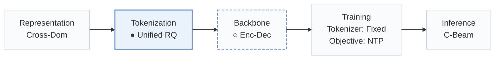
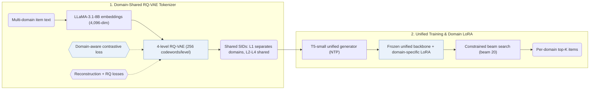
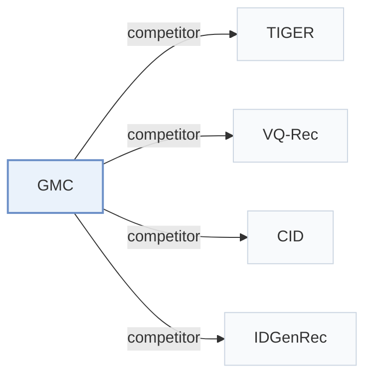

# GMC

[← Problem × Stage Matrix](../../README.md#vi--tokenization) · [Papers by Stage](../index/stages.md) · [Papers by Modality](../index/modality.md) · [Papers by Domain](../index/domain.md) · English | [中文](../zh/papers/gmc.md)

| **Title** | *Generative Multi-Target Cross-Domain Recommendation* |
| :-- | :-- |
| **Authors** | Jin et al. |
| **Venue** | arXiv’25 |
| **Problem × Stage** | `VI. Generalization` · `Tokenization` |
| **Changes** | ● Tokenization · ○ Backbone |
| **SID inputs** | `Text` |
| **Domain** | `E-commerce` |
| **Settings** | `cross-domain` |
| **Links** | [Paper](https://arxiv.org/abs/2507.12871) |
| **Reading level** | Reading Notes (Level 2) |

**On this page**: [TL;DR](#tldr) · [At a Glance](#at-a-glance) · [1. Why It Matters](#1-why-this-paper-matters) · [2. Method](#2-how-it-works) · [3. Experiments](#3-experimental-findings) · [4. Limitations](#4-limitations--critical-analysis) · [5. Related Work](#5-connections-to-related-work)

- `Cross-Dom`: Item representations transferred or shared across multiple domains.
- `Unified RQ`: Domain-unified residual quantization.
- `Enc-Dec`: Encoder-decoder.
- `Fixed`: SIDs are built first and not changed while the generator trains.
- `NTP`: Next-token prediction loss only; continuing from a pretrained LLM (SFT) also counts as NTP.
- `C-Beam`: Constrained beam search.

### TL;DR

> [!NOTE]
> GMC assigns domain-shared Semantic IDs with a domain-aware contrastive loss and trains one sequence-to-sequence generator across domains, instead of relying on users or items shared between domains.

---

### At a Glance

| Aspect | Summary |
| :-- | :-- |
| Key Findings | Across five Amazon domains (Scientific, Pantry, Instruments, Arts, and Office), GMC reports improvements over ID-based, text-based, pre-trained, and generative baselines on Recall@5, Recall@10, NDCG@5, and NDCG@10 (Abstract, Table 3). |
| Limitation | The Semantic IDs (SIDs) come from text embeddings only, so collaborative signals reach the model only through the generator's training sequences (Sec. 3). |

---

### 1. Why This Paper Matters

Existing multi-target cross-domain recommendation (MTCDR) methods rely on users or items shared between domains, which non-overlapped scenarios lack, while pre-trained semantic representations require large auxiliary corpora (Abstract). GMC bridges non-overlapped domains through a shared discrete token space and a single sequence-to-sequence generator.

> "The core idea of GMC is to leverage semantically quantized discrete item identifiers as a medium for integrating multi-domain knowledge within a unified generative model." (Abstract)

---

### 2. How It Works

#### Semantic Identifier Learning

GMC encodes item text from all domains with LLaMA-3.1-8B into 4,096-dimensional embeddings and quantizes them with a 4-level RQ-VAE (256 codewords per level, dimension 32) into SIDs shared across domains (Sec. 3). A domain-aware contrastive loss pulls quantized embeddings of same-domain items together so that first-level codes separate domains while deeper levels share codes across domains (Sec. 3.3, Eq. 6).

> "Specifically, since items within the same domain are generally more similar to each other than items from different domains, we introduce a novel domain-aware contrastive loss that brings quantized embeddings of intra-domain items closer together." (Sec. 1)

#### Domain-Specific Fine-Tuning

GMC first trains a unified T5-small generator with next-token prediction across all domains, then attaches a separate LoRA module to adapt to each target domain while keeping the unified backbone frozen (Sec. 1, Sec. 3.5).

> "Specifically, we incorporate domain-specific LoRA modules (Hu et al., 2022) into the unified recommender and update the corresponding LoRA parameters using domain-specific data, while freezing all other parameters of the unified model." (Sec. 1)

---

### 3. Experimental Findings

Experimental setup

- **Datasets**: Multi-target cross-domain task on five Amazon 2018 Reviews subsets: Scientific, Pantry, Instruments, Arts, Office. Items without titles are removed and 5-core filtering is applied to users and items; sequences capped at 20 items. Sizes (users / items): 8,317 / 4,344; 13,073 / 4,897; 24,772 / 9,922; 45,141 / 20,956; 86,554 / 25,847.
  - Source: Five Amazon subsets, title filter, 5-core, length 20: [S5.SS1.SSS1.p1](https://arxiv.org/html/2507.12871v3#S5.SS1.SSS1.p1); statistics: [S5.T2](https://arxiv.org/html/2507.12871v3#S5.T2).
- **Split**: Per-user leave-one-out: last item for test, second latest for validation, the rest for training; results reported per domain and as a user-weighted average.
  - Source: Leave-one-out allocation: [S5.SS1.SSS3.p1](https://arxiv.org/html/2507.12871v3#S5.SS1.SSS3.p1).
- **Candidates**: full catalog (the target item is ranked over the entire item set).
  - Source: Ranking over the entire item set: [S5.SS1.SSS3.p1](https://arxiv.org/html/2507.12871v3#S5.SS1.SSS3.p1).
- **Visibility**: warm; no unseen-item protocol is defined.
  - Source: Standard split with no unseen-item protocol: [S5.SS1.SSS3.p1](https://arxiv.org/html/2507.12871v3#S5.SS1.SSS3.p1).
- **SID**: 4-level RQ-VAE x 256 codewords (dimension 32) over LLaMA-3.1-8B text embeddings (D=4,096), with a codebook shared across domains and a domain-aware contrastive loss; first-level codes separate domains and deeper levels are shared. Collision handling: not reported.
  - Source: L=4 x N=256, d=32, LLaMA-3.1 4,096-dimensional embeddings, shared codebook across domains: [S5.SS1.SSS4.p1](https://arxiv.org/html/2507.12871v3#S5.SS1.SSS4.p1) and [S5.SS4.SSS1.p2](https://arxiv.org/html/2507.12871v3#S5.SS4.SSS1.p2); no collision rule found.
- **Inference budget**: Beam size 20 for item generation; T5-small backbone with domain-specific LoRA. Recall and NDCG at K=5 and 10. Hardware, inference batch size, and latency: not reported.
  - Source: Beam size 20: [S5.SS1.SSS4.p2](https://arxiv.org/html/2507.12871v3#S5.SS1.SSS4.p2); T5-small backbone: [S5.SS1.SSS4.p2](https://arxiv.org/html/2507.12871v3#S5.SS1.SSS4.p2).
- **Results from**: Table 3 (five domains and user-weighted average versus ID, ID-text, pre-training, and generative baselines); Table 4 (ablations); Figures 3-5 (code sharing, code similarity, multi-domain settings).
  - Source: Main: [S5.T3](https://arxiv.org/html/2507.12871v3#S5.T3); ablation: [S5.T4](https://arxiv.org/html/2507.12871v3#S5.T4); code analysis: [S5.F3](https://arxiv.org/html/2507.12871v3#S5.F3) and [S5.F4](https://arxiv.org/html/2507.12871v3#S5.F4); domain settings: [S5.F5](https://arxiv.org/html/2507.12871v3#S5.F5).

- Main comparison: across five non-overlapped Amazon domains (Scientific, Pantry, Instruments, Arts, and Office), GMC outperforms ID-based, text-based, pre-trained, and generative baselines on Recall@5, Recall@10, NDCG@5, and NDCG@10 (Abstract, Table 3).
- Ablation and code sharing: Table 4 ablates the shared codebook, the domain-aware contrastive loss, and the domain-specific LoRA modules, while Figs. 3–5 show that first-level codes separate domains and deeper levels share codes across domains.

---

### 4. Limitations & Critical Analysis

**Our analysis.**

- The domain-aware contrastive loss pulls items within the same domain together, which suggests a trade-off against cross-domain code sharing at coarser quantization levels.
- VQ-Rec transfers across domains with `OPQ` codes in an `Encoder` generator and `Scoring`; GMC generates `Unified RQ` codes with an `Enc-Dec` generator and `C-Beam` decoding.

---

### 5. Connections to Related Work

- **Competitor** · [TIGER](tiger.md): TIGER learns one-domain RQ-VAE identifiers; GMC learns a domain-shared codebook with a domain-aware contrastive loss and adds domain-specific LoRA tuning to a unified generator.
  - Source: GMC v3, generative baselines: [S5.I1.i4.I1.i2.p1](https://arxiv.org/html/2507.12871v3#S5.I1.i4.I1.i2.p1); Table 1 comparison: [S3.T1](https://arxiv.org/html/2507.12871v3#S3.T1); Table 3: [S5.T3](https://arxiv.org/html/2507.12871v3#S5.T3).
- **Competitor** · [VQ-Rec](vq-rec.md): VQ-Rec transfers across domains through vector-quantized codes for a discriminative model, pre-trained here on the five target domains; GMC generates shared semantic identifiers.
  - Source: GMC v3, pre-training baselines with the adapted setting: [S5.I1.i3.p1](https://arxiv.org/html/2507.12871v3#S5.I1.i3.p1) and [S5.I1.i3.I1.i2.p1](https://arxiv.org/html/2507.12871v3#S5.I1.i3.I1.i2.p1); Table 3: [S5.T3](https://arxiv.org/html/2507.12871v3#S5.T3).
- **Competitor** · [CID](cid.md): P5-CID builds collaborative identifiers by spectral clustering within a domain; GMC builds semantic identifiers shared across domains.
  - Source: GMC v3, generative baselines: [S5.I1.i4.I1.i1.p1](https://arxiv.org/html/2507.12871v3#S5.I1.i4.I1.i1.p1); Table 3: [S5.T3](https://arxiv.org/html/2507.12871v3#S5.T3).
- **Competitor** · [IDGenRec](idgenrec.md): IDGenRec learns textual IDs with an ID generator; GMC quantizes LLM embeddings into codebook IDs shared across domains.
  - Source: GMC v3, generative baselines: [S5.I1.i4.I1.i3.p1](https://arxiv.org/html/2507.12871v3#S5.I1.i4.I1.i3.p1); Table 3: [S5.T3](https://arxiv.org/html/2507.12871v3#S5.T3).

[View all papers in this cell](../../README.md#vi--tokenization)
