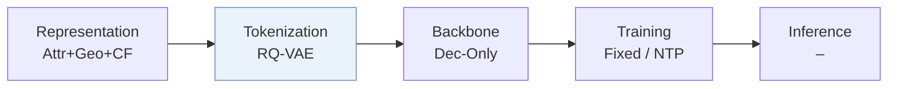
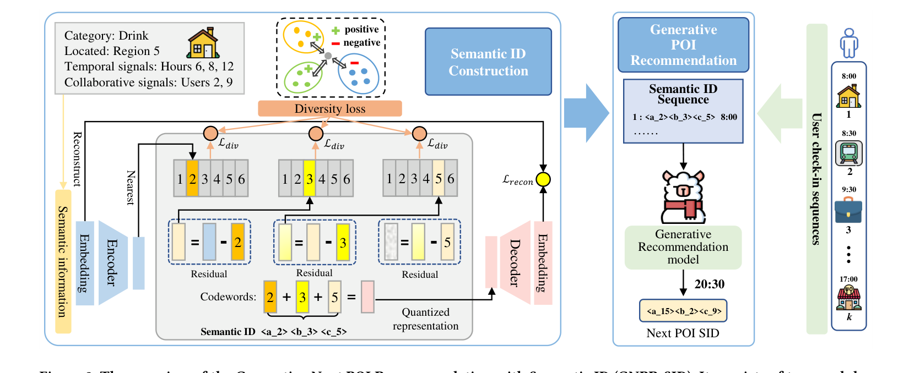
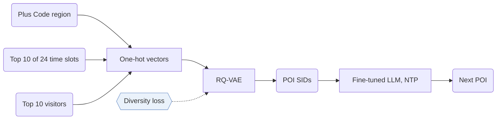
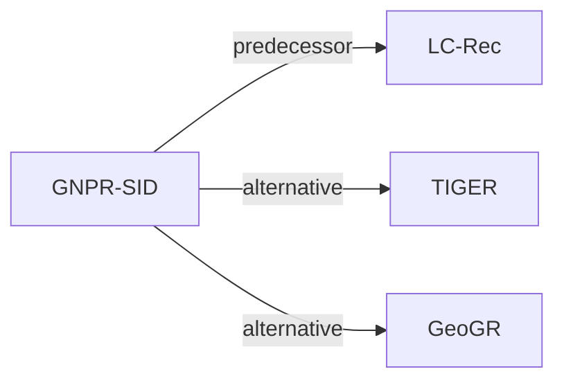

# GNPR-SID

| **Title** | *Generative Next POI Recommendation with Semantic ID* |
| :-- | :-- |
| **Authors** | Wang et al. |
| **Venue** | KDD’25 |
| **Problem × Stage** | `I. Informativeness` · `Tokenization` · `POI` |
| **Links** | [Paper](https://arxiv.org/abs/2506.01375) · [Code](https://github.com/wds1996/GNPR-SID) · [Matrix](../../README.md#i--tokenization) · [中文](../zh/papers/gnpr-sid.md) |
| **Reading level** | Reading Notes (Level 2) |

On this page: [TL;DR](#tldr) · [At a Glance](#at-a-glance) · [1. Why It Matters](#1-why-this-paper-matters) · [2. Method](#2-how-it-works) · [3. Experiments](#3-experimental-findings) · [4. Limitations](#4-limitations--critical-analysis) · [5. Related Work](#5-connections-to-related-work)

- `Attr+Geo+CF`: Category and other attributes, plus geography, plus CF (POI).
- `Dec-Only`: Decoder-only.
- `Fixed`: SIDs are built first and not changed while the generator trains.
- `NTP`: Next-token prediction loss only; continuing from a pretrained LLM (SFT) also counts as NTP.
- `–`: Not reported in the paper.

### TL;DR

> [!NOTE]
> GNPR-SID replaces random numeric POI IDs with RQ-VAE Semantic IDs built from semantic and collaborative features under a diversity loss, and fine-tunes an LLM to generate the next POI.

---

### At a Glance

| Aspect | Summary |
| :-- | :-- |
| Research Problem | I. Informativeness: Do the SIDs, or the model reading them, carry the collaborative and multimodal signals recommendation needs? |
| Key Contribution | GNPR-SID replaces random numeric POI IDs with RQ-VAE Semantic IDs built from semantic and collaborative features under a diversity loss, and fine-tunes an LLM to generate the next POI. |
| Modified Stage | Tokenization |
| Key Findings | On three benchmark datasets, GNPR-SID reports up to 16% improvement in recommendation accuracy over the compared methods (Abstract). |
| Limitation | Operating hours and collaborative features come from check-ins, so a new point of interest (POI) without visits has incomplete features (Sec. 4.1.1). |

---

### 1. Why This Paper Matters

Existing generative POI recommenders usually give POIs random numeric IDs, which limits the modeling of semantic relationships between similar locations (Abstract). GNPR-SID replaces them with Semantic IDs (SIDs) learned from POI features.

> "To achieve this, we propose the diversity loss, which promotes the distinctiveness of codewords within each codebook layer." (Sec. 1)

---

### 2. How It Works

#### POI Features

Each POI has spatial, temporal, and collaborative features (Sec. 4.1.1). The region is a Google Plus Code.

> "Compared to directly using geographic coordinates as spatial features, these region-based codes r ensure that nearby POIs are assigned the same Plus Code, allowing the model to share information among spatially adjacent POIs." (Sec. 4.1.1)

Operating hours are the 10 most visited of 24 time slots, and the collaborative feature uses each POI's 10 most frequent visitors (Sec. 4.1.1). Each feature becomes a one-hot vector (Sec. 4.1.1, Eq. 1).

#### Quantization

The diversity loss keeps the SIDs uniformly distributed across the semantic space (Abstract).

#### Training Data

Appendix A.1 adds multiple cropping and fill-in-the-blank augmentation (Appendix A.1).

---

### 3. Experimental Findings

Experimental setup

- **Datasets**: Foursquare NYC and TKY, Gowalla CA. POIs with fewer than 10 interactions and users with fewer than 10 check-ins are removed (following Yan et al. 2023). Sizes (users / POIs): NYC 1,083 / 5,135; TKY 2,293 / 7,873; CA 6,592 / 14,027.
  - Source: Datasets, filters, splits: [S5.SS1.p1](https://arxiv.org/html/2506.01375v2#S5.SS1.p1); statistics: [S5.T1](https://arxiv.org/html/2506.01375v2#S5.T1).
- **Split**: Records sorted by time and split 80% / 10% / 10% into training, validation, and test; within each user's test sequence the last visited POI is the target. Separate cross-city test: train on one city and test on the others (Table 5).
  - Source: Temporal 80/10/10 split and last-visit target: [S5.SS1.p1](https://arxiv.org/html/2506.01375v2#S5.SS1.p1); out-of-domain transfer: [S6.T5](https://arxiv.org/html/2506.01375v2#S6.T5).
- **Candidates**: not reported (full catalog versus sampled candidates); the metric is top-1 accuracy (Acc@1) of the generated POI.
  - Source: Top-1 accuracy only: [S5.SS3.p1](https://arxiv.org/html/2506.01375v2#S5.SS3.p1).
- **Visibility**: warm; users and POIs that do not appear in the training set are removed from the test set. The cross-city test in Table 5 uses POIs from another city, but their tokenizer visibility is not reported.
  - Source: Test users and POIs absent from training are removed: [S5.SS1.p1](https://arxiv.org/html/2506.01375v2#S5.SS1.p1).
- **SID**: 3-level RQ-VAE with 32 (NYC) or 64 (TKY, CA) codewords of dimension 64, k-means-initialized, plus diversity and compactness losses. Remaining collisions get an appended fourth token that makes each POI's SID unique (e.g. <d_0>, <d_1>). Table 4 reports unique SIDs and collisions before the suffix (e.g. NYC 590 collisions at lambda=0.25).
  - Source: 3 layers x 32 (NYC) or 64 (TKY, CA), dimension 64, k-means initialization: [S5.SS2.p1](https://arxiv.org/html/2506.01375v2#S5.SS2.p1); collision suffix: [S4.SS1.SSS2.p6](https://arxiv.org/html/2506.01375v2#S4.SS1.SSS2.p6); diversity loss and collision counts: [S4.SS1.SSS3.Px3.p1](https://arxiv.org/html/2506.01375v2#S4.SS1.SSS3.Px3.p1) and [S6.T4](https://arxiv.org/html/2506.01375v2#S6.T4).
- **Inference budget**: LLaMA3-8B with LoRA; decoding method not reported beyond top-1 prediction. Fine-tuning on 4 NVIDIA L40 GPUs (batch 2 per GPU); inference batch size not reported. Table 6 (NYC): total test time 110.62 s versus 230.36 s for LLM4POI.
  - Source: Hardware for fine-tuning: [S5.SS2.p1](https://arxiv.org/html/2506.01375v2#S5.SS2.p1); efficiency table: [S6.T6](https://arxiv.org/html/2506.01375v2#S6.T6); decoding not specified in Section 5.
- **Results from**: Table 2 (Acc@1 on NYC, TKY, CA versus traditional, Transformer, GCN, time-aware, and LLM-based baselines); Table 3 (ablations); Table 4 (diversity-loss weight and SID collisions); Table 5 (cross-city generalization); Table 6 (efficiency).
  - Source: Main: [S6.T2](https://arxiv.org/html/2506.01375v2#S6.T2); ablation: [S6.T3](https://arxiv.org/html/2506.01375v2#S6.T3); diversity loss: [S6.T4](https://arxiv.org/html/2506.01375v2#S6.T4); cross-city: [S6.T5](https://arxiv.org/html/2506.01375v2#S6.T5); efficiency: [S6.T6](https://arxiv.org/html/2506.01375v2#S6.T6).

- Other analyses: the paper tests out-of-domain data (Sec. 6.5) and efficiency through training time, test time, and token counts (Sec. 6.6, Table 6).

---

### 4. Limitations & Critical Analysis

**Our analysis.**

- GeoGR refines its `R-KM+EM` codes against the generator; GNPR-SID trains its `RQ-VAE` codes once.
- LC-Rec trains its LLM with `Multi-task NTP` over text; GNPR-SID uses POI attributes, geography, and collaborative features with plain `NTP`.

---

### 5. Connections to Related Work

- **Predecessor** · [LC-Rec](lc-rec.md): GNPR-SID follows LC-Rec in aligning an LLM to SID tokens through language-task prompts, and adds POI-specific quantization with time-aware prompts.
  - Source: GNPR-SID v2, Section 4.2 builds its prompts inspired by Zheng et al. (2024): https://arxiv.org/html/2506.01375v2#S4.SS2.p2.
- **Alternative** · [TIGER](tiger.md): TIGER is cited as generative recommendation with semantic IDs for products; GNPR-SID adapts RQ-VAE SIDs to POIs with diversity and compactness losses and an LLM generator.
  - Source: GNPR-SID v2, Section 2 cites Rajput et al. (2023): https://arxiv.org/html/2506.01375v2#S2.p2; not a baseline in Table 2.
- **Alternative** · [GeoGR](geogr.md): GeoGR later builds geo-aware SIDs from geographic co-visitation and an EM refinement loop, and reports gains over GNPR-SID's SIDs.
  - Source: Evidence is from the later GeoGR paper: it follows GNPR-SID preprocessing and compares against it in Tables 2, 3, and 5: https://arxiv.org/html/2602.10411v2#S5.SS1.SSS1.p2, https://arxiv.org/html/2602.10411v2#S5.T2, https://arxiv.org/html/2602.10411v2#S5.T3, https://arxiv.org/html/2602.10411v2#S5.T5.

[View all papers in this cell](../../README.md#i--tokenization)
