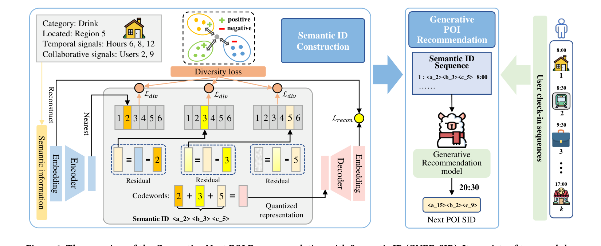

# GNPR-SID

*Generative Next POI Recommendation with Semantic ID* — Wang et al., KDD’25 · `POI`

[arXiv](https://arxiv.org/abs/2506.01375) · [Code](https://github.com/wds1996/GNPR-SID) · [Record](../../data/papers/gnpr-sid.yaml) · [← Catalog](../../README.md#i--tokenization)

> Abstract: "employ random numeric IDs for POIs, limiting the ability to model semantic relationships between similar locations". The diversity loss only spreads SIDs evenly; the abstract does not blame prior work for collisions, so not II.

| Problem it fixes | Stage it changes |
| :-- | :-- |
| **I. Informativeness**: Do the SIDs, or the model reading them, carry the collaborative and multimodal signals recommendation needs? | **Tokenization** |

## Pipeline

| Representation | Tokenization | Backbone | Training | Inference |
| :-: | :-: | :-: | :-: | :-: |
| `Attr+Geo+CF` | **`RQ-VAE`** | `Dec-Only` | `Fixed / NTP` | `–` |

- `Attr+Geo+CF`: Category and other attributes, plus geography, plus CF (POI).
- `Dec-Only`: Decoder-only.
- `Fixed`: SIDs are built first and not changed while the generator trains.
- `NTP`: Next-token prediction loss only; continuing from a pretrained LLM (SFT) also counts as NTP.
- `–`: Not reported in the paper.

## Architecture

## Evidence

- **`problem`** (abstract, p1): Abstract: "employ random numeric IDs for POIs, limiting the ability to model semantic relationships between similar locations". The diversity loss only spreads SIDs evenly; the abstract does not blame prior work for collisions, so not II.
- **`stage`** (contribution 2, p2; §4.1, p3–5): SIDs quantized from semantic and collaborative features replace random IDs.
- **`tokenizer`** (§4.2, p6; §5, p7): RQ-VAE is trained first; LLaMA3-8B is then fine-tuned with LoRA.

## 旧卡片说明

迁自 `d61aa6c:papers/gnprsid.md`。保留方法说明、实验叙述与局限；本轮只对照现有记录处理明确冲突，未重新逐句核查原论文。分类和规格以页面上方由记录生成的表格为准。

### GNPR-SID：基于语义标识的生成式下一兴趣点推荐

> GNPR-SID 将 POI 的语义、地理、时间和协同信息构造成层次化 SID，再由大语言模型直接生成下一 POI 的完整标识。

### 研究动机与问题定义

传统下一 POI 推荐常使用随机数值 ID，模型难以从相近地点的标识之间迁移语义和地理关系。GNPR-SID 研究如何把 POI 描述与用户协同信息编码为可生成的语义标识，并根据用户历史访问记录和目标时间预测下一访问地点。

### TL;DR（核心摘要）

`POI内容/地理/时间/协同信息 → RQ-VAE量化 → POI SID → LLM生成 → 下一POI`

模型先用 POI 类别、区域、营业时间和协同关系构成语义向量，再用带多样性约束的残差量化得到层次化 SID；随后将用户历史 SID 与时间组织为提示，微调 LLM 自回归生成目标 SID。生成的 SID 通过标识表直接解析为 POI，不需要独立排序模型。

### 输入与使用场景

| 方面 | 说明 |
|---|---|
| 使用信息 | POI 类别、区域、营业时间、用户协同信号和历史访问时间 |
| 信息融入位置 | SID 构建阶段及 LLM 的序列生成输入 |
| 语义标识结构 | 定长、多级离散序列 |
| 适用场景 | 下一 POI 推荐、跨域泛化和冷启动分析 |

### 方法设计

#### 4.1 语义标识构建
作者将 POI 的类别、区域、时间信号以及用户协同关系拼接为统一语义表示。协同部分依据用户共同访问 POI 的关系构造，使表示同时包含内容相似性和行为关联。

#### 4.1.1 POI 语义表示
每个 POI 的基本属性被转换为 one-hot 特征，并与区域、营业时间和协同用户信息拼接。这样构造出的向量既描述 POI 本身，也保留其在交互网络中的位置。

#### 4.1.2 POI 量化
模型使用 RQ-VAE 的编码器、残差量化器和解码器，将连续 POI 表示映射到多级 codebook。每一级量化当前残差，多个 code 组成层次化 SID；相近 POI 可共享前缀，从而为生成模型提供可迁移的语义结构。

#### 4.1.3 模型优化
除重构和量化目标外，方法加入 diversity loss，使 code 在离散空间中更均匀分布，减少大量 POI 使用相同 code 或形成碰撞。附录还给出了裁剪、填空式训练等数据增强方式。

#### 4.2 生成式 POI 推荐
用户历史被序列化为带时间的 SID 序列，模型在指定时间条件下生成下一 POI SID。训练阶段采用语言模型微调目标；推理时直接生成完整 SID 并通过映射确定 POI。论文还比较了移除 SID、时间信息和多样性损失后的效果。

### 实验结论

- 在三个 POI 数据集上，GNPR-SID 相比比较方法取得更好的下一地点预测效果，论文报告最高约 16% 的准确率提升。
- SID 的语义相关性分析表明，相似 POI 更倾向共享前缀；多样性损失有助于缓解离散标识分布不均。
- 论文报告了跨域、效率和序列长度分析，说明语义标识输入能减少部分生成负担，但具体线上服务收益未报告。

### 局限性与研究定位

#### 局限性

- SID 仍依赖离线量化和固定 POI 标识表，动态新增 POI 的处理方式未充分展开。
- 多级自回归生成的在线延迟和无效 SID 的容错机制仍需更系统的工程评估。

#### 研究定位

GNPR-SID 是较早将 Semantic ID 直接用于下一 POI 生成的工作，适合放在“地理场景生成式推荐”章节，重点体现内容-协同融合量化与时间条件生成。

### 相关资源

- [论文原文](https://arxiv.org/abs/2506.01375)
- [开源代码](https://github.com/wds1996/GNPR-SID)

### 标签

`下一兴趣点推荐` · `残差量化` · `多样性损失` · `大语言模型`

### 架构图来源

*图源：原论文，图2（[论文原文](https://arxiv.org/abs/2506.01375)）。图片使用许可待核实。*

---

### 旧总表补充

来源：`d61aa6c:tables/all-methods.md`。

- 核心贡献：将语义、地理、时间和协同信息构造成可生成 SID。
- 使用场景：下一 POI 推荐。

## Same cell: I × Tokenization (33 more)

| Paper | Venue | Pipeline |
| :-- | :-- | :-- |
| [CoST](cost.md) | RecSys’24 | `Text` → **`C-RQ`** → `Enc-Dec` → `Fixed / NTP` → `Beam` |
| [LETTER](letter.md) | CIKM’24 | `Text+CF` → **`Learn. RQ`** → `Enc-Dec` → `Fixed / NTP + Rank` → `C-Beam` |
| [LMIndexer](lmindexer.md) | ICML’24 | `Text` → **`Self-Sup. ID`** → `Enc-Dec` → `Fixed / NTP` → `C-Beam` |
| [ActionPiece](actionpiece.md) | ICML’25 | `Text` → **`OPQ`** → `Enc-Dec` → `Fixed / NTP` → `Ensemble` |
| [ADC-SID](adc-sid.md) | arXiv’25 | `Text+Img+CF` → **`MoE-VQ`** → `Enc-Dec` → `Fixed† / NTP` → `–` |
| [DAS](das.md) | CIKM’25 | `Text+CF` → **`Dual RQ`** → `Enc-Dec` → `Fixed / NTP` → `Beam` |
| [EAGER-LLM](eager-llm.md) | WWW’25 | `Text+CF` → **`Dual H-KM`** → `Dec-Only` → `Fixed / Multi-task NTP` → `Beam` |
| [FlexCode](flexcode.md) | arXiv’25 | `Text+CF` → **`Dual RQ-VAE`** → `–` → `Joint / NTP` → `–` |
| [GenSAR](gensar.md) | RecSys’25 | `Text+CF` → **`Shared/Spec. RQ`** → `Enc-Dec` → `Fixed / Multi-task NTP` → `C-Beam` |
| [GRAM](gram.md) | ACL’25 | `Text+CF` → **`H-KM`** → `Enc-Dec` → `Fixed / NTP` → `C-Beam` |
| [KGTB](kgtb.md) | arXiv’25 | `Attr+Geo+CF` → **`KG-RQ`** → `Dec-Only` → `Fixed / Multi-task NTP` → `–` |
| [MME-SID](mme-sid.md) | CIKM’25 | `Text+Img+CF` → **`MM-RQ`** → `Dec-Only` → `Fixed / NTP` → `Scoring` |
| [MQL4GRec](mql4grec.md) | ICLR’25 | `Text+Img` → **`Dual RQ`** → `Enc-Dec` → `Fixed / Multi-task NTP` → `Beam` |
| [PSRQ](psrq.md) | CIKM’25 | `Text+Img` → **`Prog. RQ`** → `Encoder` → `Fixed / Discrim.` → `Scoring` |
| [QT-Mob](qt-mob.md) | KDD’25 | `Text+Geo` → **`RQ-VAE`** → `Dec-Only` → `Fixed / Multi-task NTP` → `C-Beam` |
| [TokenRec](tokenrec.md) | TKDE’25 | `CF` → **`Masked VQ`** → `Encoder` → `Fixed / Discrim.` → `Scoring` |
| [CapsID](capsid.md) | arXiv’26 | `Text+CF` → **`Soft-RQ`** → `Dec-Only` → `Fixed / NTP` → `C-Beam` |
| [ChronoID](chronoid.md) | arXiv’26 | `Text+Time` → **`RQ-VAE / Par. VQ`** → `Dec-Only†` → `Fixed / NTP` → `Beam†` |
| [GrIS (RecDMoN / RQ-GAE)](gris-recdmon-rq-gae.md) | CIKM’26 | `Text+CF` → **`RecDMoN / RQ-VAE`** → `Enc-Dec` → `Fixed / –` → `–` |
| [MACRec](macrec.md) | AAAI’26 | `Text+Img` → **`Cross RQ`** → `Enc-Dec` → `Fixed / NTP + Ctr.` → `C-Beam` |
| [MMGRec](mmgrec.md) | TOMM’26 | `Text+Img+CF` → **`Graph RQ-VAE`** → `Enc-Dec` → `Fixed / NTP` → `C-Beam` |
| [MMQ](mmq.md) | WSDM’26 | `Text+Img` → **`MoE-VQ`** → `HeterRec` → `Joint / MTP` → `–` |
| [MSCGRec](mscgrec.md) | arXiv’26 | `Text+Img+CF` → **`RQ-VAE+DINO`** → `Enc-Dec` → `Fixed† / NTP` → `Trie/C-Beam` |
| [PCR-CA](pcr-ca.md) | KDD’26 | `Text+CF` → **`PC-AE`** → `Disc.` → `Joint / Discrim.` → `Scoring` |
| [Pctx](pctx.md) | CIKM’26 | `Text+CF` → **`RQ`** → `Enc-Dec` → `Fixed / NTP` → `Beam+Agg.` |
| [ProGEO](progeo.md) | arXiv’26 | `Text+Geo` → **`R-KM+Geo-CB`** → `Dec-Only` → `Fixed / NTP` → `Beam+Geo-Filter` |
| [RoFiGR](rofigr.md) | arXiv’26 | `Text+Img+CF` → **`CF-Aligned MM RQ`** → `Enc-Dec` → `Fixed / NTP + Aux.` → `C-Beam` |
| [ROS](ros.md) | ACL’26 | `Text+Geo` → **`Geo-Prefix+RQ-VAE`** → `Dec-Only` → `Fixed / NTP → RL` → `CoT+C-Beam` |
| [SPRIG](sprig.md) | CIKM’26 Short | `Text / Audio` → **`R-KM`** → `Dec-Only` → `Fixed / NTP` → `Div. Beam` |
| [Tlow](tlow.md) | CIKM’26 Applied | `Text` → **`Flow+PQ`** → `Non-AR` → `Fixed / MTP + Rel.MSE` → `Scoring` |
| [UniRec](unirec.md) | arXiv’26 | `Text+CF` → **`RQ`** → `Dec-Only` → `Fixed / NTP → DPO` → `C-Beam` |
| [UniSID](unisid.md) | arXiv’26 | `Text+Img+Attr` → **`Direct SID Heads`** → `–` → `– / –` → `–` |
| [VarLenRec (TIGER)](varlenrec-tiger.md) | arXiv’26 | `Text` → **`HARQ`** → `Enc-Dec` → `Fixed / NTP + Aux.` → `C-Beam` |
