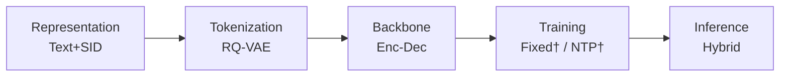
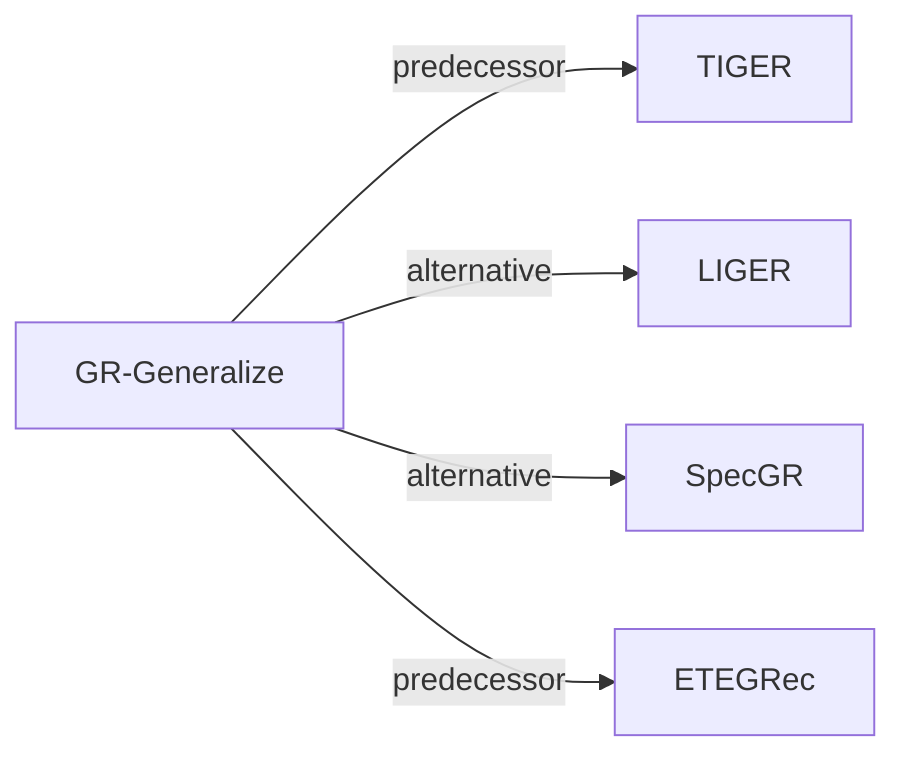

# GR-Generalize

*How Well Does Generative Recommendation Generalize?* — Ding et al. · arXiv’26

`Paradigms, Systems and Benchmarks` · `No single stage`

[Paper](https://arxiv.org/abs/2603.19809) · [Code](https://github.com/Jamesding000/MemGen-GR) · [Matrix](../../README.md#paradigms-systems-and-benchmarks)

Reading level: Overview (Level 1) · On this page: [TL;DR](#tldr) · [At a Glance](#at-a-glance) · [3. Experimental Findings](#3-experimental-findings) · [5. Connections to Related Work](#5-connections-to-related-work)

- `Text+SID`: Text representation plus semantic IDs (hybrid dense and generative retrieval).
- `Enc-Dec`: Encoder-decoder.

### TL;DR

GR-Generalize is an analysis, not a new recommender: it labels test instances as memorization or generalization, compares generative and item ID models on each, and combines both per instance.

### At a Glance

| Aspect | Summary |
| :-- | :-- |
| Research Problem | Paradigms, Systems and Benchmarks: Baseline (TIGER), end-to-end multi-stage paradigms, open-source frameworks, benchmarks, and diagnostic resources. |
| Key Contribution | GR-Generalize is an analysis, not a new recommender: it labels test instances as memorization or generalization, compares generative and item ID models on each, and combines both per instance. |
| Modified Stage | No single stage |

### 3. Experimental Findings

**Experimental setup**

- **Datasets**: Seven public datasets: Amazon 2014 Sports and Beauty; Amazon 2023 Industrial and Scientific, Musical Instruments, Office Products; Steam; Yelp. Sizes (users / items): Sports 35,599 / 18,358; Beauty 22,364 / 12,102; Science 50,986 / 25,849; Music 57,440 / 24,588; Office 223,309 / 77,552; Steam 47,762 / 10,972; Yelp 30,432 / 20,034. Filtering rules: not reported.
- **Split**: Standard leave-last-out: last item for test, second-to-last for validation. Test instances are then partitioned into memorization, generalization (with hop counts up to 4), and uncategorized subsets.
- **Candidates**: not reported (full catalog versus sampled evaluation candidates). SASRec is trained with cross-entropy over all items rather than one sampled negative.
- **Visibility**: warm; no unseen-item protocol is defined. The uncategorized subset may include items unseen during training, but they are not separated.
- **SID**: Analysis of TIGER SIDs: the mechanism study varies SID length L in {2, 3, 4, 5} (including identifier tokens) with two codebook sizes V per length (e.g. L=2 with V=1,024 or 4,096; L=3 with V=256 and a second size), at matched training compute. The default configuration for Table 1 and collision handling: not reported.
- **Inference budget**: Decoding method and beam width: not reported. Table 3 gives matched training compute per SID length (e.g. 5.00e15 FLOPs for L=2); hardware, inference batch size, and latency: not reported. NDCG@10 is the main metric.
- **Results from**: Table 1 (NDCG@10 of TIGER and SASRec on memorization and generalization subsets); Figures 4-7 and Table 3 (token-level memorization analysis and codebook-size study); Table 4 (memorization-aware adaptive ensemble).

Sources

- **Datasets**: Seven datasets and split: [S3.SS1.p1](https://arxiv.org/html/2603.19809v1#S3.SS1.p1); statistics: [S3.T2](https://arxiv.org/html/2603.19809v1#S3.T2); filtering rules not stated.
- **Split**: Leave-last-out: [S3.SS1.p1](https://arxiv.org/html/2603.19809v1#S3.SS1.p1); categorization of test instances: [S3.SS1.p4](https://arxiv.org/html/2603.19809v1#S3.SS1.p4).
- **Candidates**: SASRec trained against all items, evaluation set not stated: [S3.SS1.p2](https://arxiv.org/html/2603.19809v1#S3.SS1.p2).
- **Visibility**: No unseen-item protocol; uncategorized instances may include unseen items: [S2.SS5.p1](https://arxiv.org/html/2603.19809v1#S2.SS5.p1).
- **SID**: SID length and codebook variations: [S4.SS4.p2](https://arxiv.org/html/2603.19809v1#S4.SS4.p2) and [S4.T3](https://arxiv.org/html/2603.19809v1#S4.T3); default TIGER configuration not stated.
- **Inference budget**: Compute budgets in Table 3: [S4.T3](https://arxiv.org/html/2603.19809v1#S4.T3); no decoding settings found.
- **Results from**: Breakdown: [S2.T1](https://arxiv.org/html/2603.19809v1#S2.T1); SID configurations: [S4.T3](https://arxiv.org/html/2603.19809v1#S4.T3); ensemble: [S5.T4](https://arxiv.org/html/2603.19809v1#S5.T4).

### 5. Connections to Related Work

- **Predecessor** · [TIGER](tiger.md): TIGER is the semantic-ID model under study; the paper explains its generalization advantage over SASRec as token-level prefix memorization.
  - Source: GR-Generalize v1, Section 1 and Section 3.1 benchmark TIGER: https://arxiv.org/html/2603.19809v1#S1.p6 and https://arxiv.org/html/2603.19809v1#S3.SS1.p2; Table 1: https://arxiv.org/html/2603.19809v1#S2.T1.
- **Alternative** · [LIGER](liger.md): LIGER treats cold-start items as the out-of-distribution case for generative recommendation; this paper defines generalization by history-to-target transitions instead of target-item rarity.
  - Source: GR-Generalize v1, Section 1 cites Yang et al. (2025): https://arxiv.org/html/2603.19809v1#S1.p3.
- **Alternative** · [SpecGR](specgr.md): SpecGR also studies cold-start items as the generalization case; this paper argues that a popular target can still require generalization.
  - Source: GR-Generalize v1, Section 1 cites Ding et al. (2026): https://arxiv.org/html/2603.19809v1#S1.p3.
- **Predecessor** · [ETEGRec](etegrec.md): The paper follows ETEGRec in training SASRec with full cross-entropy for a fair comparison and uses its datasets.
  - Source: GR-Generalize v1, Section 3.1: https://arxiv.org/html/2603.19809v1#S3.SS1.p1 and https://arxiv.org/html/2603.19809v1#S3.SS1.p2.

[View all papers in this cell](../../README.md#paradigms-systems-and-benchmarks)
