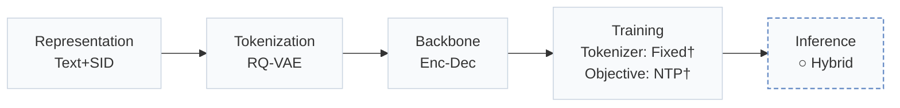
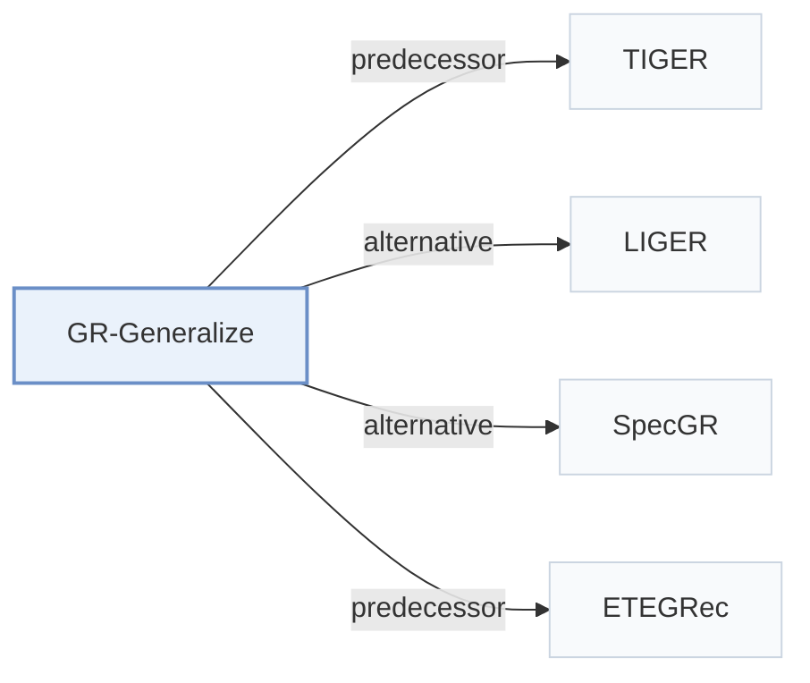

# GR-Generalize

[← Problem × Stage Matrix](../../README.md#paradigms-systems-and-benchmarks) · [Papers by Stage](../index/stages.md) · [Papers by Modality](../index/modality.md) · [Papers by Domain](../index/domain.md) · English | [中文](../zh/papers/gr-generalize.md)

| **Title** | *How Well Does Generative Recommendation Generalize?* |
| :-- | :-- |
| **Authors** | Ding et al. |
| **Venue** | arXiv’26 |
| **Problem × Stage** | `Paradigms, Systems and Benchmarks` · `No single stage` |
| **Changes** | ○ Inference |
| **SID inputs** | `Text` |
| **Domain** | `E-commerce` · `Games` · `POI / Local` |
| **Links** | [Paper](https://arxiv.org/abs/2603.19809) · [Code](https://github.com/Jamesding000/MemGen-GR) |
| **Reading level** | Overview (Level 1) |

**On this page**: [TL;DR](#tldr) · [3. Experiments](#3-experimental-findings) · [5. Related Work](#5-connections-to-related-work)

- `Text+SID`: Text representation plus semantic IDs (hybrid dense and generative retrieval).
- `RQ-VAE`: Residual-Quantized Variational AutoEncoder.
- `Enc-Dec`: Encoder-decoder.
- `Fixed†`: Tokenizer frozen before generator training (inferred).
- `NTP†`: Next-token prediction loss (inferred).
- `Hybrid`: Hybrid retrieval combining generative SID decoding with dense or co-occurrence retrieval.

### TL;DR

> [!NOTE]
> GR-Generalize partitions test instances into memorization and generalization subsets, compares generative and item-ID recommenders on each, and ensembles both per instance.

---

### 3. Experimental Findings

Experimental setup

- **Datasets**: Seven public datasets: Amazon 2014 Sports and Beauty; Amazon 2023 Industrial and Scientific, Musical Instruments, Office Products; Steam; Yelp. Sizes (users / items): Sports 35,599 / 18,358; Beauty 22,364 / 12,102; Science 50,986 / 25,849; Music 57,440 / 24,588; Office 223,309 / 77,552; Steam 47,762 / 10,972; Yelp 30,432 / 20,034. Filtering rules: not reported.
  - Source: Seven datasets and split: [S3.SS1.p1](https://arxiv.org/html/2603.19809v1#S3.SS1.p1); statistics: [S3.T2](https://arxiv.org/html/2603.19809v1#S3.T2); filtering rules not stated.
- **Split**: Standard leave-last-out: last item for test, second-to-last for validation. Test instances are then partitioned into memorization, generalization (with hop counts up to 4), and uncategorized subsets.
  - Source: Leave-last-out: [S3.SS1.p1](https://arxiv.org/html/2603.19809v1#S3.SS1.p1); categorization of test instances: [S3.SS1.p4](https://arxiv.org/html/2603.19809v1#S3.SS1.p4).
- **Candidates**: not reported (full catalog versus sampled evaluation candidates). SASRec is trained with cross-entropy over all items rather than one sampled negative.
  - Source: SASRec trained against all items, evaluation set not stated: [S3.SS1.p2](https://arxiv.org/html/2603.19809v1#S3.SS1.p2).
- **Visibility**: warm; no unseen-item protocol is defined. The uncategorized subset may include items unseen during training, but they are not separated.
  - Source: No unseen-item protocol; uncategorized instances may include unseen items: [S2.SS5.p1](https://arxiv.org/html/2603.19809v1#S2.SS5.p1).
- **SID**: Analysis of TIGER SIDs: the mechanism study varies SID length L in {2, 3, 4, 5} (including identifier tokens) with two codebook sizes V per length (e.g. L=2 with V=1,024 or 4,096; L=3 with V=256 and a second size), at matched training compute. The default configuration for Table 1 and collision handling: not reported.
  - Source: SID length and codebook variations: [S4.SS4.p2](https://arxiv.org/html/2603.19809v1#S4.SS4.p2) and [S4.T3](https://arxiv.org/html/2603.19809v1#S4.T3); default TIGER configuration not stated.
- **Inference budget**: Decoding method and beam width: not reported. Table 3 gives matched training compute per SID length (e.g. 5.00e15 FLOPs for L=2); hardware, inference batch size, and latency: not reported. NDCG@10 is the main metric.
  - Source: Compute budgets in Table 3: [S4.T3](https://arxiv.org/html/2603.19809v1#S4.T3); no decoding settings found.
- **Results from**: Table 1 (NDCG@10 of TIGER and SASRec on memorization and generalization subsets); Figures 4-7 and Table 3 (token-level memorization analysis and codebook-size study); Table 4 (memorization-aware adaptive ensemble).
  - Source: Breakdown: [S2.T1](https://arxiv.org/html/2603.19809v1#S2.T1); SID configurations: [S4.T3](https://arxiv.org/html/2603.19809v1#S4.T3); ensemble: [S5.T4](https://arxiv.org/html/2603.19809v1#S5.T4).

---

### 5. Connections to Related Work

- **Predecessor** · [TIGER](tiger.md): TIGER is the semantic-ID model under study; the paper explains its generalization advantage over SASRec as token-level prefix memorization.
  - Source: GR-Generalize v1, Section 1 and Section 3.1 benchmark TIGER: [S1.p6](https://arxiv.org/html/2603.19809v1#S1.p6) and [S3.SS1.p2](https://arxiv.org/html/2603.19809v1#S3.SS1.p2); Table 1: [S2.T1](https://arxiv.org/html/2603.19809v1#S2.T1).
- **Alternative** · [LIGER](liger.md): LIGER treats cold-start items as the out-of-distribution case for generative recommendation; this paper defines generalization by history-to-target transitions instead of target-item rarity.
  - Source: GR-Generalize v1, Section 1 cites Yang et al. (2025): [S1.p3](https://arxiv.org/html/2603.19809v1#S1.p3).
- **Alternative** · [SpecGR](specgr.md): SpecGR also studies cold-start items as the generalization case; this paper argues that a popular target can still require generalization.
  - Source: GR-Generalize v1, Section 1 cites Ding et al. (2026): [S1.p3](https://arxiv.org/html/2603.19809v1#S1.p3).
- **Predecessor** · [ETEGRec](etegrec.md): The paper follows ETEGRec in training SASRec with full cross-entropy for a fair comparison and uses its datasets.
  - Source: GR-Generalize v1, Section 3.1: [S3.SS1.p1](https://arxiv.org/html/2603.19809v1#S3.SS1.p1) and [S3.SS1.p2](https://arxiv.org/html/2603.19809v1#S3.SS1.p2).

[View all papers in this cell](../../README.md#paradigms-systems-and-benchmarks)
