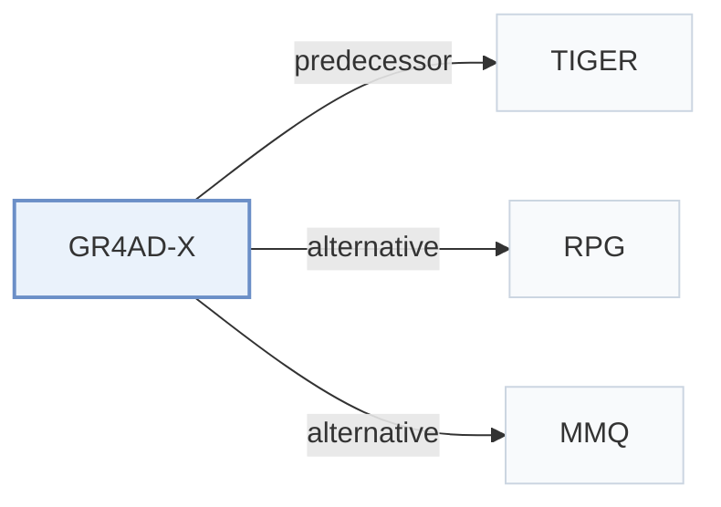

# GR4AD-X

[← Problem × Stage Matrix](../../README.md#iii--tokenization) · [Papers by Stage](../index/stages.md) · [Papers by Modality](../index/modality.md) · [Papers by Domain](../index/domain.md) · English | [中文](../zh/papers/gr4ad-x.md)

| **Title** | *Towards Reliable, Scalable, and Value-Aligned Generative Recommendation for Large-Scale Advertising* |
| :-- | :-- |
| **Authors** | Xiao et al. |
| **Venue** | arXiv’26 |
| **Problem × Stage** | `III. SID–Model Alignment` · `Tokenization` |
| **Changes** | ● Tokenization · ○ Backbone · ○ Objective · ○ Inference |
| **SID inputs** | `Other` (Ad semantic embedding, source unstated) + `Attr` |
| **Domain** | `Ads` |
| **Scenario** | `General Item Recommendation`; `Online Experiment or Deployment` |
| **Links** | [Paper](https://arxiv.org/abs/2610.38378) |
| **Reading level** | Overview (Level 1) |

**On this page**: [TL;DR](#tldr) · [3. Experiments](#3-experimental-findings) · [5. Related Work](#5-connections-to-related-work)

- `Multi-Path R-KM+Hash`: Multiple residual-k-means code paths combined with a hash-based identifier component.
- `Enc-Dec`: Encoder-decoder.
- `Fixed`: SIDs are built first and not changed while the generator trains.
- `NTP + PV-RSPO + Rank + Aux.`: Next-token prediction jointly optimized with prefix-value RSPO, ranking, and auxiliary objectives.
- `PV-Beam+Rerank`: Prefix-value-guided beam search followed by reranking.

### TL;DR

> [!NOTE]
> GR4AD-X extends GR4AD for advertising with multi-path Semantic ID assignment, capacity scaling beyond wider or deeper backbones, and value-guided generation with beam pruning and discriminative reranking.

---

### 3. Experimental Findings

Experimental setup

- **Datasets**: Kuaishou production advertising; 7.556M advertisement embeddings in the SID analysis. Dates and filtering rules not reported.
  - Source: Section 4.2 and Appendix A: [S4.SS2.p2](https://arxiv.org/html/2610.38378v1#S4.SS2.p2) and [A1.SS0.SSS0.Px1.p1](https://arxiv.org/html/2610.38378v1#A1.SS0.SSS0.Px1.p1)
- **Split**: Offline train/validation/test split not reported; each online variant receives a random 5% traffic share for seven days.
  - Source: Appendix A: [A1.SS0.SSS0.Px2.p1](https://arxiv.org/html/2610.38378v1#A1.SS0.SSS0.Px2.p1)
- **Candidates**: not reported; value-alignment analysis uses final-ranking candidates from sampled online requests, without a full-catalog or sampled-negative protocol.
  - Source: Section 4.4: [S4.SS4.p1](https://arxiv.org/html/2610.38378v1#S4.SS4.p1)
- **Visibility**: warm; no unseen-item protocol is defined.
  - Source: Section 4 and Appendix A define no item holdout: [S4](https://arxiv.org/html/2610.38378v1#S4) and [A1](https://arxiv.org/html/2610.38378v1#A1)
- **SID**: Two paths per advertisement, each with three levels: first-level RQ-KMeans 16384 centroids, second-level RQ-KMeans size not reported, final non-semantic feature hash size not reported. Collision disambiguation not reported; repeated retrieved advertisements are deduplicated by their highest-scoring path.
  - Source: Section 3.2 and Appendix A: [S3.SS2.p3](https://arxiv.org/html/2610.38378v1#S3.SS2.p3) and [A1.SS0.SSS0.Px3.p1](https://arxiv.org/html/2610.38378v1#A1.SS0.SSS0.Px3.p1)
- **Inference budget**: Beam 512; PV-BeamSearch expands to 1024 before pruning at SID levels >=2, followed by advertisement deduplication and reranking. Serving exceeds 500 QPS per NVIDIA L20 GPU with end-to-end latency below 100 ms; inference batch size not reported.
  - Source: Sections 3.2/3.4 and Appendix A: [S3.SS2.p7](https://arxiv.org/html/2610.38378v1#S3.SS2.p7) and [S3.SS4.SSS2.p2](https://arxiv.org/html/2610.38378v1#S3.SS4.SSS2.p2) and [A1.SS0.SSS0.Px1.p1](https://arxiv.org/html/2610.38378v1#A1.SS0.SSS0.Px1.p1) and [A1.SS0.SSS0.Px3.p1](https://arxiv.org/html/2610.38378v1#A1.SS0.SSS0.Px3.p1)
- **Results from**: Original Table 1: cumulative online revenue versus deployed GR4AD; Table 2: scaling/QPS; Table 3: value alignment; Figure 3: SID analysis.
  - Source: Section 4: [S4.T1](https://arxiv.org/html/2610.38378v1#S4.T1) and [S4.T2](https://arxiv.org/html/2610.38378v1#S4.T2) and [S4.T3](https://arxiv.org/html/2610.38378v1#S4.T3) and [S4.F3](https://arxiv.org/html/2610.38378v1#S4.F3)

---

### 5. Connections to Related Work

- **Predecessor** · [TIGER](tiger.md): GR4AD-X places its multi-path residual SID construction in the lineage of TIGER's residual-quantized identifiers.
  - Source: GR4AD-X v1, Sections 2.1 and 3.2: [S2.SS1.p1](https://arxiv.org/html/2610.38378v1#S2.SS1.p1); [S3.SS2.p3](https://arxiv.org/html/2610.38378v1#S3.SS2.p3).
- **Alternative** · [RPG](rpg.md): RPG is cited for parallel generation; GR4AD-X instead scales capacity under a fixed serving budget.
  - Source: GR4AD-X v1, Section 2.3 (Hou et al., 2025): [S2.SS3.p1](https://arxiv.org/html/2610.38378v1#S2.SS3.p1).
- **Alternative** · [MMQ](mmq.md): MMQ is cited among multimodal quantization studies; GR4AD-X targets SID reliability with alternative first-level paths.
  - Source: GR4AD-X v1, Section 2.1 (Xu et al., 2026): [S2.SS1.p1](https://arxiv.org/html/2610.38378v1#S2.SS1.p1).

[View all papers in this cell](../../README.md#iii--tokenization)
